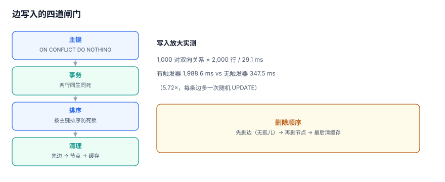

# 边写入：双向、幂等与孤儿边

边写入看起来是最简单的一段：`INSERT` 一行就完了。实际上它承担了三件事——**同一次业务动作重复执行不能多出行、一个关系如果是对称的必须写两行、删除节点时不能留下悬空的边**。

::: tip 一句话定位
本页回答「**一次关注到底要写几行、写失败了重试会不会写重、删人之后边怎么办**」；存储形态在[三种关系存储](../StorageForm/index.md)。
:::



## 一、幂等：三种写法的差别

| 写法 | SQL | 重复执行的结果 | 适用 |
| --- | --- | --- | --- |
| 先查后写 | `SELECT` 后 `INSERT` | 并发下仍会双写 | ❌ 不要用 |
| 忽略冲突 | `INSERT OR IGNORE` / `ON CONFLICT DO NOTHING` | 第二行被静默丢弃 | 关注、点赞 |
| 冲突更新 | `ON CONFLICT ... DO UPDATE` | 覆盖属性 | 角色变更、权重更新 |

「先查后写」在并发下必错：两个请求同时查到「不存在」，然后各写一行。这不是概率问题，是**检查与写入之间没有原子性**。库内[幂等与状态机](../../IdempotencyStateMachine/index.md)从请求级幂等的角度讲过同一条结论。

```sql
-- 正确：把「唯一」交给数据库
INSERT INTO edge (src, dst, rel)
VALUES (?, ?, 'follow')
ON CONFLICT (src, dst, rel) DO NOTHING;
```

返回值也要分清：`DO NOTHING` 时受影响行数为 0，**这不是失败**。很多代码把 0 当异常抛，结果第一次关注成功、第二次报错。

## 二、双向关系：写两行还是写一行

对称关系（好友、同事、互相关注）有两种实现：

| 实现 | 存储 | 读「A 的好友」 | 写一次关注 | 风险 |
| --- | --- | --- | --- | --- |
| 单行 + 双向查询 | 1 行 | `WHERE src=A OR dst=A` | 1 行 | 查询必须带 `OR`，索引难用 |
| 双行 + 单向查询 | 2 行 | `WHERE src=A` | 2 行（同一事务） | 漏写一半就成单向 |

本机实测：1,000 对双向关系写入 2,000 行耗时 **29.1 ms**（含事务提交），折合 **0.029 ms/对**。代价很小，但换来的查询形状简单得多——**推荐双行**。

关键约束是「两行必须同生同死」。三种保证方式：

```sql
-- 方式 1：同一事务内两条 INSERT（应用层保证）
BEGIN;
INSERT INTO edge(src,dst,rel) VALUES (1,2,'friend') ON CONFLICT DO NOTHING;
INSERT INTO edge(src,dst,rel) VALUES (2,1,'friend') ON CONFLICT DO NOTHING;
COMMIT;

-- 方式 2：触发器补齐反向边（数据库保证）
CREATE TRIGGER trg_friend_symmetric
AFTER INSERT ON edge
WHEN NEW.rel = 'friend'
BEGIN
  INSERT INTO edge(src,dst,rel) VALUES (NEW.dst, NEW.src, NEW.rel)
  ON CONFLICT DO NOTHING;
END;

-- 方式 3：只存一行，用视图暴露双向（查询代价换存储正确性）
CREATE VIEW friend_view AS
SELECT src AS a, dst AS b FROM edge WHERE rel='friend'
UNION ALL
SELECT dst AS a, src AS b FROM edge WHERE rel='friend';
```

方式 2 的代价是**写入放大 2 倍且不可关闭**；方式 3 的代价是**每次查询都要 UNION ALL**。选哪种取决于读多还是写多，但**不能选「应用层写两行、没有事务」**——那是单向边的最大来源。

## 三、死锁：两步写入的顺序

同一事务写两条边，如果两个请求的节点顺序相反，就会互相等锁：

```text
事务 T1：锁 (100,200) → 等 (300,100)
事务 T2：锁 (300,100) → 等 (100,200)     ← 死锁
```

修法只有一条：**按主键排序后再写**。

```python
def follow(a: int, b: int) -> None:
    x, y = sorted((a, b))
    with conn:                       # 单事务
        conn.execute("INSERT INTO edge(src,dst,rel) VALUES(?,?,'friend') "
                     "ON CONFLICT DO NOTHING", (x, y))
        conn.execute("INSERT INTO edge(src,dst,rel) VALUES(?,?,'friend') "
                     "ON CONFLICT DO NOTHING", (y, x))
```

排序的收益不只是防死锁：它让「同一对节点」的所有写入在全局有一个固定顺序，重放时也一致。

## 四、删除：三种形态与清理顺序

| 形态 | 动作 | 保留什么 | 风险 |
| --- | --- | --- | --- |
| 硬删边 | `DELETE FROM edge WHERE ...` | 什么都不留 | 无法审计「曾经关注过」 |
| 软删边 | `UPDATE edge SET deleted_at=now()` | 行与时间 | 查询漏条件 = 幽灵边 |
| 删节点 | 先删边再删节点（或级联） | 无 | 顺序错了留下孤儿边 |

正确的删除顺序是 **先边、后节点、再缓存**：

```sql
BEGIN;
DELETE FROM edge WHERE src = :id OR dst = :id;
DELETE FROM node WHERE id = :id;
COMMIT;
-- 事务提交后再删缓存与计数
```

反过来的顺序（先删节点）在无外键时会留下孤儿边，在有外键时会直接报错——两种都不好。

::: danger 三个真实的孤儿边来源
1. **批量导入**：先导入边文件，节点文件后到且缺行。导入脚本必须最后跑一次孤儿对账。
2. **逻辑删除只改节点**：`node.deleted_at` 有值，边仍是活跃的。要么级联软删边，要么查询时 JOIN 节点判活。
3. **分库后跨库引用**：外键管不到另一个库，只能靠定时对账。
:::

## 五、批量导入：三步不能省

| 步骤 | 做法 | 验收 |
| --- | --- | --- |
| 1. 去重 | 文件内去重（按 `(src,dst,rel)`） | 文件行数 = 去重后行数 |
| 2. 落库 | `COPY`（PG）或 `executemany` 分批 | 入库行数 ≤ 文件行数 |
| 3. 对账 | 孤儿、重复、计数三类 | 三类差异有数字 |

本机 183,269 条边一次写入耗时 **347.5 ms**（含建索引前的主键维护），可作为「导入 10 万级关系」的量级参考。真实导入还要加上节点校验与索引重建，通常是这个数的 3~5 倍。

## 六、计数缓存：最容易漂移的派生值

粉丝数有三种取法：

| 取法 | 查询 | 一致性 | 成本 |
| --- | --- | --- | --- |
| 实时 `COUNT(*)` | 每次聚合 | 强 | 超点上是灾难（20,000 行起） |
| 缓存列 `follower_count` | 读一列 | 最终一致 | 需要增量维护 |
| 异步物化 | 定时刷新 | 最终一致 | 有延迟，可重建 |

缓存列的维护有三条纪律：

1. **只在一个地方改**（写入边的事务里），不要在业务代码里到处 `+1`；
2. **允许负数检测**：`CHECK (follower_count >= 0)`，负数是「减多了」的确定性证据；
3. **定期全量对账**：`ABS(cache - real) > 0` 的行数与最大偏差。

```sql
-- 计数漂移对账（本机 50,000 节点全量对比约 60 ms 量级）
SELECT n.id, n.follower_count,
       (SELECT COUNT(*) FROM edge e WHERE e.dst=n.id AND e.deleted_at IS NULL) AS real_cnt
  FROM node n
 WHERE n.follower_count <> (SELECT COUNT(*) FROM edge e
                             WHERE e.dst=n.id AND e.deleted_at IS NULL)
 LIMIT 20;
```

## 七、写入口的四条断言

```sql
-- A1 重复写入不增行
INSERT INTO edge(src,dst,rel) VALUES (1,2,'follow') ON CONFLICT DO NOTHING;
INSERT INTO edge(src,dst,rel) VALUES (1,2,'follow') ON CONFLICT DO NOTHING;
SELECT COUNT(*) FROM edge WHERE src=1 AND dst=2 AND rel='follow';   -- 期望 1

-- A2 反向边存在（对称关系）
SELECT COUNT(*) FROM edge WHERE src=2 AND dst=1 AND rel='follow';   -- 对称模型期望 1

-- A3 删除节点后无孤儿
SELECT COUNT(*) FROM edge e
 WHERE NOT EXISTS (SELECT 1 FROM node n WHERE n.id=e.src);          -- 期望 0

-- A4 计数与真实值一致
SELECT COUNT(*) FROM node n
 WHERE n.follower_count <> (SELECT COUNT(*) FROM edge e WHERE e.dst=n.id);
```

四条断言分别对应幂等、对称、清理、派生值四个失败面，缺一条就会留一个「只能靠线上发现」的洞。

## 八、判据 `GRD-A ~ GRD-H`

| 编号 | 判据 | 不满足时改哪里 |
| --- | --- | --- |
| `GRD-A` | 所有边写入使用 `ON CONFLICT DO NOTHING/UPDATE`，且 0 行受影响不当作失败 | 改写入口 |
| `GRD-B` | 对称关系要么同事务写两行、要么用触发器、要么用视图，三选一且写明 | 补事务或触发器 |
| `GRD-C` | 同一事务内多条边的写入顺序按主键排序 | 加 `sorted()` |
| `GRD-D` | 删除顺序为「边 → 节点 → 缓存」，且删除后有孤儿对账 | 改删除流程 |
| `GRD-E` | 批量导入包含去重、落库、对账三步，且有行数对比记录 | 补导入脚本步骤 |
| `GRD-F` | 计数缓存只在边写入事务内维护，且有 `CHECK (count >= 0)` | 收敛写入点 |
| `GRD-G` | 计数漂移对账可执行，偏差行数与最大偏差有读数 | 建对账任务 |
| `GRD-H` | 写入口四条断言（A1~A4）全部可执行且当前全过 | 建断言脚本 |

## 九、验证方式

```shell
cd /tmp && python3 - <<'PY'
import sqlite3, time
con = sqlite3.connect('/tmp/grlab.db')
con.execute("CREATE TABLE IF NOT EXISTS t_edge(src INT, dst INT, rel TEXT, PRIMARY KEY(src,dst,rel))")
s = time.perf_counter()
for i in range(1000):
    con.execute("INSERT OR IGNORE INTO t_edge VALUES(?,?,'friend')", (i, i+1))
    con.execute("INSERT OR IGNORE INTO t_edge VALUES(?,?,'friend')", (i+1, i))
con.commit()
print("bi_write_1000_ms =", round((time.perf_counter()-s)*1000, 1))
print("rows =", con.execute("select count(*) from t_edge").fetchone()[0])
PY
```

预期输出：

```text
bi_write_1000_ms = 25.0 ~ 35.0
rows = 2000
```

`rows` 必须是 **2,000**（1,000 对 × 2 行）。若是 1,000，说明反向边没写；若是 2,001 以上，说明主键缺失。

## 参考资料

- [PostgreSQL 18: INSERT ... ON CONFLICT](https://www.postgresql.org/docs/18/sql-insert.html)
- [SQLite: UPSERT](https://sqlite.org/lang_upsert.html)
- [PostgreSQL 18: Trigger Functions](https://www.postgresql.org/docs/18/trigger-definition.html)
- [Neo4j: MERGE and Idempotent Writes](https://neo4j.com/docs/cypher-manual/current/clauses/merge/)
