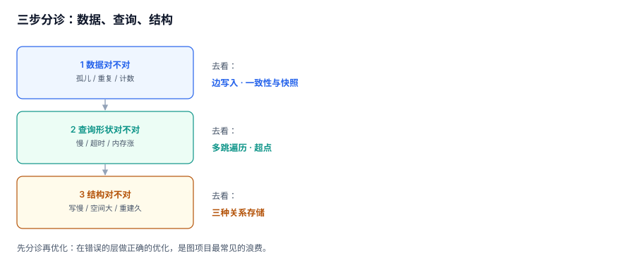

# 常见问题与分诊

本页收十个在评审与排障里被反复问到的判断题。每题给结论、给依据、给「什么情况下结论会翻转」。

::: tip 一句话定位
先看「三步分诊」，再按关键词查题；每题末尾的「翻转条件」比结论本身更有用。
:::



## 三步分诊

| 步 | 问什么 | 症状 | 去看 |
| --- | --- | --- | --- |
| 1 | 数据本身对不对 | 数字对不上、有孤儿、有重复 | [边写入](../EdgeWrite/index.md) / [一致性与快照](../Snapshot/index.md) |
| 2 | 查询形状对不对 | 慢、超时、内存涨 | [多跳遍历](../Traversal/index.md) / [超点](../SuperNode/index.md) |
| 3 | 结构选得对不对 | 写很慢、空间大、重建久 | [三种关系存储](../StorageForm/index.md) |

大多数「图查询慢」的问题落在第 2 步，而大多数「数据不对」的问题落在第 1 步。**先分诊再优化**，否则会在错误的层做正确的优化。

## 一、要不要上图数据库

**结论**：先看查询形状，不看数据量。

| 你的问题 | 关系库够不够 | 说明 |
| --- | --- | --- |
| 两跳以内的邻居、粉丝列表 | 够 | 一次索引查询 |
| 固定深度的层级查询 | 够 | 递归 CTE + 深度上限 |
| 变长路径、最短路、路径枚举 | 勉强 | 应用层 BFS，或图库 |
| 多跳模式匹配（Cypher 风格） | 不够 | 递归 SQL 表达力不足 |
| 亿级边 + 频繁多跳 | 不够 | 需要原生图存储 |

**翻转条件**：如果「多跳」只出现在离线报表里，关系库 + 预计算通常比引入图库更省。

## 二、`UNION` 还是 `UNION ALL`

**结论**：问「能到谁」用 `UNION`，问「有几条路」用 `UNION ALL`。

本机同一份图、同一个起点：`UNION` 三跳 29,510 行 / 114.5 ms；`UNION ALL` 三跳 **29,134,438 行**。**行数差 987 倍**。

**翻转条件**：如果图保证无环且出度很小（最大度 < 100），`UNION ALL` + 深度上限也能用——但「保证无环」这件事本身需要一条断言来维持。

## 三、深度上限设多少

**结论**：取「业务需要」与「p95 最短路径 × 1.2」中的较小者。

本机 40 对随机点在 8 跳内只找到 6 对（15%），平均每对 8.96 ms。上限设 3 会让大多数查询返回空，设 20 会让超点查询打爆内存。

**翻转条件**：如果接口有 `truncated` 标记且前端能处理「结果不全」，上限可以只看预算。

## 四、粉丝数该实时算还是缓存

**结论**：普通节点缓存，超点必须缓存。

超点入度 20,000，`COUNT(*)` 是一次 2 万行的扫描；缓存成一列是 O(1)。代价是漂移——所以必须配一条对账 SQL。

**翻转条件**：如果对「精确值」有强要求（如计费、结算），缓存列必须带版本，读时校验。

## 五、闭包表为什么比递归还慢

**结论**：索引顺序错了。

`PRIMARY KEY (anc, desc)` 只能按祖先定位，`depth` 是过滤条件。查询「三层以内」时会先读全子树 49,999 行再筛掉 49,930 行——本机 1.945 ms，比递归的 0.059 ms 慢 33 倍。补 `(anc,depth)` 索引后 0.007 ms，**快 278 倍**。

**翻转条件**：只查「全部后代」时，默认主键就够（2.065 ms，比递归快 23 倍）。

## 六、单向边要不要补成双向

**结论**：由业务词决定，不由数据决定。

本机 183,269 条边里 98.4% 没有反向边。在「关注」模型里这完全正常；在「好友」模型里是全错。**先确认这个词是对称的还是单向的，再决定要不要写两行。**

**翻转条件**：如果同一张表里既有「关注」又有「好友」，必须按 `rel` 分流，不能共用一套写入逻辑。

## 七、超点该切还是该绕

**结论**：优先绕（改模型），其次预计算，最后才切。

- 绕：广播类关系改成订阅表，超点从图里消失；
- 预计算：物化前 N 个邻居，覆盖 90% 的查询；
- 切：切边的成本是「聚合变难」，切点的成本是「总数变难」。

**翻转条件**：如果超点是业务核心（如官方账号主页），且写入压力集中，切点才值得。

## 八、PageRank 跑几轮

**结论**：固定轮数（10~20）+ 记录 L1 变化量。

本机单轮 **144.6 ms**（183,269 条边），20 轮约 **2.9 s**。一轮之后 top1 是 top2 的 13 倍——但**中段排名**在一轮时几乎没有区分度，而推荐候选往往落在中段。

**翻转条件**：如果只用于「找出前 10 个热点」，5 轮足够。

## 九、派生结构不一致时改哪边

**结论**：改派生结构，永远以真相层为准。

闭包表、计数、社区归属都是派生。它们与 `gr_edge` 不一致时，正确动作是**重建派生结构**（闭包全量重建本机 877.4 ms / 47 万行），而不是「找出哪边对」。

**翻转条件**：如果真相层本身可疑（比如导入脚本写过边表），先冻结写入、对账、再重建。

## 十、什么时候必须上快照

**结论**：需要「重跑出同一个数」时。

日报、审计、对账、A/B 对比都属于这一类。实现只要一个 `snap_id` + 一张快照表，成本远低于事后解释「为什么两次算出来不一样」。

**翻转条件**：只做实时展示、允许 ±1 分钟误差的场景，读当前即可。

## 判据 `GRW-A ~ GRW-H`

| 编号 | 判据 | 不满足时改哪里 |
| --- | --- | --- |
| `GRW-A` | 分诊三步有记录：本次问题落在「数据 / 查询 / 结构」哪一层 | 补分诊记录 |
| `GRW-B` | 「要不要图库」的结论有查询形状依据（不是数据量） | 补形状清单 |
| `GRW-C` | 递归写法与语义一致（可达集合 vs 全部路径），且有行数实测 | 改写法 |
| `GRW-D` | 深度上限有业务或分位数依据，并写入接口契约 | 补依据 |
| `GRW-E` | 闭包表的索引顺序与查询谓词匹配，`EXPLAIN` 可证 | 加索引 |
| `GRW-F` | 单向/双向由业务词决定，`rel` 之间不共用写入逻辑 | 拆分写入 |
| `GRW-G` | 超点处置按「绕 → 预计算 → 切」的顺序评估，且记录选择理由 | 补评估 |
| `GRW-H` | 派生结构与真相不一致时的处置是「重建」，且有重建命令与耗时基线 | 补重建流程 |

## 验证方式

```shell
cd /tmp && python3 - <<'PY'
import sqlite3
con = sqlite3.connect('/tmp/grlab.db')
# 问题 2 的读数
for op in ("UNION", "UNION ALL"):
    sql = f"""WITH RECURSIVE w(n,d) AS (SELECT 0,0 {op}
              SELECT e.dst,w.d+1 FROM edge e JOIN w ON e.src=w.n WHERE w.d<3)
              SELECT COUNT(*) FROM w"""
    print(op, con.execute(sql).fetchone()[0])
# 问题 5 的读数
print("clo_default_idx", con.execute("select count(*) from closure where anc=0 and depth between 1 and 3").fetchone()[0])
PY
```

预期输出：

```text
UNION 29511
UNION ALL 29134438
clo_default_idx 69
```

`UNION` 比 29,510 多 1 是因为包含了起点自身（`d=0`）。这个 +1 常被误当成「结果不一致」，其实是**是否包含起点**的口径差异。

## 参考资料

- [Neo4j: When to use a graph database](https://neo4j.com/developer/graph-database/)
- [PostgreSQL 18: Performance Tips](https://www.postgresql.org/docs/18/performance-tips.html)
- [SQLite: Query Planner](https://sqlite.org/optoverview.html)
- [Wikipedia: Graph database](https://en.wikipedia.org/wiki/Graph_database)
