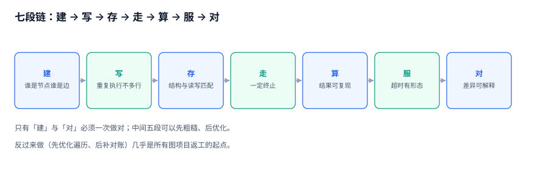
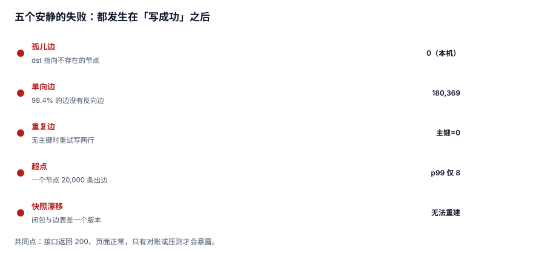

# 总览：三个「这条关系」与五个安静的失败

「图数据」听起来像一种数据库选型，实际上它是一类**问题形状**：数据之间的连接比数据本身更重要。本页把这类问题拆成三个身份、七段链与五个失败，给出后面十章共用的坐标系。

::: tip 一句话定位
本页回答「**关系算错了，通常错在哪一步**」；如果你只想知道该用邻接表还是闭包表，直接跳[三种关系存储](../StorageForm/index.md)。
:::



## 一、关系数据的三个身份

一个「关注」动作在系统里留下三种东西，它们的成立条件互不推导。

| 身份 | 定义 | 谁能判定 | 典型观测手段 |
| --- | --- | --- | --- |
| **事实**（fact） | 某个时刻、某个人，确实执行了「关注」这个动作 | 业务事件日志 | `event` 表 + 时间戳 + 操作者 |
| **记录**（record） | 某张表里有对应的一行 | 数据库约束 | `SELECT COUNT(*)` / 外键 |
| **可用**（usable） | 现在从 A 出发能走到 B，且路径可解释 | 一条带方向的查询 | 递归查询 / 图接口 |

三个身份互相独立的证据，来自本机语料：

- **记录在、事实不在**：脚本刷的 4,000 条边，行数是真的，业务上不认。
- **记录在、可用不在**：目标用户注销后，边还在表里，但查询已经不该返回它。
- **事实在、记录不在**：事件已落库，写边的事务回滚了。这类要靠对账补，不靠重试。

::: warning 为什么必须先拆开
把三者混成一个 `COUNT(*)` 会导致一个很常见的误判：**粉丝数下降就以为有人取关**。实际上可能是「注销清理」把边软删了，事实层面并没有人取关。两个原因对应两种修法，混在一起永远修不对。
:::

## 二、七段链

| 段 | 输入 | 输出 | 本段唯一要保证的事 |
| --- | --- | --- | --- |
| 建 | 业务语义 | 节点表、边表、关系类型 | 边的方向与主语写死 |
| 写 | 一次业务动作 | 一行或多行边 | 重复执行不产生第二行 |
| 存 | 边表 | 查询结构（邻接/闭包/路径） | 结构与读写模式匹配 |
| 走 | 起点与深度 | 节点集合或路径 | 一定终止，且行数可控 |
| 算 | 子图 | 排序、分组、分数 | 结果可复现 |
| 服 | 在线请求 | 响应 | 超时有形态，不是黑洞 |
| 对 | 边表与派生结构 | 差异清单 | 差异能被解释，不是「忽略」 |

七段里，**只有「建」和「对」是必须一次性做对的**；中间五段都可以先粗糙、后优化。反过来做（先优化遍历、后补对账）几乎是所有图项目返工的起点。

## 三、五个安静的失败

### 3.1 孤儿边（orphan edge）

边的某一端指向不存在的节点。外键能挡住「新增时不存在」，挡不住三种情况：

1. 导入脚本先删节点、后删边，中途失败；
2. 分库分表后跨库引用没有外键；
3. 逻辑删除只改了 `node.deleted_at`，边没跟着改。

判定只需一条 SQL，成本 56.8 ms（183,269 条边，本机）：

```sql
-- 孤儿边：两端任意一端在 node 表里找不到
SELECT COUNT(*) FROM edge e
 WHERE NOT EXISTS (SELECT 1 FROM node n WHERE n.id = e.src)
    OR NOT EXISTS (SELECT 1 FROM node n WHERE n.id = e.dst);
```

### 3.2 单向边（one-way edge）

同一个业务词，两种模型。关注天然单向，好友天然双向。把好友建成单向，就会出现「A 的列表里有 B，B 的列表里没有 A」。

本机实测最能说明问题的一组数：183,269 条边里，存在反向边的只有 **2,900 对**，也就是 **98.4% 的边没有反向边**。这在「关注」模型里完全正常，在「好友」模型里是灾难——**同一份数据，换个业务词就从正常变成全错**。

```sql
-- 缺反向边的数量（把关系当无向时必跑）
SELECT COUNT(*) FROM edge a
 WHERE NOT EXISTS (SELECT 1 FROM edge b WHERE b.src = a.dst AND b.dst = a.src);
```

### 3.3 重复边（duplicate edge）

没有 `(src, dst, rel)` 主键时，客户端重试、消息重投、导入重跑都会写第二行。后果不是「多一行」，而是：

- 粉丝数 `COUNT(*)` 偏大；
- 「共同关注」权重偏大；
- 去重后的图算法与展示不一致。

### 3.4 超点（super node）

绝大多数节点的度很小，极少数节点度极大。本机语料的度分布：

| 指标 | 值 |
| --- | --- |
| 最大出度 | **20,000** |
| p99 出度 | **8** |
| 有出边的节点 | 48,506 / 50,000 |

最大与 p99 差 **2,500 倍**。这意味「平均每跳 3.7 行」的经验在超点上一跳就是两万行，两跳 80,970 行，三跳 **29,134,438 行**。

### 3.5 快照漂移（snapshot drift）

闭包表、粉丝数、推荐候选都是派生结构。派生结构的正确性只有一条判据：**能不能从边表重建**。不能重建，它就已经是第二份真相了，早晚要与第一份打架。



## 四、关系 ≠ 外键

外键保证「引用完整性」，不保证任何遍历语义。两者的差别用一张表说清：

| 问题 | 外键能回答 | 遍历能回答 |
| --- | --- | --- |
| `dst` 存在吗 | 能 | 能 |
| 从 A 出发三跳能到谁 | 不能 | 能 |
| 这条路径为什么算「相关」 | 不能 | 能（带关系类型与深度） |
| 删除 B 之后 A 的列表该不该变 | 不能（只报错或级联） | 能（取决于软删语义） |

所以「我们有外键，所以关系是对的」是一句不成立的推论。**外键管的是行，遍历管的是路径。**

## 五、三条反模式

::: danger 三条都在本库的实测里付过代价
1. **用多层自连接代替遍历**：三层自连接在 10 万行表上是 10 亿级中间结果，`EXPLAIN` 看起来「走了索引」，实际跑不完。正确写法是递归 CTE 或分层 BFS，并用深度上限兜底。
2. **用 `UNION ALL` 写递归且不设上限**：遇到环就不终止。即使设了上限，超点上的放大也是指数级的（20,001 → 80,970 → 29,134,438）。正确写法见[多跳遍历](../Traversal/index.md)。
3. **把闭包表当唯一真相**：闭包表 473,214 行、构建 877.4 ms，它本质是「用写放大换读性能」。删掉它必须能从 `edge` 重建，否则一次误删就是数据丢失。
:::

## 六、起步顺序

按顺序做，前三步不改代码，只加约束与查询：

| 顺序 | 动作 | 验收 |
| --- | --- | --- |
| 1 | 给边表加主键 `(src, dst, rel)` | 重复边查询返回 0 |
| 2 | 建 `reconcile_log`，跑孤儿/单向/重复/计数四类对账 | 四类差异有数字，且能解释 |
| 3 | 定遍历深度上限（业务上限，不是图的直径） | 任一查询都有 `WHERE depth <= N` |
| 4 | 选存储形态 | 见[三种存储](../StorageForm/index.md)的选型表 |
| 5 | 上算力（PageRank、社区） | 单轮成本 < 预算的 1/10 |

## 七、版本与边界

本册不按产品版本分目录（理由见[目录页](../index.md)）。与相邻专题的边界：

- **Neo4j 专题**讲产品（Cypher、GDS、集群）；本册讲「同一件事在关系库里怎么做、成本多少」。
- **SQL 优化专题**讲单条语句的执行计划；本册讲「多跳查询的形状」。
- **推荐系统专题**讲特征与排序；本册只提供「关系怎么变成可用的输入」。

## 八、判据 `GRA-A ~ GRA-H`

| 编号 | 判据 | 不满足时改哪里 |
| --- | --- | --- |
| `GRA-A` | 每个关系词都能说出它是「事实 / 记录 / 可用」中的哪一种，且三种身份各有一条独立查询 | 补事件表或补遍历查询 |
| `GRA-B` | 七段链的每一段都有一句「本段唯一要保证的事」，且写进了设计文档 | 补设计文档的段级约束 |
| `GRA-C` | 五个安静的失败各有一条可执行 SQL，且当前读数已记录 | 建 `reconcile_log` |
| `GRA-D` | 边表存在 `(src, dst, rel)` 主键，重复边查询返回 0 | 加主键 + 去重迁移 |
| `GRA-E` | 遍历查询都带深度上限，上限值有业务依据 | 加 `depth <= N` |
| `GRA-F` | 任一派生结构（闭包表/计数/候选集）给出「删掉后如何重建」的命令 | 补重建脚本说明 |
| `GRA-G` | 起步顺序按「约束 → 对账 → 上限 → 存储 → 算法」执行，且有当前所处阶段的记录 | 回到第 1 步 |
| `GRA-H` | 本册 88 条判据中，与本系统相关的条目已筛出并给出责任人 | 建判据台账 |

## 九、验证方式

按顺序执行以下四条，读数与本页基线一致（±10% 视为环境差异）：

```shell
cd /tmp && python3 - <<'PY'
import sqlite3
con = sqlite3.connect('/tmp/grlab.db')
print("edges =", con.execute("select count(*) from edge").fetchone()[0])
print("max_outdeg =", con.execute("select max(c) from (select count(*) c from edge group by src)").fetchone()[0])
print("orphan =", con.execute("""select count(*) from edge e
  where not exists(select 1 from node n where n.id=e.src)
     or not exists(select 1 from node n where n.id=e.dst)""").fetchone()[0])
print("no_reverse =", con.execute("""select count(*) from edge a
  where not exists(select 1 from edge b where b.src=a.dst and b.dst=a.src)""").fetchone()[0])
PY
```

预期输出：

```text
edges = 183269
max_outdeg = 20000
orphan = 0
no_reverse = 180369
```

第 4 行 **180,369** 不是缺陷，是「有向图」的正常读数——它证明「单向」这件事必须由业务词决定，而不是由数据决定。

## 十、下一步

- 要动手：从[关系建模](../RelationModel/index.md)开始，先把边的主键与方向定死。
- 要对账：直接看[一致性与快照](../Snapshot/index.md)的四类差异模板。
- 要选型：看[三种关系存储](../StorageForm/index.md)的三组实测（23 倍、1,389 倍、277 倍）。

## 参考资料

- [PostgreSQL 18: Recursive Queries](https://www.postgresql.org/docs/18/queries-with.html#QUERIES-WITH-RECURSIVE)
- [SQLite: The WITH Clause](https://sqlite.org/lang_with.html)
- [Neo4j: Graph Data Modeling](https://neo4j.com/docs/getting-started/appendix/graph-modeling/)
- [Wikipedia: Supernode (graph theory)](https://en.wikipedia.org/wiki/Supernode_(graph_theory))
