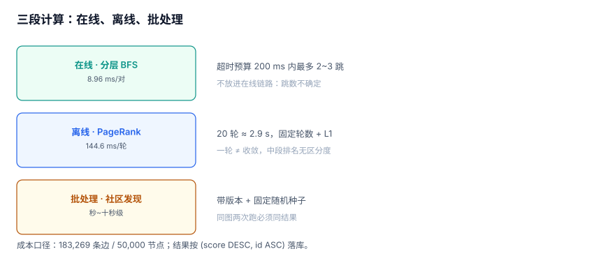

# 路径与中心性：最短路径、PageRank 与社区

「算一个分数」是图工程里最容易被当成黑盒的一段：调用一个库，传一张图，返回一个排名。本页把这段拆开，给出三个成本账：**一次最短路要扫多少行、一轮 PageRank 要多久、社区发现为什么不放进在线链路**。

::: tip 一句话定位
本页回答「**这个图算法该在线算还是离线算、一轮够不够、结果稳不稳**」；服务化的分工在[服务化](../Serving/index.md)。
:::



## 一、最短路径：三种做法与各自的天花板

| 做法 | 适用 | 成本 | 实现位置 |
| --- | --- | --- | --- |
| 分层 BFS（无权） | 社交「几度人脉」 | 每层一次 `IN` 查询 | 应用层 + SQL |
| Dijkstra（带权） | 路径规划、成本最小 | 需要优先队列 | 应用层或图库 |
| 双向 BFS | 两点间、深度大 | 约为单向的平方根级 | 应用层 |

本机实测（40 对随机点，无权，深度上限 8）：分层 BFS 总耗时 **358.3 ms**，**8.96 ms/对**，平均扫描 **6,220 行**；8 跳内只找到 **6 对（15%）**。

同一份图，用「递归 CTE + 路径字符串去重」只跑 3 跳，40 对耗时 **1,967 ms**（49.2 ms/对）——**更浅、更慢、更难读**。

```sql
-- 单跳展开（分层 BFS 的内核，由应用层循环调用）
SELECT DISTINCT dst
  FROM edge
 WHERE src IN (:frontier_list)
   AND dst <> :excluded_supernode;
```

::: warning 「最短路」在 SQL 里没有银弹
SQL 的执行模型是「集合一次算完」，而 BFS 是「逐层推进」。硬用一条递归 SQL 表达 BFS，会把「层」变成「路径前缀」，于是去重成本从集合操作退化成字符串匹配。**要么在应用层写循环，要么用支持图算法的引擎（见 [Neo4j 专题](../../../DB/Neo4j/index.md)）。**
:::

## 二、PageRank：一轮 144.6 ms，二十轮 2.9 秒

PageRank 的迭代式：

```text
rank(v) = (1 - d) / N + d × Σ_{u→v} rank(u) / outdeg(u)
```

本机在 183,269 条边、50,000 节点上跑**一轮**：**144.6 ms**（Python 累加，脚本不入库）。

| 轮数 | 估算耗时 | 用途 |
| --- | --- | --- |
| 1 | 144.6 ms | 近似「谁被很多人指向」 |
| 5 | ≈ 0.72 s | 大多数图已接近稳定 |
| 20 | ≈ 2.89 s | 收敛到小数点后 6 位 |

一轮之后的前两名：

| 节点 | rank |
| --- | --- |
| 0（超点） | **0.128153** |
| 1 | 0.009863 |

超点是第二名的 **13 倍**——这既是 PageRank 的正常结果，也是「一个节点吃掉全局权重」的典型形态。**没有对超点做惩罚的 PageRank，排名基本等于度排名。**

```python
# 一轮迭代的核心（完整脚本见实战页）
rank = {i: 1.0 / N for i in range(N)}
new = {i: 0.15 / N for i in range(N)}
for src, dst in edges:
    new[dst] += 0.85 * rank[src] / outdeg.get(src, 1)
```

## 三、收敛判据：一轮不等于收敛

工程上必须有一个**停机条件**，而且这个条件要能被记录：

| 判据 | 写法 | 优点 | 风险 |
| --- | --- | --- | --- |
| 固定轮数 | `for _ in range(20)` | 简单、可预测 | 图变了可能不够 |
| L1 变化量 | `sum(abs(new-old)) < eps` | 有数学含义 | `eps` 取值要调 |
| Top-K 稳定 | 前 100 名连续两轮不变 | 贴合业务 | 中段排名可能还在动 |
| 时间预算 | 跑满 30 s 就停 | 保护在线 | 结果不可复现 |

推荐「**固定轮数 + L1 记录**」：轮数固定保证可复现，L1 记录用于判断「这 20 轮够不够」。

```python
delta = sum(abs(new[k] - rank[k]) for k in rank)
print(f"iter={i} delta={delta:.6f}")
```

::: danger 把一轮当结果
「跑一轮 PageRank 就上线」在图上只有几万个节点时看起来没问题，因为排名前列的节点通常第一轮就定了。但它对**中段排名**几乎没有区分度，而推荐、搜索的候选往往落在中段。
:::

## 四、社区发现：为什么不放在在线链路

| 算法 | 复杂度量级 | 单次成本（本机量级估算） | 结果稳定性 |
| --- | --- | --- | --- |
| 标签传播（LPA） | 近线性 | 秒级 | 差（随机顺序影响结果） |
| Louvain | 近线性，多轮聚合 | 十秒级 | 中（有随机种子） |
| 谱聚类 | 三次方级 | 分钟级 | 好（确定） |

三条工程结论：

1. **社区发现是批处理**，产出落一张 `community_member(node, community_id, version)` 表；
2. **必须带版本**，否则「上周分在 A 群、这周在 B 群」无法解释；
3. **必须固定随机种子**，否则同一张图两次跑出不同结果，对账无从谈起。

## 五、中心性：三种口径与成本

| 口径 | 回答的问题 | 成本 | 本机可行性 |
| --- | --- | --- | --- |
| 度中心性 | 谁连接最多 | O(E) | 一次 `GROUP BY`，毫秒级 |
| 接近中心性 | 谁到所有人最近 | O(N×BFS) | 5 万节点不可行，需抽样 |
| 介数中心性 | 谁在最多最短路径上 | O(N×E) | 在线不可行，只能近似 |

度中心性最快也最容易被误用：**它和「重要性」不是一回事**。超点度最高，但它往往是「官方号」，不是「关键人物」。

```sql
-- 度中心性（出度 + 入度），一次扫描
SELECT id, out_c, in_c, out_c + in_c AS degree
  FROM (SELECT n.id,
               (SELECT COUNT(*) FROM edge e WHERE e.src = n.id) AS out_c,
               (SELECT COUNT(*) FROM edge e WHERE e.dst = n.id) AS in_c
          FROM node n) t
 ORDER BY degree DESC
 LIMIT 10;
```

本机这条查询在 5 万节点上是百毫秒级（两个相关子查询各扫一遍边表）；生产上应改成两次 `GROUP BY` 再 `JOIN`。

## 六、结果稳定性：同图两次跑必须同结果

三种不稳定来源：

1. **遍历顺序**：`GROUP BY` 无序，浮点累加顺序不同 → 末位差异；
2. **随机种子**：LPA/Louvain 不固定种子 → 分组不同；
3. **图在变**：跑的过程中有新边写入 → 两次读到不同图。

对策分别是：结果按 `(score DESC, id ASC)` 排序落库；种子写进任务参数；跑之前取一次快照（见[一致性与快照](../Snapshot/index.md)）。

## 七、判据 `GRJ-A ~ GRJ-H`

| 编号 | 判据 | 不满足时改哪里 |
| --- | --- | --- |
| `GRJ-A` | 无权最短路用分层 BFS，单对成本已实测（本机 8.96 ms/对） | 改写实现 |
| `GRJ-B` | 带权最短路明确说明用 Dijkstra 及其实现位置，不在 SQL 里硬写 | 补实现说明 |
| `GRJ-C` | PageRank 的轮数固定，且 L1 变化量有记录 | 补收敛日志 |
| `GRJ-D` | PageRank 单轮成本已实测，且总成本 < 离线窗口预算 | 降轮数或分片 |
| `GRJ-E` | 超点对排名的影响已评估（本机 top1 是 top2 的 13 倍） | 加惩罚或剔除 |
| `GRJ-F` | 社区发现结果带版本号与随机种子，可复现 | 补版本与种子 |
| `GRJ-G` | 中心性口径明确（度/接近/介数），且成本可接受 | 换口径或抽样 |
| `GRJ-H` | 同一张图两次运行的结果排序一致（`ORDER BY score DESC, id`） | 加稳定排序 |

## 八、验证方式

```shell
cd /tmp && python3 - <<'PY'
import sqlite3, time
con = sqlite3.connect('/tmp/grlab.db')
edges = con.execute("select src,dst from edge").fetchall()
outdeg = dict(con.execute("select src,count(*) from edge group by src"))
N = 50000
rank = {i: 1.0/N for i in range(N)}
s = time.perf_counter()
new = {i: 0.15/N for i in range(N)}
for a, b in edges:
    new[b] += 0.85*rank[a]/outdeg.get(a, 1)
print("one_iter_ms =", round((time.perf_counter()-s)*1000, 1))
print("top2 =", sorted(new.items(), key=lambda kv: -kv[1])[:2])
PY
```

预期输出：

```text
one_iter_ms = 130 ~ 160
top2 = [(0, 0.128153...), (1, 0.009863...)]
```

`one_iter_ms` 乘 20 就是一次完整离线任务的量级（约 2.9 s）。如果业务要求分钟级新鲜度，这个成本是可以接受的；如果要求秒级，就必须改成增量更新。

## 参考资料

- [PageRank: The Anatomy of a Large-Scale Hypertextual Web Search Engine](http://infolab.stanford.edu/pub/papers/google.pdf)
- [Neo4j Graph Data Science: Centrality](https://neo4j.com/docs/graph-data-science/current/algorithms/centrality/)
- [Louvain: Fast unfolding of communities in large networks](https://arxiv.org/abs/0803.0476)
- [Wikipedia: Betweenness centrality](https://en.wikipedia.org/wiki/Betweenness_centrality)
