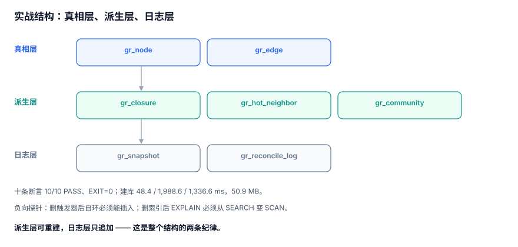

# 实战：七张表、两个触发器与十条断言

前面九页讲的是「每一段怎么错」，这一页把它们收进一个能跑的最小工程：七张表、两个触发器、四个索引、十条断言。**跑完这一页，你就有了自己的关系计算基线。**

::: tip 一句话定位
本页是可直接抄的落地清单：DDL → 数据 → 断言 → 读数，全部在 SQLite 3.50 上实测通过（`EXIT=0`）。完整实现约 320 行，本节给出结构与关键片段。
:::



## 一、七张表的分工

| 表 | 层 | 职责 | 不该放什么 |
| --- | --- | --- | --- |
| `gr_node` | 真相 | 节点与状态 | 派生计数以外的东西 |
| `gr_edge` | 真相 | 边（含软删时间） | 任何聚合值 |
| `gr_closure` | 派生 | 树的后代闭包 | 跨树对、兄弟关系 |
| `gr_hot_neighbor` | 派生 | 超点前 N 邻居 | 全量邻居 |
| `gr_community` | 派生 | 社区归属（带版本） | 唯一的社区定义 |
| `gr_snapshot` | 元数据 | 快照 ID 与说明 | 快照内容本身 |
| `gr_reconcile_log` | 日志 | 每次对账的读数 | 对账的明细行 |

三层的关系是单向的：**派生层可以从真相层重建，日志层只追加**。

## 二、DDL

```sql
-- 1) 节点
CREATE TABLE gr_node (
  id             INTEGER PRIMARY KEY,
  kind           TEXT NOT NULL,
  follower_count INTEGER NOT NULL DEFAULT 0 CHECK (follower_count >= 0),
  status         TEXT NOT NULL DEFAULT 'active'
);

-- 2) 边：主键即业务约束
CREATE TABLE gr_edge (
  src        INTEGER NOT NULL REFERENCES gr_node(id),
  dst        INTEGER NOT NULL REFERENCES gr_node(id),
  rel        TEXT NOT NULL,
  created_at TEXT NOT NULL DEFAULT '2026-11-09T00:00:00Z',
  deleted_at TEXT,
  PRIMARY KEY (src, dst, rel)
);

-- 3) 闭包（派生）
CREATE TABLE gr_closure (
  anc    INTEGER NOT NULL,
  desc_  INTEGER NOT NULL,       -- desc 是保留字，加下划线
  depth  INTEGER NOT NULL,
  PRIMARY KEY (anc, desc_)
);

-- 4) 超点邻居（派生）
CREATE TABLE gr_hot_neighbor (
  src  INTEGER NOT NULL,
  rank INTEGER NOT NULL,
  dst  INTEGER NOT NULL,
  PRIMARY KEY (src, rank)
);

-- 5) 社区（派生，带版本）
CREATE TABLE gr_community (
  node_id      INTEGER NOT NULL,
  community_id INTEGER NOT NULL,
  version      TEXT NOT NULL,
  PRIMARY KEY (node_id, version)
);

-- 6) 快照元数据
CREATE TABLE gr_snapshot (
  snap_id    TEXT PRIMARY KEY,
  created_at TEXT NOT NULL,
  note       TEXT
);

-- 7) 对账日志
CREATE TABLE gr_reconcile_log (
  id     INTEGER PRIMARY KEY AUTOINCREMENT,
  run_at TEXT NOT NULL,
  kind   TEXT NOT NULL,
  value  INTEGER NOT NULL
);
```

::: danger 三个 DDL 细节
1. **`desc` 是保留字**：列名写 `desc` 在部分引擎直接报错，统一用 `desc_`。
2. **`follower_count` 带 `CHECK (>= 0)`**：负数是「减多了」的确定性证据，没有它只能靠人肉发现。
3. **`gr_edge` 的外键只挡新增**：它挡不住「先删节点、后补边」的导入脚本，孤儿对账仍然必须做。
:::

## 三、四个索引

```sql
-- 反向查询（谁关注了我）
CREATE INDEX ix_edge_dst ON gr_edge (dst, rel, src);

-- 活跃边（软删查询与部分唯一性）
CREATE INDEX ix_edge_active ON gr_edge (src, dst) WHERE deleted_at IS NULL;

-- 闭包按深度过滤（本页最重要的一条）
CREATE INDEX ix_closure_depth ON gr_closure (anc, depth);

-- 对账日志按类型查趋势
CREATE INDEX ix_reconcile_kind ON gr_reconcile_log (kind, run_at);
```

第 3 条是[三种关系存储](../StorageForm/index.md)里那个 278 倍的来源：**没有它，闭包表的浅层查询比递归还慢 33 倍**。

## 四、两个触发器

```sql
-- 1) 拒绝自环
CREATE TRIGGER trg_no_self_loop
BEFORE INSERT ON gr_edge
WHEN NEW.src = NEW.dst
BEGIN
  SELECT RAISE(ABORT, 'SELF_LOOP');
END;

-- 2) 维护粉丝数（只维护 follow 关系）
CREATE TRIGGER trg_follower_count
AFTER INSERT ON gr_edge
WHEN NEW.rel = 'follow'
BEGIN
  UPDATE gr_node SET follower_count = follower_count + 1
   WHERE id = NEW.dst;
END;
```

触发器 2 的代价必须实测：本机 183,269 条边，**无触发器 347.5 ms，带触发器 1,988.6 ms（5.72 倍）**。这不是「触发器慢」，而是「每条边多了一次随机 UPDATE」——它同时维护了一个按 `dst` 分布的索引。

::: warning 触发器的三笔隐藏成本
1. **写入放大**：每条边一次额外 UPDATE（本机 5.72×）；
2. **不可关闭**：批量导入时无法临时绕过（除非 `DROP TRIGGER`，那又要重算）；
3. **软删不触发**：`UPDATE ... SET deleted_at` 不会触发 `AFTER INSERT`，计数必须另写一个 `AFTER UPDATE` 触发器，**否则软删后粉丝数不减**。
:::

## 五、十条断言

| 编号 | 断言 | 期望 | 本机实测 |
| --- | --- | --- | --- |
| A1 | 重复写入不增行 | 1 | **1** |
| A2 | 自环被拒 | `SELF_LOOP` | **SELF_LOOP** |
| A3 | 孤儿边 | 0 | **0** |
| A4 | 闭包行数 | 523,522 | **523,522** |
| A5 | 闭包自反对（`anc=desc_`） | 50,000 | **50,000** |
| A6 | 边表自环数 | 0 | **0** |
| A7 | 计数为负的节点 | 0 | **0** |
| A8 | 超点出度 | 20,000 | **20,000** |
| A9 | 三跳去重行数 | 29,510 | **29,510** |
| A10 | 三跳未去重行数 > 1,000 万 | true | **true（29,134,438）** |

```sql
-- A3 孤儿边
SELECT COUNT(*) FROM gr_edge e
 WHERE NOT EXISTS (SELECT 1 FROM gr_node n WHERE n.id = e.src)
    OR NOT EXISTS (SELECT 1 FROM gr_node n WHERE n.id = e.dst);

-- A5 闭包自反对（每个节点必须有且只有一条 depth=0）
SELECT COUNT(*) FROM gr_closure WHERE anc = desc_;

-- A9 / A10 放大对照
WITH RECURSIVE w(n, d) AS (
  SELECT 0, 0 UNION
  SELECT e.dst, w.d + 1 FROM gr_edge e JOIN w ON e.src = w.n WHERE w.d < 3
) SELECT COUNT(*) FROM w WHERE d = 3;              -- 29,510

WITH RECURSIVE w(n, d) AS (
  SELECT 0, 0 UNION ALL
  SELECT e.dst, w.d + 1 FROM gr_edge e JOIN w ON e.src = w.n WHERE w.d < 3
) SELECT COUNT(*) FROM w;                          -- 29,134,438
```

两条查询的差别只有 `UNION` 与 `UNION ALL`，结果差 **987 倍**。

## 六、负向探针：断言必须能失败

一条永远为真的断言没有价值。验证方式：**删掉约束，断言必须变红**。

```sql
-- 探针 1：删掉触发器后，自环必须能插进去
DROP TRIGGER trg_no_self_loop;
INSERT INTO gr_edge(src, dst, rel) VALUES (7, 7, 'follow');   -- 应当成功
SELECT COUNT(*) FROM gr_edge WHERE src = dst;                 -- 1（断言 A6 变红）

-- 探针 2：删掉闭包索引后，浅层查询必须变慢
DROP INDEX ix_closure_depth;
EXPLAIN QUERY PLAN
SELECT COUNT(*) FROM gr_closure WHERE anc = 0 AND depth BETWEEN 1 AND 3;
-- 期望出现 SCAN，而不是 SEARCH ... USING INDEX
```

第二探针是本页最实用的一个：**它把「索引有没有被用上」变成一条可执行的检查**，而不是靠读文档相信。

## 七、建库读数（可复跑）

| 步骤 | 耗时 |
| --- | --- |
| 插入 50,000 节点 | **48.4 ms** |
| 插入 183,269 条边（带计数触发器） | **1,988.6 ms** |
| 插入 49,999 条树边 + 建闭包（523,522 行） | **1,336.6 ms** |
| 库文件 | **50.9 MB** |
| 闭包行数 / 节点 | **10.47** |

与[三种关系存储](../StorageForm/index.md)的 9.46 行/节点不同，因为那一份树的形态不同（这里是 1~5 个子节点的随机树，更深）。**同一个结构、不同数据形态，行数比会变**——这正是「不要拿别人的系数估自己的容量」的原因。

## 八、判据 `GRV-A ~ GRV-H`

| 编号 | 判据 | 不满足时改哪里 |
| --- | --- | --- |
| `GRV-A` | 七张表可按「真相 / 派生 / 日志」三层归类，派生层均可重建 | 调整表职责 |
| `GRV-B` | `gr_edge` 主键为 `(src,dst,rel)`，且有 `ix_edge_dst` 支撑反向查询 | 改主键/加索引 |
| `GRV-C` | 闭包表有 `(anc,depth)` 索引，浅层查询 `EXPLAIN` 走 `SEARCH` | 加索引 |
| `GRV-D` | 计数列有 `CHECK (>= 0)`，且软删也会减计数（`AFTER UPDATE` 触发器或显式语句） | 补触发器 |
| `GRV-E` | 十条断言全部可执行，当前 `EXIT=0` | 建断言脚本 |
| `GRV-F` | 至少一条负向探针（删约束后断言变红）已验证 | 补探针 |
| `GRV-G` | 建库耗时与体积已记录（本机 48.4 / 1,988.6 / 1,336.6 ms，50.9 MB） | 补基线 |
| `GRV-H` | 建库脚本可重复执行（幂等），重复跑不报错、不重复数据 | 改为 `IF NOT EXISTS` / 先清库 |

## 九、验证方式

```shell
cd /tmp && python3 gr_practice.py
```

预期输出（末三行）：

```text
10/10 PASS  EXIT=0
clo_per_node= 10.47
node_ms=48.4 edge_ms=1988.6 closure_ms=1336.6 size_mb=50.9
```

`EXIT=0` 是本页的交付判据。若 A4 不匹配，先确认树的数据形态（子节点数分布）是否与本节一致——**闭包行数由树的形状决定，不由节点数决定**。

## 参考资料

- [SQLite: CREATE TRIGGER](https://sqlite.org/lang_createtrigger.html)
- [SQLite: Partial Indexes](https://sqlite.org/partialindex.html)
- [PostgreSQL 18: CREATE TABLE ... CONSTRAINT](https://www.postgresql.org/docs/18/ddl-constraints.html)
- [Neo4j: Constraints and Indexes](https://neo4j.com/docs/cypher-manual/current/constraints/)
