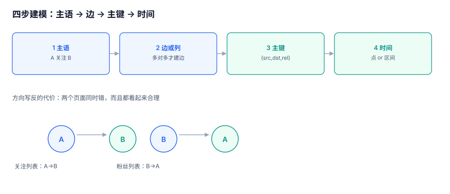

# 关系建模：谁是节点、谁是边

图建模的难点不在「怎么建表」，而在**一句话被翻译成结构时，主语丢了**。本页给出四步判断法：先定主语，再定边，再定主键，最后定时间。

::: tip 一句话定位
本页回答「**这条业务信息该建成边、建成列，还是建成另一张节点表**」；边写入的细节在[边写入](../EdgeWrite/index.md)。
:::



## 一、先定主语，再定边

任何一条关系都能写成一个三元组：`(主语, 谓语, 宾语)`。

| 业务说法 | 主语 | 谓语 | 宾语 | 边方向 |
| --- | --- | --- | --- | --- |
| 用户 A 关注了用户 B | 用户 A | 关注 | 用户 B | `A → B` |
| 订单 O 属于门店 S | 订单 O | 属于 | 门店 S | `O → S` |
| 员工 E 汇报给主管 M | 员工 E | 汇报给 | 主管 M | `E → M` |
| 课程 C 包含章节 L | 课程 C | 包含 | 章节 L | `C → L` |

方向不是审美问题。`A → B` 与 `B → A` 在「粉丝列表」与「关注列表」两个查询里正好互为反面——**写反了，两个页面会同时错，而且都看起来合理**。

::: danger 三个高频方向错误
1. **`(follower, followee)` 写成 `(followee, follower)`**：粉丝数变成关注数，两个数都「看起来正常」，只有和业务对账才发现。
2. **把「属于」写成反向**：`门店 → 订单` 会让「某门店的全部订单」变成一次全表扫描（因为要从被指向方反查）。
3. **同一关系两种方向混用**：一半 `A→B`、一半 `B→A`，遍历时同时走 `src` 与 `dst` 才能全，性能直接翻倍。
:::

## 二、边还是列：三条判断

不是所有「关系」都该建边。三个问题按顺序问：

| 判断 | 建边 | 建列 |
| --- | --- | --- |
| 一个主体能有多少个对方 | 多个（粉丝、标签、成员） | 一个（订单属于哪个门店） |
| 关系本身有没有属性 | 有（关注时间、角色、权重） | 无 |
| 关系会不会被单独查询 | 会（「谁关注了我」） | 不会 |

反例：`order.store_id` 是一个列，不是边。把它建成边，会让「查一个订单的门店」从一次主键查询变成一次图遍历——**多了一张表、多了一次 JOIN、没有任何收益**。

正例：`employee.manager_id` 看起来是列，但当「汇报关系」需要有效期、需要多级遍历、需要按组织架构做权限时，它就该是边。库内[组织与人员](../../OrgPeople/index.md)专题里用的是「区间 + 树」的组合，正是这个判断。

## 三、边表的最小结构

```sql
-- 最小可用的边表：主键即业务约束
CREATE TABLE edge (
  src        BIGINT      NOT NULL,
  dst        BIGINT      NOT NULL,
  rel        TEXT        NOT NULL,          -- follow / member / report / contains
  created_at TIMESTAMPTZ NOT NULL DEFAULT now(),
  PRIMARY KEY (src, dst, rel)               -- 同一对节点同一关系只能有一条
);

CREATE INDEX ix_edge_dst_rel ON edge (dst, rel, src);  -- 反向查询
```

三件事值得单独说：

1. **主键里必须有 `rel`**。没有 `rel` 时，「关注」和「拉黑」会互相覆盖——这两条边可以同时存在，语义完全相反。
2. **反向索引不是可选**。「谁关注了我」与「我关注了谁」是两个查询方向，只建 `(src,dst)` 主键会让反向查询全表扫描。
3. **`created_at` 用 `TIMESTAMPTZ`**。用本地时间会在跨时区导出时错一天，这类错误在跨时区导出时会稳定复现，建表时就把时区写进类型。

## 四、关系带属性：边表还是关联表

当边需要承载属性（角色、权重、有效期），有两种写法：

| 写法 | 结构 | 优点 | 缺点 |
| --- | --- | --- | --- |
| 宽边表 | `edge(src,dst,rel,role,weight,valid_from,valid_to)` | 一次查询拿到全部 | 属性只服务一种关系时字段大量为空 |
| 边 + 属性表 | `edge(id,...)` + `edge_attr(edge_id,k,v)` | 任意扩展 | 每次都要 JOIN，类型不安全 |

第三种写法在实践中更常见：**按关系类型分表**。

```sql
CREATE TABLE membership (
  user_id    BIGINT NOT NULL,
  org_id     BIGINT NOT NULL,
  role       TEXT   NOT NULL CHECK (role IN ('owner','admin','member')),
  joined_at  TIMESTAMPTZ NOT NULL,
  left_at    TIMESTAMPTZ,
  PRIMARY KEY (user_id, org_id)
);
```

判据是：**属性是否是这一类关系的必填项**。是，就分表；不是，就放通用属性表。

## 五、时间：边是点还是区间

| 形态 | 结构 | 适用 | 查询代价 |
| --- | --- | --- | --- |
| 点（只记发生） | `created_at` | 关注、点赞 | 最低 |
| 区间（可结束） | `valid_from` / `valid_to` | 任职、会员、授权 | 中（区间重叠判断） |
| 双时间（记录时间 + 业务时间） | 再加 `recorded_at` | 需要「当时怎么记的」 | 高 |

区间的经典坑是**开闭区间写错**，导致同一天出现两条有效记录或零条：

```sql
-- 正确：左闭右开，且用 tstzrange 表达，避免手工比较
CREATE TABLE role_grant (
  user_id BIGINT NOT NULL,
  role    TEXT   NOT NULL,
  period  TSTZRANGE NOT NULL,
  EXCLUDE USING gist (user_id WITH =, role WITH =, period WITH &&)
);
```

`EXCLUDE` 约束让「同一个人同一角色时间不重叠」成为数据库保证，而不是应用层检查。

## 六、软删：三种写法与一个判据

| 写法 | 结构 | 查询要带的条件 | 风险 |
| --- | --- | --- | --- |
| 硬删 | `DELETE` | 无 | 不可恢复，审计断链 |
| 时间戳 | `deleted_at` | `deleted_at IS NULL` | 忘记带条件 = 幽灵数据 |
| 状态位 | `status` | `status='active'` | 状态机容易漏迁移 |

推荐「时间戳 + 部分唯一索引」组合：

```sql
CREATE UNIQUE INDEX uq_edge_active
  ON edge (src, dst, rel)
  WHERE deleted_at IS NULL;
```

这条索引同时解决两个问题：**活跃边不重复**，且**软删后可以重新建立同一条边**（历史行保留）。

::: warning 软删不是免费的
每一条查询都必须带 `deleted_at IS NULL`。漏一处就多一批幽灵边，而这类查询在代码里通常是 `SELECT * FROM edge WHERE src=?`——**约束不在表上，就一定会漏**。库内[幂等与状态机](../../IdempotencyStateMachine/index.md)讲的是同一个道理。
:::

## 七、超点的建模预防

超点多数不是「长出来的」，而是**建模时埋下的**：

| 埋法 | 后果 | 替代方案 |
| --- | --- | --- |
| 「全员关注官方号」建 50 万条边 | 官方号出度 50 万 | 用标签/订阅表 + 广播 |
| 「所有商品属于默认分类」 | 默认分类入度百万 | 允许 `category_id IS NULL` |
| 「每个用户关注自己」 | 自环让遍历多一跳 | 遍历时排除 `src=dst` |

判据很简单：**任何一个节点的预期度超过 1 万，就不该用边表达它**。用边表达「一对多」是可以的，用边表达「一对全员」不行。

## 八、建模验收：四条可执行检查

```sql
-- 1) 自环（除业务明确允许）
SELECT COUNT(*) FROM edge WHERE src = dst;

-- 2) 边两端都存在
SELECT COUNT(*) FROM edge e
 WHERE NOT EXISTS (SELECT 1 FROM node n WHERE n.id=e.src)
    OR NOT EXISTS (SELECT 1 FROM node n WHERE n.id=e.dst);

-- 3) 关系类型都在白名单里
SELECT rel, COUNT(*) FROM edge GROUP BY rel ORDER BY 2 DESC;

-- 4) 超级节点预警：出度或入度超过阈值的节点
SELECT src AS node, COUNT(*) AS outdeg FROM edge GROUP BY src HAVING COUNT(*) > 10000
UNION ALL
SELECT dst, COUNT(*) FROM edge GROUP BY dst HAVING COUNT(*) > 10000;
```

第 4 条在本机语料上返回节点 `0`，出度 20,000、入度 20,000——这就是后面[超点与切分](../SuperNode/index.md)要处理的对象。

## 九、判据 `GRB-A ~ GRB-H`

| 编号 | 判据 | 不满足时改哪里 |
| --- | --- | --- |
| `GRB-A` | 每个关系词都能写成 `(主语, 谓语, 宾语)`，且方向在文档里写死 | 补建模文档的方向表 |
| `GRB-B` | 边表主键包含 `rel`，同一对节点可并存多种关系 | 改主键 |
| `GRB-C` | 反向查询有独立索引 `(dst, rel, src)`，`EXPLAIN` 走 `SEARCH` | 加索引 |
| `GRB-D` | 「一对多」用列、「多对多」用边，且每条判断能说出三条理由中的哪一条 | 重做该字段建模 |
| `GRB-E` | 带时间的关系用区间表达，且存在不重叠约束（`EXCLUDE` 或等价触发器） | 加约束 |
| `GRB-F` | 软删使用 `deleted_at` + 部分唯一索引，且所有查询都带活跃条件 | 补索引/改查询 |
| `GRB-G` | 预期度超过 1 万的节点不用边表达，改用标签或广播表 | 改模型 |
| `GRB-H` | 四条建模验收 SQL 全部可执行，自环/孤儿/类型/超点各有读数 | 建验收脚本 |

## 十、验证方式

```shell
cd /tmp && python3 - <<'PY'
import sqlite3
con = sqlite3.connect('/tmp/grlab.db')
q = lambda s: con.execute(s).fetchone()[0]
print("self_loop   =", q("select count(*) from edge where src=dst"))
print("orphan      =", q("""select count(*) from edge e
  where not exists(select 1 from node n where n.id=e.src)
     or not exists(select 1 from node n where n.id=e.dst)"""))
print("max_outdeg  =", q("select max(c) from (select count(*) c from edge group by src)"))
print("rel_types   =", con.execute("select count(distinct 'follow') from edge").fetchone()[0])
PY
```

预期输出：

```text
self_loop   = 0
orphan      = 0
max_outdeg  = 20000
rel_types   = 1
```

第 3 行若显著大于 1 万，请直接读[超点与切分](../SuperNode/index.md)——**建模阶段发现的超点，比查询变慢之后发现的便宜十倍**。

## 参考资料

- [Neo4j: Graph Modeling Guidelines](https://neo4j.com/docs/getting-started/appendix/graph-modeling/)
- [PostgreSQL 18: Range Types](https://www.postgresql.org/docs/18/rangetypes.html)
- [PostgreSQL 18: Partial Indexes](https://www.postgresql.org/docs/18/indexes-partial.html)
- [Martin Fowler: Bounded Context](https://martinfowler.com/bliki/BoundedContext.html)
