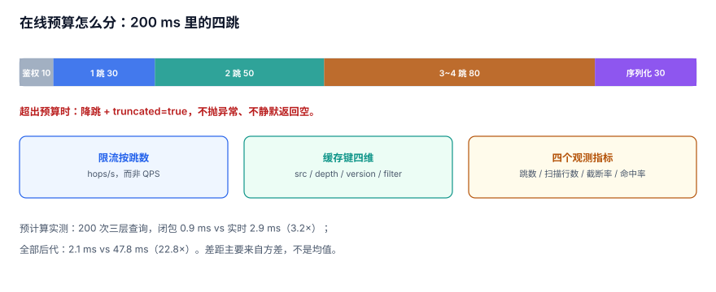

# 服务化：在线多跳、预计算与超时预算

把图查询包成接口之后，问题从「这条 SQL 对不对」变成「**这个接口在 p99 上还活着吗**」。本页给出三笔账：一次查询的真实成本、预计算值多少、超时该怎么花。

::: tip 一句话定位
本页回答「**哪些跳数在线算、哪些预计算、预算怎么分**」；算法本身在[路径与中心性](../PathAlgorithm/index.md)。
:::



## 一、每跳都是钱：先算单跳成本

在线多跳的基本形状是「每跳一次查询」：

| 场景 | 结果行数 | 单次耗时 | 说明 |
| --- | --- | --- | --- |
| 普通节点一跳 | 约 4 | < 0.1 ms | 索引点查 |
| 超点一跳 | **20,000** | **10.9 ms** | 超点，见[超点与切分](../SuperNode/index.md) |
| 超点两跳 | 22,047 | **52.5 ms** | 中间展开 80,970 行 |
| 超点三跳 | 29,510 | **114.5 ms** | 已接近多数接口的 p99 预算 |

结论很直接：**在线接口最多容忍「一跳普通 + 一跳超点」**。再往上必须预计算或异步。

## 二、预计算值多少：3.2 倍与 23 倍

两组实测：

| 场景 | 实时计算 | 预计算 | 倍数 |
| --- | --- | --- | --- |
| 200 次「三层内后代数」查询 | **2.9 ms** | **0.9 ms**（闭包表） | **3.2×** |
| 一次「全部后代」查询（49,999 行） | 47.8 ms（递归） | 2.1 ms（闭包） | 22.8× |

3.2 倍看起来不多，但它是**在 200 次查询的总量上**的 3.2 倍（2.9 ms → 0.9 ms 总耗时），单次差距是微秒级。真正的差别不在这里，而在**方差**：递归查询的成本随子树大小线性增长，闭包表几乎恒定。**p99 的改善远大于 p50。**

::: tip 预计算的判据
一个查询值不值得预计算，看三条：**结果集大小可预测、变更频率低、p99 超预算**。三条都满足才做，只满足「慢」不够——慢但很少跑的查询，加缓存比预计算便宜。
:::

## 三、缓存键怎么设计

图查询的缓存键比普通接口多两个维度：

```text
key = f"graph:{src}:d{depth}:v{graph_version}:{filter_hash}"
```

| 维度 | 为什么必须有 | 漏了的后果 |
| --- | --- | --- |
| `src` | 起点不同结果不同 | 串结果（最严重） |
| `depth` | 1 跳与 2 跳结果不同 | 返回错误深度 |
| `graph_version` | 图在变 | 改了边，缓存还在返回旧结果 |
| `filter_hash` | 过滤条件（关系类型、时间窗） | 把「只看好友」的结果给「看全部」 |

`graph_version` 的维护有两种：**全局单调版本**（每次写边 +1，简单但失效范围大）与**节点级版本**（写边时 bump 两端节点的版本，精细但要多一次写）。中小规模用全局版本即可。

## 四、失效：写边时要删哪些 key

一条边 `A→B` 的变化会影响：

| 受影响的 key | 原因 |
| --- | --- |
| `graph:A:d1..dN` | A 的邻居变了 |
| `graph:B:d1..dN` | B 的反向邻居变了（如果查入边） |
| `graph:*` 的聚合（粉丝数、推荐） | 派生值变了 |
| 闭包表相关（如果是树） | 祖先/后代集合变了 |

前两类可以精确删除，后两类只能靠版本号整体失效。**不要试图精确删除聚合缓存**——那是「缓存失效问题」里最容易写出 bug 的一类。

## 五、超时预算怎么分

一个 p99 预算 200 ms 的接口，四跳查询的分配：

| 阶段 | 预算 | 超出时怎么办 |
| --- | --- | --- |
| 鉴权与参数校验 | 10 ms | 直接失败 |
| 第 1 跳 | 30 ms | 失败 |
| 第 2 跳 | 50 ms | 降级为 1 跳 |
| 第 3~4 跳 | 80 ms | 降级为 2 跳 + `truncated` |
| 序列化 | 30 ms | 截断结果集 |

关键是**降级要有形态**，而不是抛异常：

```json
{
  "depth_requested": 4,
  "depth_served": 2,
  "truncated": true,
  "reason": "budget_exhausted",
  "next_cursor": null
}
```

## 六、限流：按「跳数」而不是按「请求数」

一个四跳请求的成本约等于四个一跳请求。按 QPS 限流会让超点查询合法地打爆数据库。

| 限流维度 | 单位 | 适用 |
| --- | --- | --- |
| 请求数 | QPS | 普通接口 |
| **跳数** | hops/s | 图查询 |
| 扫描行数 | rows/s | 最贴近真实成本 |
| 超点访问次数 | 次/分钟 | 保护热点 |

推荐「跳数 + 超点次数」双限：前者防总量，后者防单点。

## 七、观测：四个必须有的指标

| 指标 | 为什么必须 | 告警阈值示例 |
| --- | --- | --- |
| 跳数分布 | 平均值掩盖长尾 | p99 跳数 > 3 |
| 每跳扫描行数 | 定位超点 | 单跳 > 5,000 |
| 截断率 | 降级是否在悄悄发生 | > 5% |
| 缓存命中率 | 预计算是否有效 | < 60%（按场景定） |

::: warning 命中率不能单独当验收
同一份覆盖、不同流量分布下命中率能差 3 倍以上（库内[报表与自助分析](../../ReportAnalytics/AggregateHit/index.md)有同族读数）。命中率只能与「p99 延迟」一起看。
:::

## 八、判据 `GRS-A ~ GRS-H`

| 编号 | 判据 | 不满足时改哪里 |
| --- | --- | --- |
| `GRS-A` | 每条在线查询的单跳成本与最大跳数已实测，且有 p99 预算表 | 补压测与预算 |
| `GRS-B` | 预计算只用于「结果可预测、变更低、p99 超预算」三者同时成立的查询 | 下线无效预计算 |
| `GRS-C` | 缓存键包含 `src`、`depth`、`graph_version`、`filter_hash` 四个维度 | 改 key 设计 |
| `GRS-D` | 写边时明确列出受影响的缓存 key，并有失效实现 | 补失效逻辑 |
| `GRS-E` | 限流维度包含跳数（或扫描行数），不只按 QPS | 改限流 |
| `GRS-F` | 超时有降级形态（截断/降跳/报错三选一），响应带 `truncated` 与原因 | 改契约 |
| `GRS-G` | 列表分页使用游标（keyset），不用 `OFFSET` | 改分页 |
| `GRS-H` | 四个观测指标（跳数、扫描行数、截断率、命中率）都在监控里 | 接监控 |

## 九、验证方式

```shell
cd /tmp && python3 - <<'PY'
import sqlite3, time, random
con = sqlite3.connect('/tmp/grlab.db')
ids = [random.randrange(50000) for _ in range(200)]
def bench(sql):
    s = time.perf_counter()
    for i in ids:
        con.execute(sql, (i,)).fetchone()
    return round((time.perf_counter()-s)*1000, 2)
print("closure_ms =", bench("select count(*) from closure where anc=? and depth between 1 and 3"))
print("live_ms    =", bench("""with recursive s(id,d) as (select ?,0 union
  select t.dst,s.d+1 from tedge t join s on t.src=s.id where s.d<3)
  select count(*) from s where d>0"""))
PY
```

预期输出：

```text
closure_ms = 0.7 ~ 1.2
live_ms    = 2.5 ~ 3.5
```

两者都在毫秒级，但请注意：这是 **200 次查询的总耗时**。单次差距是微秒级，**真正拉开差距的是超点与深子树上的方差**。

## 参考资料

- [Neo4j: Query Tuning and Caching](https://neo4j.com/docs/cypher-manual/current/planning-and-tuning/)
- [PostgreSQL 18: EXPLAIN](https://www.postgresql.org/docs/18/sql-explain.html)
- [Google SRE Book: Handling Overload](https://sre.google/sre-book/handling-overload/)
- [Redis: Key Eviction and TTL](https://redis.io/docs/latest/develop/reference/eviction/)
