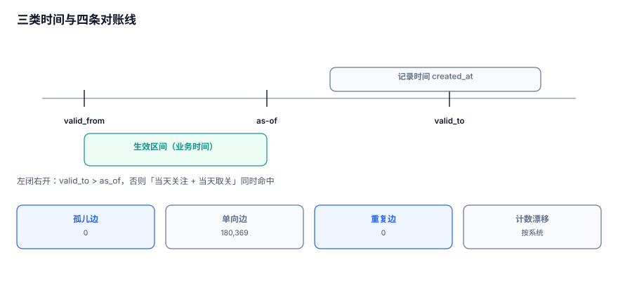

# 一致性与快照：读到的图是哪一刻的

「关系是对的」这句话必须先回答一个追问：**哪一刻的关系**。边在变、节点在删、闭包表在重建，一次查询如果跨了这些变化，返回的图在任何时刻都不存在。

::: tip 一句话定位
本页回答「**这次查询读的是哪一版图、派生结构和真相差多少、怎么对账**」；在线服务的降级在[服务化](../Serving/index.md)。
:::



## 一、三类时间

| 时间 | 含义 | 存在哪 | 用来回答 |
| --- | --- | --- | --- |
| 业务时间 `valid_from/valid_to` | 关系在现实中生效的区间 | 业务列 | 「去年他和谁一组」 |
| 记录时间 `created_at` | 这行什么时候被写进库 | 系统列 | 「这次导入是哪天」 |
| 读取时间 `now()` | 查询执行的时刻 | 不存 | 「现在看到的是什么」 |

三者可以完全不同。把「记录时间」当「业务时间」用，会在补录数据时得到一条「2026 年建立、但业务上属于 2024 年」的边——按时间分区、按时间统计全部错位。

## 二、as-of 查询：读某一刻的图

区间模型下，「2026-06-01 这天 A 关注了谁」是一次区间包含查询：

```sql
SELECT dst
  FROM follow
 WHERE src = :a
   AND valid_from <= :as_of
   AND (valid_to IS NULL OR valid_to > :as_of);
```

三个细节决定这条查询对不对：

1. **左闭右开**：`valid_to > as_of` 而不是 `>=`，否则「6 月 1 日取关」和「6 月 1 日关注」会同时命中。
2. **索引用区间**：`GIST (src, tstzrange(valid_from, valid_to))`，B 树对区间无能为力。
3. **`NULL` 表示至今**：用 `'infinity'` 替代 `NULL` 可以让区间运算统一，代价是导入时要转换。

```sql
-- 推荐：显式区间 + 排他约束
CREATE TABLE follow (
  src        BIGINT NOT NULL,
  dst        BIGINT NOT NULL,
  period     TSTZRANGE NOT NULL,
  PRIMARY KEY (src, dst, period),
  EXCLUDE USING gist (src WITH =, dst WITH =, period WITH &&)
);
```

`EXCLUDE` 让「同一对节点时间重叠」在数据库层不可能发生，这比任何应用层检查都可靠。

## 三、并发可见性：三种隔离级别的读数

| 场景 | 读到什么 | 风险 |
| --- | --- | --- |
| 写入事务未提交 | 看不到（读已提交） | 无 |
| 写入已提交、查询已开始 | 取决于隔离级别 | 同一事务两次查询可能不同 |
| 边删了、闭包表还没删 | 两个结构不一致 | **最常见** |

SQLite 的 WAL 模式下，写事务提交前对其他连接不可见——这一点与 PostgreSQL 的读已提交一致。真正的问题不在单条边，而在**跨结构**：

```text
T1: DELETE FROM edge WHERE src=1 AND dst=2;      -- 边删了
T2: SELECT COUNT(*) FROM closure WHERE anc=1;    -- 闭包还没删 → 多一个后代
```

修法只有一条：**边与派生结构在同一事务内改**，或接受最终一致并把它写进接口契约。

## 四、跨表快照：一次查询读两张表

「A 的关注数」与「A 的关注列表」如果来自两张表（计数缓存 + 边表），一次请求里可能读到两个版本：

| 读法 | 一致性 | 成本 |
| --- | --- | --- |
| 两次独立查询 | 可能不一致 | 低 |
| 同一事务（可重复读） | 一致 | 中 |
| 同一快照 ID（物化） | 一致且可复现 | 高 |

对账类任务（日报、审计）必须用第三种：**先取快照，再从快照算**。否则「昨天算出来 1,000，今天重跑算出 1,002」永远解释不清。

## 五、派生结构漂移：闭包表最典型

闭包表是预计算，边变了它不一定变。漂移有三种形态：

| 形态 | 表现 | 检测 |
| --- | --- | --- |
| 漏加 | 新边的后代查不到 | `closure` 缺对 |
| 漏删 | 删掉的边还在闭包里 | `closure` 多对 |
| 深度错 | 对的深度值不对 | `depth` 与邻接表不一致 |

本机闭包表全量重建 **877.4 ms / 473,214 行**。这个成本决定了策略：**能重建就不要增量修补**。增量修补的代码量与出错概率远高于「重建 + 校验」。

```sql
-- 漂移检测：闭包里存在、但邻接表走不通的对（抽样 1,000 条）
SELECT COUNT(*) FROM (
  SELECT anc, desc FROM closure WHERE depth > 0 LIMIT 1000
) c
WHERE NOT EXISTS (
  SELECT 1 FROM closure a JOIN closure b
    ON a.desc = b.anc AND a.anc = c.anc AND b.desc = c.desc
   AND a.depth + b.depth = (SELECT depth FROM closure x WHERE x.anc=c.anc AND x.desc=c.desc)
);
```

## 六、四类对账：形状比总数重要

只对总数是不够的：**总数相等但形状不同**是最难查的一类。

| 类型 | 查询 | 本机读数 | 含义 |
| --- | --- | --- | --- |
| 孤儿边 | 两端不在 `node` | **0** | 引用完整性 |
| 单向边 | 缺反向边 | **180,369**（98.4%） | 有向图的正常值，无向模型的全错 |
| 重复边 | 主键外重复 | 0（有主键时） | 重试/导入 |
| 计数漂移 | 缓存列 ≠ `COUNT(*)` | 按系统 | 派生值 |

```sql
-- 四类对账一次跑完，结果落 reconcile_log
INSERT INTO reconcile_log(run_at, kind, value)
SELECT now(), 'orphan', COUNT(*) FROM edge e
 WHERE NOT EXISTS (SELECT 1 FROM node n WHERE n.id=e.src)
    OR NOT EXISTS (SELECT 1 FROM node n WHERE n.id=e.dst)
UNION ALL
SELECT now(), 'no_reverse', COUNT(*) FROM edge a
 WHERE NOT EXISTS (SELECT 1 FROM edge b WHERE b.src=a.dst AND b.dst=a.src)
UNION ALL
SELECT now(), 'dup', COUNT(*) FROM (
  SELECT src,dst,rel FROM edge GROUP BY 1,2,3 HAVING COUNT(*) > 1
) d;
```

**对账的价值在趋势，不在单次数值**：`no_reverse` 从 180,369 变成 180,400 说明新增了 31 条单向边，这才是可行动的信号。

## 七、快照的三种实现

| 实现 | 机制 | 成本 | 适用 |
| --- | --- | --- | --- |
| 数据库快照 | PG 的 `pg_dump` / 只读副本 | 中 | 日批 |
| 版本列 | 每行带 `version`，查询带 `version <=` | 低（存储涨） | 需要 as-of |
| 物化快照表 | `snapshot(node_a,node_b,snap_id)` | 高（全量复制） | 审计、复现 |

选择判据：**要不要「重跑出同一个数」**。要，就必须有快照 ID；不要，读当前即可。

## 八、判据 `GRR-A ~ GRR-H`

| 编号 | 判据 | 不满足时改哪里 |
| --- | --- | --- |
| `GRR-A` | 业务时间与记录时间分开存，且统计口径明确用哪一个 | 加 `valid_from/valid_to` |
| `GRR-B` | as-of 查询使用左闭右开区间，且有区间索引 | 改比较符/加 GIST |
| `GRR-C` | 同一对节点的区间重叠由数据库约束阻止（`EXCLUDE` 或触发器） | 加约束 |
| `GRR-D` | 边与派生结构在同一事务内修改，或明确声明最终一致 | 改事务边界 |
| `GRR-E` | 对账类任务使用快照 ID，可用同一快照重跑出同一结果 | 加快照机制 |
| `GRR-F` | 闭包表可一条命令重建，且重建耗时已记录（本机 877.4 ms） | 补重建脚本 |
| `GRR-G` | 四类对账（孤儿/单向/重复/计数）全部可执行，结果落表 | 建对账任务 |
| `GRR-H` | 对账结果有趋势视图（至少保留 30 天），能看出「今天比昨天多了几条」 | 建趋势表 |

## 九、验证方式

```shell
cd /tmp && python3 - <<'PY'
import sqlite3
con = sqlite3.connect('/tmp/grlab.db')
q = lambda s: con.execute(s).fetchone()[0]
print("orphan     =", q("""select count(*) from edge e
  where not exists(select 1 from node n where n.id=e.src)
     or not exists(select 1 from node n where n.id=e.dst)"""))
print("no_reverse =", q("""select count(*) from edge a
  where not exists(select 1 from edge b where b.src=a.dst and b.dst=a.src)"""))
print("closure    =", q("select count(*) from closure"))
print("clo_per_node =", round(q("select count(*) from closure")/50000, 2))
PY
```

预期输出：

```text
orphan     = 0
no_reverse = 180369
closure    = 473214
clo_per_node = 9.46
```

第 4 行应与树的最大深度（9）+ 1 同量级。显著大于 10 说明闭包表里混进了「同层兄弟」或「跨树对」——那不是闭包，是笛卡尔积。

## 参考资料

- [PostgreSQL 18: Concurrency Control](https://www.postgresql.org/docs/18/mvcc.html)
- [PostgreSQL 18: Range Types and Exclusion Constraints](https://www.postgresql.org/docs/18/rangetypes.html)
- [SQLite: Write-Ahead Logging](https://sqlite.org/wal.html)
- [Martin Kleppmann: Designing Data-Intensive Applications, Ch. 7](https://dataintensive.net/)
