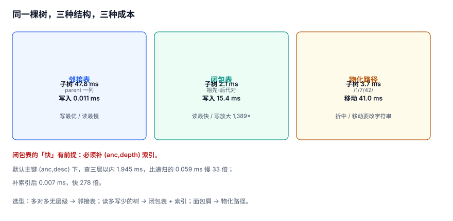

# 三种关系存储：邻接表、闭包表、物化路径

同一棵树可以放进三种结构里，它们的区别不是「谁更先进」，而是**把成本放在写还是读、放在插入还是移动**。本页用同一份 5 万节点、深度 9 的组织树跑三组对照，给出可直接抄的选型表。

::: tip 一句话定位
本页回答「**这棵树该用哪种结构存**」，并给出一组可复跑的读数；遍历写法在[多跳遍历](../Traversal/index.md)。
:::



## 一、三种结构长什么样

### 1.1 邻接表（adjacency list）

只存「我的父节点是谁」：

```sql
CREATE TABLE node (
  id     BIGINT PRIMARY KEY,
  parent BIGINT REFERENCES node(id)
);
```

- 写入：一行，O(1)；
- 查子树：递归，成本随子树大小线性增长；
- 查祖先：递归向上，成本随深度增长。

### 1.2 闭包表（closure table）

额外存「所有祖先-后代对」以及距离：

```sql
CREATE TABLE closure (
  anc   BIGINT NOT NULL,
  desc  BIGINT NOT NULL,
  depth INT    NOT NULL,
  PRIMARY KEY (anc, desc)
);
CREATE INDEX ix_closure_depth ON closure (anc, depth);
```

- 写入：新增一个叶子要插入「它的全部祖先 + 它自己」的行；
- 查子树：一次索引范围扫描，成本与结果集大小成正比，**与树深无关**；
- 代价：空间 9.46 行/节点（本机实测）。

### 1.3 物化路径（materialized path）

把从根到自己的路径存成一个字符串：

```sql
CREATE TABLE node (
  id   BIGINT PRIMARY KEY,
  path TEXT NOT NULL          -- 例如 /1/7/42/108/
);
CREATE INDEX ix_node_path ON node (path);
```

- 查子树：`WHERE path LIKE '/1/7/%'`，一次前缀扫描；
- 移动子树：要改写所有后代的 `path`；
- 路径长度受层级与 id 位数影响。

## 二、三组实测（同一份语料）

**语料**：50,000 节点组织树，最大深度 **9**，邻接表建树 **171.1 ms**；闭包表全量构建 **877.4 ms**，产出 **473,214 行**（**9.46 行/节点**）。库文件 18.4 MB（含社交图）。

### 2.1 查全部后代（根节点，49,999 行结果）

| 结构 | 查询 | 耗时 | 相对 |
| --- | --- | --- | --- |
| 邻接表 + 递归 CTE | `WITH RECURSIVE` | **47.801 ms** | 1× |
| 闭包表 | `WHERE anc=? AND depth>0` | **2.065 ms** | **23.1× 更快** |
| 物化路径 | `WHERE path LIKE ?` | **3.707 ms** | 12.9× 更快 |

闭包表赢在「结果已经在索引里排好」，不需要逐层展开；物化路径赢在「一次前缀扫描」，但要额外过滤自身。

### 2.2 查三层以内的后代（69 行结果）

| 结构 | 查询 | 耗时 | 备注 |
| --- | --- | --- | --- |
| 邻接表 + 递归 CTE | `depth < 3` | **0.059 ms** | 只展开三层，很快 |
| 闭包表（默认主键） | `depth BETWEEN 1 AND 3` | **1.945 ms** | **比递归慢 33 倍** |
| 闭包表（加 `(anc,depth)` 索引） | 同上 | **0.007 ms** | 快 **278 倍** |
| 物化路径 | `path LIKE ? AND depth<=?` | **3.865 ms** | 要扫全部后代再过滤 |

这组数是本页最值得记的一条：**闭包表「快」不是无条件的**。主键 `(anc,desc)` 只能按祖先定位，`depth` 是过滤条件而不是索引列——于是「查三层以内」会先把 49,999 行全读出来再筛掉 49,930 行。补一个 `(anc,depth)` 索引，1.945 ms → **0.007 ms**。

::: danger 抄了闭包表却没抄索引
只建 `PRIMARY KEY (anc,desc)` 的闭包表，在「限制深度」的查询上**比递归还慢**。这不是闭包表的问题，是索引顺序的问题：**过滤列必须进索引，且放在等值列之后。**
:::

### 2.3 写入与移动

| 操作 | 邻接表 | 闭包表 | 物化路径 |
| --- | --- | --- | --- |
| 新增一个叶子节点 | **0.0111 ms** | **15.4182 ms**（**1,389×**） | 一次 INSERT（≈ 邻接表） |
| 移动 500 节点子树 | 一次 UPDATE | **27.9 ms**（删 500+ 行的闭包） | **41.0 ms**（改 500 行字符串） |

闭包表的写放大是结构性的：新增一个深度 9 的叶子要写 10 行（自己 + 9 个祖先）。本机 0.0111 ms → 15.4182 ms，**1,389 倍**。这也是「社交图不要用闭包表」的直接原因：关注关系没有「祖先」概念，硬套闭包表等于给每条边建一个传递闭包。

移动子树的读数有点反直觉：闭包表（27.9 ms）比物化路径（41.0 ms）**更快**。原因是闭包表删的是行（走主键），物化路径改的是字符串且 `LIKE` 前缀匹配要扫全部匹配行再逐行 `replace`。**「物化路径移动便宜」是一句只在层级浅、路径短时成立的话。**

## 三、选型表

| 场景 | 推荐 | 理由 |
| --- | --- | --- |
| 关注/点赞/成员这类多对多、无层级 | 邻接表 | 闭包表在这里没有「祖先」可算 |
| 组织架构、分类树，读多写少，深度 ≤ 10 | 闭包表 + `(anc,depth)` 索引 | 子树查询 23×，浅层查询 278× |
| 层级深、频繁移动（如可拖拽的目录） | 邻接表（+ 缓存） | 闭包写入放大 1,389×，移动要重算 |
| 需要「路径可读」的展示（面包屑） | 物化路径 | 一次查询直接拿到路径字符串 |
| 超大规模只读（报表、数仓） | 预计算闭包 + 分区 | 读最优，写反正不频繁 |

## 四、混合形态：邻接表是真相，其余是索引

最稳的组合是「一份真相 + 一到两份索引」：

```text
edge/node（邻接表，唯一真相）
   ├── closure（闭包表，服务子树查询）
   └── path_cache（物化路径，服务面包屑）
```

三条纪律：

1. **写只写邻接表**，其余由触发器或后台任务派生；
2. **派生结构可随时 `TRUNCATE` 并重建**，重建命令写在运维手册里；
3. **对账以邻接表为准**，派生结构与它不一致时，改派生结构。

判据只有一句：**删掉闭包表，系统还能不能工作**。不能，就说明有人把它当成了唯一副本。

## 五、重建与校验

闭包表全量重建（本机 877.4 ms / 47 万行，可作为量级参考）：

```sql
BEGIN;
TRUNCATE closure;
INSERT INTO closure (anc, desc, depth)
SELECT id, id, 0 FROM node;

WITH RECURSIVE c(anc, desc, depth) AS (
  SELECT parent, id, 1 FROM node WHERE parent IS NOT NULL
  UNION
  SELECT c.anc, n.id, c.depth + 1
    FROM c JOIN node n ON n.parent = c.desc
)
INSERT INTO closure (anc, desc, depth)
SELECT anc, desc, depth FROM c
ON CONFLICT DO NOTHING;
COMMIT;
```

重建后必须校验，否则「重建成功」只证明 SQL 跑完了：

```sql
-- V1：每个节点的祖先数 = 深度（根为 0）
SELECT COUNT(*) FROM node n
 WHERE (SELECT COUNT(*) FROM closure c WHERE c.desc = n.id) <> n.depth + 1;

-- V2：闭包里的每一对都能在邻接表上走通（抽样）
SELECT COUNT(*) FROM closure c
 WHERE c.depth > 0
   AND NOT EXISTS (
     SELECT 1 FROM closure a JOIN closure b
       ON a.desc = b.anc AND a.anc = c.anc AND b.desc = c.desc
      AND a.depth + b.depth = c.depth
   );

-- V3：闭包不含跨树的对（多根场景）
SELECT COUNT(DISTINCT anc) FROM closure WHERE depth = 0;
```

## 六、判据 `GRF-A ~ GRF-H`

| 编号 | 判据 | 不满足时改哪里 |
| --- | --- | --- |
| `GRF-A` | 邻接表是唯一写入入口，其余结构均为派生 | 收敛写入口 |
| `GRF-B` | 闭包表存在 `(anc,depth)` 索引，浅层查询 `EXPLAIN` 走索引范围扫描 | 加索引 |
| `GRF-C` | 闭包表行数 / 节点数 ≤ 树的最大深度 + 1（本机 9.46 ≤ 10） | 检查是否误建传递闭包 |
| `GRF-D` | 子树查询实测：闭包 vs 递归的比值已记录，且闭包更快 | 重测或换结构 |
| `GRF-E` | 新增叶子的写入成本已实测，写放大倍数可接受（本机 1,389×） | 换邻接表 |
| `GRF-F` | 移动子树的成本已实测，且选定结构在该场景下更优 | 换结构 |
| `GRF-G` | 闭包表与物化路径都能一条命令重建，且重建后有 V1~V3 校验 | 补重建脚本 |
| `GRF-H` | 派生结构被删除后系统仍可工作（降级路径存在） | 补降级逻辑 |

## 七、验证方式

```shell
cd /tmp && python3 - <<'PY'
import sqlite3, time
con = sqlite3.connect('/tmp/grlab.db')
root = con.execute("select anc from closure where depth=1 limit 1").fetchone()[0]
for name, sql in [
  ("adj", "WITH RECURSIVE s(id) AS (SELECT ? UNION SELECT t.dst FROM tedge t JOIN s ON t.src=s.id) SELECT COUNT(*) FROM s"),
  ("clo", "SELECT COUNT(*) FROM closure WHERE anc=? AND depth>0"),
]:
    s = time.perf_counter()
    for _ in range(5):
        n = con.execute(sql, (root,)).fetchone()[0]
    print(name, n, round((time.perf_counter()-s)*1000/5, 3), "ms")
PY
```

预期输出（与本页基线同量级）：

```text
adj 50000 45 ~ 55 ms
clo 49999 1.8 ~ 2.4 ms
```

若 `clo` 与 `adj` 差距不足 10 倍，先检查 `(anc,depth)` 索引是否存在——**索引缺了，闭包表就退化成一个更占空间的邻接表**。

## 参考资料

- [PostgreSQL 18: WITH Queries](https://www.postgresql.org/docs/18/queries-with.html)
- [SQLite: Indexes and Query Planning](https://sqlite.org/optoverview.html)
- [Bill Karwin: Models for Hierarchical Data](https://karwin.blogspot.com/2010/05/models-for-hierarchical-data.html)
- [Neo4j: Indexes for Graph Lookups](https://neo4j.com/docs/cypher-manual/current/indexes/)
