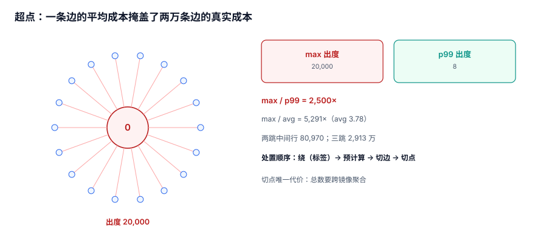

# 超点与切分：两万条出边的那一个节点

每个图里都有几个「所有人都认识」的节点：官方号、默认分类、全员群、系统账号。它们的度不是平均值的几倍，而是**四个数量级**。本页把超点的成本量化，并给出四种切法各自的代价。

::: tip 一句话定位
本页回答「**一个节点两万条边，会不会把我的查询拖垮、该切边还是切点**」；遍历语法在[多跳遍历](../Traversal/index.md)。
:::



## 一、度分布：平均值是最没用的指标

本机语料（50,000 节点 / 183,269 有向边）：

| 指标 | 值 |
| --- | --- |
| 最大出度 | **20,000** |
| p99 出度 | **8** |
| 平均出度 | 3.78（183,269 / 48,506） |
| 有出边的节点 | 48,506 |

最大出度是 p99 的 **2,500 倍**，是平均值的 **5,291 倍**。

::: danger 「按平均值估容量」必然翻车
平均出度 3.78 意味着「一跳大约 4 行、两跳 16 行」，按这个预算设计的接口在超点上会变成 20,000 行与 80,970 行。**容量必须按 p99.9 或最大值估，不能按平均值估。**
:::

## 二、成本：一跳已经很贵，两跳就是事故

从超点 0 出发（`UNION` 去重）：

| 跳数 | 结果行数 | 耗时 |
| --- | --- | --- |
| 1 | 20,000 | **10.9 ms** |
| 2 | 22,047 | **52.5 ms** |
| 3 | 29,510 | **114.5 ms** |

`UNION ALL` 版本（不去重）同一路径：

| 跳数 | 中间行数 | 放大 |
| --- | --- | --- |
| 1 | 20,001 | — |
| 2 | 80,970 | 4.05× |
| 3 | 29,134,438 | 359.8× |

注意一个反直觉的事实：**去重后的行数几乎不涨（20,000 → 22,047 → 29,510），但耗时涨了 10 倍**。因为成本不在结果，在**中间展开**——第二跳要扫 20,000 个邻居的出边，第三跳要扫它们的邻居。

## 三、四种切法

### 3.1 切边（edge partitioning）

把超点的边按目标哈希分成 N 个桶，查询时分桶并行：

```sql
CREATE TABLE edge_shard (
  src BIGINT NOT NULL,
  bucket SMALLINT NOT NULL,     -- dst % 16
  dst BIGINT NOT NULL,
  rel TEXT NOT NULL,
  PRIMARY KEY (src, bucket, dst, rel)
);
```

- 查询改写：`WHERE src=? AND bucket IN (0..15)`，或按桶并发；
- 收益：单桶 1,250 行，10.9 ms → 单桶约 1 ms；
- 代价：总代价不变（甚至因 16 次查询而略高），**换的是并发度与尾延迟**。

### 3.2 切点（node mirroring）

把超点复制成多个「镜像节点」，边分散挂到镜像上：

```text
official_account#0 ~ official_account#15
每个镜像挂 1,250 条边
发布时随机/轮询选一个镜像写入
```

- 收益：单点写与单点查都被摊平；
- 代价：**「这个账号一共多少粉丝」需要跨镜像聚合**，且镜像数变更时要迁移。

### 3.3 预计算（materialized neighbors）

把超点的前 N 个邻居（按权重/时间）物化到一张小表，查询先读小表：

```sql
CREATE TABLE hot_neighbor (
  src BIGINT NOT NULL,
  dst BIGINT NOT NULL,
  rank INT NOT NULL,
  PRIMARY KEY (src, rank)
);
```

- 收益：热门路径变成一次索引扫描；
- 代价：只覆盖前 N 个，`rank > N` 的查询仍要回源；**必须能重建**。

### 3.4 用标签替代边（modeling fix）

「全员关注官方号」这类关系，本质是**广播**，不是图：

```sql
-- 不建 50 万条边，建一个订阅标签
CREATE TABLE broadcast_subscriber (
  channel_id BIGINT NOT NULL,
  user_id BIGINT NOT NULL,
  PRIMARY KEY (channel_id, user_id)
);
```

查询「这个频道的全部订阅者」仍然是一次范围扫描，但它**不参与多跳遍历**——超点从图里消失了。

## 四、四种切法的对比

| 切法 | 单点查询 | 聚合查询 | 写入 | 实现成本 | 适用 |
| --- | --- | --- | --- | --- | --- |
| 切边 | 分桶并行，尾延迟降 | 需汇总 N 桶 | 不变 | 中 | 读多、能并发 |
| 切点 | 摊平 | **变贵**（跨镜像） | 分摊 | 高 | 写多、读少 |
| 预计算 | 最快 | 不变 | 要维护 | 中 | 有热点、可容忍延迟 |
| 标签替代 | 不参与遍历 | 不变 | 不变 | 低 | 广播类关系 |

::: tip 优先顺序
**先建模（标签替代）→ 再预计算 → 再切边 → 最后切点。** 切点是唯一会让「总数」变难的方案，除非写入压力真的集中在一个点上，否则不值得。
:::

## 五、分页：超点上不能用 OFFSET

20,000 行的列表，`OFFSET 19000 LIMIT 20` 要扫 19,020 行。用游标：

```sql
-- 第一页
SELECT dst FROM edge WHERE src = :id ORDER BY dst LIMIT 20;
-- 后续页
SELECT dst FROM edge WHERE src = :id AND dst > :last ORDER BY dst LIMIT 20;
```

本机实测（另一份 4 万订单语料）`OFFSET` 到 3 万行时是首页的 **24.9 倍**，而 keyset 分页始终是首页成本。关系列表同理。

## 六、超时的正确形态

超点查询一定会超时，问题是怎么超：

| 形态 | 表现 | 评价 |
| --- | --- | --- |
| 直接报错 | 500 / 超时异常 | 可用性差，但语义清楚 |
| 静默返回空 | 200 + `[]` | ❌ 最差：调用方以为「没有邻居」 |
| 截断返回 | 200 + `truncated: true` + 部分结果 | ✅ 推荐 |
| 降级到 1 跳 | 200 + `depth: 1` + 标记 | ✅ 适合信息流类场景 |

```json
{
  "node": 0,
  "depth_requested": 3,
  "depth_served": 1,
  "truncated": true,
  "reason": "fanout_budget_exceeded",
  "items": ["..."]
}
```

## 七、判据 `GRH-A ~ GRH-H`

| 编号 | 判据 | 不满足时改哪里 |
| --- | --- | --- |
| `GRH-A` | 出度/入度的最大值、p99、平均值三个数都有记录，容量按最大值或 p99.9 估算 | 补度分布统计 |
| `GRH-B` | 出度超过阈值的节点有清单，且每个都有处置方案（标签/预计算/切分） | 建超点清单 |
| `GRH-C` | 一跳/两跳在超点上的行数与耗时已实测 | 补压测 |
| `GRH-D` | 若采用切边，桶数与单桶行数已确定，且聚合查询有汇总路径 | 补桶设计 |
| `GRH-E` | 若采用切点，跨镜像聚合的查询与成本已给出 | 补聚合查询 |
| `GRH-F` | 列表分页使用游标而非 `OFFSET` | 改分页 |
| `GRH-G` | 超时有形态（截断/降级/报错三选一），且响应里带 `truncated` 与原因 | 改接口契约 |
| `GRH-H` | 广播类关系不建边（用订阅表），且图里不存在「一对全员」的边 | 改模型 |

## 八、验证方式

```shell
cd /tmp && python3 - <<'PY'
import sqlite3
con = sqlite3.connect('/tmp/grlab.db')
deg = [r[0] for r in con.execute("select count(*) from edge group by src order by 1 desc")]
print("max =", deg[0], "p99 =", deg[len(deg)//100], "avg =", round(sum(deg)/50000, 2))
for d in (1,2):
    sql = f"""WITH RECURSIVE w(n,dd) AS (SELECT 0,0 UNION ALL
              SELECT e.dst,w.dd+1 FROM edge e JOIN w ON e.src=w.n WHERE w.dd<{d})
              SELECT COUNT(*) FROM w"""
    print(f"hop{d} =", con.execute(sql).fetchone()[0])
PY
```

预期输出：

```text
max = 20000 p99 = 8 avg = 3.78
hop1 = 20001
hop2 = 80970
```

看到 `max / p99 = 2500` 这个比值，就该把「平均值容量模型」丢掉了。

## 参考资料

- [Neo4j: Super Nodes and Dense Nodes](https://neo4j.com/docs/cypher-manual/current/performance/dense-nodes/)
- [Pregel: A System for Large-Scale Graph Processing](https://research.google/pubs/pub37252/)
- [PostgreSQL 18: LIMIT and OFFSET](https://www.postgresql.org/docs/18/queries-limit.html)
- [Wikipedia: Power-law distribution](https://en.wikipedia.org/wiki/Power_law)
