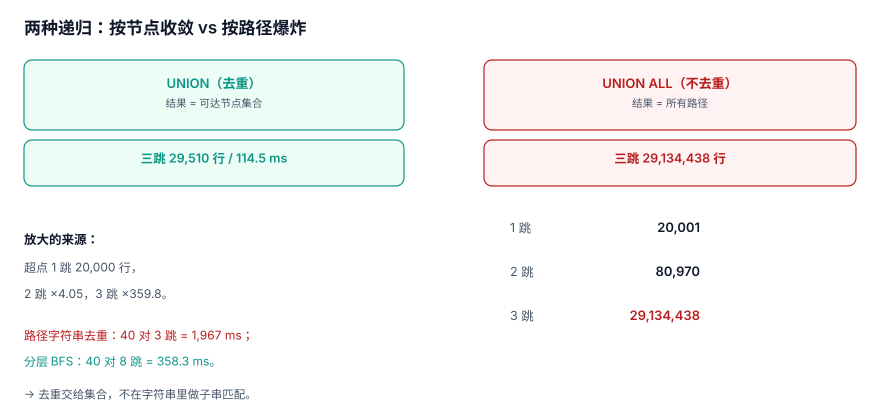

# 多跳遍历：终止性、放大与分层 BFS

`WITH RECURSIVE` 让关系库拥有了「走图」的能力，但它同时把两个坑一起交给你：**默认不保证终止**（有环就跑不完），**默认不保证行数可控**（超点上指数放大）。本页用同一份 18 万边的语料把这两个坑量化。

::: tip 一句话定位
本页回答「**这条递归查询会不会停、会放大多少倍、该用 UNION 还是 UNION ALL**」；超点的专门处置在[超点与切分](../SuperNode/index.md)。
:::



## 一、两种递归，回答两个不同的问题

| 写法 | 语义 | 结果 | 何时用 |
| --- | --- | --- | --- |
| `UNION` | 按整行去重 | **可达节点集合** | 「能到谁」「有没有路径」 |
| `UNION ALL` | 不去重 | **所有路径**（含重复节点序列） | 「有几条路」「最短几步」 |

选错的代价不是「慢一点」：

- 该用 `UNION` 用了 `UNION ALL` → 环上无限展开，或超点上爆炸；
- 该用 `UNION ALL` 用了 `UNION` → 路径被去重，`COUNT(*)` 得到的是节点数不是路径数。

```sql
-- 可达节点集合（会收敛）
WITH RECURSIVE reach(n) AS (
  SELECT :start
  UNION
  SELECT e.dst FROM edge e JOIN reach r ON e.src = r.n
)
SELECT COUNT(*) FROM reach;

-- 所有路径（必须自己加深度上限）
WITH RECURSIVE path(n, d) AS (
  SELECT :start, 0
  UNION ALL
  SELECT e.dst, p.d + 1 FROM edge e JOIN path p ON e.src = p.n
   WHERE p.d < :max_depth
)
SELECT COUNT(*) FROM path;
```

## 二、环：为什么 `UNION` 能停

本机语料里有一条 5,000 节点的有向环（`1→2→…→5000→1`）。从节点 1 出发：

| 写法 | 行数 | 耗时 | 说明 |
| --- | --- | --- | --- |
| `UNION` | **33,026** | **61.0 ms** | 去重后收敛，行数 = 可达节点数 |
| `UNION ALL`（深度上限 3） | **55** | 47.8 ms | 只走了 3 层，行数少是**因为起点出度小** |

第二行是本页最危险的读数：**55 行看起来「很安全」**，但它是靠深度上限截出来的，不是靠语义收敛的。把起点换成超点 0，同一个写法立刻变成 20,001 → 80,970 → 29,134,438 行。

::: danger 三个「看起来能跑」的递归
1. **没有 `UNION`、没有深度上限**：遇到环直接不返回。开发环境图小、恰好无环，上线遇到「A 关注 B、B 关注 A」就挂。
2. **有深度上限但没有 `UNION`**：能停，但行数按出度指数增长。三跳 2,913 万行足以打爆内存。
3. **有 `UNION` 但把深度写进选择列**：`SELECT n, 0 UNION SELECT dst, d+1` 里的 `d` 让每一行都不同，去重失效——**去重是按整行比的，加一列就废了**。
:::

## 三、放大：一跳、两跳、三跳

从超点 0（出度 20,000）出发，`UNION ALL` 的中间行数：

| 跳数 | 行数 | 相对上一跳 | 说明 |
| --- | --- | --- | --- |
| 1 | **20,001** | — | 起点 + 20,000 个直接邻居 |
| 2 | **80,970** | 4.05× | 20,000 个邻居各自的出边 |
| 3 | **29,134,438** | 359.8× | 已经是**两千九百一十三万行** |

同样的三跳，用 `UNION` 去重后只剩 **29,510 个节点**（114.5 ms）——**放大 987 倍的行数，换来 114.5 ms 的查询**。这就是「按节点去重」和「按路径展开」的全部差别。

```sql
-- 自测：把跳数从 1 加到 3，观察行数怎么涨
WITH RECURSIVE w(n, d) AS (
  SELECT 0, 0
  UNION ALL
  SELECT e.dst, w.d + 1 FROM edge e JOIN w ON e.src = w.n WHERE w.d < 3
)
SELECT d, COUNT(*) FROM w GROUP BY d ORDER BY d;
```

## 四、路径去重的代价：字符串 vs 分层

想在 SQL 里「不重复经过同一节点」，最直觉的写法是把路径拼成字符串并用 `instr` 判断：

```sql
-- 反例：路径字符串去重
WITH RECURSIVE p(n, d, path) AS (
  SELECT :start, 0, ',' || :start || ','
  UNION ALL
  SELECT e.dst, p.d + 1, p.path || e.dst || ','
    FROM edge e JOIN p ON e.src = p.n
   WHERE p.d < 3 AND instr(p.path, ',' || e.dst || ',') = 0
)
SELECT MIN(d) FROM p WHERE n = :target;
```

实测：40 对随机点、深度上限 3，总耗时 **1,967 ms**（**49.2 ms/对**）。作为对照，分层 BFS（每层一个 `IN` 列表）跑深度上限 8、同样 40 对，总耗时 **358.3 ms**（**8.96 ms/对**，平均每对扫描 6,220 行）。

分层 BFS 的形状：

```python
def bfs(start: int, target: int, cap: int = 8) -> int | None:
    frontier, seen, hops = {start}, {start}, 0
    while frontier and hops < cap:
        q = ",".join("?" * len(frontier))
        rows = conn.execute(
            f"SELECT DISTINCT dst FROM edge WHERE src IN ({q})", tuple(frontier)
        ).fetchall()
        frontier = {r[0] for r in rows} - seen
        hops += 1
        if target in frontier:
            return hops
        seen |= frontier
    return None
```

它比字符串版**快 5.5 倍且能走更深**（8 跳 vs 3 跳），原因是每层只物化「新节点」，去重交给 `SELECT DISTINCT` 与集合运算，而不是在字符串里做子串匹配。

## 五、深度上限怎么定

上限不能拍脑袋。三种依据：

| 依据 | 取值方式 | 例子 |
| --- | --- | --- |
| 业务语义 | 业务上「几度人脉」有意义 | 二度人脉 → 上限 2 |
| 图直径 | `p95` 最短路径长度 × 1.2 | 实测 p95 = 5 → 上限 6 |
| 预算 | 单次查询行数上限 ÷ 平均每跳行数 | 10 万行 ÷ 6,220 → 约 16 跳 |

本机 40 对随机点在 8 跳内只找到 **6 对**（15%），平均每对 8.96 ms——说明这张图的连通性并不强，**「都能走到」是一个需要先验证的假设**。

::: warning 无路可走也要有形态
未找到路径时返回空集是正确行为，但要区分两种空：**「图里确实没有路径」**与**「深度上限内没有」**。前者可以缓存，后者换上限就有结果。接口应该返回 `truncated: true/false`，不要都返回 `[]`。
:::

## 六、结果去重与排序

递归 CTE 的输出没有顺序保证。三件事要显式做：

1. **去重**：`UNION` 已按整行去重；用 `UNION ALL` 时必须在外层 `SELECT DISTINCT`。
2. **排序**：按 `depth` 再按 `id`，否则分页结果不稳定。
3. **截断标记**：`LIMIT` 命中时要有 `has_more`，不要静默截断。

```sql
WITH RECURSIVE reach(n, d) AS (
  SELECT :start, 0
  UNION
  SELECT e.dst, r.d + 1 FROM edge e JOIN reach r ON e.src = r.n WHERE r.d < :depth
)
SELECT n, MIN(d) AS d FROM reach GROUP BY n ORDER BY d, n LIMIT :limit;
```

## 七、判据 `GRG-A ~ GRG-H`

| 编号 | 判据 | 不满足时改哪里 |
| --- | --- | --- |
| `GRG-A` | 每条递归查询都写明是「可达集合」还是「全部路径」，写法与语义一致 | 改 `UNION` / `UNION ALL` |
| `GRG-B` | 所有递归查询都有深度上限，上限值有依据（业务/直径/预算） | 加 `WHERE d <= N` |
| `GRG-C` | 有环图的递归使用 `UNION`（或显式 visited 集合），且有环上收敛的实测 | 改写法 |
| `GRG-D` | 一跳/两跳/三跳的中间行数已实测，放大倍数已记录 | 补压测 |
| `GRG-E` | 不在 SQL 里用路径字符串去重；需要最短路径时用分层 BFS | 改写查询 |
| `GRG-F` | 分层 BFS 的单跳查询走 `(src)` 索引，`EXPLAIN` 无全表扫描 | 加索引 |
| `GRG-G` | 未找到路径时能区分「不存在」与「超上限」，接口返回 `truncated` | 补返回字段 |
| `GRG-H` | 递归结果有稳定排序与去重，分页不重复不遗漏 | 加 `ORDER BY` |

## 八、验证方式

```shell
cd /tmp && python3 - <<'PY'
import sqlite3, time
con = sqlite3.connect('/tmp/grlab.db')
for d in (1, 2, 3):
    sql = f"""WITH RECURSIVE w(n,dd) AS (SELECT 0,0 UNION ALL
              SELECT e.dst,w.dd+1 FROM edge e JOIN w ON e.src=w.n WHERE w.dd<{d})
              SELECT COUNT(*) FROM w"""
    s = time.perf_counter(); n = con.execute(sql).fetchone()[0]
    print(f"hop{d} rows={n} ms={round((time.perf_counter()-s)*1000,1)}")
PY
```

预期输出：

```text
hop1 rows=20001 ms=9 ~ 13
hop2 rows=80970 ms=45 ~ 60
hop3 rows=29134438 ms=1100 ~ 1600
```

第三行是**两千九百多万**。看到这个数就该停下来：不是换机器，是换写法（`UNION` + 深度上限），或者换结构（预计算，见[服务化](../Serving/index.md)）。

## 参考资料

- [PostgreSQL 18: Recursive Queries](https://www.postgresql.org/docs/18/queries-with.html#QUERIES-WITH-RECURSIVE)
- [SQLite: Recursive CTE](https://sqlite.org/lang_with.html#recursive_common_table_expressions)
- [Neo4j: Variable-Length Patterns](https://neo4j.com/docs/cypher-manual/current/patterns/variable-length-patterns/)
- [Wikipedia: Breadth-first search](https://en.wikipedia.org/wiki/Breadth-first_search)
