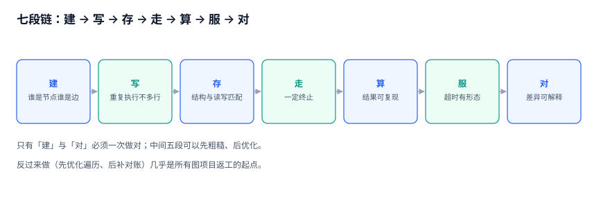
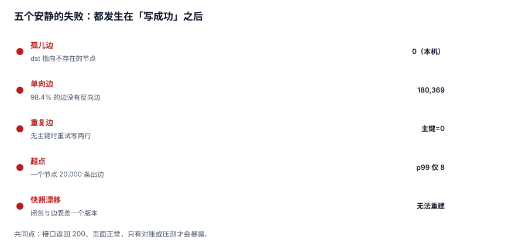

# 图数据与关系计算工程

「用户 A 关注了用户 B」这句话，几乎每个系统里都有一张表。但真正让人加班的不是**这条边存不下来**，而是：A 关注 B 之后 B 的主页粉丝数没涨、取关之后推荐还在推、走三跳算「可能认识的人」把数据库连接池打满、运营问「这个月新增的关系有多少对是重复的」时没人答得上来。

关系数据的特点是：**写进去只要一行，读出来却要一个形状**。

本专题只回答一个问题：**一条关系，从被写进库到被走成一条路径，中间哪几步会安静地错掉，每一步怎么用一条 SQL 证明它没出错。**

::: tip 一句话理解
图数据库解决的是「怎么存和怎么走」，关系计算解决的是「**走出来的东西算不算数**」。前者换产品就能换，后者换不了。
:::

## 本专题回答什么、不回答什么

库内与「图」沾边的册子有三处，主讲的东西完全不同。下表把分工写死，避免同一个问题被两册各答一遍。

| 问题的主语 | 由谁回答 | 具体页面 |
| --- | --- | --- |
| Neo4j 怎么装、Cypher 怎么写、GDS 怎么跑、集群怎么组 | 产品用法视角 | [Neo4j 专题](../../DB/Neo4j/index.md) |
| 图结构本身怎么在磁盘上组织、B+ 树与页 | 存储引擎视角 | [数据库内部原理](../../DB/DatabaseInternals/index.md) |
| 社交/推荐场景里「关系」怎么变成特征 | 推荐算法视角 | [推荐系统](../RecommenderSystems/index.md) |
| 递归查询的语法与优化器行为 | SQL 调优视角 | [SQL 优化](../../DB/Relational/SQLOptimization/index.md) |
| **同一条关系在三种存储里怎么放、怎么走、怎么对账，超点与快照怎么处置** | **本册** | 就是你现在看的这一册 |

分界线一句话：**主语是「Cypher 这条语句怎么写」，看 Neo4j 那一册；主语是「这条边到底该放邻接表还是闭包表、走三跳会不会炸、算出来的路径能不能对账」，看本册。**

## 三个「这条关系」

同一个「关注」，在系统里有三种身份。它们可以同时成立，也可以只成立一种——而绝大多数线上事故，是把第三种当成了第一种。

| 身份 | 它是什么 | 判定方式 | 失效的样子 |
| --- | --- | --- | --- |
| **事实** | 用户确实点了关注 | 有业务事件、有时间、有操作者 | 事件丢了，但页面显示已关注 |
| **记录** | `edge` 表里有一行 | `SELECT` 得到一行 | 行在，但 `src` 指向一个已注销用户 |
| **可用** | 从 A 出发能走到 B，且能解释为什么 | 一条带方向与深度的查询能返回它 | 走得通，但走的是三个月前的快照 |

::: warning 三个身份不能互相替代
「表里有行」不等于「事实成立」（可能是脚本刷的），「事实成立」也不等于「现在还能走通」（B 已注销、边已软删）。判据必须各自写一条，不能用一个 `COUNT(*)` 交差。
:::

## 七段链

| 段 | 这一段在干什么 | 最容易安静出错的地方 | 对应章节 |
| --- | --- | --- | --- |
| 建 | 决定谁是节点、谁是边、边带什么属性 | 把「属性」建成「边」，或反过来 | [关系建模](RelationModel/index.md) |
| 写 | 一条边落库，以及它的反向边、计数、缓存 | 双向只写了一半 | [边写入](EdgeWrite/index.md) |
| 存 | 选邻接表 / 闭包表 / 物化路径 | 用闭包表存社交图，写放大 1,389 倍 | [三种存储](StorageForm/index.md) |
| 走 | 多跳遍历与终止 | `UNION ALL` 走环，三跳 2,913 万行 | [多跳遍历](Traversal/index.md) |
| 算 | 路径、中心性、社区 | 用「一轮 PageRank」当收敛结果 | [路径与中心性](PathAlgorithm/index.md) |
| 服 | 在线多跳与预计算的分工 | 预计算被当成真相 | [服务化](Serving/index.md) |
| 对 | 孤儿、单向、重复、计数漂移 | 只对总数，不对形状 | [一致性与快照](Snapshot/index.md) |

## 本专题的起点：一份可复跑的语料

全专题的读数来自同一份本机语料（Python 3.13.12 + SQLite 3.50.4，固定种子 `20261109`，脚本不入库）：

| 数据集 | 规模 | 用途 |
| --- | --- | --- |
| 社交关注图 | 50,000 节点 / **183,269 条有向边**，最大出度 **20,000**、p99 出度 **8** | 遍历、超点、路径、对账 |
| 组织树 | 50,000 节点 / 最大深度 **9**，闭包表 **473,214 行**（9.46 行/节点） | 三种存储对比 |

建图 347.5 ms、建树 171.1 ms、闭包表全量构建 877.4 ms，库文件 18.4 MB。**所有数字都可以按[实战](Practice/index.md)页给出的 DDL 与脚本复跑**，包括那些看起来不合理的（三跳 2,913 万行、闭包写入慢 1,389 倍）。

## 五个安静的失败

这五件事的共同点是：**接口返回 200，页面看起来正常，只有对账或压测才会暴露**。

1. **孤儿边**：`dst` 指向一个不存在的节点。外键能挡新增，挡不住「先删节点、后补数据」的导入脚本。
2. **单向边**：把关注当好友用，只写 `A→B`。实测 183,269 条边里只有 **2,900 对**存在反向边，**98.4% 是单向的**——不是数据错，是模型错。
3. **重复边**：没有 `(src,dst)` 主键时，重试会写两行，粉丝数涨两次。
4. **超点**：一个节点 20,000 条出边，两跳就是 80,970 行中间结果，三跳 **29,134,438 行**。
5. **快照漂移**：闭包表是预计算，边改了它没改，查询结果与真相差一个版本。

## 三条反模式

::: danger 这三条在本库的实测里都付过代价
1. **把图当表**：以为「有 `JOIN` 就能算关系」，于是用三层自连接算「好友的好友」。三张表各 10 万行时，两层自连接已经是 10 亿级中间结果——**不是慢，是跑不完**。
2. **把递归当万能**：`WITH RECURSIVE` 写起来最像「图」，但它默认不保证终止、不保证去重、不保证有深度上限。没有 `UNION`（而非 `UNION ALL`）与深度谓词，一条环就能让它转到连接超时。
3. **把预计算当真相**：闭包表、粉丝数、推荐候选都是**索引**，不是事实。判据只有一条：**把它 `TRUNCATE` 掉，系统还能不能从边表重建出来**。不能，就说明有人把它当成了唯一副本。
:::

## 起步顺序

如果只想改一件事，按这个顺序：

1. **先给边表加主键** `(src, dst, rel)`，并跑一次重复检查。重复边是所有计数漂移的源头。
2. **再跑一次对账**（孤儿、单向、计数），把结果落成一张 `reconcile_log`。没有基线，后面所有优化都无法证明有效。
3. **然后才谈存储形态**。读多写少的树用闭包表，写多的社交图用邻接表，两者都不要指望「一种结构通吃」。
4. **最后才是算法**。PageRank 一轮 144.6 ms 看着不贵，但它乘上迭代次数与图规模就是分钟级——先确认业务要的是「排序」还是「绝对值」。

## 目录

| 章节 | 它管的那一段 | 一句话 |
| --- | --- | --- |
| [总览：三个「这条关系」与五个安静的失败](Overview/index.md) | 全景 | 先把三种身份拆开 |
| [关系建模：谁是节点、谁是边](RelationModel/index.md) | 建 | 边的主键就是业务约束 |
| [边写入：双向、幂等与孤儿边](EdgeWrite/index.md) | 写 | 一次关注要写几行 |
| [三种关系存储：邻接表、闭包表、物化路径](StorageForm/index.md) | 存 | 23 倍与 1,389 倍的取舍 |
| [多跳遍历：终止性、放大与分层 BFS](Traversal/index.md) | 走 | 三跳 2,913 万行是怎么来的 |
| [超点与切分：两万条出边的那一个节点](SuperNode/index.md) | 走 | 度分布不是均匀的 |
| [路径与中心性：最短路径、PageRank 与社区](PathAlgorithm/index.md) | 算 | 一轮不等于收敛 |
| [一致性与快照：读到的图是哪一刻的](Snapshot/index.md) | 对 | 预计算必须可重建 |
| [服务化：在线多跳、预计算与超时预算](Serving/index.md) | 服 | 0.9 ms 与 2.9 ms 的分工 |
| [实战：七张表、两个触发器与十条断言](Practice/index.md) | 全链 | 约束落在表上才算数 |
| [常见问题与分诊](FAQ/index.md) | — | 十个被反复问到的判断题 |

## 本专题的判据族

本专题共 **11 族 88 条判据**，每页 8 条，逐条可判定。

| 族 | 覆盖 | 页 |
| --- | --- | --- |
| `GRA-A ~ GRA-H` | 三个身份、七段链、五个安静失败、三条反模式、起步顺序、边界、版本组织、验收入口 | [总览](Overview/index.md) |
| `GRB-A ~ GRB-H` | 节点与边的分工、边主键、方向语义、属性还是边、时间区间、软删、超点预防、建模验收 | [关系建模](RelationModel/index.md) |
| `GRD-A ~ GRD-H` | 幂等写入、双向不变量、死锁顺序、删除三态、孤儿来源、批量导入、计数缓存、写入验收 | [边写入](EdgeWrite/index.md) |
| `GRF-A ~ GRF-H` | 邻接表、闭包表、物化路径、三者实测、选型判据、混合形态、重建、存储验收 | [三种存储](StorageForm/index.md) |
| `GRG-A ~ GRG-H` | UNION 与 UNION ALL、环收敛、深度截断、放大倍数、路径去重代价、分层 BFS、上限取值、结果去重 | [多跳遍历](Traversal/index.md) |
| `GRH-A ~ GRH-H` | 度分布、两跳放大、切边、切点、标签替代、分页、超时形态、超点验收 | [超点与切分](SuperNode/index.md) |
| `GRJ-A ~ GRJ-H` | 无权 BFS、有权最短路、双向搜索、PageRank 成本、收敛判据、社区发现、中心性、结果稳定性 | [路径与中心性](PathAlgorithm/index.md) |
| `GRR-A ~ GRR-H` | 三类时间、as-of 查询、并发可见性、跨表快照、闭包漂移、重建与增量、四类对账、快照验收 | [一致性与快照](Snapshot/index.md) |
| `GRS-A ~ GRS-H` | 每跳成本、预计算分工、缓存键、失效传播、限流、降级截断、游标分页、观测指标 | [服务化](Serving/index.md) |
| `GRV-A ~ GRV-H` | 七表 DDL、两触发器、四索引、十条断言、负向探针、复跑、覆盖缺口、交付 | [实战](Practice/index.md) |
| `GRW-A ~ GRW-H` | 十个判断题、三步分诊、图库选型、深度上限、计数漂移、超点处置、快照问、升级路径 | [常见问题](FAQ/index.md) |

## 版本组织：本专题不建版本目录

本册面向的不是某一代产品。**「边要有主键」「遍历要有深度上限」「预计算要可重建」这三条，在 2010 年的邻接表与 2026 年的属性图数据库上是同一句话。**

所以按「链上的一段」分族（`GRA` `GRB` `GRD` `GRF` `GRG` `GRH` `GRJ` `GRR` `GRS` `GRV` `GRW`），不按产品版本分目录。需要按大版本建目录的是「同一份代码两套写法」那类主题，库内已有范式可对照：

- [Spring 5](../Java/Frame/Spring/Spring5/index.md) 与 [Spring 6](../Java/Frame/Spring/Spring6/index.md)：两代 API 不兼容，旧版保留并标注状态。
- [Vue 2](../../Frontend/Frame/Vue/Vue2/index.md) 与 [Vue 3](../../Frontend/Frame/Vue/Vue3/index.md)：同一框架两套响应式写法。
- [GraphQL 16](../GraphQL/Graphql16/index.md) 与 [GraphQL 17](../GraphQL/Graphql17/index.md)：规范两版并存。

图计算没有这种分裂：Neo4j 5 换成 6、PostgreSQL 16 换成 18、SQLite 换成 DuckDB，判据一个字都不用改。产品差异写在[Neo4j 专题](../../DB/Neo4j/index.md)里，本册只在需要对照语法时引用它。

## 阅读顺序

- **只要结论**：读[总览](Overview/index.md)的「五个安静的失败」，五分钟能对上自己的系统。
- **正在被「好友的好友」拖垮**：按 [三种存储](StorageForm/index.md) → [多跳遍历](Traversal/index.md) → [超点](SuperNode/index.md) 读。
- **要对账但对不出来**：直接看[一致性与快照](Snapshot/index.md)的四类差异，再回头补[实战](Practice/index.md)的表结构。

## 参考资料

- [PostgreSQL 18 Documentation: WITH Queries (Common Table Expressions)](https://www.postgresql.org/docs/18/queries-with.html)
- [SQLite: Recursive Common Table Expressions](https://sqlite.org/lang_with.html)
- [Neo4j Cypher Manual](https://neo4j.com/docs/cypher-manual/current/)
- [Apache AGE: Graph Database Extension for PostgreSQL](https://age.apache.org/)
- [W3C: RDF 1.1 Concepts and Abstract Syntax](https://www.w3.org/TR/rdf11-concepts/)
