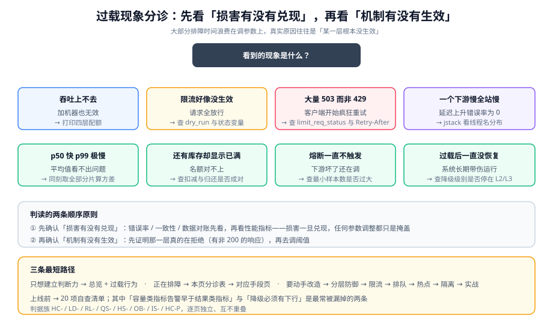

# 常见问题与最佳实践

本页是专题的收口：**现象怎么分诊、常见疑问怎么回答、上线前自查什么**。

::: tip 一句话理解
**先看「损害有没有兑现」，再看「机制有没有生效」。** 大部分排障时间浪费在调参数上，而真实原因往往是「某一层根本没生效」。
:::

## 一、现象分诊表



按「你看到的现象」查找，不要按「你怀疑的原因」查找。

| 现象 | 先跑什么（第一步） | 判读 | 去哪一页 |
| --- | --- | --- | --- |
| 加了机器但吞吐不涨 | 打印四层配额，看是否单调递减 | 有某层配额 = 上一层 → 瓶颈已下沉 | [分层防御](../LayeredDefense/index.md) |
| 限流配了但没拦到任何人 | `$limit_req_status` 是否 `DELAYED`/`PASSED`；是否开了 `dry_run` | 只 `DELAYED` 说明在**延迟**而非拒绝 | [限流](../RateLimit/index.md) |
| 被限流后客户端疯狂重试 | 响应里有没有 `Retry-After` | 没有 → 客户端只能盲重试 | [限流](../RateLimit/index.md) |
| 大量 `503` 而不是 `429` | nginx `limit_req_status` 是否配成 `429` | 默认 `503` 会让客户端以为服务挂了 | [分层防御](../LayeredDefense/index.md) |
| 延迟缓慢上升但错误率为 0 | 队列深度 / 池使用率是否在涨 | 容量类指标先涨 → 还没有过载设计 | [过载行为](../OverloadBehavior/index.md) |
| 一个下游变慢，全站变慢 | `jstack` 看线程名分布 | 线程名无区分 → 没有隔离 | [隔离](../Isolation/index.md) |
| 队列里积压很多但 CPU 不高 | 消息年龄分布 vs 队列深度 | 积压在「过期消息」→ 缺年龄丢弃 | [排队与削峰](../QueueShaping/index.md) |
| 系统 p50 很快但 p99 极慢 | 分片/实例间的**方差** | 方差大 → 热点，不是总量问题 | [热点拆分](../HotspotSplit/index.md) |
| 明明还有库存却显示已满 | 扣减与归还是否成对 | 失败路径漏了归还 → 名额泄漏 | [实战](../Practice/index.md) |
| 缓存改了但部分用户读到旧值 | 本地缓存失效是否覆盖全部实例 | 只失效了一部分 → 比例约 1/N | [热点拆分](../HotspotSplit/index.md) |
| 熔断一直不触发 | 最小样本数是否 > 实际调用量 | 过载时样本少，阈值 100 会让熔断永不生效 | [过载行为](../OverloadBehavior/index.md) |
| 过载结束后一直没恢复 | 降级级别是否还停在 `L2`/`L3` | 缺恢复条件 → 系统长期带伤运行 | [过载行为](../OverloadBehavior/index.md) |
| 压测机自己先崩了 | 压测机与目标机是否同机；工具是否闭模型 | 同机会互相拖慢，闭模型测不出吞吐墙 | [总览](../Overview/index.md) |
| 加了线程数反而更慢 | 平均响应时间是否同步上升 | `QPS = 并发/延迟` 分子分母一起涨 | [总览](../Overview/index.md) |

## 二、高频十二问

### 1. 该用限流还是用队列？

判据是**结果能不能等**：

- 结果能等（能被异步化）→ 队列（见[排队与削峰](../QueueShaping/index.md)）。
- 结果必须同步、且「现在做」与「以后做」等价 → 限流。
- 结果必须同步但可以打折 → 降级。

### 2. 限流值配多少才合适？

不要拍。三步：**① 实测单实例容量；② 乘以实例数；③ 乘 0.7~0.8 的安全系数**。系数不是保守，而是为「单实例容量会衰减」（GC、邻居干扰）留余量。见[分层防御](../LayeredDefense/index.md)。

### 3. 令牌桶和漏桶到底怎么选？

一句话判据：**你要不要给「平时安静、偶尔爆发」的调用方一次机会？**

- 要 → 令牌桶（突发额度 = 桶容量）。
- 下游真的不能吃尖峰 → 漏桶（速率恒定）。

比例经验值：`capacity / rate` 取 **3~5 秒**。

### 4. 多实例下为什么限流不准？

因为「各实例独立限流」的总量 = 实例数 × 单实例配额。这不是 bug，是拓扑决定的取舍（见[限流](../RateLimit/index.md)的三拓扑对照）。**对外承诺的配额必须用集中式。**

### 5. Redis 挂了，限流该放行还是拒绝？

按场景选，且**必须显式选**：

- **攻击防护类**（入口防刷）→ `fail-closed` 或回退本地限流。放行等于在最需要保护时失效。
- **配额管理类**（对外 API 配额）→ 可 `fail-open`，但必须打点告警，事后按日志追补。

### 6. `burst` 是「额外放行」还是「排队」？

**是排队。** nginx 的 `limit_req` 用漏桶，`burst` 是队列深度。不加 `nodelay` 时，超出的请求会被**延迟处理**（这既不是放行也不是拒绝，是最容易误判的一种行为）。

### 7. 队列开多大？

由「**可接受的最大等待时间 × 处理速率**」反推，并且**必须有界**。队列满时立即失败，因为「队列满」等价于「等待已超过你承诺的上限」。

### 8. 为什么加了机器没用？

九成是因为瓶颈已经下沉到**共享资源**：数据库连接数、缓存单分片、下游配额。**先找到那个共享资源**，见[热点拆分](../HotspotSplit/index.md)的分片方差检查。

### 9. 隔离用线程池还是信号量？

- 需要**硬超时**（能把调用拉回来）→ 线程池隔离。
- 只需要限制并发、调用本身很快 → 信号量隔离（更省资源）。

注意信号量**不能中断已发起的调用**，它只控制同时在途的数量。

### 10. 虚拟线程上还需要隔离吗？

**需要，而且需要的东西没变。** 虚拟线程降低的是「等待的成本」，不是「下游的容量」。一个下游的并发上限仍由下游决定，与线程成本无关。另外：`synchronized` 块内的阻塞 IO 会 **pin 住载体线程**，应改用 `ReentrantLock`。

### 11. 降级开关放哪？

**集中的、可远程下发的**位置（配置中心 / 特性开关），不要散在业务代码里。配套要求：每级降级必须有**恢复条件**，否则系统会长期带伤运行。

### 12. 过载保护和「代码级性能优化」是什么关系？

它们解决不同层的问题，互不替代：

| | 性能优化 | 过载保护 |
| --- | --- | --- |
| 问题 | 一次请求慢 | 请求太多 |
| 手段 | 算法、索引、缓存 | 限流、排队、隔离、降级 |
| 判据 | P99 下降 | 过载时成功率不崩 |

**顺序上先做性能优化**：如果 P99 是被慢 SQL 拖的，做限流只是把一个错误换成了另一个错误。详见[SQL 优化](../../../DB/Relational/SQLOptimization/index.md)与[性能与容量工程](../../../Ops/PerformanceEngineering/index.md)。

## 三、上线自查清单（20 项）

```text
【容量与水位】
 1. 单实例容量有实测数字（含 P99 条件），不是估算
 2. 集群容量 = 单实例 × 实例数 × 0.7~0.8（写过算式）
 3. 当前峰值水位线已算出，且落在「已知动作」的区间里
 4. 共享资源清单（DB/缓存/下游/带宽/MQ）逐项确认过容量上限

【四层防线】
 5. 四层防线各自「拒谁」都有一句话定义
 6. 四层配额单调递减（从上到下）
 7. 每层余量写明「留给谁」
 8. 限流拒绝码是 429（不是 503），且带 Retry-After
 9. 集中式限流的读写是原子的（Lua / 单命令）
10. 每个限流 key 都有 TTL，且 key 基数可控

【排队与热点】
11. 所有队列/线程池都是有界的（`grep` 无 `newFixedThreadPool`）
12. 队列容量由「可接受等待 × 处理速率」反推
13. 消费前检查消息年龄，过期直接丢弃
14. 分片间负载方差已知（最大/最小 < 2）
15. 本地缓存有 maximumSize 与短 TTL，失效覆盖全部实例

【过载行为】
16. 降级分级表每一级都有触发条件**与恢复条件**
17. 降级升降阈值不同（有滞回）
18. 熔断最小样本 ≤ 50、半开放行 ≤ 5
19. 重试带指数退避 + 抖动 + 重试预算

【可观测】
20. 容量类指标（队列深度/池使用率/线程活跃）的告警早于结果类指标
```

## 四、最佳实践（12 条）

1. **先算数，再配参数。** 任何写进配置的数字都要能回答「它从哪来」。
2. **把「慢」改成「快失败」。** 慢比拒绝危险得多，因为慢会诱发重试。
3. **给「等待」加一个上限。** 连接获取、信号量获取、队列排队——三处都必须有超时。
4. **隔离的判据是「阻塞原因不同」。** 说不出「B 慢为什么影响 A」就不该分池。
5. **队列必须有界，且满时快速失败。** 无界队列把突发变成持续一小时的事故。
6. **本地缓存是性价比最高的读热点手段。** 单 key QPS 超过 1 万就该考虑。
7. **写热点先分桶、再考虑异步。** 分桶的代价小于异步一致性的代价。
8. **降级分级必须有「下行」。** 只实现上行会得到长期带伤运行的系统。
9. **容量类指标先于结果类告警。** 结果类指标告诉你「已经出事」，容量类告诉你「即将出事」。
10. **不变式破坏要单独告警。** 例如「成功数 ≠ 审计数」，它没有任何数据库约束能兜。
11. **保留一条可验证的失败路径。** 能证明「拒绝真的发生了」比「看起来运行正常」重要。
12. **明确写出「不做什么」。** 见[实战](../Practice/index.md)最后一节——省下的复杂度比省下的代码更值钱。

## 五、术语表

| 术语 | 英文 | 本专题口径 |
| --- | --- | --- |
| 到达率 | arrival rate | 单位时间进入系统的请求数，由外部决定 |
| 并发 | concurrency / in-flight | 同一时刻正在被处理的请求数 |
| 水位线 | watermark | 当前负载 ÷ 容量，用百分比表示 |
| 限流 | rate limiting | 按频率拒绝 |
| 并发限制 | concurrency limiting | 按同时在途数量拒绝 |
| 排队 | queueing | 延迟处理而非拒绝 |
| 削峰 | peak shaving | 把瞬时高峰摊到更长时间 |
| 熔断 | circuit breaking | 下游已坏时暂时停止调用 |
| 隔离 | bulkhead / isolation | 把资源分区，限制单类请求的占比 |
| 降级 | degradation | 用更低质量但可用的结果替代 |
| 快速失败 | fail fast | 立即返回错误而不是等待 |
| 背压 | backpressure | 消费者主动告知生产者降速 |
| 有损服务 | lossy service | 允许返回近似结果的模式 |
| 滞回 | hysteresis | 上下行使用不同阈值，避免抖动 |
| 陈旧请求 | stale request | 已被上游超时、继续处理无意义的请求 |
| 过期消息丢弃 | stale drop | 处理前检查年龄，超龄直接丢弃 |
| 热点 | hotspot | 流量或负载高度集中在一个点上 |
| 分桶 | bucketing | 把 1 个热点资源拆成 N 个 |
| 幂等键 | idempotency key | 用于识别重复提交的客户端标识 |
| 半开 | half-open | 熔断的探测状态，放行极少量请求 |

## 六、相关页面

- 上一篇：[实战：写接口的过载治理](../Practice/index.md)
- 回到专题入口：[高并发系统设计](../index.md)
- 相邻专题：[性能与容量工程](../../../Ops/PerformanceEngineering/index.md)、[熔断限流与降级](../../Microservices/CircuitBreaker/index.md)、[网关深入 · 流量治理](../../GatewayDeep/TrafficManagement/index.md)、[混沌工程](../../../Ops/ChaosEngineering/index.md)、[故障应急体系](../../../Ops/IncidentResponse/index.md)。

## 七、参考资料

- [nginx `ngx_http_limit_req_module` 官方文档](https://nginx.org/en/docs/http/ngx_http_limit_req_module.html)
- [RFC 6585 · `429 Too Many Requests`](https://www.rfc-editor.org/rfc/rfc6585)
- [RFC 9110 · HTTP 语义（`503` / `Retry-After`）](https://www.rfc-editor.org/rfc/rfc9110)
- [Google SRE Book · Handling Overload](https://sre.google/sre-book/handling-overload/)
- [AWS Builders' Library · Timeouts, retries, and backoff with jitter](https://aws.amazon.com/builders-library/timeouts-retries-and-backoff-with-jitter/)
- [Resilience4j 官方文档](https://resilience4j.readme.io/docs)
