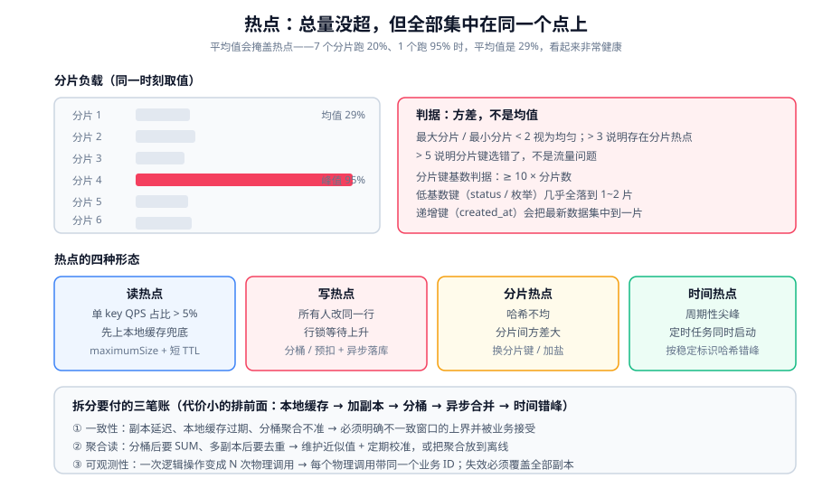

# 热点识别与拆分

上一页的排队假设「请求是均匀的」。本页处理相反的情况：**总量没超，但全部集中在同一个点上。**

::: tip 一句话理解
**过载的本质是「不均」，不是「总量」。** 一个系统完全可能出现「全局只用了 30% 容量，但某一个分片已经 100%」——此时加机器、加限流都不会有任何效果，唯一的出路是把那个点拆开。
:::

## 一、热点的四种形态

四类热点的成因、症状与手段完全不同，**先把形态判对**再谈手段。

| 形态 | 成因 | 典型症状 | 识别信号 |
| --- | --- | --- | --- |
| 读热点（热 key） | 某个 key 被极高频率读 | 单分片 CPU 高、整体命中率正常 | 单 key QPS 占总量 > 5% |
| 写热点（单行/单账户） | 所有人改同一行 | 行锁等待、`innodb_row_lock_time` 上升 | 单行更新 QPS 异常集中 |
| 分片热点（哈希不均） | 分片键选择不当或基数低 | 分片间 QPS 方差大 | 最大分片 QPS / 均值 > 2 |
| 时间热点（同时开始） | 定时任务、整点活动 | 周期性尖峰（每分钟/每小时） | 按分钟聚合后出现明显尖峰 |

## 二、怎么从「平均值」里发现热点

平均值会掩盖热点。一个分片系统里 8 个分片，7 个跑在 20% 而 1 个跑在 95%，平均值是 29%——**看起来非常健康**。



### 1. 先看「方差」，再看「均值」

判据只有一条：**分片间负载的方差**。

```shell
# 用一个分片负载方差的自检（以 Redis 为例，采集各节点 ops）
for node in $(redis-cli -p 7000 cluster nodes | awk '{print $2}' | cut -d@ -f1 | head -8); do
  host=${node%:*}; port=${node#*:}
  echo -n "$node  "
  redis-cli -h "$host" -p "$port" --no-raw info commandstats 2>/dev/null \
    | awk -F: '/cmdstat_get:/ {gsub(/,.*/,"",$2); print $2}' 
done | sort -k2 -n
# 期望：各节点的调用次数同量级（最大/最小 < 2）
# 判读：最大/最小 > 3 说明存在分片热点；> 5 说明分片键选错了
```

::: danger 三个让「方差检查」给出错误结论的坑
1. **只看瞬时值**：分片负载会随流量分布变化（某个租户活跃时会集中到一片）。必须在**同一时刻**对全部分片取值，并且看一段时间内的**最大方差**。
2. **把「连接数」当成「负载」**：长连接会让所有节点连接数接近，看不出任何差异。要看的是**命令数 / 带宽 / CPU**。
3. **对「热度」用平均值判断**：热 key 的判据是「**单 key 占总量比例**」，不是「平均值是否升高」。必须做 Top-N 排序。
:::

### 2. 探测手段对照

| 手段 | 位置 | 精度 | 对线上影响 | 适用阶段 |
| --- | --- | --- | --- | --- |
| 代理层采集 | 自研/商业代理 | 高（能看到每个 key） | 无 | 常态化 |
| 客户端采样 | 应用内埋点 | 中（采样率决定） | 无（采样） | 常态化 |
| 服务端采集 | `redis-cli --hotkeys` / `INFO` | 高（基于 LFU） | 低 | 排查期 |
| 命令回放 | `MONITOR` | 极高（全量） | **高（显著降吞吐）** | 仅限排查，禁止长期开 |

```shell
# 服务端采集：需要 LFU 淘汰策略才有效（maxmemory-policy allkeys-lfu）
redis-cli config set maxmemory-policy allkeys-lfu
redis-cli --hotkeys          # 输出最热的 key（可能耗时，建议在低峰跑）

# 客户端采样：不要「每个请求都记」，会自己变成热点
# 用固定间隔采样（如每 1000 次一次），把 key 与耗时写入本地环形缓冲
```

::: warning `MONITOR` 的三条纪律
1. **只在单节点、低峰、短时（< 30 s）使用**。全量回放会把命令计数、网络流量和 CPU 一起拉高。
2. **输出必须重定向到文件并限流**，否则 `redis-cli` 自己会吃掉大量内存。
3. **结果只用于定位，不作为容量依据**——采样期间系统行为已被改变。
:::

## 三、拆分的五种手段

按「代价从小到大」排序，**优先用代价小的**：

| 手段 | 机制 | 代价 | 适用形态 |
| --- | --- | --- | --- |
| ① 本地缓存兜底 | 把热数据放到进程内，绕过共享存储 | 一致性（需要失效机制） | 读热点 |
| ② 增加副本 | 读请求分散到多个副本 | 复制延迟、内存翻倍 | 读热点 |
| ③ 分桶 / 加盐 | 把 1 个 key 变成 N 个 key | 需要聚合读、失效要覆盖全部副本 | **写热点** |
| ④ 异步合并 | 把多次写合并成一次 | 最终一致、可能丢数据 | 计数类写 |
| ⑤ 时间错峰 | 把同时发生的任务打散 | 结果可见时间推迟 | 时间热点 |

### 读热点：先用本地缓存

```java
// Caffeine 本地兜底：把单 key 的读压力从共享层移走
Cache<String, HotItem> local = Caffeine.newBuilder()
        .maximumSize(10_000)              // ★ 必须有上限，防止热 key 把内存吃光
        .expireAfterWrite(Duration.ofSeconds(2))  // ★ 短 TTL，控制最大不一致窗口
        .build();
```

| 参数 | 为什么必须有 | 缺了会怎样 |
| --- | --- | --- |
| `maximumSize` | 限制本地缓存的内存占用 | 冷 key 涌入把堆吃满 |
| `expireAfterWrite` 短 TTL | 控制不一致窗口上界 | 数据改了本地读不到，且**不会自动恢复** |

**收益量级**：单进程本地缓存的吞吐是 Redis 的 100 倍以上、延迟低 2 个数量级。**只要一个 key 的 QPS 超过 1 万，本地缓存通常是收益最高的一步。**

### 写热点：把「一个点」变成「一串点」

写热点靠缓存解决不了，因为写必须落到同一个业务实体上。以「库存扣减」为例，三次演进：

```text
演进一（行锁）：
  UPDATE stock SET available = available - 1 WHERE sku_id = ? AND available >= 1;
  → 所有请求竞争同一行的写锁，QPS 上限 = 1 / 单次事务耗时
  → 实测：单行 200~800 TPS 就出现明显锁等待

演进二（分桶）：
  把 stock=100 拆成 10 桶，每桶 10
  UPDATE stock_bucket SET available = available - 1
   WHERE sku_id = ? AND bucket_id = FLOOR(RAND()*10) AND available >= 1;
  → 写分散到 10 行，理论 QPS × 10
  → 代价：某桶先空时会出现「总库存还有但该桶已空」→ 需要重试其它桶

演进三（预扣 + 异步落库）：
  Redis 原子扣减（DECR 或 Lua）作为唯一判定
  → 数据库只做最终落库，且允许合并（把 N 次扣减合并为一次）
  → 代价：Redis 与 DB 之间需要补偿与对账
```

::: danger 分桶方案的四个必须处理的问题
1. **桶必须先空**：`FLOOR(RAND()*10)` 会随机撞到一个空桶而失败。正确做法是「随机起点 + 顺序扫描」，或单独维护「哪些桶还有货」。
2. **总量必须能核对**：`SUM(各桶 available) = 总库存` 必须是一条可执行的校验 SQL，且**必须在压测后立即跑一次**。
3. **桶数会限制最大并发**：10 桶意味着最多约 10 倍的并发提升，不是无限。桶数要按目标 TPS 反推。
4. **分桶引入了新的不一致窗口**：读侧看到的「剩余库存」是各桶之和，需要额外一次聚合查询（或维护一个近似值）。
:::

### 哈希不均：分片键的选择

分片出现的「热点」常常不是流量造成的，而是**分片键本身基数太低**。

| 分片键 | 基数 | 结果 |
| --- | --- | --- |
| `tenant_id` | 中（几十~几千） | 大租户会把单分片打满 |
| `user_id` | 高 | 均匀 |
| `status`（枚举） | 极低 | **几乎全部落到 1~2 片** |
| `created_at`（按天） | 低且递增 | 最新一天全部集中到一片（写热点） |

**判据**：分片键的基数至少要 **10 倍于分片数**，且分布不能随时间单调集中。

### 时间热点：错峰

定时任务、整点活动、缓存预热都属这类。做法见[排队与削峰 · 时间分片](../QueueShaping/index.md)。

**一个补充判据**：错峰时**不要按任务编号取模**，要按**稳定标识哈希**——否则任务增删会改变分配规律，运维排查时找不到规律。

## 四、拆分的代价：三笔必须付的账

| 账 | 具体表现 | 缓解方式 |
| --- | --- | --- |
| 一致性 | 副本延迟、本地缓存过期、分桶聚合不准 | 明确不一致窗口上界；对「不可容忍不一致」的数据不做拆分 |
| 聚合读 | 分桶后读需 `SUM`，多副本后读需去重 | 维护近似值 + 定期校准；或把聚合放到离线 |
| 可观测性 | 一个逻辑操作变成 N 次物理调用 | 每个物理调用都带上同一个业务 ID，便于串联 |

::: warning 最容易被忽略的一笔：**失效必须覆盖全部副本**
拆成 N 份之后，「删缓存」变成了「删 N 个 key」。只删了一个（例如随机挑一个或删「主」的那一个）会得到一个极难排查的现象：**部分请求读到新值、部分读到旧值，比例约等于 1/N**。

正确做法有两种：
- **版本号寻址**：把版本号写进 key（`hot:{id}:v{version}`），旧版本自然过期，**不需要删**。
- **删除全部副本**：明确列出所有副本的 key 生成规则并逐个删。
:::

## 五、判据清单

| 编号 | 判据 | 怎么验证 |
| --- | --- | --- |
| `HS-A` | 热点的**形态**已被判定（读/写/分片/时间） | 能说出属于哪一种，且手段与之匹配 |
| `HS-B` | 分片间负载的最大/最小值比 < 2 | 同一时刻取全部分片的命令数或 CPU |
| `HS-C` | 有 Top-N 热点探测（不是只看平均值） | 探测配置或脚本存在，且输出 Top-N |
| `HS-D` | 本地缓存有 `maximumSize` 与短 TTL | 检查配置里的两个参数都非默认无限 |
| `HS-E` | 写热点已拆分，且 `SUM(拆分后) = 原总量` 可校验 | 跑一次校验 SQL/命令，输出相等 |
| `HS-F` | 分片键基数 ≥ 10 × 分片数 | 给出基数与分片数的估算 |
| `HS-G` | 拆分后的失效**覆盖全部副本**（或采用版本号寻址） | 单测：写一次后立刻读 N 个副本，全部是新值 |
| `HS-H` | 拆分引入的不一致窗口有明确上界并被业务接受 | 文档里给出窗口值（秒）与接受理由 |

## 六、验证方式

```shell
# 1) 验证分片无热点：取全部分片同一时刻的负载，算比值
# （以 Redis Cluster 为例，用 ops 作为负载代理）
for n in 7000 7001 7002 7003; do
  echo -n "node:$n  "
  redis-cli -p $n info stats | awk -F: '/instantaneous_ops_per_sec/ {print $2}' | tr -d '\r'
done
# 期望：最大/最小 < 2
# 判读：> 3 时用 --hotkeys 找出集中在这个分片上的 key

# 2) 验证写热点拆分后的总量守恒
# 压测前记录总库存，压测后核对（以分桶表为例）
mysql -e "SELECT SUM(available) AS total FROM stock_bucket WHERE sku_id = 1001;"
mysql -e "SELECT available FROM stock WHERE sku_id = 1001;"
# 期望：两个数字相等（若不相等，说明存在未回滚的失败路径）

# 3) 验证本地缓存的失效覆盖全部实例
# 改一次数据，然后连续打 10 次（会落到不同实例）
for i in $(seq 1 10); do curl -s http://localhost/api/item/1001 | jq -r '.version'; done | sort -u
# 期望：只输出一个新版本号（若出现两个版本号交替，说明有实例的本地缓存没被失效）

# 4) 验证「读热点」确实被本地缓存吸收
# 压测单 key，观察共享层（Redis）的 ops 是否反而下降
redis-cli info stats | grep instantaneous_ops_per_sec
# 期望：压测 QPS 上升的同时，Redis ops 不升甚至下降
```

::: danger 四个让「热点验证」得出错误结论的做法
1. **逐个分片串行取值**：串行取值之间有时间差，流量分布已经变了，算出的方差是假的噪声。必须**并行**取（`&` + `wait`，或一次 `cluster nodes` 批量）。
2. **用压测前的库存当基线而不做备份**：第 2 步要在**压测前**先 `SELECT` 存档，压测后对比同一时刻的快照，而不是「凭记忆」。
3. **第 3 步只打一次**：一次请求只会落到一个实例，无法暴露「部分实例未失效」。必须打多次（≥ 实例数 × 2），或直接用负载均衡的会话保持关闭。
4. **对「热点已解决」只看 QPS**：热点拆分常伴随「QPS 没涨但延迟降了」或「QPS 涨了但错误率也涨了（如撞空桶）」。**必须同时看错误率与延迟分位。**
:::

## 七、相关页面与下一篇

- 上一篇：[排队与削峰](../QueueShaping/index.md)
- 下一篇：[过载行为与有损服务](../OverloadBehavior/index.md)——当热点拆不动时，如何让系统「有损但不崩」。
- 相邻必读：[分布式缓存深入 · 热点与倾斜治理](../../DistributedCache/index.md)（缓存层视角）、[分库分表](../../../DB/Relational/Sharding/index.md)（分片键与扩容）、[电商系统设计 · 库存](../../Ecommerce/Inventory/index.md)（库存拆分的业务完整版）。

## 八、参考资料

- [Redis `--hotkeys` 与 LFU 淘汰策略官方文档](https://redis.io/docs/latest/develop/reference/eviction/)
- [Redis `MONITOR` 命令文档（含性能影响说明）](https://redis.io/docs/latest/commands/monitor/)
- [MySQL `InnoDB` 行锁与 `innodb_row_lock_time` 官方文档](https://dev.mysql.com/doc/refman/8.4/en/innodb-lock-waits.html)
- [Caffeine 官方文档（`maximumSize` / `expireAfterWrite`）](https://github.com/ben-manes/caffeine/wiki)
- [Apache ShardingSphere 官方文档（分片键与路由）](https://shardingsphere.apache.org/document/current/en/overview/)
