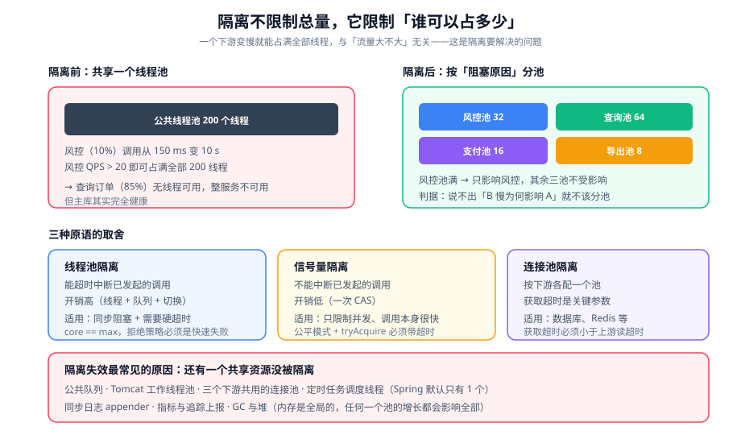

# 资源隔离与并发控制

前几页把「入口」和「热点」处理了。本页处理最隐蔽的一类过载来源：**一个慢下游把整个进程的资源吃光**——不是流量大，而是资源被独占。

::: tip 一句话理解
**隔离不限制总量，它限制「谁可以占多少」。** 限流回答「一共能进来多少」，隔离回答「一类请求最多能占走多少资源」——两者配合才完整：限流防总量超标，隔离防资源独占。
:::

## 一、为什么需要隔离：一个典型的失败形状

一个订单服务，同一个线程池处理三类请求：

| 请求类型 | 占比 | 依赖 | 正常耗时 |
| --- | --- | --- | --- |
| 查询订单 | 85% | 主库 | 20 ms |
| 导出订单 | 5% | 主库 + 对象存储 | 3 s |
| 调用风控 | 10% | 外部 HTTP 服务 | 150 ms |

当外部风控服务变慢（150 ms → 10 s）时：

```text
线程池 200 个线程
  → 风控调用占用线程时长从 150 ms 变成 10 s
  → 每秒占用线程数 = 风控 QPS × 10 s
  → 风控 QPS 只要 > 20，就能占满全部 200 个线程
  → 剩下的查询订单（85% 的正常流量）**没有线程可用**
  → 整个服务不可用，但主库其实完全健康
```

**根因不是风控慢，而是「风控慢」能影响到「查询订单」。** 这就是隔离要解决的问题。

## 二、隔离的三个维度



| 维度 | 按什么分资源 | 典型场景 | 粒度 |
| --- | --- | --- | --- |
| 按**下游**分 | 每个外部依赖一个池 | 风控、支付、短信、对象存储 | 最常用，收益最高 |
| 按**接口**分 | 每个接口（或接口组）一个池 | 核心写入 vs 查询 vs 导出 | 保护核心链路 |
| 按**租户/调用方**分 | 每个租户一个池 | SaaS 多租户 | 防「一个租户打满所有人」 |
| 按**优先级**分 | 高优 / 普通 / 低优三档 | 交易 vs 报表 | 保证高优不被低优挤掉 |

::: warning 维度的选择有一条硬判据
**被隔离的两种东西必须真的「独立」**——即它们造成阻塞的原因不同。把「查询订单」和「导出订单」分开是有意义的（导出可能因为对象存储慢而阻塞）；把「查询订单」和「查询用户」分开通常没意义（它们同时受主库影响）。

**判据**：如果你说不出「B 变慢时，为什么 A 会受 B 影响」，那这两个东西就不该分池。
:::

## 三、三种隔离原语的取舍

| 原语 | 阻塞方式 | 能否超时中断 | 单请求开销 | 适用 |
| --- | --- | --- | --- | --- |
| 线程池隔离 | 每类请求一个独立线程池 | **能** | 高（线程 + 队列 + 切换） | 同步阻塞调用、需要硬超时 |
| 信号量隔离 | 共享线程，用计数控制并发 | **不能**（只控制并发数） | 低（一次 CAS） | 非阻塞调用、调用快且不会永久阻塞 |
| 连接池隔离 | 每类请求一个连接池 | 能（获取超时） | 中 | 数据库、Redis 等有连接概念的依赖 |

**「能否超时中断」是最关键的一列**：信号量隔离在调用已经发起后无法把它拉回来——它只能保证「同时最多 N 个」，不能保证「每个都不超过 T 秒」。所以：

```text
需要「硬超时」 → 线程池隔离（或下游调用本身支持超时）
只需要「限制并发」 → 信号量隔离（更省资源）
```

### 线程池隔离的配置骨架

```java
// 按下游各配一个池：风控慢不影响到支付
@Configuration
public class IsolationConfig {

    @Bean("riskPool")
    public ThreadPoolExecutor riskPool() {
        return build("risk", 32, 256);
    }

    @Bean("paymentPool")
    public ThreadPoolExecutor paymentPool() {
        return build("payment", 16, 128);
    }

    private ThreadPoolExecutor build(String name, int threads, int queue) {
        ThreadPoolExecutor p = new ThreadPoolExecutor(
                threads, threads,
                0L, TimeUnit.MILLISECONDS,
                new ArrayBlockingQueue<>(queue),                  // ★ 有界
                new NamedThreadFactory("iso-" + name),
                new ThreadPoolExecutor.AbortPolicy());            // ★ 满了快速失败
        return p;
    }
}
```

| 参数 | 怎么定 | 定错的后果 |
| --- | --- | --- |
| `threads` | 目标 QPS × P95 耗时 × 1.5 | 太小 → 正常流量被拒；太大 → 失去隔离意义 |
| `queue` | 可接受等待时间 × 期望处理速率 | 无界 → 延迟失控（见[排队与削峰](../QueueShaping/index.md)） |
| 拒绝策略 | `AbortPolicy`（快速失败） | `CallerRunsPolicy` 会让**调用线程**去执行任务，等于把阻塞传染给上游 |

::: danger 四个会让线程池隔离「名义存在、实际失效」的配置
1. **`maximumPoolSize > corePoolSize`**：线程池的执行顺序是「核心满 → 入队 → 队列满 → 扩容 → 再满才拒绝」，扩容在队列满之后才发生。隔离池应当让两者相等。
2. **用了 `CallerRunsPolicy`**：池满时由**调用者线程**执行任务，于是「隔离」变成了「把阻塞传递给上游」——在最需要隔离的时候恰恰失效。
3. **线程没有名字**：出问题时 `jstack` 里全是 `pool-3-thread-7`，无法判断是哪个下游把线程吃掉了。**命名是隔离可观测性的前提。**
4. **线程池数量随下游增长而没有上限**：30 个下游 × 32 线程 = 960 个线程，光是上下文切换就会拖慢系统。经验上限：**单进程总线程数不超过 CPU 核数的 100 倍**，且每个池至少留 4 个线程。
:::

### 信号量隔离的正确用法

```java
@Component
public class SemaphoreIsolation {
    // 同一个下游最多 40 个并发（本地缓存，避免每请求一次远程调用）
    private final ConcurrentHashMap<String, Semaphore> gates = new ConcurrentHashMap<>();

    public <T> T call(String downstream, Callable<T> task) throws Exception {
        Semaphore s = gates.computeIfAbsent(downstream, k -> new Semaphore(40, true)); // ★ 公平模式
        if (!s.tryAcquire(20, TimeUnit.MILLISECONDS)) {       // ★ 等待有上限
            throw new BulkheadFullException(downstream);
        }
        try {
            return task.call();
        } finally {
            s.release();                                      // ★ 必须在 finally
        }
    }
}
```

::: danger 信号量隔离的三个易错点
1. **用了非公平模式**：非公平模式下，后来的请求可能不断插队，先到的请求长时间等不到令牌（饥饿）。**公平模式（`new Semaphore(n, true)`）**在过载时行为更可预测。
2. **`tryAcquire` 不带超时**：等价于无限等待，隔离退化成串行化。**必须给等待上限，且上限要远小于上游超时。**
3. **把 `Semaphore` 当「QPS 限制」用**：它限制的是**并发数**，不是速率。一次处理 200 ms、许可 40，实际通过速率约 200 QPS——与你想设的 QPS 可能差很远。
:::

## 四、隔离为什么会「看起来配了但没生效」

这是本页最重要的一节。**隔离失效几乎总是因为「还有一个共享资源没被隔离」**：

| 共享资源 | 为什么它破坏隔离 | 怎么发现 |
| --- | --- | --- |
| 线程池的**公共队列** | 多池共用队列时池大小形同虚设 | 检查队列是不是每个池独立 `new` 的 |
| Tomcat/Jetty 的**工作线程池** | 隔离在业务层，但请求还没进业务层就已经占用了 Web 线程 | 看 `tomcat_threads_busy_threads` 是否被占满 |
| 连接池 | 三个下游共用一个连接池时，池满会互相影响 | 看每个下游是否有独立数据源/池 |
| 公共的**定时器 / 调度线程** | 所有 `@Scheduled` 默认共用 1 个线程，一个慢任务会推迟所有任务 | 看调度线程池配置（Spring 默认 `poolSize=1`） |
| 公共的**日志 appender** | 慢磁盘会让同步日志把线程堵住 | 看是否用了同步 `FileAppender` |
| 公共的**指标/追踪上报** | 上报阻塞会拖慢业务线程 | 看上报是否异步、是否有队列上限 |
| GC / 堆 | 内存是全局的，任何一个池的内存增长会影响所有池 | 看各池相关的对象分配速率 |

::: danger 一个特别隐蔽的例子：Spring 的调度线程池默认只有 1 个线程
```java
// 默认：@Scheduled 全部共用一个线程，一个慢任务推迟所有其它任务
// 正确写法：显式配置线程池
@Configuration
@EnableScheduling
public class ScheduleConfig implements SchedulingConfigurer {
    @Override
    public void configureTasks(ScheduledTaskRegistrar registrar) {
        ThreadPoolTaskScheduler s = new ThreadPoolTaskScheduler();
        s.setPoolSize(8);                       // ★ 按任务数与耗时定
        s.setThreadNamePrefix("sched-");
        s.setWaitForTasksToCompleteOnShutdown(true);
        s.initialize();
        registrar.setTaskScheduler(s);
    }
}
```
**验证方式**：在同一个应用里放两个 `@Scheduled(fixedDelay = 1000)`，其中一个 `Thread.sleep(3000)`。如果另一个任务的执行间隔也变成了 3 秒以上，说明它们共用了线程。
:::

## 五、隔离参数怎么定

给出一个可复用的推法。

```text
已知目标：
  风控调用 QPS 目标 = 300
  P95 耗时 = 150 ms（正常），最长可接受 = 3 s
  可接受的最大排队等待 = 200 ms

① 并发上限 = QPS × P95 耗时 × 1.5 = 300 × 0.15 × 1.5 = 67.5 → 取 64
② 队列容量 = 可接受等待 × 期望处理速率 = 0.2 s × (64 / 0.15) ≈ 85 → 取 64
③ 线程数 = 并发上限（线程池隔离时相等）= 64
④ 单次调用超时 = min(下游承诺, 可接受等待 + P99 耗时) = min(3 s, 0.2 + 0.5) = 700 ms
⑤ 熔断阈值 = 50%，最小样本 20，openDuration 10 s
```

**校验方式**：把这五个数写成一行注释贴在配置旁边，任何一个数变化时都重新算一遍。

| 数值 | 若配错 | 现象 |
| --- | --- | --- |
| 并发上限偏小 | 正常流量被拒 | 池相关的拒绝计数 > 0，但下游健康 |
| 并发上限偏大 | 隔离失效 | 单下游变慢时其它接口一起变慢 |
| 队列偏大 | 延迟失控 | 请求耗时远大于 P95，且随队列长度上升 |
| 超时偏大 | 池被长期占用 | 活跃线程数长期贴近上限 |

## 六、虚拟线程改变了什么、没改变什么

Java 21 引入的虚拟线程（[JEP 444](https://openjdk.org/jeps/444)）与 JDK 25 的持续演进，让「一个请求一个线程」的成本大幅下降。但它**不是隔离的替代品**：

| 问题 | 虚拟线程能解决吗 | 说明 |
| --- | --- | --- |
| 线程昂贵（1 MB 栈、创建慢） | **能** | 虚拟线程栈按需增长，可创建百万级 |
| 一个下游占满线程池 | **不能** | 占用的是「有限的下游容量」，不是线程数 |
| 需要给下游设硬超时 | **部分能** | 阻塞点必须可被虚拟线程正确挂起（阻塞 IO、`LockSupport`）；`synchronized` 块内或 JNI 调用会**钉住**载体线程 |
| 限制「一类请求最多 N 个并发」 | **不能** | 仍然需要信号量/限流器，虚拟线程只是让「等待」更便宜 |

::: warning 使用虚拟线程时最容易踩的两个坑
1. **在 `synchronized` 块里做阻塞 IO**：会造成 carrier 线程被 pin（钉住），吞吐反而下降。用 `ReentrantLock` 替代 `synchronized`（`ReentrantLock` 会让虚拟线程正确挂起）。
2. **以为「线程便宜」=「可以无限并发」**：并发上限由**下游容量**决定，与线程成本无关。把并发从 200 提到 20000 只会更快地把下游打挂。

**正确的组合**：虚拟线程承载「便宜的等待」，限流器/信号量承载「真正的容量边界」，两者互补而不是替代。
:::

## 七、判据清单

| 编号 | 判据 | 怎么验证 |
| --- | --- | --- |
| `IS-A` | 每个「独立阻塞原因」的外部依赖有独立资源池 | 逐依赖列出池，且能说明「为什么它需要独立」 |
| `IS-B` | 隔离池的核心数 = 最大数 | 读配置，两个值相等 |
| `IS-C` | 拒绝策略是快速失败（非 `CallerRunsPolicy`） | 读配置 |
| `IS-D` | 线程有业务可辨识的命名 | `jstack` 输出里能看到 `iso-<下游名>` |
| `IS-E` | 所有隔离池的队列都是有界的，容量由算式反推 | 页面/配置里能给出算式 |
| `IS-F` | 单进程隔离池总线程数有上限且不超过 100 × CPU | 统计各池线程数求和 |
| `IS-G` | 公共资源（调度线程池、日志、上报）不构成隐藏的共享瓶颈 | 调度池已显式配置；日志为异步或本地磁盘足够快 |
| `IS-H` | 隔离生效性被验证过：单下游变慢时其它接口耗时不变 | 用故障注入（延迟）做一次对照实验 |

## 八、验证方式

```shell
# 1) 验证隔离生效：给一个下游注入延迟，观察其它接口的 P95
# 注入前
curl -s 'http://localhost:9090/api/v1/query?query=histogram_quantile(0.95,sum(rate(http_server_requests_seconds_bucket{uri="/api/query"}[1m]))by(le))' | jq -r '.data.result[0].value[1]'
# 给 /api/risk 的下游注入 5 秒延迟（用 toxiproxy / Chaos Mesh）
# 注入后再次查询上面的 P95
# 期望：/api/query 的 P95 变化 < 20%；若显著上升，说明隔离没生效（去找共享队列或共享连接池）

# 2) 验证线程命名与占用分布
jstack <pid> | grep '^"' | awk -F'"' '{print $2}' | sed 's/-[0-9]*$//' | sort | uniq -c | sort -rn
# 期望：能看到 iso-risk-* / iso-payment-* 这样的分组，且没有一组接近其上限

# 3) 验证调度线程池已隔离
# 在同一个应用里放两个 @Scheduled，一个 sleep 3 s、一个 1 s
# 期望：fast 任务的执行间隔稳定在 ~1 s；若被拖到 3 s，说明共用单线程

# 4) 验证虚拟线程没有被 pin（若使用虚拟线程）
# 开启 -Djdk.tracePinnedThreads=short（或 full）后运行压测
# 期望：输出里没有 PINNED 记录；若有，定位到 synchronized 或原生调用并替换
java -Djdk.tracePinnedThreads=short -jar app.jar
```

::: danger 四个让隔离验证得出错误结论的做法
1. **注入的延迟太短**：注入 500 ms、P95 本来 300 ms，看不出差别。**注入值应比该下游的 P95 大一个数量级**（如 5 s）。
2. **只看平均值**：隔离失效时，受影响接口的表现是「一部分请求极慢」而不是「整体变慢」。**必须看 P95/P99。**
3. **在同一个进程里做注入与观测**：注入工具本身会占用资源。用独立进程（toxiproxy 容器）注入。
4. **第 4 步不区分「pin 了」和「pin 了一下」**：偶发的短 pin 可以接受；要关注的是**长时间 pin**（单次 > 10 ms 且频繁）。先记录再判断，不要一看到 PINNED 就改代码。
:::

## 九、相关页面与下一篇

- 上一篇：[过载行为与有损服务](../OverloadBehavior/index.md)
- 下一篇：[实战：写接口的过载治理](../Practice/index.md)——把前七页的判据在一套完整设计里落地。
- 相邻必读：[熔断限流与降级](../../Microservices/CircuitBreaker/index.md)（隔离库的用法）、[响应式编程](../../ReactiveProgramming/index.md)（非阻塞链路下的并发控制）、[容器编排进阶](../../../Ops/ContainerOrchestration/index.md)（资源限额与实例级隔离）。

## 十、参考资料

- [JEP 444：Virtual Threads](https://openjdk.org/jeps/444)
- [Java `ThreadPoolExecutor` 官方文档（队列与拒绝策略语义）](https://docs.oracle.com/en/java/javase/25/docs/api/java.base/java/util/concurrent/ThreadPoolExecutor.html)
- [Resilience4j `Bulkhead` 官方文档（信号量与线程池两种形态）](https://resilience4j.readme.io/docs/bulkhead)
- [Spring Framework 官方文档：`@EnableScheduling` 与 `TaskScheduler` 配置](https://docs.spring.io/spring-framework/reference/integration/scheduling.html)
- [HikariCP 配置指南（每依赖独立池的理由）](https://github.com/brettwooldridge/HikariCP#gear-configuration-knobs-babysitting)
