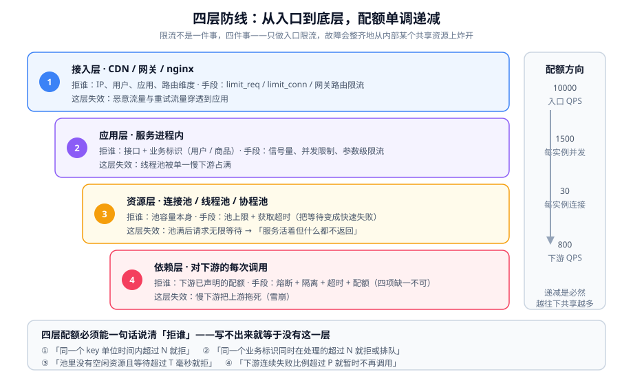

# 分层防御与预算分配

上一页说「降级必须有序」。本页把这件事落成一张**可以分配的预算表**：四层防线各拒谁、每层留多少余量、层与层之间的数字怎么互推。

::: tip 一句话理解
**限流不是一件事，四件事。** 只做入口限流的系统，过载时会整齐地从内部某一个共享资源上炸开——因为入口限流管的是「总量」，而瓶颈永远在「某个具体的地方」。
:::

## 一、为什么要分四层

先看一个真实形状的故障。一个 API 网关做了入口限流（10000 QPS），应用有 8 个实例，每个实例配了 20 个数据库连接。

- 入口总量确实被限到了 10000 QPS。
- 但某个慢 SQL 让单条查询从 5 ms 变成 200 ms，于是单实例的 20 个连接被占满。
- 连接池打满后，应用线程开始等连接 → Tomcat 线程池（默认 200）被占满。
- 新的请求进来时，网关看到的是「应用还活着」（TCP 连得上），于是**继续放行**。
- 全部线程在等数据库连接，数据库那边被 160 个连接轮着压，慢 SQL 更慢。

结果：入口限流形同虚设，系统在整个线程池上炸开，且**没有任何一层能提前拒绝**。

**问题不在「入口限流做错了」，而在于「只有一层」。**

## 二、四层防线的职责



| 层 | 位置 | 拒谁的依据 | 典型手段 | 这层失效的表现 |
| --- | --- | --- | --- | --- |
| ① 接入层 | CDN / 网关 / nginx | IP、用户、应用、路由维度 | `limit_req` / `limit_conn`、网关路由限流 | 恶意流量与重试流量穿透到应用 |
| ② 应用层 | 服务进程内 | 接口 + 业务标识（用户/商品） | 信号量、并发限制、参数级限流 | 线程池被单一慢下游占满 |
| ③ 资源层 | 连接池 / 线程池 / 协程池 | 该资源的**池容量** | 池大小上限 + 获取超时 | 池满后请求无限等待 |
| ④ 依赖层 | 对下游的每次调用 | 下游已声明的配额 | 熔断 + 隔离 + 超时 + 配额 | 慢下游把上游拖死（雪崩） |

::: warning 四层不是「越多越好」
每层都有成本：多一次拒绝路径、多一个可能配错的参数、多一处需要观测的位置。**低水位线的系统只该做 ①；水位线越高，层数才越多。**
:::

### 每层的「拒谁」必须能一句话说清

| 层 | 一句话判据（写进文档，不许含糊） |
| --- | --- |
| ① | 「**同一个 key** 在单位时间内的请求数超过 N 就拒」 |
| ② | 「**同一个业务标识** 同时在处理的请求数超过 N 就拒或排队」 |
| ③ | 「**池里没有空闲资源**，且等待超过 T 毫秒就拒」 |
| ④ | 「**下游连续失败比例** 超过 P 就暂时不再调用它」 |

如果这四句里有任何一句写不出来（例如「根据系统压力动态决定」），那一层就等于没有——因为它无法被验证。

## 三、预算分配：把入口配额分到每一层

这是本页的核心方法。预算的方向是**从入口往下分**，而校验的方向是**从下往上**。

### 1. 先定入口总配额

```text
入口配额 = min(所有实例的容量之和, 所有共享资源的容量之和) × 安全系数
```

- **安全系数取 0.7~0.8**，理由不是「保守」，而是「单实例容量是会衰减的」：GC 停顿、邻居干扰、依赖抖动都会让某几个实例暂时变弱，配额必须留出这种偏差。
- 「所有共享资源的容量之和」里最小的一项，才是真上限。**共享资源清单**（逐项确认）：

| 共享资源 | 怎么算它的容量上限 | 一处常见错误 |
| --- | --- | --- |
| 数据库 | `max_connections` ÷ 单实例池大小 = 能挂的实例数上限 | 只算「够不够」，不算「够几个实例」 |
| 缓存 | 分片数 × 单分片带宽 | 只看总带宽，忽略热 key 集中到一片 |
| 下游接口 | 对方给出的配额（QPS / 并发） | 把别人的配额当成「建议值」 |
| 消息队列 | 单分区写入上限 × 分区数 | 分区数写死了不扩容 |
| 带宽 | 出口带宽 ÷ 平均响应体大小 | 忘算压缩与峰值包大小 |

### 2. 再按「层」拆，且每层留余量

一个可复用的分配骨架（示例数字，按自己的实测替换）：

| 层 | 配额 | 依据 | 余量留给谁 |
| --- | --- | --- | --- |
| ① 接入层 | 10000 QPS | 入口总配额 | 留给突发（burst 排队） |
| ② 应用层 | 每个实例 1500 并发 | 单实例压测 2000 并发 × 0.75 | 留给同实例内的其他接口 |
| ③ 资源层 | 每实例 20 连接 | 数据库 200 `max_connections` ÷ 8 实例 × 0.8 | 留给运维与批处理连接 |
| ④ 依赖层 | 下游配额 800 QPS | 对方给的 1000 × 0.8 | 留给对方自身的其他调用方 |

::: danger 预算分配最常见的三个错误
1. **每层都用「总配额」**：入口 10000、应用层每实例也配 10000——那么单个实例被打满时，其余 7 个还在正常，网关仍然放行，故障被限制在一个实例上，「均匀退化」变成「局部黑洞」。
2. **各层配额相等而不是递减**：正确的形状是**从上到下递减的漏斗**，因为越往下共享得越厉害。相等意味着下层会先满。
3. **留了余量但没人知道留给谁**：余量必须写明用途（突发 / 其他接口 / 运维通道），否则它会在第一次「临时放宽」里被吃掉，且永远不会恢复。
:::

### 3. 从下往上校验：一条可执行的检查

```shell
# 逐层把实际值与配额并排打印，任何一层超过 80% 都要有解释
cat <<'EOF' > /tmp/budget-check.sh
#!/usr/bin/env bash
set -euo pipefail
PROM=${PROM:-http://localhost:9090}
q() { curl -s "$PROM/api/v1/query" --data-urlencode "query=$1" | jq -r '.data.result[0].value[1] // "n/a"'; }

echo "① 入口 QPS        : $(q 'sum(rate(nginx_http_requests_total[1m]))')"
echo "② 单实例并发      : $(q 'max(tomcat_threads_busy_threads)')"
echo "③ 数据库池使用率  : $(q 'max(hikaricp_connections_active) / max(hikaricp_connections_max)')"
echo "④ 下游调用 QPS    : $(q 'sum(rate(http_client_requests_seconds_count[1m]))')"
EOF
bash /tmp/budget-check.sh
```

**期望输出**：四行具体数字，且 `③` 的比值应低于 `②` 的比值（因为资源层共享度更高、更该留余量）。
**判读**：如果 `③` 已经接近 1 而 `②` 才 0.5，说明瓶颈早就下沉到资源层，此时**加应用层的并发限制没有意义**——要做的是给连接池加**获取超时**（见[资源隔离与并发控制](../Isolation/index.md)）。

## 四、各层的最小可用配置

### ① 接入层：nginx 漏桶

nginx 的 `limit_req` 用的是**漏桶**算法。三个必须理解的点：

```nginx
# /etc/nginx/conf.d/limit.conf
limit_req_zone $binary_remote_addr zone=perip:10m rate=10r/s;
limit_req_zone $server_name        zone=perserver:10m rate=2000r/s;

server {
    location /api/ {
        # 每 IP 10 r/s，突发排队 5 个，超出的立即拒绝（nodelay）
        limit_req zone=perip burst=5 nodelay;
        # 全站 2000 r/s，突发排队 20 个，超出的延迟处理
        limit_req zone=perserver burst=20;
        # 拒绝时返回 429 而不是默认的 503
        limit_req_status 429;
        proxy_pass http://backend;
    }
}
```

| 参数 | 真实含义 | 配错的后果 |
| --- | --- | --- |
| `rate=10r/s` | 漏桶**出水的速率**（平均速率） | 写成 `10r/m` 会限到每分钟 10 次 |
| `burst=5` | **排队容量**，不是额外放行数 | 以为它放宽了 5 个名额，实际是「多 5 个可以等」 |
| `nodelay` | 突发请求立刻处理，不排队 | 不加时突发请求被延迟处理 → 客户端超时 |
| `delay=N`（1.15.7+） | 允许 N 个立即处理，其余延迟 | 与 `nodelay` 互斥，同时写会冲突 |
| `limit_req_status 429` | 拒绝时返回的状态码 | 默认 **503** 会让客户端以为「服务挂了」而触发重试 |
| `zone=perip:10m` | 共享内存大小 | 10 MB ≈ 16k（32 位）或 8k（64 位）状态；**用满时按 LRU 淘汰**，不是拒绝 |

::: tip 上线前先 dry run
nginx 自 1.17.1 起支持 `limit_req_dry_run on`：只记账不拒绝，并用 `$limit_req_status` 观察会命中多少。用日志统计一下再决定阈值，可以把「限流把正常用户挡了」这类事故提前消掉。

```shell
# 先 dry run 一天，再看有多少请求会被拒
awk '/REJECTED_DRY_RUN/ {c++} END {print "would be rejected:", c+0}' /var/log/nginx/access.log
```
:::

### ② 应用层：按业务标识限制并发

应用层能看见 nginx 看不见的东西（用户 ID、商品 ID、方法名），因此它的维度更细。

```java
// 每个商品同时只允许 N 个在处理的请求：区间内排队，超时后拒绝
@Component
public class PerSkuLimiter {
    private final ConcurrentHashMap<String, Semaphore> gates = new ConcurrentHashMap<>();
    private static final int PERMITS = 8;          // 单 SKU 并发上限
    private static final long WAIT_MS = 50;        // 等待上限，超过就快速失败

    public boolean tryAcquire(String skuId) throws InterruptedException {
        Semaphore s = gates.computeIfAbsent(skuId, k -> new Semaphore(PERMITS));
        return s.tryAcquire(WAIT_MS, TimeUnit.MILLISECONDS);
    }

    public void release(String skuId) {
        Semaphore s = gates.get(skuId);
        if (s != null) s.release();
    }
}
```

::: danger 这段「看起来没问题」的代码有四个坑
1. **`gates` 会无限增长**：每个访问过的 SKU 都留一个 `Semaphore` 永不释放。必须加上限与过期淘汰（用 Caffeine 的 `maximumSize` + `expireAfterAccess`）。
2. **等待 50 ms 后返回 `false`** 是恢复的关键：如果改成 `s.acquire()`（无限等待），那么超时时间就等于「上游客户端的超时时间」，你只是把失败从应用挪到了客户端，且线程仍在占用。
3. **`release` 必须放在 `finally`**，否则任何异常都会永久吃掉一个令牌，最终该 SKU 再也无法服务。
4. **并发上限不等于 QPS 上限**：如果单次处理 200 ms，8 个并发约等于 40 QPS。要按 QPS 限流请用令牌桶，不要用信号量。
:::

### ③ 资源层：给「等待」加一个上限

资源层最容易被漏掉的配置是**获取超时**。池打满时，默认行为是**无限等待**——这正是「系统还活着但什么都不返回」的成因。

```yaml
# Spring Boot 4.x 数据源配置（HikariCP）
spring:
  datasource:
    hikari:
      maximum-pool-size: 20
      minimum-idle: 20
      connection-timeout: 300        # 毫秒；获取连接最多等 300 ms，超时抛异常
      validation-timeout: 200        # 校验连接可用性的上限
      max-lifetime: 1740000          # 必须小于数据库的 wait_timeout
      leak-detection-threshold: 5000 # 超过 5 s 没归还就打日志（定位泄漏）
```

| 参数 | 为什么必须有 | 缺了会发生什么 |
| --- | --- | --- |
| `connection-timeout` | 把「无限等待」变成「快速失败」 | 线程全部堵在获取连接上，线程池耗尽 |
| `max-lifetime` | 避免使用被数据库单方断开的连接 | 偶发 `Communications link failure` |
| `leak-detection-threshold` | 连接泄漏的唯一低成本发现手段 | 池逐渐被泄漏的连接占满，重启才恢复 |

**判据**：`connection-timeout` 必须**明显小于**上游的读超时。若上游 3 s 超时、这里等 5 s，那么上游永远看不到你的失败原因，只会看到自己的超时。

### ④ 依赖层：熔断 + 隔离 + 超时必须成套

```text
一次下游调用需要四个参数，缺一不可：

  connect_timeout   = 100 ms      连接都建不起来，说明网络或对端已死
  read_timeout      = 500 ms      连上了但不回，说明对端在排队或慢查询
  隔离（并发上限）  = 20          同一个下游最多占用我 20 个并发
  熔断阈值          = 50% / 20 次 连续失败达阈值就暂时不再调用
```

::: warning 只配超时不配隔离，等于没配
超时保护的是「单次调用不会占着线程太久」，隔离保护的是「这个下游不会占走我的全部线程」。**只配超时**时，1000 个线程同时发起 500 ms 超时的调用，每个都合法，但 1000 个线程全被占——总耗时仍是 500 ms，只是失败的规模从 20 变成了 1000。
:::

## 五、三层预算的数字怎么互推

给定入口配额，反推每层的参数（一套可直接套用的推法）：

```text
已知：入口 10000 QPS，实例 8 台，单请求平均耗时 100 ms（含下游）
① 每实例 QPS = 10000 / 8 = 1250
② 每实例所需并发 = QPS × 平均耗时 = 1250 × 0.1 = 125
   → 线程池下限 125；配 200 时余量 60%（给瞬时抖动）
③ 每实例数据库连接：单请求平均占用连接 20 ms
   → 所需连接 = 1250 × 0.02 = 25 → 配 20 会排队，配 30 有余量
   → 数据库 max_connections 至少 8 × 30 + 20(运维) = 260
④ 下游调用：若单请求平均调用下游 2 次
   → 下游 QPS = 10000 × 2 = 20000；若对方只给 8000，则必须在此处做缓存或批量化
```

**这套推法的价值在于它会暴露矛盾**：上面第 ④ 步立刻显示「下游配额不够」，这正是必须在设计阶段就做缓存或聚合的原因——而不是等上线后靠熔断兜。

## 六、判据清单

| 编号 | 判据 | 怎么验证 |
| --- | --- | --- |
| `LD-A` | 四层防线的「拒谁」都有一句话定义 | 四句话能被人复述，无「动态决定」 |
| `LD-B` | 入口配额 ≤ 最小共享资源的容量 × 0.8 | 写一遍共享资源清单表，取最小值 |
| `LD-C` | 四层配额呈**从上到下递减** | 打印四层配额，检查单调性 |
| `LD-D` | 每层余量都写明了「留给谁」 | 余量列非空 |
| `LD-E` | 资源层配了获取超时，且 < 上游读超时 | 比对两个配置值 |
| `LD-F` | 依赖层四项参数（连接/读/隔离/熔断）齐全 | 逐项在配置里 `grep` 到 |
| `LD-G` | 限流拒绝码是 `429` 而不是 `503` | `curl -i` 触发一次限流看状态码 |
| `LD-H` | 每层的命中率都可观测 | 四层各有一个「被拒」计数器 |

## 七、验证方式

```shell
# 1) 校验分层配额递减（把四层的配置值打出来比对）
grep -R "rate=" /etc/nginx/conf.d/limit.conf
grep -R "maximum-pool-size\|connection-timeout" src/main/resources/application.yml
# 期望：接入层 > 应用层 > 资源层 > 依赖层，逐层递减且每层都有余量注释

# 2) 验证限流返回的是 429 而不是 503
seq 1 50 | xargs -P 50 -I{} curl -s -o /dev/null -w "%{http_code}\n" http://localhost/api/ping | sort | uniq -c
# 期望：输出里同时有 200 与 429，且没有 503

# 3) 验证资源层的获取超时真的生效（把连接池打满后观察失败形态）
# 用 40 个并发打一个持有连接 2 s 的接口，池大小 20、connection-timeout 300ms
# 期望：约一半请求在 ~300 ms 后失败（而不是 2 s），日志里出现获取连接超时

# 4) 验证依赖层隔离生效（把下游打慢，观察上游线程是否被占满）
# 期望：被占用的线程数 ≤ 隔离上限；其余请求快速失败而不是一起变慢
```

::: danger 让上面四条验证全部失效的写法
1. **用 `curl` 串行发 50 次测限流**：串行发送的间隔远大于 `rate`，永远不会触发限流，看到清一色 200。必须并发（`-P` 或 `xargs -P`）。
2. **在 `location` 里写了多条 `limit_req` 但只有一条生效**：nginx 的 `limit_req` 指令在**同一层级**会叠加生效，但**子层级会覆盖父层级**（除非子层没写）。验证时把 `conf` 里所有 `limit_req` 都数一遍。
3. **以为 `burst` 会自动放大阈值**：见上表——`burst` 是排队容量，用 `nodelay` 才会立即处理，不用它就变成「延迟」。
4. **在测试机器上同时跑压测机与目标机**：资源层与依赖层的观测值会被污染，第四步验证的结论不可信。
:::

## 八、相关页面与下一篇

- 上一篇：[总览：高并发的四条边界](../Overview/index.md)
- 下一篇：[限流：算法与分布式实现](../RateLimit/index.md)——第 ① 层到底该用哪种算法。
- 相邻必读：[网关深入 · 流量治理](../../GatewayDeep/TrafficManagement/index.md)（配置写法）、[性能与容量工程 · 容量规划](../../../Ops/PerformanceEngineering/Capacity/index.md)（水位线）。

## 九、参考资料

- [nginx `ngx_http_limit_req_module`（`burst` / `nodelay` / `delay` / `dry_run`）](https://nginx.org/en/docs/http/ngx_http_limit_req_module.html)
- [nginx `ngx_http_limit_conn_module`（并发连接限制）](https://nginx.org/en/docs/http/ngx_http_limit_conn_module.html)
- [HikariCP 官方配置说明（`connection-timeout` / `max-lifetime`）](https://github.com/brettwooldridge/HikariCP#gear-configuration-knobs-babysitting)
- [RFC 6585 · `429 Too Many Requests`](https://www.rfc-editor.org/rfc/rfc6585)
- [Resilience4j 官方文档（Bulkhead / RateLimiter / TimeLimiter）](https://resilience4j.readme.io/docs)
