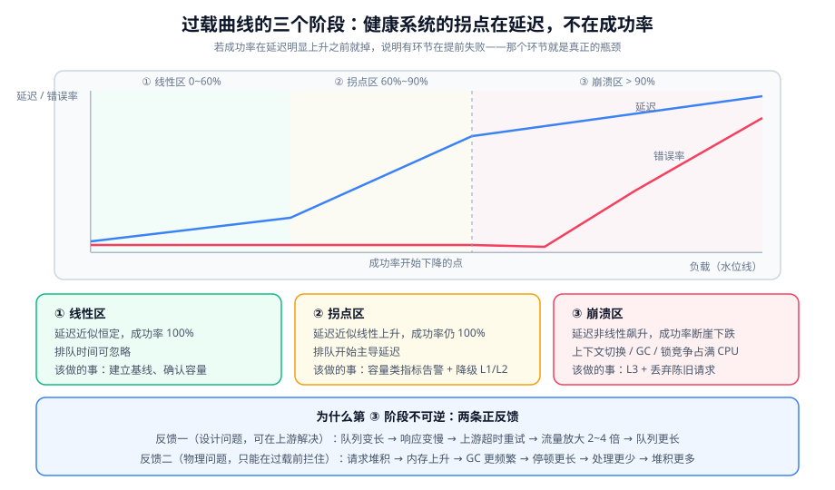

# 过载行为与有损服务

前三页讲的是「怎么不进入过载」。本页讲**进入过载之后**：系统的表现应该长什么样、怎么保证它一定会恢复。

::: tip 一句话理解
**健康系统的过载曲线是「延迟上升、成功率不降」；病态系统的过载曲线是「成功率断崖式下跌」。** 前者的用户还能用（只是慢），后者的用户完全不可用。设计目标就是把右图变成左图。
:::

## 一、过载曲线的三个阶段



| 阶段 | 负载区间 | 延迟 | 成功率 | 系统状态 |
| --- | --- | --- | --- | --- |
| ① 线性区 | 0 ~ 60% 水位 | 近似恒定 | 100% | 排队时间可忽略 |
| ② 拐点区 | 60% ~ 90% | 近似线性上升 | 100%（可能已有少量超时） | 排队开始主导延迟 |
| ③ 崩溃区 | > 90% ~ 100% | 非线性飙升 | **断崖下跌** | 上下文切换、GC、锁竞争占满 CPU |

**核心判据：健康系统的拐点在「延迟开始明显上升」处，且**成功率维持到拐点之后**。** 如果成功率在拐点之前就开始掉，说明有某个环节在提前拒绝或提前失败（通常是连接池超时或下游熔断），**那个环节就是真正的瓶颈**。

### 为什么第 ③ 阶段不可逆

进入崩溃区后，系统会出现**正反馈**，把「慢」变成「崩」：

```text
到达率超容量
  → 请求排队，响应时间变长
  → 上游/客户端超时，开始重试        ← 放大 2~3 倍流量
  → 更多请求涌入，队列更长
  → 响应时间继续变长，超时更多
  → 重试更多                          ← 正反馈成立

同时另一条正反馈：
  请求堆积 → 内存占用上升 → GC 更频繁
  → 每次 GC 停顿更长 → 每秒处理的请求更少
  → 堆积更多                          ← 第二条正反馈
```

**两条正反馈里，第一条（重试风暴）是设计问题，可以在上游解决；第二条（GC）是物理问题，只能在过载前拦住。**

::: danger 三个让正反馈正式成立的配置错误
1. **重试没有退避**：`Retry: 3 次，间隔 0` 会把 1 份流量变成 4 份，且是**同时**发出——这是重试风暴的标准配方。正确做法：指数退避 + 抖动 + 重试预算。
2. **超时设得比下游处理时间还长**：客户端等 10 s、下游 12 s 才出结果，于是客户端超时后重试，下游同时处理两份。**超时必须小于下游能承受的排队上限。**
3. **熔断器「半开」探测放行太多请求**：半开状态下如果一次放行全部请求，等于没有熔断。半开只应放行**极少量**（如 1~5 个）用于探测。
:::

## 二、快速失败 vs 超时

这两个词经常被当成同义词，但它们的**时间行为**完全不同，而时间行为决定了是否会触发重试风暴。

| 维度 | 快速失败 | 超时 |
| --- | --- | --- |
| 返回耗时 | ~0（立即） | 等于超时阈值（如 3 s） |
| 上游能否区分 | 能（明确错误码） | 不能（只知道「没结果」） |
| 触发重试倾向 | 低（`429` 会退避） | **高**（客户端不确定是否已生效） |
| 资源占用 | 无 | 一个线程/连接被占用整个超时周期 |
| 正确用法 | 已判定「现在不该做」 | 已判定「这次调用出问题了」 |

::: tip 一条实用的替换顺序
把「超时」尽可能换成「快速失败」，顺序是：

1. **先判配额**（限流）→ 超出立刻 `429`，不进业务逻辑。
2. **再判并发**（隔离）→ 达到并发上限立刻 `503`/`429`，不排队。
3. **最后才靠超时**兜底不可预期的慢（下游故障、网络异常）。

**如果一次故障中 90% 的失败都是「超时」而不是「快速失败」，说明前两步缺席了。**
:::

## 三、不能等，但可以降级

「有损服务」的核心思想是：**在过载时返回一个质量更低但仍然可用的结果，而不是错误。**

三类典型的降级：

| 降级类型 | 原行为 | 降级行为 | 用户感知 |
| --- | --- | --- | --- |
| 数据精度降级 | 实时精确计数 | 返回近似值 / 缓存值 | 「数字略旧」 |
| 功能降级 | 返回完整结果（含推荐、评论） | 只返回主内容 | 「少了几块」 |
| 粒度降级 | 分页返回全部字段 | 只返回列表页需要的字段 | 「详情要点进去」 |
| 一致性降级 | 强一致读主库 | 读从库 / 读缓存 | 「刚改的没立刻看到」 |

::: warning 降级必须满足两个条件，否则不该做
1. **降级后的结果对业务仍然成立**：例如「库存显示 999+」比「库存显示 3 但实际上 0」安全得多——前者是保守近似，后者是错误。
2. **降级是显式的、可观测的**：必须打点（降级次数、降级原因），否则你会得到一个「一直静默降级、永远没人发现」的系统。
:::

### 降级分级：四级台阶

| 级别 | 触发条件（示例） | 降什么 | 恢复条件 |
| --- | --- | --- | --- |
| `L0` | 水位 < 60% | 无 | — |
| `L1` | 水位 60%~80% 持续 1 min | 关闭非核心功能（推荐、埋点、富文本渲染） | 水位 < 60% 持续 5 min |
| `L2` | 水位 80%~90% 持续 1 min | 加缓存降级、读从库、缩短超时 | 水位 < 70% 持续 5 min |
| `L3` | 水位 > 90% 持续 30 s | 只保留核心写入与详情读；其余全部 `429` | 水位 < 80% 持续 5 min |

::: danger 分级降级最常见的三个实现错误
1. **只实现「上行」，不实现「下行」**：过载结束后没人把 `L2` 调回 `L0`，系统长期「带伤运行」。**每一级必须写明恢复条件与恢复延迟**（上表右列），并且恢复要有人负责。
2. **升降级没有滞回（hysteresis）**：上表用「80% 上、70% 下」这样的**不同阈值**，正是为了避免在水位线附近反复横跳。用同一个阈值会导致 `L1`/`L2` 每几秒切换一次。
3. **降级开关散落在代码各处**：一个降级要去改 8 个地方的 `if`。**降级开关必须是集中的、可远程下发的**（配置中心 / 特性开关），且开关状态要能被读到。
:::

## 四、断路器的三态，以及一个补充参数

断路器的三种状态已经是常识（关闭 / 打开 / 半开），本页只补三个实际落地时最关键的细节：

```text
状态转移：
  关闭 --(失败率 > 阈值 且 样本数 >= 最小样本数)--> 打开
  打开 --(等待 openDuration)--> 半开
  半开 --(探测成功数 >= N)--> 关闭
  半开 --(任一探测失败)--> 打开（重新计时）
```

| 参数 | 常见默认 | 本专题的建议 | 理由 |
| --- | --- | --- | --- |
| 失败率阈值 | 50% | 50%（但**失败的定义**要收敛） | 把「业务异常」计入失败会让熔断误触发 |
| 最小样本数 | 100 | 20~50 | 过载时可能只有几十次调用，100 会让熔断永不生效 |
| `openDuration` | 60 s | 5~30 s | 过载通常是瞬时的，60 s 太长 |
| **半开放行数** | 10 | **1~5** | 放行 10 个且全失败时，又是一次放大 |

::: warning 一个容易被忽略的补充参数：**半开的放行策略**
多数实现的半开是「放行固定数量的请求，全部成功才关闭」。在过载场景下更稳的做法是**渐进放行**：

```text
半开期 t=0s ：放行 1 个
   成功       ：t=5s 放行 3 个
   再成功     ：t=10s 放行 10 个 → 关闭
   任一失败   ：立即回到打开，重新计时
```

代价是实现更复杂；收益是**恢复过程本身不会成为第二次过载**。Resilience4j 的 `CircuitBreaker` 支持 `permittedNumberOfCallsInHalfOpenState`，但渐进放行需要自己在配置层做多档。
:::

## 五、恢复：为什么「流量回落」不等于「自动恢复」

直觉上，流量降下来系统就该恢复。实际上有四个因素会让恢复变慢甚至不发生：

| 因素 | 机制 | 对策 |
| --- | --- | --- |
| 队列里仍是陈旧请求 | 新请求排在旧请求后面 | 请求带时间戳，超时的直接丢弃（**不处理**） |
| 熔断仍处于打开状态 | 熔断按自己的计时器走 | 确认恢复后主动 `reset`，或缩短 `openDuration` |
| 降级开关还是 L2/L3 | 没有恢复逻辑 | 明确恢复条件 + 定时任务复查 |
| 连接池被慢调用占满 | 慢调用还没超时 | 超时时间必须 < 池耗尽的时间尺度 |

**最关键的一条是第一条**：过载时队列里堆积的请求，绝大多数在上游看来**早已超时**。继续处理它们等于「为已经离开的用户工作」——CPU 打满、产出为零。

```java
// 处理前先看过期时间：过期的直接丢弃，不进入业务逻辑
public void handle(Envelope env) {
    long age = System.currentTimeMillis() - env.createdAt();
    if (age > MAX_QUEUE_AGE_MS) {          // 例：500 ms
        metrics.counter("queue.dropped.stale").increment();
        return;                            // ★ 不做任何事
    }
    doProcess(env);
}
```

## 六、水位线信号：容量类 vs 结果类

过载是否即将发生，取决于你看的是哪类指标。

| 类别 | 例子 | 过载前的表现 | 用途 |
| --- | --- | --- | --- |
| **容量类**（前瞻） | 队列深度、连接池使用率、线程池活跃数、CPU steal | **会先涨** | 触发降级/限流（提前） |
| **结果类**（滞后） | QPS、错误率、P99 延迟 | 过载后才变差 | 验收与事后分析 |

::: danger 最常见的监控设计错误
**只告警结果类指标。** 「P99 > 500 ms 持续 5 分钟」这条规则在系统进入崩溃区之后才会响——而那时已经晚了几分钟，且系统可能已经因为正反馈而无法自愈。

正确做法是两条都要，但**容量类指标的阈值更早触发**：

| 指标 | 阈值 | 动作 |
| --- | --- | --- |
| 队列深度 | > 80% 持续 30 s | 进入 `L2` 降级 |
| 连接池使用率 | > 90% 持续 30 s | 进入 `L2`，并检查慢查询 |
| 线程池活跃数 | > 90% 持续 30 s | 进入 `L3`（因为线程池已是最后一道防线） |
| P99 延迟 | > 500 ms 持续 5 min | 事后分析 + 值班介入 |
:::

## 七、判据清单

| 编号 | 判据 | 怎么验证 |
| --- | --- | --- |
| `OB-A` | 过载曲线被实测过，拐点位置已知 | 有「负载 vs 延迟/成功率」的阶梯压测结果 |
| `OB-B` | 拐点之后成功率仍接近 100%（或明确知道何时下降、为什么） | 观察阶梯压测中成功率曲线的下降点 |
| `OB-C` | 重试带指数退避 + 抖动，且有重试预算 | 检查客户端配置；`grep` 退避实现 |
| `OB-D` | 熔断的最小样本数 ≤ 50，`openDuration` ≤ 30 s | 读配置值 |
| `OB-E` | 半开放行数 ≤ 5 | 读配置值 |
| `OB-F` | 降级分级（`L0`~`L3`）每一级都有触发条件与**恢复条件** | 表格两列都非空 |
| `OB-G` | 升降级使用不同阈值（有滞回） | 比较上/下行阈值 |
| `OB-H` | 队列消费前检查消息年龄，过期直接丢弃 | 代码里有该判断且有对应的丢弃计数 |
| `OB-I` | 容量类指标（队列深度/池使用率/线程活跃）都有早于结果类的告警 | 告警配置里两条规则都存在且阈值合理 |

## 八、验证方式

```shell
# 1) 画出过载曲线：按阶梯加大负载，记录延迟与成功率
for r in 100 300 600 900 1200 1500 2000; do
  echo -n "rate=$r  "
  k6 run --quiet --vus 1 --duration 60s \
     -e RATE=$r -e BASE=http://localhost:8080 loadtest/arrival.js 2>&1 \
     | grep -E "http_req_duration|http_req_failed" | tr '\n' ' '
  echo
done
# 期望：成功率在某个 rate 之后开始下降；下降点就是容量上限
# 判读：若成功率在延迟明显上升之前就掉，说明有环节在提前失败（去找连接池/超时配置）

# 2) 验证重试会造成放大（对比有无退避）
# 在客户端侧统计下游实际收到的请求数 / 业务请求数
# 期望：带退避与重试预算时比值 ≈ 1.0x~1.3x；无退避时可达 3x~4x

# 3) 验证降级确实生效且有滞回
# 制造 90% 水位，观察降级级别与关键开关状态
curl -s http://localhost:8080/actuator/health | jq '.["degradation-level"]'
# 然后撤掉负载，观察恢复耗时
# 期望：级别按 L3 → L2 → L1 → L0 逐级回落，且每次回落都在配置的恢复条件满足之后

# 4) 验证「陈旧消息被丢弃」
# 让消费者暂停 30 秒（队列积压），然后恢复消费并观察丢弃计数
curl -s 'http://localhost:9090/api/v1/query?query=queue_dropped_stale_total' | jq -r '.data.result[0].value[1]'
# 期望：该计数 > 0，且队列清空的时间明显短于「处理全部积压消息」所需时间
```

::: danger 四个会让过载验证付出真实代价的错误
1. **在生产环境做第 1 步**：阶梯压测会真实把系统推入崩溃区。只能在预发/隔离环境，且要有「随时停止」的手段。
2. **压测时开着告警通知**：会让值班同事收到大量假告警。压测前先静默相关告警，并在事后说明。
3. **第 3 步只看级别变化，不看「谁在改它」**：自动降级与人工降级可能同时存在，互相覆盖。验证前先确认有没有人手动设过级别。
4. **把「成功率没掉」当成「没有过载」**：如果你已经把超时改成了快速失败，成功率会掉；如果你把失败也重试了，成功率会「看起来没掉」——**必须同时看重试次数**。
:::

## 九、相关页面与下一篇

- 上一篇：[热点识别与拆分](../HotspotSplit/index.md)
- 下一篇：[资源隔离与并发控制](../Isolation/index.md)——让「一处过载」不会变成「全部过载」。
- 相邻必读：[熔断限流与降级](../../Microservices/CircuitBreaker/index.md)（工具实现）、[混沌工程](../../../Ops/ChaosEngineering/index.md)（用故障注入验证过载行为）、[故障应急体系](../../../Ops/IncidentResponse/index.md)（真的崩了怎么办）。

## 十、参考资料

- [USL（Universal Scalability Law）与非线性退化](https://en.wikipedia.org/wiki/Universal_scalability_law)
- [AWS Well-Architected：使用退避与抖动处理重试](https://aws.amazon.com/builders-library/timeouts-retries-and-backoff-with-jitter/)
- [Resilience4j `CircuitBreaker` 官方文档（`permittedNumberOfCallsInHalfOpenState` 等）](https://resilience4j.readme.io/docs/circuitbreaker)
- [RFC 9110 · `503` 与 `Retry-After`](https://www.rfc-editor.org/rfc/rfc9110)
- [Google SRE Book · 处理过载（Handling Overload）](https://sre.google/sre-book/handling-overload/)
