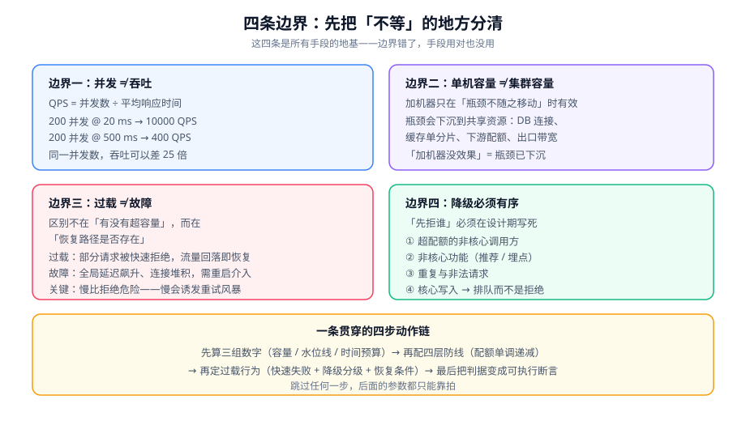

# 总览：高并发的四条边界

高并发系统设计的全部工作，可以压缩成一句话：**把「流量超过容量」这件事从一场事故，变成一个可预测、可恢复、可解释的状态**。

本页先立四条边界。它们是后面八页所有判据的地基——边界错了，手段用对也没用。

::: tip 一句话理解
**过载不是故障，未被设计的过载才是。** 一个系统的容量是有限的，这是物理事实；但「超过容量之后它会怎么表现」，是设计选择。
:::

## 一、先分清三个不等的量

### 1. 并发数 ≠ QPS

这两个词在日常对话里被混着用，但它们在公式里是两个不同的量：

```text
QPS = 并发数 ÷ 平均响应时间（秒）
```

代入一组真实形状的数字：

| 场景 | 并发数 | 平均响应时间 | 推导出的 QPS |
| --- | --- | --- | --- |
| A：轻量查询 | 200 | 20 ms = 0.02 s | 10000 |
| B：同一条链路加了慢查询 | 200 | 500 ms = 0.5 s | 400 |
| C：A 的并发涨到 5000 | 5000 | 20 ms | 250000（**不可能**） |

第 3 行是本节的重点：**并发数不能独立于响应时间随意增大**。真正的约束是「同时在处理的请求数不能超过某个上限」，而这个上限由线程池、连接池、文件描述符、内存这些**有限资源**决定。

::: danger 三个由这个混淆直接导致的错误结论
1. **「我们并发 5000 都没事，所以 10000 QPS 也没问题」**——如果那 5000 并发的平均响应时间是 500 ms，实际 QPS 只有 10000，且线程池已经接近上限，再涨就是雪崩。
2. **「加线程数就能扛住」**——线程数增加会同时拉长平均响应时间（上下文切换、锁竞争、下游排队），`QPS = 并发 / 延迟` 的分子分母一起涨，结果是净收益为负。
3. **「压测时并发数打到 500 就够」**——压力工具里的「并发」是**同时在跑的虚拟用户数**，不是服务端真正同时处理的请求数；闭模型压测会把服务端排队造成的延迟算进客户端的「等待」，从而**低估**服务端真实并发。
:::

### 2. 正确的读法

| 量 | 定义 | 谁在限制它 |
| --- | --- | --- |
| 并发（in-flight） | 同一时刻正在被处理的请求数 | 线程池大小、连接池大小、协程数 |
| 到达率（arrival rate） | 单位时间**进入**系统的请求数 | 由外部流量决定，系统不能选 |
| 吞吐（throughput） | 单位时间**完成**的请求数 | 在下游不成为瓶颈时 ≈ 到达率 |
| 响应时间 | 从进入到完成的时间 | 服务时间 + 排队时间 |

真正的因果链是：**到达率上涨 → 排队时间上涨 → 响应时间上涨 → 在并发上限固定的情况下吞吐停止增长**。这一步之后，多出来的请求就只能：**排队（延迟增大）、被拒（错误）、或者把系统拖垮**。三选一，没有第四个选项——这就是本专题要设计的东西。

### 3. 可执行验证：用一个公式自检

```shell
# 采集 1 分钟的接口指标（Prometheus 口径），把下面三个数填进去
# 1) 平均在途请求数（并发）
curl -s 'http://localhost:9090/api/v1/query?query=sum(rate(http_server_requests_seconds_count[1m]))' | jq -r '.data.result[0].value[1]'
# 2) 平均响应时间（秒）
curl -s 'http://localhost:9090/api/v1/query?query=sum(rate(http_server_requests_seconds_sum[1m]))/sum(rate(http_server_requests_seconds_count[1m]))' | jq -r '.data.result[0].value[1]'
# 3) 线程池活跃线程数
curl -s 'http://localhost:9090/api/v1/query?query=tomcat_threads_busy_threads' | jq -r '.data.result[0].value[1]'
```

**判读方式**：如果第 3 个数已经接近 `tomcat_threads_config_max_threads`，而第 1 个数还在涨，说明系统已经进入「并发上限固定、到达率继续涨」的区间——此时 QPS 不会再涨，只会看到响应时间线性上升。**这就是过载的入口，不是故障的开始。**

## 二、四条边界



### 边界一：并发不等于吞吐

**判据**：任何一次容量讨论，都必须同时给出「并发上限」和「该并发下的响应时间」，否则这个数字没有意义。

**反面案例**：某接口压测报告写「支持 3000 并发」，但没写响应时间。真实情况是 3000 并发时 P99 = 8.2 s——用户早就超时了，那 3000 个请求里的绝大多数在用户侧是失败的。**这不是「支持 3000 并发」，这是「排队区能站 3000 个人」。**

### 边界二：单机容量不等于集群容量

**判据**：集群容量 = 单机容量 × 实例数 **只有在**「瓶颈不随实例增加而移动」时才成立，而它几乎总是不成立。

**瓶颈会往哪移动**，从下往上是一次不可跳过的检查：

| 层 | 扩展后新增的瓶颈 | 立刻可验证的信号 |
| --- | --- | --- |
| 应用实例 | 无（应用本身通常无状态） | 实例数 × 单机 QPS ≈ 实测 QPS |
| 连接池 / 线程池 | 每实例各自持有一份连接，总连接数 = 实例数 × 池大小 | `max_connections` 是否够 |
| 数据库 | 连接数、锁、WAL 写入带宽 | `Threads_running`、`innodb_row_lock_time` |
| 缓存 | 单分片带宽、热 key 打在同一节点 | 分片间 QPS 方差 |
| 网络出口 / 入口 | 带宽、LB 的连接数上限 | 网卡出带宽 / LB 活跃连接数 |

::: warning 一条经验判据
**「加机器没效果」几乎总是同一个原因**：瓶颈已经下沉到共享资源（数据库、缓存单分片、下游接口的配额）上了。这时候加机器的收益是 0，正确的动作是**先找到那个共享资源**——见[热点识别与拆分](../HotspotSplit/index.md)。
:::

### 边界三：过载不等于故障

这是本专题最重要的一条边界。两者的区别不在「有没有超容量」，而在于**恢复路径是否存在**：

| 维度 | 过载（可恢复） | 故障（不可恢复/恢复慢） |
| --- | --- | --- |
| 触发 | 到达率 > 容量 | 到达率 > 容量 **且** 没有过载设计 |
| 表现 | 部分请求被快速拒绝，延迟分布可控 | 全局延迟飙升、连接堆积、OOM/GC 反复 |
| 恢复方式 | 流量回落即自动恢复 | 需要重启、限流外挂、甚至人工介入 |
| 恢复时间 | 秒级 | 分钟到小时级 |
| 对上游的影响 | 上游看到 429，可以退避 | 上游看到超时，**往往会重试**，形成正反馈 |

最后一行是关键：**「慢」比「拒绝」危险得多**。一个超时的请求在上游看来是「可能有结果」，于是上游重试——原本 1 份流量被放大成 2 份、3 份，把本来只是临界的状态推进了崩溃区。

### 边界四：降级必须有序，且提前写死

**判据**：系统必须能回答「现在开始拒绝，先拒谁」这个问题，而且这个答案**不能是运行时临时决定的**。

一个可用的分层顺序（从上到下，越靠下越不该拒）：

| 优先级 | 拒什么 | 理由 |
| --- | --- | --- |
| 最先 | 超出配额的非核心调用方 | 它的损失最小，且可以提前告知 |
| 其次 | 非核心功能（推荐、评论、埋点） | 功能可降级，不影响主流程 |
| 再次 | 重复请求、明显非法的请求 | 本就该被挡，不占用容量 |
| 最后 | 核心写入（下单、支付、记账） | 拒它的代价最大，应当**排队**而不是拒绝 |
| 绝不 | **已进入核心事务的请求** | 中途拒绝会产生不一致状态，代价高于排队 |

::: danger 最常见的错误：把「拒绝」放在事务中间
正确做法是把拒绝点放在**事务开始之前**（拦截器 / 过滤器 / 网关），而不是在业务代码里「查一下系统压力再决定要不要继续」。后者会留下半完成的事务，且回滚本身也是一次开销——在过载时，回滚往往比正常提交更贵。
:::

## 三、三个「以为不会发生」

### 1. 「我们的流量是平稳的」

即使是平稳的日均流量，小时级与秒级都可能出现 3~10 倍的尖峰。**平稳的是均值，不是瞬时值。** 验证方式：

```shell
# 用 1 秒粒度看 5 分钟的到达率波动（而不是 1 分钟均值）
curl -s 'http://localhost:9090/api/v1/query_range?query=sum(rate(http_server_requests_seconds_count[1s]))&step=1s' \
  | jq -r '.data.result[0].values[] | @tsv' \
  | awk '{print $2}' | sort -n | awk '{a[NR]=$1} END {print "p50="a[int(NR*0.5)], "p99="a[int(NR*0.99)], "max="a[NR]}'
```

**判读**：`max / p50` 大于 5 就说明你的容量必须按 `max` 附近来设计，或者必须有过载防线。

### 2. 「上有限流就够了」

限流在**入口**，但过载可能发生在**内部任意一跳**：应用内调下游的线程池、数据库连接池、缓存的单分片。入口限流只能保护「入口之后的所有东西」，它的粒度**通常比真正的瓶颈粗**。

### 3. 「加监控就能提前发现」

监控告诉你「已经慢了」，但不告诉你「接下来会发生什么」。要提前发现，需要的是**容量类指标**（水位线、剩余配额、队列深度）而不是**结果类指标**（QPS、错误率、P99）。后者在过载真正暴露之前，往往还是「绿的」。

详见[过载行为与有损服务](../OverloadBehavior/index.md)的水位线一节。

## 四、什么时候不需要做这套设计

高并发设计有成本（复杂度、运维面、排查难度）。以下五类场景**明确不该做**：

1. **还没有真实流量的内部系统**：内部管理后台、日活几百的系统，先把功能做对。
2. **容量远大于流量的场景**：如果实测峰值只用了 10% 容量，唯一的动作是**保留监控**，不是加防线。
3. **瓶颈在别处的系统**：如果 P99 是被慢 SQL 拖的（而非被打满），做限流只是把一个错误变成另一个错误——先去看 [SQL 优化](../../../DB/Relational/SQLOptimization/index.md)。
4. **无法拒绝的业务**：如果所有请求都必须成功（例如不可丢的采集上报），那么正确的方案是**排队 + 上游缓冲**，而不是限流。见[排队与削峰](../QueueShaping/index.md)。
5. **一次活动、一次性的峰值**：租用云资源 + 临时扩容 + 人工值守，比设计一套常态化防线更便宜。

::: tip 一条实用判据
**当「容量水位线」长期低于 50% 时，本专题的绝大部分内容都不该做**。判据是水位线，不是「有没有听过限流」。
:::

## 五、最小起步三步

如果你刚接手一个系统、什么都不知道，按这个顺序做，每一步都有明确的完成定义。

### 第一步：把「容量」变成一个数

```shell
# 取最近 7 天同一时刻的峰值 QPS（1 分钟粒度）
curl -s 'http://localhost:9090/api/v1/query?query=max_over_time(sum(rate(http_server_requests_seconds_count[1m]))[7d:1m])' \
  | jq -r '.data.result[0].value[1]'
```

**期望输出**：一个具体数字，例如 `1820.5`。
**完成定义**：这个数字有出处（哪个接口、哪个时间窗）、被写进文档，并且有人认领它。

### 第二步：把「单机能力」变成一个数

用**恒定到达率模型**压测（不要用并发模型），得到单实例能稳定处理的 QPS 与此时的 P99。

**完成定义**：得到「单实例 X QPS @ P99 < 200 ms」这样一条可复算的结论。

### 第三步：算水位线，缺口用防线补

```text
水位线 = 峰值 QPS ÷ (单实例 QPS × 实例数)

水位线 < 50%   → 只保留监控，不做防线
50% ~ 80%     → 做入口限流 + 队列深度告警
> 80%         → 全套防线：限流 + 隔离 + 降级分级 + 快速失败
```

**完成定义**：水位线被算出来，且对应的动作被写进预案。**注意这是三条不同的路线，不是「越多越安全」**——在低水位线上堆防线，只会让正常流量被误伤。

## 六、术语对齐

同一批词在不同团队里的含义经常不同，先把口径钉死。

| 术语 | 本专题的口径 | 常见误用 |
| --- | --- | --- |
| 限流（rate limiting） | **按频率**拒绝，限制「单位时间的次数」 | 与并发限制混用 |
| 并发限制（concurrency limiting） | **按同时数量**拒绝，限制「同时在处理的数量」 | 误以为它等价于 QPS 限制 |
| 排队（queueing） | 请求**被延迟**处理而不是被拒 | 误以为排队 = 削峰（它只是把峰**推后**） |
| 削峰（peak shaving） | 把瞬时高峰**摊到更长时间**上处理 | 误以为它降低了总工作量 |
| 熔断（circuit breaking） | **下游已经坏了**，暂时不再调用它 | 误用于「上游太吵」的场景（那是限流） |
| 降级（degradation） | 用**更低质量的结果**替代原结果 | 与「拒绝」混淆——降级是返回一个**可用**结果 |
| 快速失败（fail fast） | 立刻返回错误，而不是等待 | 与「超时」混淆——超时是**等了一会儿**才失败 |
| 隔离（bulkhead） | 把资源**分区**，一处耗尽不影响另一处 | 与「限流」混淆——隔离不限制总量 |
| 背压（backpressure） | 消费者**主动告知**生产者降速 | 误以为「丢弃」就是背压 |

## 七、判据清单

本页是全专题的地基，所以判据写的是**边界**而不是手段：下面六条如果有一条不成立，后面八页的手段再对也会用错地方。

| 编号 | 判据 | 怎么验证 |
| --- | --- | --- |
| `HC-A` | 任何一次容量讨论都**同时**给出「并发上限」与该并发下的响应时间 | 让人复述一遍这两个数；只有并发数没有延迟即视为无效结论 |
| `HC-B` | 集群容量 = 单机容量 × 实例数，**只在「瓶颈不随实例增加而移动」时才成立** | 扩容后实测 QPS 与线性预期比对，差值就是瓶颈所在的那一层 |
| `HC-C` | 过载与故障的分界是「**恢复路径是否存在**」，不是「有没有超过容量」 | 压到过载后撤掉压力，观察是否自愈（自愈 = 过载，不自愈 = 故障） |
| `HC-D` | 「先拒谁」的顺序写在文档里，**不允许运行时临时决定** | 文档里能找到一份有序的拒绝清单，且与代码里的判定顺序一致 |
| `HC-E` | 「要不要做整套防线」由**水位线**决定，不由「听过什么名词」决定 | 写出水位线算式并代入实际数值；长期 < 50% 时本专题绝大部分内容不该做 |
| `HC-F` | 每个超出容量的请求都有「**排队 / 拒绝 / 降级**」三者之一的明确归属 | 逐接口列出归属；出现「到时候看情况」即不合格 |

::: warning `HC-A` 与 `HC-B` 是这两条最常被跳过
它们不是「理论」，而是**两处会让人算出错误容量结论的地方**：跳过 `HC-A` 会得到「支持 3000 并发」这种没有意义的数字；跳过 `HC-B` 会得出「加两台就够」这类在扩容后立刻被证伪的计划。两处的验证都很便宜——一次复述、一次扩容实测。
:::

## 八、验证方式

本页的结论可以用三条命令在本地或预发环境验证。

```shell
# 1) 确认「并发 ≠ QPS」：同一个接口在两种响应时间下的 QPS 比值应约等于响应时间比值
ab -n 2000 -c 200 "http://localhost:8080/api/fast"    # 记录 Requests per second
ab -n 2000 -c 200 "http://localhost:8080/api/slow"    # 记录 Requests per second
# 期望：两份报告的 "Time per request" 比值与 "Requests per second" 的反比一致（误差 < 20%）

# 2) 确认「水线确实存在」：加大并发但吞吐不再增长
for c in 50 100 200 400 800; do
  echo -n "c=$c  "; ab -n 2000 -c $c "http://localhost:8080/api/slow" | grep -E "Requests per second|Time per request"
done
# 期望：c 从某个值起，Requests per second 不再增长，而 Time per request 继续上升

# 3) 确认「过载会先表现为排队而不是错误」
# 在上面某个 c 值下同时观察：线程池活跃数、队列深度、错误率
# 期望：错误率维持 0，队列/活跃数先到顶，然后延迟才飙升——若错误率先涨，说明有地方在提前拒绝
```

::: danger 三个会让上面三条命令给出错误结论的写法
1. **用 `ab` 而不用恒定到达率工具**：`ab` 是闭模型（固定并发数），它会自动降速以维持并发，于是**永远测不出「吞吐墙」**。要测墙请用 `wrk2`、`k6` 的 `constant-arrival-rate` 或 `vegeta -rate`。
2. **压测目标在被压测的机器上**：压测机与目标机共享 CPU，测到的是两台机器的总和，且随并发升高会先耗尽压测机。
3. **只跑一次就下结论**：JIT 预热、连接池冷启动、Page Cache 未命中都会让第一次显著更差。**先跑一轮丢弃，再跑三轮取中位数。**
:::

## 九、相关页面与下一篇

- 下一篇：[分层防御与预算分配](../LayeredDefense/index.md)——把本页的「四条边界」落成四层防线与一份可分配的预算表。
- 相邻必读：[性能与容量工程 · 容量规划](../../../Ops/PerformanceEngineering/Capacity/index.md)（水位线怎么算）、[熔断限流与降级](../../Microservices/CircuitBreaker/index.md)（工具怎么用）。
- 反面对照：[电商系统设计 · 秒杀](../../Ecommerce/FlashSale/index.md)——一个具体场景里这四条边界长什么样。

## 十、参考资料

- [nginx `ngx_http_limit_req_module`（漏桶实现与 `burst` 语义）](https://nginx.org/en/docs/http/ngx_http_limit_req_module.html)
- [RFC 9110 · HTTP 语义（`503`、`Retry-After`）](https://www.rfc-editor.org/rfc/rfc9110)
- [RFC 6585 · `429 Too Many Requests`](https://www.rfc-editor.org/rfc/rfc6585)
- [Little's law（并发、吞吐与延迟的关系）· Wikipedia](https://en.wikipedia.org/wiki/Little%27s_law)
- [USL（Universal Scalability Law）与「加机器为何无效」](https://en.wikipedia.org/wiki/Universal_scalability_law)
