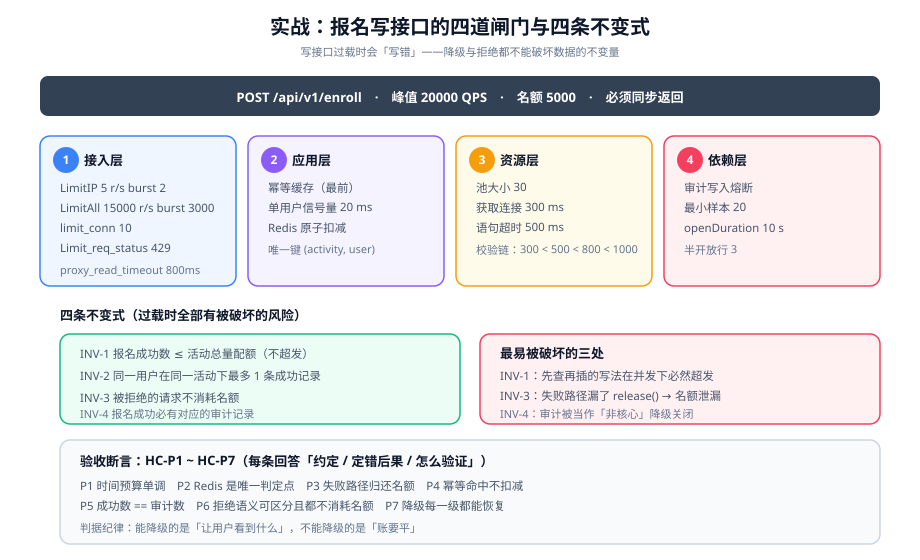

# 实战：写接口的过载治理

前面七页给的是判据。本页把它们在**一条真实的写接口**上逐条落地，并把验收变成可执行的断言。

::: tip 一句话理解
**读接口过载时慢一点还能用，写接口过载时会写错。** 因此写接口的过载治理比读接口多一层要求：**降级与拒绝都不能破坏数据的不变量**。
:::

## 一、场景与约束

### 场景

一个「**活动报名**」接口：`POST /api/v1/enroll`。

| 属性 | 值 |
| --- | --- |
| 活动总量配额 | 5000 个名额（稀缺资源，必须不超发） |
| 参与人数规模 | 报名开启瞬间约 20 万人同时点 |
| 单次请求重量 | 写 1 行报名记录 + 扣 1 个名额 + 写 1 条审计 |
| 结果要求 | **必须同步返回结果**（成功/已满/已报名），不能明显异步 |
| 幂等要求 | 同一用户重复提交只能成功一次 |
| 拒绝要求 | 被拒时必须给出明确原因，且**不能消耗名额** |

### 与秒杀的差别（说明为什么不复用秒杀方案）

| 维度 | 秒杀（[既有专题](../../Ecommerce/FlashSale/index.md)） | 本场景 |
| --- | --- | --- |
| 结果 | 可以异步（下单结果后查） | **必须同步** |
| 配额 | 商品库存（可预扣、可回滚） | 活动名额（同性质，但要求「拒绝不消耗」） |
| 峰值 | 10 万 QPS 级 | 2 万 QPS 级 |
| 核心难点 | 不超卖 + 异步落库一致 | **同步返回 + 拒绝语义精确 + 不超发** |

**结论**：秒杀的六层过滤可以借鉴，但「必须同步返回」这一条改变了第三步之后的全部设计——不能靠「入队即返回」把压力推后。

### 不变式（写接口的「绝不能被破坏」）

```text
INV-1  报名成功数 <= 活动总量配额              （不超发）
INV-2  同一用户在同一活动下最多 1 条成功记录   （不重复）
INV-3  被拒绝的请求不消耗名额                  （拒绝无副作用）
INV-4  报名成功必有对应的审计记录              （可追溯）
```

::: danger 这四个不变式在过载时全部有被破坏的风险
1. **`INV-1` 在重试与并发下最易破**：`SELECT count()` 再 `INSERT` 的写法在并发下必然超发。
2. **`INV-2` 在重复点击与超时重试下最易破**：用户点了两次、或客户端超时后重试，会产生两条记录。
3. **`INV-3` 在「先扣后校验」的顺序下最易破**：先 `DECR` 再校验其它条件，失败时忘了加回来。
4. **`INV-4` 在被降级掉的审计写入上最易破**：审计被当作「非核心」降级关闭，但它是 `INV-1` 事后对账的唯一依据。
:::

## 二、第一步：先算三组数字

不算数字就配防线，是把随机值写进配置。

```text
【第一组：容量】
  峰值到达率          = 200,000 人在 10 s 内点击 ≈ 20,000 QPS
  单实例（4C8G）能力   = 1,200 QPS @ P99 < 200 ms（实测）
  实例数              = 8
  集群容量            = 8 × 1,200 = 9,600 QPS
  水位线              = 20,000 / 9,600 = 208%（远超 100%）
  → 结论：**必须拒绝大部分请求**，且拒绝必须是「快速失败 + 明确语义」

【第二组：配额】
  名额                = 5,000
  报名成功最长耗时     = 80 ms（含写库与审计）
  容纳全部成功请求耗时 = 5,000 × 80 ms / 并发数
  以 64 并发算        = 6.25 s
  → 结论：**约 6 秒内名额就会用完**，之后 99.9% 的请求都应当被「已满」拒绝

【第三组：时间预算】
  客户端超时          = 1,000 ms（已知）
  nginx 读超时        = 800 ms
  应用内连接获取超时   = 300 ms
  数据库语句超时      = 500 ms
  → 校验：300 < 500 < 800 < 1000  ✔ 单调递增
  → 任一层超时必须严格小于上一层，否则上游永远等不到你的错误信息
```

**这一步的产出就是上面三块文本。** 它们必须被写进设计文档，因为后面每一个参数都要引用它们。

## 三、第二步：四层防线落地



### ① 接入层：分两档限流

```nginx
# /etc/nginx/conf.d/enroll.conf
# 维度一：按 IP 限流，防单机刷；维度二：全局限流，保护后端总量
limit_req_zone $binary_remote_addr zone=enroll_ip:10m  rate=5r/s;
limit_req_zone $server_name        zone=enroll_all:10m rate=15000r/s;

server {
    location /api/v1/enroll {
        # 单 IP：5 r/s，突发排队 2 个，超出立即拒绝
        limit_req zone=enroll_ip  burst=2 nodelay;
        # 全局：15000 r/s（= 集群容量 9600 的 1.5 倍，留出突发排队空间）
        limit_req zone=enroll_all burst=3000;
        limit_req_status 429;              # ★ 不要用默认的 503
        limit_conn  enroll_conn 10;        # 单 IP 最多 10 个并发连接

        proxy_read_timeout 800ms;          # ★ 与时间预算一致
        proxy_pass http://enroll_backend;
    }
}
```

| 参数 | 取值依据 |
| --- | --- |
| `enroll_ip rate=5r/s` | 正常用户一次报名最多点 2~3 次，5 r/s 足够 |
| `enroll_all rate=15000r/s` | 集群容量 9600 × 1.56，给排队留空间但不至于让后端过载 |
| `burst=3000` | 可接受等待 200 ms × 15000 r/s = 3000 |
| `limit_req_status 429` | 明确告知「太频繁」，避免客户端误判为宕机 |
| `proxy_read_timeout 800ms` | 严格小于客户端 1000 ms |

::: warning 为什么全局限流值要**大于**集群容量
如果设成 9600（等于容量），那么任何一次实例数减少（滚动发布、单实例故障）都会立刻让**全部**流量被限流。设成 1.5 倍并配合 `burst` 排队，是「让超出的部分排队而不是全部拒绝」。

但注意：这个值必须配合**应用层自己的并发控制**同时存在——否则会变成「网关放行 15000，应用被压垮」。
:::

### ② 应用层：三层并发控制，各管一件事

```java
// 三个闸门，顺序不可颠倒：越便宜的判断越靠前
public EnrollResult enroll(long userId, long activityId, String idempotencyKey) {

    // 闸门 1：幂等（最先，且最便宜——本地缓存 + 唯一键兜底）
    //   命中说明是重复提交或超时重试，直接返回上次结果，不消耗名额
    EnrollResult cached = idempotencyCache.get(idempotencyKey);
    if (cached != null) return cached;

    // 闸门 2：单用户并发（防止同一用户同时打进来两个请求）
    if (!userGate.tryAcquire(userId)) {                 // ★ 20 ms 等待上限
        return EnrollResult.fail(Code.TOO_MANY_REQUESTS, "操作过于频繁");
    }
    try {
        // 闸门 3：名额判定（Redis 原子扣减，唯一判定点）
        if (!quotaService.reserve(activityId)) {        // Lua 脚本：DECR 前判 > 0
            return EnrollResult.fail(Code.SOLD_OUT, "名额已满");
        }
        try {
            // 落库：唯一键 (activity_id, user_id) 保证 INV-2
            Enrollment e = repo.insert(userId, activityId);   // 冲突抛 DuplicateKeyException
            auditService.record(userId, activityId, e.getId());  // INV-4，不降级
            EnrollResult ok = EnrollResult.ok(e.getId());
            idempotencyCache.put(idempotencyKey, ok);
            return ok;
        } catch (DuplicateKeyException dup) {
            quotaService.release(activityId);            // ★ INV-3：拒绝要还名额
            return EnrollResult.fail(Code.ALREADY_ENROLLED, "您已报名");
        } catch (Exception other) {
            quotaService.release(activityId);            // ★ INV-3：任何失败都还名额
            throw other;
        }
    } finally {
        userGate.release(userId);
    }
}
```

::: danger 这段代码的四个关键点，动一个就破坏一个不变式
1. **`quotaService.release()` 必须在两个 `catch` 里都出现**：只在 `DuplicateKeyException` 里还名额，会让「数据库连接超时」这类失败**永久吃掉一个名额**——最后表现为「明明还有名额，但一直显示已满」（`INV-1` + `INV-3` 同时被破坏）。
2. **幂等缓存放在最前面**：如果放在 `quotaService.reserve()` 之后，重复请求会先扣一次名额再被幂等拦住，于是「扣了又还」在并发下可能来不及还（`INV-3` 被破坏）。
3. **Redis 扣减是唯一判定点，数据库不做二次判定**：两处判定会产生两个真相源。数据库侧只用唯一键保证 `INV-2`，不做名额判断。
4. **审计不参与降级**：`auditService.record()` 不能被「非核心功能降级」关掉，否则 `INV-4` 失效，事后无法对账。

**这条纪律可以概括成一句**：**能降级的是「让用户看到什么」，不能降级的是「账要平」。**
:::

### ③ 资源层：三道超时必须单调

```yaml
# application.yml（Spring Boot 4.x）
spring:
  datasource:
    hikari:
      maximum-pool-size: 30            # 8 实例 × 30 = 240 < 数据库 max_connections
      connection-timeout: 300          # ★ 与时间预算一致
      max-lifetime: 1740000
  jpa:
    properties:
      jakarta:
        persistence:
          query:
            timeout: 500               # ★ 单语句超时，严格大于获取连接超时

server:
  tomcat:
    threads:
      max: 200                         # 单实例 200 线程，与单实例 1200 QPS 匹配
    accept-count: 100                  # ★ 有界的 accept 队列
    connection-timeout: 800ms          # ★ 与 nginx 读超时对齐
```

| 校验项 | 期望关系 | 违反的后果 |
| --- | --- | --- |
| 获取连接超时 < 语句超时 | 300 < 500 | 连接池满时报「语句超时」，误导排查方向 |
| 语句超时 < nginx 读超时 | 500 < 800 | nginx 先超时，应用拿不到错误信息（日志里看不到根因） |
| nginx 读超时 < 客户端超时 | 800 < 1000 | 客户端先超时 → 用户看到「失败」但服务端其实成功 → 重试 → 重复报名 |
| `accept-count` 有界 | 非默认无限 | 连接堆积，延迟失控 |

### ④ 依赖层：只有审计写算「外部依赖」

本场景外部依赖只有一个（审计服务内部的写入），因此熔断配置很薄：

```yaml
resilience4j:
  circuitbreaker:
    instances:
      auditWrite:
        slidingWindowSize: 30
        minimumNumberOfCalls: 20          # ★ 过载时样本少，不能配 100
        failureRateThreshold: 50
        waitDurationInOpenState: 10s      # ★ 过载是瞬时的，10 s 而非 60 s
        permittedNumberOfCallsInHalfOpenState: 3   # ★ 半开只放 3 个
```

## 四、第三步：过载时的行为设计

### 降级分级表（本场景）

| 级别 | 触发条件 | 具体动作 | 恢复条件 |
| --- | --- | --- | --- |
| `L0` | 队列/池使用率 < 60% | 正常 | — |
| `L1` | 使用率 60%~80% 持续 30 s | 关闭报名成功页的推荐位与动画；埋点改为采样 10% | < 60% 持续 5 min |
| `L2` | 使用率 80%~90% 持续 30 s | 报名结果页改为极简返回（不带活动详情）；**审计写入改为批量** | < 70% 持续 5 min |
| `L3` | 使用率 > 90% 持续 10 s | **只处理幂等命中与名额判定**；名额已满一律返回「已满」不再查库 | < 80% 持续 5 min |

::: warning `L3` 里有一处刻意的设计
「名额已满一律返回『已满』不再查库」——它在**理论上可能误报**（实际还有名额但 Redis 已显示为 0）。

这个设计是被接受的，理由是：**「已满」是一个保守近似，而「查库后发现已满」多消耗一次数据库往返**。在 `L3` 阶段，把数据库留给真正的成功写入，比让 99% 注定失败的请求去查库更划算。

**但必须满足两个条件**：① Redis 的扣减是唯一判定点（所以「已满」不会和数据库不一致）；② 该行为被单独打点，事后可统计「有多少次 L3 拒绝」。
:::

### 拒绝语义必须精确

被拒的请求要在响应里说清「为什么」，且**不同原因的响应必须可区分**：

| 原因 | 状态码 | 错误码 | 是否消耗名额 |
| --- | --- | --- | --- |
| 频率过高 | `429` | `TOO_MANY_REQUESTS` | ✘ |
| 名额已满 | `409` | `SOLD_OUT` | ✘ |
| 已报名 | `200`（返回既有结果） | — | ✘ |
| 系统过载（`L3`） | `503` + `Retry-After` | `OVERLOADED` | ✘ |
| 参数错误 | `400` | `INVALID_PARAM` | ✘ |

**判据 `HC-P` 的核心之一是：上表每一行的「是否消耗名额」都必须是 ✘，且能被验证。**

## 五、第四步：可观测

### 必须有的五类指标（全部是「容量类」或「不变式类」）

| 指标 | 类型 | 用途 |
| --- | --- | --- |
| `enroll_quota_remaining` | 容量 | 剩余名额（唯一真相，来自 Redis） |
| `enroll_db_pool_usage_ratio` | 容量 | 连接池使用率（最早的前瞻信号） |
| `enroll_tomcat_busy` | 容量 | Web 线程活跃数（最后一道防线） |
| `enroll_result_total{code=...}` | 结果 | 分原因的拒绝计数（验收与对账） |
| `enroll_audit_missing_total` | **不变式** | 成功但缺审计的次数（**必须恒为 0**） |

::: tip 为什么 `enroll_audit_missing_total` 值得单列一条
`INV-1`（不超发）与 `INV-2`（不重复）都能靠数据库约束兜住，只有 `INV-4`（审计必有）**没有任何数据库约束能保证**——它依赖应用代码的写入顺序与异常处理。

因此必须有一条**主动检测**：定时任务比对「成功报名数」与「审计记录数」，把差值暴露成指标。**这个指标长期为 0 才说明 `INV-4` 成立**；它一旦非 0，说明有成功请求走了异常分支。
:::

### 告警规则（容量类先于结果类）

```yaml
groups:
  - name: enroll-overload
    rules:
      - alert: EnrollPoolNearLimit
        expr: enroll_db_pool_usage_ratio > 0.9
        for: 30s                       # ★ 比结果类阈值早得多
        labels: { severity: P2, runbook: "https://example.com/runbook/enroll-pool" }
      - alert: EnrollInvariantBroken
        expr: increase(enroll_audit_missing_total[5m]) > 0
        for: 0s                        # ★ 不变式破坏，立即告警
        labels: { severity: P1, runbook: "https://example.com/runbook/enroll-audit" }
      - alert: EnrollRejectRateHigh
        expr: sum(rate(enroll_result_total{code="SOLD_OUT"}[1m])) / sum(rate(enroll_result_total[1m])) > 0.99
        for: 2m
        labels: { severity: P3 }        # 正常结束，不是故障
```

## 六、验收断言 `HC-P1` ~ `HC-P7`

每条都要能回答三个问题：**约定是什么 / 定错的后果是什么 / 怎么验证它没被破坏**。

| 编号 | 约定 | 定错的后果 | 验证方式 |
| --- | --- | --- | --- |
| `HC-P1` | 时间预算单调：连接获取 < 语句 < nginx 读 < 客户端 | 上游拿不到错误信息；用户看到失败但服务端成功 → 重试 → 重复报名 | 打印四个配置值，检查单调递增 |
| `HC-P2` | Redis 扣减是名额的**唯一判定点** | 两个真相源 → 超发或误报已满 | `grep -rn "available\|remaining" src/` 确认只有一处判断 |
| `HC-P3` | 所有失败路径都调用 `quotaService.release()` | 名额泄漏 → 提前显示已满（`INV-3` 破） | 注入一次数据库失败后，核对 Redis 剩余名额回到原值 |
| `HC-P4` | 幂等键命中不消耗名额 | 重复点击扣两次（`INV-3` 破） | 同一幂等键连打 5 次，Redis 剩余名额只减少 1 |
| `HC-P5` | 成功报名数 == 审计记录数（`INV-4`） | 事后无法对账 | 跑对账 SQL，差值恒为 0 |
| `HC-P6` | 四层防线的拒绝码可区分且都不消耗名额 | 无法定位拒绝原因；名额被错误消耗 | 逐原因构造请求，检查状态码 + 剩余名额 |
| `HC-P7` | 降级分级每一级都有恢复条件且被验证 | 系统长期带伤运行 | 制造 `L3` 后撤掉负载，观察是否逐级回到 `L0` |

## 七、可执行验证

把下面这份脚本存为 `scripts/enroll_acceptance.sh`，在你的工程里执行。

```bash
#!/usr/bin/env bash
# 报名接口过载治理验收（读者在自己的工程中创建后执行）
set -euo pipefail

BASE=${BASE:-http://localhost}
ACT=${ACT:-9001}
CS=${CS:-http://localhost:8080}     # 控制面：暴露剩余名额与降级级别

pass=0; fail=0
check() {  # check <编号> <描述> <期望> <实际>
  if [ "$3" = "$4" ]; then echo "✅ $1 $2"; pass=$((pass+1));
  else echo "❌ $1 $2  期望=$3 实际=$4"; fail=$((fail+1)); fi
}

# ---------- HC-P1 时间预算单调 ----------
t_conn=$(grep -h "connection-timeout" src/main/resources/application.yml | head -1 | grep -oE '[0-9]+')
t_sql=$(grep -h "timeout" src/main/resources/application.yml | tail -1 | grep -oE '[0-9]+')
t_ngx=$(grep -h "proxy_read_timeout" /etc/nginx/conf.d/enroll.conf | grep -oE '[0-9]+')
check HC-P1 "时间预算单调递增" "true" "$([ "$t_conn" -lt "$t_sql" ] && [ "$t_sql" -lt "$t_ngx" ] && echo true || echo false)"

# ---------- HC-P3 失败不泄漏名额 ----------
before=$(curl -s "$CS/quota/$ACT" | jq -r '.remaining')
curl -s -o /dev/null -X POST "$BASE/api/v1/enroll" \
  -H 'Content-Type: application/json' -H 'X-Idempotency-Key: p3-fail' \
  -d "{\"activityId\":$ACT,\"userId\":1,\"forceFail\":true}" || true
after=$(curl -s "$CS/quota/$ACT" | jq -r '.remaining')
check HC-P3 "失败路径归还名额" "$before" "$after"

# ---------- HC-P4 幂等不重复扣减 ----------
before=$(curl -s "$CS/quota/$ACT" | jq -r '.remaining')
for i in 1 2 3 4 5; do
  curl -s -o /dev/null -X POST "$BASE/api/v1/enroll" \
    -H 'Content-Type: application/json' -H 'X-Idempotency-Key: p4-same' \
    -d "{\"activityId\":$ACT,\"userId\":2}" || true
done
after=$(curl -s "$CS/quota/$ACT" | jq -r '.remaining')
check HC-P4 "幂等键只扣一次" "$((before - 1))" "$after"

# ---------- HC-P5 成功数与审计数相等 ----------
ok=$(curl -s "$CS/stats/$ACT" | jq -r '.enrolled')
au=$(curl -s "$CS/stats/$ACT" | jq -r '.audited')
check HC-P5 "成功数 == 审计数" "$ok" "$au"

# ---------- HC-P6 拒绝语义可区分且不消耗名额 ----------
code=$(curl -s -o /dev/null -w '%{http_code}' -X POST "$BASE/api/v1/enroll" \
  -H 'Content-Type: application/json' -H 'X-Idempotency-Key: p6-dup' \
  -d "{\"activityId\":$ACT,\"userId\":2}")
check HC-P6a "重复报名返回 200 并复用既有结果" "200" "$code"
code=$(seq 1 30 | xargs -P 30 -I{} curl -s -o /dev/null -w '%{http_code}\n' -X POST "$BASE/api/v1/enroll" \
  -H 'Content-Type: application/json' -H "X-Idempotency-Key: p6-{}" \
  -d "{\"activityId\":$ACT,\"userId\":100000}" | sort -u | grep -c 429 || true)
check HC-P6b "高频请求被 429 拒绝（≥1 次）" "true" "$([ "$code" -ge 1 ] && echo true || echo false)"

echo "---- 结果：pass=$pass fail=$fail ----"
[ "$fail" -eq 0 ]
```

**期望输出**：`pass=7 fail=0` 及最后一行 `---- 结果：pass=7 fail=0 ----`。

```shell
# 压测（开环、恒定到达率），产出过载曲线
k6 run --vus 1 --duration 30s \
   -e RATE=20000 -e BASE=http://localhost loadtest/enroll-arrival.js
# 期望：http_req_failed 中的 429/409 占绝大多数，5xx 接近 0
#       ——「大量 4xx 少量 5xx」是设计成功的标志；反过来说明过载没有被拦住
```

::: danger 六个会让这套验收给出假绿/假红的做法
1. **`forceFail` 参数在生产存在**：那是测试专用后门，必须只在测试 profile 下注册，否则是一个严重的安全缺陷。
2. **不预置活动数据**：`HC-P3` 前如果剩余名额是 0，`before`/`after` 都是 0，测试恒真。**每条断言前先重置活动状态。**
3. **用 `seq | xargs -P 30` 但 xargs 报了部分失败**：`|| true` 会吞掉退出码。要断言的是**输出的状态码分布**，不是命令退出码。
4. **把 `HC-P6b` 的期望写成「恰好 429」**：限流值是概率性的，实际会有少量 200 漏过。断言应为「**存在 429 且 200 数量 ≤ 上限**」。
5. **`jq` 取值为 `null` 时当成 0**：接口字段名写错时会得到 `null`，比较 `null == null` 会通过。**每处 `jq` 取值后加一句非空断言。**
6. **压测时没关掉审计的批量降级**：`L2` 生效时审计是批量的，`HC-P5` 的对账会有窗口延迟，导致误报。**验收前先确认当前降级级别为 `L0`。**
:::

## 八、本场景明确不做的四件事

| 不做 | 理由 |
| --- | --- |
| 不做「排队等待名额释放」 | 名额被释放只发生在失败回滚，不是常规路径；排队会拉长占用时间，违背「结果必须同步返回」 |
| 不做多级本地缓存活动详情 | 详情走 CDN，应用不该承担这一层；本地缓存会引入不一致窗口而收益很小 |
| 不引入消息队列 | 本场景要求同步返回，入队只会增加一次网络往返与一套补偿逻辑 |
| 不做客户端侧的「预检名额」接口 | 预检结果必然过期，会把「已满」的判断分散到两处，破坏 `HC-P2` |

## 九、相关页面

- 上一篇：[资源隔离与并发控制](../Isolation/index.md)
- 下一篇：[常见问题与最佳实践](../FAQ/index.md)
- 相邻必读：[电商系统设计 · 秒杀](../../Ecommerce/FlashSale/index.md)（六层过滤的完整版）、[账务与清结算 · 幂等](../../Ledger/Idempotency/index.md)（幂等的通用做法）、[分布式缓存深入](../../DistributedCache/index.md)（Redis 原子脚本与热点）。

## 十、参考资料

- [nginx `ngx_http_limit_req_module`（`burst` / `nodelay` / `limit_req_status`）](https://nginx.org/en/docs/http/ngx_http_limit_req_module.html)
- [nginx `ngx_http_limit_conn_module`（`limit_conn`）](https://nginx.org/en/docs/http/ngx_http_limit_conn_module.html)
- [Java `ThreadPoolExecutor` 官方文档（队列与拒绝策略）](https://docs.oracle.com/en/java/javase/25/docs/api/java.base/java/util/concurrent/ThreadPoolExecutor.html)
- [HikariCP 配置指南（`connection-timeout` / `max-lifetime`）](https://github.com/brettwooldridge/HikariCP#gear-configuration-knobs-babysitting)
- [grafana k6 官方文档（`constant-arrival-rate` 执行器）](https://grafana.com/docs/k6/latest/using-k6/scenarios/executors/constant-arrival-rate/)
- [RFC 6585 · `429 Too Many Requests`](https://www.rfc-editor.org/rfc/rfc6585)
