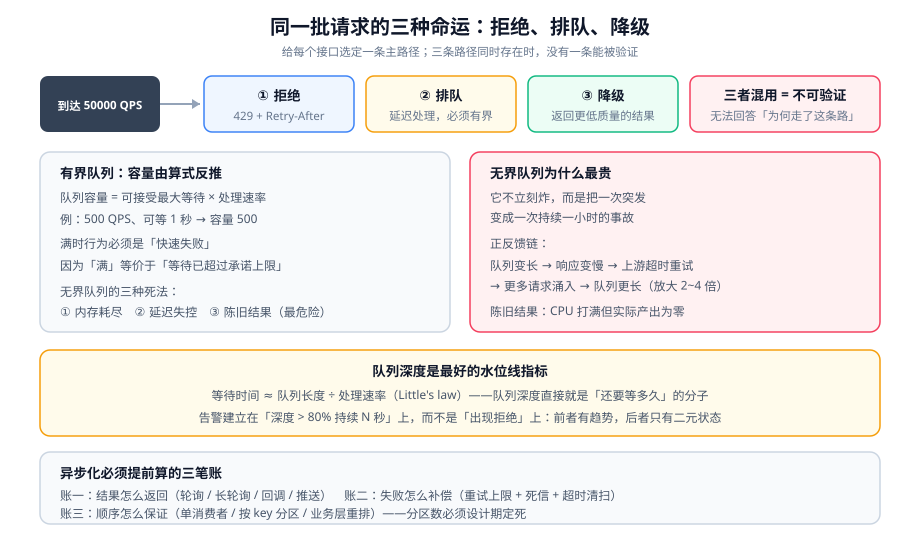

# 排队与削峰

限流是「拒绝」，排队是「延迟」。本页讲清楚：什么时候该让请求等、等待的代价是什么、以及「削峰」这个动作到底改变了什么。

::: tip 一句话理解
**排队不减少工作量，只改变工作发生的时间。** 削峰不减少总请求数，只把「同时来」变成「排着来」。两者的收益都是「让下游在一个它能承受的节奏上工作」，代价都是「结果不再是同步的」。
:::

## 一、先分清三种处置

同一次过载，同一批请求，可以有三种命运。它们的差别不在「是否符合规范」，而在「用户看到什么」：

| 处置 | 用户看到 | 系统内部 | 适用判据 |
| --- | --- | --- | --- |
| 拒绝（限流） | 立刻失败（`429`） | 不占用任何资源 | 「这个请求**现在**做不了，但**以后任何时候**做都一样」 |
| 排队（削峰） | 等一会儿成功 | 占用队列内存 + 一个待办条目 | 「这个请求**现在**必须有结果，但可以稍微晚一点」 |
| 降级（有损） | 立刻成功，但结果更简 | 走更便宜的路径 | 「结果可以打折，但不能错、也不能等」 |

::: warning 三者不能混着用
最常见的错法是「先排队，排不下再拒绝，同时做了降级」——三条路径同时存在时，**没有一条能被验证**：你无法回答「这次请求为什么走了这条路」。正确做法是**给每个接口选定一条主路径**，其余作为明确的兜底。
:::

## 二、队列必须有界

无界队列是过载治理里最贵的一次误判。它不会立刻炸，而是**把一次突发变成一次持续一小时的事故**。



### 无界队列的三种死法

| 死法 | 机制 | 表现 | 恢复 |
| --- | --- | --- | --- |
| 内存耗尽 | 队列元素累积，每个元素持有一个请求上下文 | GC 频繁 → 停顿变长 → 处理更慢 → 队列更长（正反馈） | 重启 |
| 延迟失控 | 队列长度除以处理速率 = 等待时间，线性增长 | 用户等了 40 秒才拿到「成功」 | 队列自然排空（可能很慢） |
| 陈旧结果 | 队列里的请求已经超时，但系统还在为它工作 | 用户早已放弃，系统仍在消耗资源 | 需要应用层识别过期请求 |

**三种死法里最危险的是第三种**，因为它看起来「系统很忙、CPU 打满」，但**实际产出为零**——所有工作都是为用户已经放弃的请求做的。

```java
// 有界队列 + 拒绝策略：队列满了立刻失败，而不是无限堆积
ThreadPoolExecutor pool = new ThreadPoolExecutor(
        64,                                  // corePoolSize
        64,                                  // maximumPoolSize（与 core 相等）
        0L, TimeUnit.MILLISECONDS,
        new ArrayBlockingQueue<>(512),       // ★ 有界队列，容量必须写死
        new ThreadPoolExecutor.AbortPolicy() // ★ 满了抛异常 → 上层转 429/503
);
```

::: danger 四个线程池配置陷阱
1. **用 `Executors.newFixedThreadPool`**：它内部用的是 `LinkedBlockingQueue`（**无界**），队列永远不会满，`maximumPoolSize` 也永远不会生效。生产环境一律手写 `ThreadPoolExecutor`。
2. **`maximumPoolSize > corePoolSize` 且队列有界**：`ThreadPoolExecutor` 的行为是「核心满 → 入队 → 队列满 → 扩到 maximum → 再满才拒绝」。于是**扩容只在队列满之后才发生**，早已太晚。
3. **`AbortPolicy` 的异常被吞掉**：`submit()` 返回的 `Future` 会吞掉异常，只有 `get()` 时才抛出。要用 `execute()` + 显式 `RejectedExecutionHandler`，或统一在 `try/catch` 里把 `RejectedExecutionException` 转成 `429`。
4. **队列容量按「经验」拍**：容量应由「能接受的最大等待时间」反推（见下一节），而不是「看着差不多」。
:::

### 队列容量怎么算

```text
队列容量 = 可接受最大等待时间 × 处理速率

例：处理速率 500 QPS，可接受等待 ≤ 1 秒
    → 队列容量 = 500 × 1 = 500
```

**判据**：队列满时的行为必须是「快速失败」，而不是「继续等」。因为队列满意味着**等待时间已经超过你设定的上限**——再等就违反了你的承诺。

## 三、等待时间与队列深度的关系

这是排队论里最实用的一个结论：在一个处理速率固定的单队列里，**等待时间大致与队列长度成正比**。

```text
等待时间 ≈ 队列长度 ÷ 处理速率
```

因此队列深度是一个**极好的水位线指标**：它直接等于「还要等多久」的分子。

| 队列深度（相对容量） | 含义 | 该做什么 |
| --- | --- | --- |
| < 10% | 空闲 | 无需动作 |
| 10% ~ 50% | 正常工作区 | 记录基线 |
| 50% ~ 80% | **接近水位线** | 开始观察延迟分位；准备扩容或限流 |
| > 80% | 等待已接近承诺上限 | 立刻收口上游（限流/降级），**不要等它满** |
| = 100%（开始拒绝） | 承诺已被打破 | 已经是事故，处理见 [故障应急体系](../../../Ops/IncidentResponse/index.md) |

::: tip 为什么「队列深度」比「队列满」更该告警
队列满是一个**二元信号**——它只有「没满」和「满了」两种状态，等你看到「满了」时，用户已经在被拒绝了。队列深度是**连续信号**，它在 50% 时就能告诉你趋势。

**判据**：告警必须建立在「队列深度 > 80% 持续 N 秒」上，而不是「出现拒绝」上。
:::

## 四、同步转异步：三笔必须提前算的账

把「同步处理」改成「入队 + 异步处理」，是削峰的标准动作。但它带来三笔账，**每一笔都必须在设计时算清**。

### 账一：结果怎么返回

| 方案 | 客户端行为 | 代价 | 适用 |
| --- | --- | --- | --- |
| 立刻返回「受理中」+ 轮询 | 客户端定时查结果 | 多一个结果查询接口 + 结果存储 | 下单、导出、批处理 |
| 长轮询（服务端 hold 一段时间） | 客户端等 → 有结果就返回 | 占用连接 | 等待时间可预期（< 30 s） |
| 回调（webhook） | 客户端提供回调地址 | 需要重试与签名验证 | 服务间调用 |
| 推送（WebSocket / SSE） | 客户端保持长连接 | 连接管理复杂度 | 交互式产品 |

**判据**：**没有「统一最优方案」**。选错这一项的表现是「异步改造后用户投诉变多」——因为用户不知道要去哪看结果。

### 账二：失败怎么补偿

异步之后，失败发生在**用户已经离开**之后。此时必须能回答三个问题：

1. **失败了怎么让用户知道？**（消息通知 / 订单状态可见 / 主动刷新）
2. **失败了几次算彻底失败？**（重试上限 + 死信队列）
3. **超时未处理的怎么回收？**（定时清扫 + 幂等回滚）

```text
一条可用的补偿链路（以「秒杀下单」为例）：

  入队成功 → 返回 requestId
       ↓（消费者处理）
  成功 → 写订单 + 扣库存 + 标记 requestId 完成
  失败 → 重试（最多 3 次，指数退避）
       ↓（仍失败）
  进死信队列 → 定时任务扫描 → 释放预占库存 + 通知用户「下单失败，请重试」

  同时：定时任务扫描「入队超过 T 秒仍未完成」的 requestId
       → 判定为丢弃 → 释放预占 + 通知
```

### 账三：顺序怎么保证

队列天然是「先进先出」，但**并发消费者会打破这个顺序**。三种保序方案：

| 方案 | 实现 | 代价 | 适用 |
| --- | --- | --- | --- |
| 单消费者 | 一个消费线程 | 吞吐被限制在单线程 | 低频、强顺序（对账） |
| 按 key 分区 | 相同 key 落同一分区/队列 | 需要固定分区策略；改分区数要重算 | 订单、账户（按 ID 保序） |
| 业务层排序 | 不依赖 MQ 顺序，按业务序号重排 | 需要缓冲与超时判定 | 消息可能乱序到达 |

::: danger 顺序相关最常见的两个错误
1. **先「按 key 分区」再「动态扩分区」**：分区数变了，同一个 key 会落到不同分区，历史消息与新消息的顺序关系被打破。**分区数必须在系统设计时就定死**，或者用「分区数 = 固定值 × 一致性哈希」这类方案。
2. **以为「单消费者」就能保序**：只有当**消费端不并发**且**失败不重投**时才成立。带重试的单消费者仍可能乱序——第一次失败的消息被投到队尾，第二次成功时已经晚了。
:::

## 五、削峰的三条路线

### 1. 异步队列（最常用）

适用：**结果可以不立刻返回**。典型是下单、发券、日志写入、导出。

```text
峰值 50000 QPS，下游只能承受 5000 QPS
→ 入队（无业务逻辑，只做校验与去重）
→ 消费者按 5000 QPS 恒定速率消费
→ 峰值期间队列长度上升，峰值过后自然排空

关键判据：队列长度 = (峰值 - 消费速率) × 峰值持续时长
          50000 - 5000) × 60s = 2,700,000 条

→ 这个数字决定了两件事：
   ① 队列必须能装下 270 万条（或提前开始拒绝）
   ② 峰值结束后清空需要 2700000 / 5000 = 540 秒（9 分钟）
```

**第 ② 条是最容易被忽略的**：「9 分钟才能清空」意味着用户最长可能等 9 分钟。如果业务上不能接受，那么**必须同时限流**——削峰解决不了「总量远超容量」的问题。

### 2. 批量聚合

适用：**个体很小、可以合并**。典型是日志、埋点、计数写入。

```java
// 聚合写：把 N 次单条写合并成一次批量写
@Component
public class BatchWriter {
    private final BlockingQueue<Record> buf = new LinkedBlockingQueue<>(20000);

    @Scheduled(fixedDelay = 200)      // 每 200 ms 刷一次
    public void flush() {
        List<Record> batch = new ArrayList<>(1000);
        buf.drainTo(batch, 1000);     // 一次最多取 1000 条
        if (batch.isEmpty()) return;
        dao.batchInsert(batch);       // 一条 SQL 写 1000 行
    }
}
```

**收益**：写放大约减少 100~1000 倍。
**代价**：① 最多延迟 200 ms 才对下游可见；② **进程崩溃会丢掉缓冲区里的数据**——所以这个模式只适用于「丢一点可接受」的数据（日志、埋点），绝不适用于账务。

### 3. 时间分片（错峰）

适用：**任务本身可以任意推迟**。典型是批量对账、报表生成、缓存预热。

```text
把「同时开始」的任务分散到一个时间窗内：
  1000 个租户的对账任务，原本都定在 00:00
  → 改为 00:00 + hash(tenantId) % 3600 秒（打散到 1 小时内）

效果：峰值并发从 1000 降到约 1000 / 3600 × 单任务耗时对应值
代价：部分任务的结果可查看时间被推迟（需要业务接受）
```

::: warning 时间分片的一个致命变体
**不要按「任务编号取模」来分散，要按「稳定标识哈希」**。按编号取模时，任务增删会改变分配，导致同一个租户的任务在不同天落到不同时刻——运维排查时会找不到规律。

另外要确保分散后的时刻**仍在业务要求的窗口内**（例如「每日 2 点前必须完成」）。
:::

## 六、HTTP 上没有背压时怎么近似

[响应式编程的背压](../../ReactiveProgramming/Backpressure/index.md)依赖一条反向通道（`request(n)`）。HTTP 短连接没有这条通道——服务器不能对客户端说「慢点发」。

可用的近似手段只有三种：

| 手段 | 本质 | 何时有效 |
| --- | --- | --- |
| 有界队列 + 快速失败 | 用拒绝**代替**背压信号 | 客户端是理性的（会退避） |
| `429` + `Retry-After` | **把背压信号编码进响应** | 客户端实现了退避逻辑 |
| 长轮询 / 流式响应 | 人为造出一条「服务器主动说话」的通道 | 需要服务器主动控制节奏 |

**判据**：如果你希望客户端退避，就必须在响应里给出**可执行的指示**（`Retry-After` 的具体值）。只返回 `429` 而不给等待时间，等于要求客户端猜——它通常选择「立刻重试」。

## 七、判据清单

| 编号 | 判据 | 怎么验证 |
| --- | --- | --- |
| `QS-A` | 每个接口都选定了「拒绝 / 排队 / 降级」中的一条主路径 | 逐接口能说出主路径，且配置里能找到对应实现 |
| `QS-B` | 所有队列/线程池都是**有界**的 | `grep -R "LinkedBlockingQueue\|newFixedThreadPool"` 应为 0 命中 |
| `QS-C` | 队列容量由「可接受等待时间 × 处理速率」反推 | 页面/文档里能给出这个算式与数字 |
| `QS-D` | 队列满时的行为是快速失败，不是继续等 | 压满队列，观察失败耗时 ≈ 0 |
| `QS-E` | 有「队列深度 > 80% 持续 N 秒」的告警 | 在告警配置里 `grep` 到该规则 |
| `QS-F` | 异步链路的三笔账（结果 / 补偿 / 顺序）都写清了 | 三个问题各有一段设计说明 |
| `QS-G` | 有「入队超时未完成」的清扫任务 | 定时任务列表里有该项 |
| `QS-H` | 若依赖保序，分区数已定死且不可动态变更 | 分区数在配置中为常量，且有注释说明原因 |

## 八、验证方式

```shell
# 1) 验证队列有界且会快速失败
# 造一个消费者故意变慢（sleep），以 3 倍速率灌入
for i in $(seq 1 20000); do curl -s -o /dev/null -w "%{http_code} %{time_total}\n" \
  -X POST http://localhost:8080/api/enqueue & done | sort | uniq -c | head
# 期望：出现非 200 的快速失败（time_total 很小）；绝不出现「time_total 长达数十秒的 200」

# 2) 验证等待时间与队列深度成正比
for d in 100 200 400; do
  curl -s "http://localhost:9090/api/v1/query?query=queue_depth" | jq -r '.data.result[0].value[1]'
  # 同时读一个探针请求的耗时
  curl -s -o /dev/null -w "  probe=%{time_total}s\n" http://localhost:8080/api/probe
done
# 期望：probe 耗时随 queue_depth 近似线性上升（偏差过大说明处理速率也在下降）

# 3) 验证削峰后的清空时间与估算吻合
# 峰值结束后，每 10 秒记录一次队列深度，观察回到 0 需要多久
watch -n 10 "curl -s 'http://localhost:9090/api/v1/query?query=queue_depth' | jq -r '.data.result[0].value[1]'"
# 期望：实测清空时间与 (队列峰值 / 消费速率) 的估算相差在 20% 以内

# 4) 验证「入队超时清扫」确实在跑
# 人为制造一批永远不会被消费的消息，等待超过清扫阈值
# 期望：超时后出现「已释放 / 已通知」的记录，且预占资源（库存、额度）回到原值
```

::: danger 四个会让上述验证失真或危险的做法
1. **在生产队列上做第 1 步**：灌入 2 万条会真实污染业务数据。**必须在隔离环境**，且消费端要能安全丢弃。
2. **用 `&` 后台并发而不是 `xargs -P`**：`&` 会在 shell 退出时被回收，观测不完整；且没有并发上限控制，可能把本机压死。用 `xargs -P N`。
3. **只看队列深度不看「陈旧消息数」**：队列在消费（深度在降）不代表在正常——可能消费的都是已超时消息。**要同时看「入队时间到处理时间的差值分布」。**
4. **把清空时间的估算当结论**：估算假设消费速率恒定，而实际中消费端可能因背压变慢。**估算只用于设计，实测才是结论。**
:::

## 九、相关页面与下一篇

- 上一篇：[限流：算法与分布式实现](../RateLimit/index.md)
- 下一篇：[热点识别与拆分](../HotspotSplit/index.md)——排队解决不了「所有请求都打同一个点」。
- 相邻必读：[消息队列](../../MessageQueue/index.md)（中间件本身）、[响应式编程 · 背压](../../ReactiveProgramming/Backpressure/index.md)（有反向通道时怎么做）、[分布式事务](../../Microservices/DistributedTransaction/index.md)（异步链路上的最终一致）。

## 十、参考资料

- [Little's law（队列长度、等待时间与吞吐的关系）· Wikipedia](https://en.wikipedia.org/wiki/Little%27s_law)
- [Java `ThreadPoolExecutor` 官方文档（队列与拒绝策略）](https://docs.oracle.com/en/java/javase/25/docs/api/java.base/java/util/concurrent/ThreadPoolExecutor.html)
- [RFC 9110 · `Retry-After` 与 `503 Service Unavailable`](https://www.rfc-editor.org/rfc/rfc9110)
- [Apache Kafka 官方文档（分区与顺序保证）](https://kafka.apache.org/documentation/)
