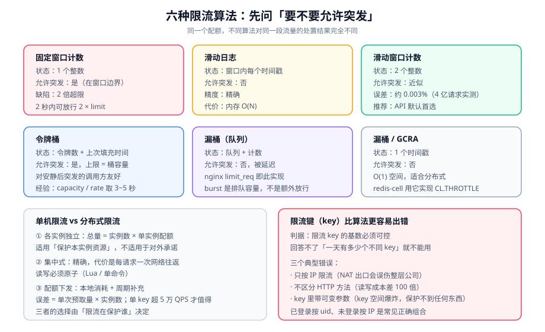

# 限流：算法与分布式实现

第 ① 层的核心决定是「用哪种算法」，第 ② 层往下的核心决定是「限流的 key 是什么」。本页把这两件事讲透，并给出单机与分布式两条可落地的实现。

::: tip 一句话理解
**算法决定「突发流量怎么被对待」，key 决定「你在保护谁」。** 前者是数学，后者是业务——绝大多数限流事故出在后者。
:::

## 一、六种算法对照



| 算法 | 每 key 状态 | 单次开销 | 允许突发 | 边界问题 | 典型用途 |
| --- | --- | --- | --- | --- | --- |
| 固定窗口计数 | 1 个整数 | O(1) | 是（在边界） | **2 倍超限** | 粗粒度配额、按天计数 |
| 滑动日志 | 窗口内每个请求的时间戳 | O(log N) | 否 | 无 | 精确计费、少量 key |
| 滑动窗口计数 | 2 个整数 | O(1) | 近似允许 | 约 0.003% 误差 | **API 默认首选** |
| 令牌桶 | 令牌数 + 上次填充时间 | O(1) | **是，最多桶容量** | 无 | 对友好突发流量宽容 |
| 漏桶（队列） | 队列 + 计数 | O(1) | 否，被延迟 | 无 | 下游真的不能吃尖峰 |
| 漏桶 / GCRA | 1 个时间戳 | O(1) | 否 | 无 | 分布式（`redis-cell`） |

### 1. 固定窗口：失败的边界

固定窗口按「自然时间片」计数，实现最简单：

```java
// 固定窗口：每分钟最多 100 次
public boolean allow(String key) {
    long window = System.currentTimeMillis() / 60000;      // 当前是第几个分钟
    String k = "rl:fw:" + key + ":" + window;
    long n = redis.incr(k);
    if (n == 1) redis.expire(k, 120);                      // 两个窗口后过期，留一份余量
    return n <= 100;
}
```

**它的问题可以精确量化**：客户端在 `12:00:59.9` 发 100 次（用掉上一窗口的全部配额），在 `12:01:00.1` 再发 100 次——**2 秒钟内 200 次，是限制值的 2 倍**。

::: danger 三个固定窗口的常见错误写法
1. **`incr` 之后才 `expire`**：如果进程在两条命令之间崩掉，key 永不过期，该客户端**被永久限流**。正确做法是用 `SET key 0 EX 120 NX` 或 Lua 原子化，或统一用 `INCR` + `EXPIRE` 的 Lua 脚本。
2. **TTL 只设一个窗口**：窗口切换瞬间旧 key 立刻过期，但如果是「先读后写」的实现，可能读到刚被清零的值而放行突刺。设 2 倍窗口更稳（代价是多占一份内存）。
3. **用本地时间做窗口编号**：多实例时钟不同步（即使有 NTP，也可能差几十毫秒）会造成「实例 A 已进下一窗口、实例 B 还在上一窗口」，总量被放大。
:::

### 2. 滑动窗口计数：O(1) 拿到「够准」

两窗口加权估算，是本仓推荐的默认算法（除需要精确计费外都用它）：

```java
// 滑动窗口计数：limit 次 / windowMs（两窗口加权）
public boolean allow(String key, int limit, long windowMs) {
    long now = System.currentTimeMillis();
    long curWin = now / windowMs;
    double elapsed = (now % windowMs) / (double) windowMs;   // 当前窗口已过去多少（0~1）

    String curK  = "rl:sw:" + key + ":" + curWin;
    String prevK = "rl:sw:" + key + ":" + (curWin - 1);

    long cur  = parseLong(redis.get(curK));
    long prev = parseLong(redis.get(prevK));

    // 上一窗口对「当前滑动窗口」的贡献，按还剩多少比例计入
    double estimate = cur + prev * (1 - elapsed);

    if (estimate >= limit) return false;

    redis.incr(curK);
    redis.expire(curK, (long) Math.ceil(windowMs * 2 / 1000.0));  // TTL 跨两个窗口
    return true;
}
```

**精度**：Cloudflare 实测 4 亿请求，与精确滑动日志的差异约 **0.003%**，且被误放行的请求超出真实上限都在 15% 以内。对绝大多数 API，这个误差不可见。

::: warning 两个会让滑动计数失效的实现细节
1. **`prev` 的 TTL 必须覆盖「当前窗口 + 上一窗口」**：只设一个窗口的 TTL，`prevK` 会在你还需要它的时候过期，`estimate` 退化成「只看当前窗口」——也就是退化成固定窗口。
2. **`elapsed` 用的是「当前窗口已过去」而不是「剩余」**：写反会让估算在窗口开始时偏小、结束时偏大，误差方向与真值相反。**验证方式是让流量均匀，观察被拒比例是否恒定。**
:::

### 3. 令牌桶：本质是「允许突发」

令牌桶回答的问题是：**「一个平时很安静、偶尔来一下的调用方，要不要给它一次爆发机会？」** 答案通常是「给」。

```java
// 令牌桶：capacity 个令牌，每秒补 rate 个
public final class TokenBucket {
    private final double capacity;
    private final double rate;        // 每秒补充的令牌数
    private double tokens;
    private long lastRefillNanos;

    public TokenBucket(double capacity, double rate) {
        this.capacity = capacity;
        this.rate = rate;
        this.tokens = capacity;       // 初始满桶，允许开局的突发
        this.lastRefillNanos = System.nanoTime();
    }

    public synchronized boolean tryConsume(double cost) {
        long now = System.nanoTime();
        double add = (now - lastRefillNanos) / 1e9 * rate;
        tokens = Math.min(capacity, tokens + add);
        lastRefillNanos = now;

        if (tokens >= cost) { tokens -= cost; return true; }
        return false;
    }
}
```

| 参数 | 含义 | 配错的后果 |
| --- | --- | --- |
| `capacity` | 桶容量 = **单次最大突发量** | 配得和 rate 一样大 → 退化成「不允许任何突发」 |
| `rate` | 稳态速率 | 配成 capacity 的很多倍 → 突发保护失效 |
| `cost` | 每次消费的令牌数 | 全写 1 → 无法给「贵请求」更高的权重 |

::: tip 一个有用的推论
**令牌桶的「平滑度」由 capacity/rate 之比决定**。`capacity / rate` 就是「攒满一个空桶需要几秒」。

- 比值 = 1 s：对突发极其敏感，几乎只有瞬时抖动会被吸收。
- 比值 = 10 s：允许「安静 10 秒然后一次性打 10 秒的量」，对下游冲击明显。
- 经验起点：**比值取 3~5 秒**，配合下游的排队能力调整。
:::

### 4. 漏桶与 GCRA：不允许突发

漏桶（无论实现是队列还是 GCRA）的核心语义是：**不管你来得多快，出去的速率是恒定的**。

nginx 的 `limit_req` 就是漏桶，`burst` 是队列深度（见[分层防御与预算分配](../LayeredDefense/index.md)）。GCRA（Generic Cell Rate Algorithm，通用信元速率算法）是漏桶的 O(1) 表示：

```text
GCRA 的状态只有「理论到达时间 TAT」一个数：
  每次请求：now ≥ TAT - τ 才放行，放行后 TAT = max(TAT, now) + 1/rate
  其中 τ 是「允许的抖动」，等价于允许多少突发
```

**它为什么值得知道**：`redis-cell` 用 GCRA 实现了 `CL.THROTTLE`，一条命令同时返回「是否被限、上限、剩余、多久后可重试、多久后重置」，且只需要一个时间戳：

```shell
# 语义：key=user123，最大突发 15，30 个令牌 / 60 秒，本次消费 1 个
redis-cli CL.THROTTLE user123 15 30 60
# 返回 5 个整数：
#   0) 0=放行 / 1=被限
#   1) 总上限（= max_burst + 1）
#   2) 剩余
#   3) 多久后可重试（放行时为 -1）
#   4) 多久后重置到满
```

::: warning `redis-cell` 的现状必须写进选型结论
该模块的作者已明确声明处于 **best-effort 维护模式**（不再积极开发）。这意味着：

1. Redis 出新大版本时，官方镜像不一定同步更新（现有标签按 Redis 版本 + 发行版命名，如 `0.4.0-redis8.2-bookworm`）。
2. **不要把它当唯一实现**。合理定位是「可选加速」，同时保留一条纯 `INCR`/Lua 的退路。

同理，Sentinel 的规则模型与 Dashboard 是 **JVM 中心**的；非 JVM 服务或「希望策略由 sidecar 拥有」的团队，应当考虑网格或服务端限流方案，而不是硬接 Sentinel。
:::

## 二、单机限流 vs 分布式限流

这是第二类核心决定。三种拓扑各有一致性—性能的取舍：

| 拓扑 | 总量控制 | 单次开销 | 实现复杂度 | 适用 | 一句话判据 |
| --- | --- | --- | --- | --- | --- |
| ① 各实例独立限流 | **不精确**（总量 = 实例数 × 单实例配额） | 纳秒级（进程内） | 最低 | 保护本实例、防单机热点 | 「限流目的是不让**本机**崩」 |
| ② 集中式（Redis / 网关侧） | 精确 | 一次网络往返 | 中 | 对外配额、计费类限制 | 「限流目的是兑现**对外承诺**」 |
| ③ 配额下发（本地消耗 + 周期补充） | 近似精确（最多欠 N 个） | 纳秒级 + 周期同步 | 高 | 高 QPS、无法承受每请求一次 Redis | 「QPS 高到集中式成为瓶颈」 |

### ① 各实例独立的适用边界（比想象中宽）

如果限流的目标是「保护本实例的稀缺资源」（本地缓存、本机 CPU、单个慢下游的调用），那么**各实例独立限流是正确的，不是妥协**。因为资源本身就是每实例各一份。

::: danger 唯一的禁忌
**不要用「各实例独立限流」来实现「对外承诺的总配额」**。8 个实例各配 1000 QPS，对外承诺 1000 QPS，实际会放行 8000 QPS——而且这个错误在低峰期**完全看不出来**，只有全量压测或真实高峰才会暴露。
:::

### ② 集中式：Redis + Lua 的正确写法

「先 `GET` 再 `SET`」在并发下必然超标。必须把「读状态 → 判断 → 写状态」放进一个 Lua 脚本里原子执行：

```lua
-- rate_limit_token_bucket.lua
-- KEYS[1] = 桶的 key
-- ARGV[1] = 桶容量 capacity
-- ARGV[2] = 每秒补充令牌数 rate
-- ARGV[3] = 本次消费令牌数 cost
-- ARGV[4] = 当前时间（秒·浮点）
-- ARGV[5] = key 的过期秒数（建议 >= capacity/rate * 2）
local capacity = tonumber(ARGV[1])
local rate     = tonumber(ARGV[2])
local cost     = tonumber(ARGV[3])
local now      = tonumber(ARGV[4])
local ttl      = tonumber(ARGV[5])

local st = redis.call('HMGET', KEYS[1], 'tokens', 'ts')
local tokens = tonumber(st[1])
local ts     = tonumber(st[2])
if tokens == nil then
  tokens = capacity    -- 首次访问：满桶
  ts = now
end

-- 按流逝时间补充令牌
local delta = math.max(0, now - ts)
tokens = math.min(capacity, tokens + delta * rate)

local allowed = 0
local retryAfter = 0
if tokens >= cost then
  tokens = tokens - cost
  allowed = 1
else
  retryAfter = math.ceil((cost - tokens) / rate)
end

redis.call('HSET', KEYS[1], 'tokens', tokens, 'ts', now)
redis.call('EXPIRE', KEYS[1], ttl)
return { allowed, math.floor(tokens), retryAfter }
```

```java
// Java 侧调用（Spring Data Redis）
private static final RedisScript<List> SCRIPT =
        RedisScript.of(new ClassPathResource("lua/rate_limit_token_bucket.lua"), List.class);

public RateResult tryConsume(String key, int capacity, double rate, int cost) {
    List<?> r = redis.execute(SCRIPT,
            List.of("rl:tb:" + key),
            String.valueOf(capacity), String.valueOf(rate), String.valueOf(cost),
            String.valueOf(System.currentTimeMillis() / 1000.0),
            String.valueOf((long) Math.ceil(capacity / rate * 2)));
    long allowed = (Long) r.get(0);
    return new RateResult(allowed == 1, (Long) r.get(1), (Long) r.get(2));
}
```

::: danger 五个会让 Redis 限流「偶尔失效」的坑
1. **把 `now` 交给 Redis 用 `TIME`**：看似更准，但启用 Lua 的 `redis.call('TIME')` 在**写命令之后**是不允许的（脚本必须先写后读，`TIME` 属于非确定性命令）。所以时间由客户端传入——这也意味着**必须容忍客户端时钟偏差**。
2. **没给 key 设 TTL**：每个访问过的 key 永久留着，内存线性增长。`EXPIRE` 必须在脚本里设。
3. **TTL 太短**：桶状态被提前清掉，每次都恢复满桶 → 限流失效。建议 `capacity / rate × 2`。
4. **用 `KEYS` 扫 key**：生产环境禁止。限流的 key 空间必须可枚举或按前缀分片。
5. **Redis 挂了就直接放行（fail-open）**：这会让限流在**最需要它的时刻**（Redis 抖动引发流量放大）失效。正确做法是按场景选择：面向攻击防护的入口限流应 **fail-closed**（或回退到本地限流），面向配额管理的可 fail-open 但要打点告警。
:::

### ③ 配额下发：当集中式成为瓶颈

思路：每个实例本地维护一个桶，每 `T` 毫秒向中心要一次令牌（或按比例分配总量）。

```text
总量 Q = 10000 QPS，实例 N = 10，同步周期 T = 1 s
每个实例每次预取 = 10000 / 10 / (1/T) = 1000 个

误差来源：某个实例在同步周期内提前用完，其它实例还有剩余
最大欠额 = 单实例预取量 × 实例数 = 1000 × 10 = 10000（即一整秒的量）

结论：预取周期越短，误差越小，但中心压力越大。
      T = 1s 时误差量级是「1 秒的总量」；T = 100ms 时降到 1/10。
```

**判据**：配额下发只有在「QPS 高到每请求一次 Redis 都撑不住」时才值得。经验阈值：**单 key QPS 超过 5 万**（Redis 单分片约 10 万 ops，且你要留一半给其它业务）。

## 三、限流 key 怎么选

这是本页最容易出错、也最不需要算法知识的部分。

| 维度 | 表达式（nginx 变量 / 应用内取值） | 保护谁 | 什么时候会误伤 |
| --- | --- | --- | --- |
| 客户端 IP | `$binary_remote_addr` | 防单 IP 刷 | **NAT 出口**（一个公司共用一个 IP） |
| 用户 ID | 登录态里的 `uid` | 公平分配 | 未登录流量无法归集 |
| 设备指纹 | `device_id` | 防单设备刷 | 指纹可伪造 |
| 应用 / API Key | `$http_x_api_key` | 兑现对外配额 | key 被共享 |
| 具体接口 | `location` + 方法 | 保护贵接口 | 粒度太细，配置爆炸 |
| **组合 key** | `IP + 接口` | 防刷 + 保贵接口 | 需要 hash 后落 Redis |
| 全局 | `$server_name` | 保护后端总容量 | 一个坏调用方拖垮所有人 |

::: danger 三个「看起来合理」的限流 key 实际上是错的
1. **只按 IP 限流，且业务有登录态**：同一办公网 500 人共用一个出口 IP，按 IP 限 10 r/s 会让 499 个人被误伤；正确的组合是「已登录按 uid，未登录按 IP」。
2. **按接口路径限流但不区分方法**：`GET /order` 与 `POST /order` 的成本可能差 100 倍，同一个配额会给查单接口充足的余量，同时让下单接口轻易打满。
3. **限流 key 里带上了可变参数**：把 `userId`、`skuId` 都拼进去，key 空间爆炸（低频 key 反而**保护不到**任何东西），且 Redis 内存被大量「见过一次」的 key 占满。
:::

**key 选择的一条硬判据**：**限流 key 的基数必须可控**。如果你无法回答「全量跑一天会有多少个不同的 key」，这个 key 就不能用。

## 四、被限流时该返回什么

被拒不是「什么都不返回」。协议层面有三个必须给出的信息：

```http
HTTP/1.1 429 Too Many Requests
Retry-After: 3
X-RateLimit-Limit: 100
X-RateLimit-Remaining: 0
X-RateLimit-Reset: 1746000012
Content-Type: application/problem+json

{
  "type": "https://example.com/errors/rate-limited",
  "title": "Too Many Requests",
  "status": 429,
  "detail": "key=uid:1024 超出 100 次/分钟，请在 3 秒后重试"
}
```

| 头 / 字段 | 作用 | 缺了会怎样 |
| --- | --- | --- |
| `Retry-After` | 告诉客户端**等多久**再试 | 客户端只能盲目重试，放大流量 |
| `X-RateLimit-*` | 让客户端做主动退避（预算管理） | 客户端只能「撞墙才知道」 |
| `429` 状态码 | RFC 6585 定义的标准语义 | 用 `503` 会被误判为「服务不可用」并触发重试 |

::: tip 一个便宜且高收益的动作
**把 `Retry-After` 和一个「抖动」一起下发**：`Retry-After: 3` 会让所有被拒客户端在第 3 秒**同时**回来，形成二次尖峰。

实用做法是让服务端返回一个略大的窗口，由客户端在 `[0, Retry-After]` 内随机化：

```java
// 客户端侧退避（把 Retry-After 当作上界，而不是确切时刻）
long upper = Long.parseLong(resp.getHeader("Retry-After"));
long delay = ThreadLocalRandom.current().nextLong(upper * 1000L);
Thread.sleep(delay);
```
:::

## 五、判据清单

| 编号 | 判据 | 怎么验证 |
| --- | --- | --- |
| `RL-A` | 选定的算法与「要不要允许突发」一致 | 能一句话说明「安静 10 秒后能打多少」 |
| `RL-B` | 若用固定窗口，必须已知其 2 倍边界的量级 | 给出窗口内与跨窗口两次的实测对比 |
| `RL-C` | 滑动计数的 `prev` TTL 覆盖两个窗口 | `redis-cli TTL` 两次落在两个窗口的 key |
| `RL-D` | `burst` / `capacity` 的语义在文档里写对 | 文档中说清它是「排队容量」还是「突发额度」 |
| `RL-E` | 集中式限流的读写是原子的（Lua / 单命令） | `MONITOR` 下看不到裸的 GET+SET 序列 |
| `RL-F` | 每个限流 key 都有 TTL | `redis-cli --scan --pattern 'rl:*' \| head` 后逐个查 TTL |
| `RL-G` | Redis 不可用时的行为（fail-open / fail-closed）被明确选择并打点 | 断开 Redis 跑一次，观察是被放行还是被拒且有告警 |
| `RL-H` | 限流 key 的基数可控 | 给出「一天内 key 数上限」的估算 |
| `RL-I` | 拒绝返回 `429` + `Retry-After` + `X-RateLimit-*` | `curl -i` 触发一次，检查三个头 |

## 六、验证方式

```shell
# 1) 验证固定窗口的 2 倍边界（在自己的实现上复现）
# 在 12:00:59 的最后一秒连发 limit 个请求，在 12:01:00 的第一秒再连发 limit 个
# 期望：若实现是固定窗口，两次都会被放行；若实现是滑动窗口，第二次会被拒一部分

# 2) 验证令牌桶的突发额度确实等于 capacity
# 关闭流量 30 秒（桶被补满），然后一次性并发 capacity + 10 个请求
grep -c "allowed" /tmp/rl.log   # 期望：恰好 capacity 个放行

# 3) 验证集中式限流的原子性（并发下不超标）
seq 1 500 | xargs -P 100 -I{} curl -s -o /dev/null -w "%{http_code}\n" \
  -H "X-User-Id: u1" http://localhost:8080/api/limited | sort | uniq -c
# 期望：200 的个数不超过配额；若超过，说明读写不是原子的

# 4) 验证 Redis 故障时的行为
redis-cli DEBUG SLEEP 10 &    # 让 Redis 阻塞
curl -s -o /dev/null -w "%{http_code} %{time_total}\n" http://localhost:8080/api/limited
# 期望：要么快速 429/503（fail-closed 或降级），要么快速 200（fail-open）；
#       不能是「卡住 10 秒后超时」——那是限流本身成了故障源
```

::: danger 验证时最容易得出错误结论的四种做法
1. **用串行 `curl` 测限流**：间隔远大于 rate，永远不触发。必须并发。
2. **忘了关掉 `dry_run`**：nginx 的 dry run 只记账不拒绝，你会得出「限流没生效」的错误结论。
3. **只测一个 key**：单 key 测试通过推不出「多 key 并发下不互相影响」。至少用 3 个不同 key 并发跑。
4. **在 4 号验证里只看状态码不看耗时**：`time_total` 是关键——**限流组件本身成了故障源**是这类实现最典型的死法，而它只体现在耗时上，不体现在状态码上。
:::

## 七、相关页面与下一篇

- 上一篇：[分层防御与预算分配](../LayeredDefense/index.md)
- 下一篇：[排队与削峰](../QueueShaping/index.md)——被拒的请求如果「本可以等一会儿」，该怎么做。
- 相邻必读：[网关深入 · 流量治理](../../GatewayDeep/TrafficManagement/index.md)（实际配置）、[熔断限流与降级](../../Microservices/CircuitBreaker/index.md)（工具选型）、[分布式缓存深入](../../DistributedCache/index.md)（Redis 本身的可靠性）。

## 八、参考资料

本节涉及的版本与时效性结论按 2026-10 口径整理；使用前请以官方发布页为准。

- [nginx `ngx_http_limit_req_module`（漏桶、`burst`、`dry_run`、`$limit_req_status`）](https://nginx.org/en/docs/http/ngx_http_limit_req_module.html)
- [redis-cell（`CL.THROTTLE` / GCRA，注意其维护模式声明）](https://github.com/t-ho/redis-cell)
- [Bucket4j 官方文档（令牌桶的 Java 实现与集群支持）](https://bucket4j.com/)
- [RFC 6585 · `429 Too Many Requests`](https://www.rfc-editor.org/rfc/rfc6585)
- [RFC 9110 · `Retry-After` 语义](https://www.rfc-editor.org/rfc/rfc9110)
- [Sentinel 官方仓库与 Releases（1.8.10 为当前稳定版）](https://github.com/alibaba/Sentinel/releases)

## 网格不提供限流，但它决定限流有没有用（第 187 天补充）

一个常见误解是「上了服务网格就有全局限流」。事实是：**Istio 本身没有内建配额/限流模型**，限流仍在网关（入口）或业务（按用户/租户配额）里做。网格能做的是另一件事——**控制单个上游实例收到多少并发、以及坏实例要不要被摘掉**。

两者配合的关系：

- **限流决定「放进来多少」**，网格的 `connectionPool` 决定「同时在飞多少」，`outlierDetection` 决定「坏实例多久被踢出」。
- **重试会直接抵消限流**：入口限流 1000 QPS，若每个请求在最坏情况下重试 3 次，实际打到下游的是 3000 QPS。限流阈值必须按「含重试的放大倍数」折算，放大算式见 [服务网格 · 东西向流量治理](../../ServiceMesh/Traffic/index.md)。
- **`429` 与 `503` 的语义不要混**：限流拒绝应该是 `429`（带 `Retry-After`），网格摘除与过载是 `503`/`UO`。混用会让调用方的退避策略失效。

::: warning 本页特有的坑：把「连接数上限」当限流
`connectionPool.tcp.maxConnections` 打满后的表现是**请求排队**而不是拒绝——调用方看到的是延迟上升，不是 `429`。用它替代限流，会把「明确的拒绝」换成「缓慢的超时」，在上游看来更难判断是否需要退避。队列只能当缓冲，不能当闸门。
:::
