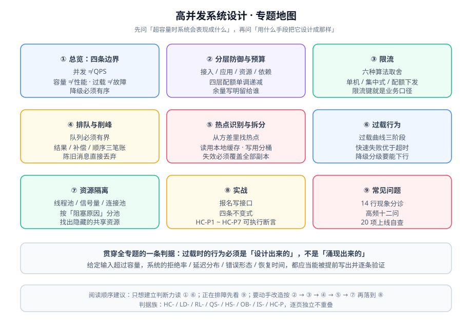

# 高并发系统设计

流量一定会超过容量。本专题回答的不是「怎么让它更快」，而是——**当流量超过容量的那一刻，系统应该表现出什么样的行为，以及你怎么提前把它设计成那样**。

::: tip 一句话理解
性能工程问的是「一次请求有多快、一台机器能扛多少」；高并发系统设计问的是「**当请求数超过能扛的量，剩下的那些去哪了**」。**答案必须是设计出来的，不能是涌现出来的。**
:::

## 与相邻专题的分工

本专题最容易和十个已存在的专题混淆。下表把边界逐条写死——**判据可以互相借用，结论不能互相搬运**。

| 相邻专题 | 它回答什么 | 本专题回答什么 | 为什么不能互相替代 |
| --- | --- | --- | --- |
| [高性能 Java](../HighPerformanceJava/index.md) | 单个进程内的性能：JMH、JIT、对象布局、锁开销、火焰图 | 多个进程 + 多层依赖构成的系统在过载时的行为 | 单机 P99 打到 20 ms，推不出「4 倍流量下系统不崩」 |
| [性能与容量工程](../../Ops/PerformanceEngineering/index.md) | 单机能力是多少、需要几台、水位线定多少 | 容量不够时**怎么办**（拒绝、排队还是降级） | 容量工程给的是**分母**，本专题设计的是**分子的形状** |
| [分布式缓存深入](../DistributedCache/index.md) | 把读放大的次数降下来，以及多级缓存的一致性 | 缓存在过载时的角色：回源、穿透、雪崩与「缓存是第二道防线」 | 缓存解决「同样的读重复了 N 次」，解决不了「不同的写来了 10 万次」 |
| [消息队列](../MessageQueue/index.md) | 消息中间件本身：Kafka / RabbitMQ 的模型、可靠性、集群 | 什么该放进队列、放进去之后的一致性代价怎么补 | MQ 提供**削峰这个能力**，本专题决定**削峰之后的账怎么平** |
| [网关深入 · 流量治理](../GatewayDeep/TrafficManagement/index.md) | 网关上四个开关**具体怎么配**：限流、熔断、超时重试、灰度 | 这些开关的**预算从哪来、分几层、每层拒谁** | 那一页是「一条路由的写法」，本专题是「整套防线的分配」 |
| [熔断限流与降级](../Microservices/CircuitBreaker/index.md) | 熔断器状态机与 Resilience4j / Sentinel 的用法与配置 | 熔断**只是四层防线中的一层**，以及它与其余三层如何配比 | 会配熔断 ≠ 知道该在几步之后熔断 |
| [电商系统设计 · 秒杀](../Ecommerce/FlashSale/index.md) | 秒杀这一个业务的六层过滤怎么搭，以及防超卖 | 把秒杀换成任意一个写热点时，**怎么判断该拆哪里** | 秒杀是**一个实例**，本专题是**一类问题的判据** |
| [响应式编程 · 背压](../ReactiveProgramming/Backpressure/index.md) | 流式链路里 `request(n)` 的语义与溢出策略 | 请求-响应链路上**没有背压通道**时怎么近似出背压 | 背压需要一条反向通道；HTTP 短连接没有这条通道 |
| [SQL 优化](../../DB/Relational/SQLOptimization/index.md) | 单条 SQL 为什么慢：执行计划、索引失效、分页 | 数据库连接被占满时，**上层该发生什么** | 慢 SQL 是**病因**，连接池耗尽与线程池堆积是**死法** |
| [故障应急体系](../../Ops/IncidentResponse/index.md) | 出事之后：定级、指挥、预案、复盘方法 | 出事之前：让「出事的形态」是有限且可枚举的 | 应急体系假设事故会发生；本专题的目标是**让过载不升级为事故** |

::: info 版本组织说明
「高并发系统设计」是**通用技术名**，没有单一官方版本线，因此**不建版本目录**——不存在需要长期并存维护的第二条内容线。

文中涉及的**具体产品**（Sentinel、Resilience4j、Bucket4j、nginx、Redis）的大版本差异，一律在页内用 `::: info` 标注适用版本并说明差异，**不删除旧写法**。仓库内已有的版本目录范式可供对照（三个都按「旧版本保留 + 页顶标注状态 + 新版不覆盖」的约定组织）：

| 版本目录范式 | 入口 | 组织方式 |
| --- | --- | --- |
| Spring 框架 | [Spring 版本入口](../Java/Frame/Spring/index.md) | `Spring5/` 与 `Spring6/` 并存，各自独立目录 |
| Vue 框架 | [Vue3](../../Frontend/Frame/Vue/Vue3/index.md) | `Vue2/` 与 `Vue3/` 并存，`Vue2` 标注为存量项目使用 |
| Spring Boot | `docs/Backend/Java/Frame/SpringBoot/` 下的 `v2` / `v3` / `v4` | 按大版本分目录，共享同一份 `assets/` |
:::

## 专题地图

## 九篇正文

按「先建立判断，再学手段，最后动手」的顺序排列。

| # | 页面 | 一句话说明 |
| --- | --- | --- |
| 1 | [总览：高并发的四条边界](./Overview/index.md) | 并发 ≠ QPS、容量 ≠ 性能、过载 ≠ 故障、降级必须有序 |
| 2 | [分层防御与预算分配](./LayeredDefense/index.md) | 四层防线各拒谁、预算怎么从入口分到依赖 |
| 3 | [限流：算法与分布式实现](./RateLimit/index.md) | 六种算法的取舍、单机 vs 分布式、限流键怎么选 |
| 4 | [排队与削峰](./QueueShaping/index.md) | 队列把「拒绝」换成「延迟」，代价在哪、怎么补 |
| 5 | [热点识别与拆分](./HotspotSplit/index.md) | 从平均值里找出热点，然后把「一个点」变成「一串点」 |
| 6 | [过载行为与有损服务](./OverloadBehavior/index.md) | 过载曲线、快速失败、降级分级与恢复策略 |
| 7 | [资源隔离与并发控制](./Isolation/index.md) | 线程池、信号量、连接池，以及隔离为什么会失效 |
| 8 | [实战：写接口的过载治理](./Practice/index.md) | 从一条写接口出发，把七项判据一条条落成可验证的断言 |
| 9 | [常见问题与最佳实践](./FAQ/index.md) | 分诊表、高频问答、上线自查清单、术语表 |

## 阅读顺序建议

1. **只想建立判断力**：读 [总览](./Overview/index.md) + [过载行为与有损服务](./OverloadBehavior/index.md)，两页加起来够你在评审会上问出正确的问题。
2. **正在排一次线上过载**：先读 [常见问题与最佳实践](./FAQ/index.md) 的分诊表，它会把你送回正确的页面。
3. **要动手改造**：按 2 → 3 → 4 → 5 → 7 的顺序读，再落到 [实战](./Practice/index.md)。
4. **要说服别人**：直接引 [分层防御与预算分配](./LayeredDefense/index.md) 的预算表——「每层拒谁」比「要不要限流」好争论得多。

## 事实与规格速览（2026-10 口径）

口径统一为「已联网核对 + 标注版本号」，涉及产品的地方**都写了适用版本**。

| 事项 | 结论 | 依据 |
| --- | --- | --- |
| nginx 稳定版 / 主线版 | **1.30.5 / 1.31.6**（均 2026-09-15） | 官方 news 页 |
| nginx 限流实现算法 | **漏桶**（`limit_req`），`burst` 是**排队容量**而非「额外放行数」 | `ngx_http_limit_req_module` 文档 |
| nginx 限流可观测变量 | `$limit_req_status`（1.17.6+）：`PASSED` / `DELAYED` / `REJECTED` / `DELAYED_DRY_RUN` / `REJECTED_DRY_RUN` | 同上 |
| nginx 限流拒绝状态码 | 默认 **503**，可用 `limit_req_status` 改成 429 | 同上 |
| Sentinel | **1.8.10**（2026-05-21）为最新稳定；1.8.9（2025-10-17）；默认分支为 `1.8`；`2.0.0-alpha`（2023-02-14）之后无后续 | GitHub Releases |
| Resilience4j | **2.4.0**（2026-03-14）为最新 tag；`2.4.x` 分支**已确认不再发 bugfix**，修复只在 3.0.0+；`spring-boot3` / `spring-boot4` 是**分开的模块** | MVNRepository + 官方仓库说明 |
| Bucket4j | **8.21.0**（2026-10-03）；坐标自 8.10 起按 JDK 拆分为 `bucket4j_jdk17-core` / `bucket4j_jdk11-core` | bucket4j.com + MVNRepository |
| Redis 侧限流 | `redis-cell` 提供 `CL.THROTTLE`（GCRA），但作者已声明处于 **best-effort 维护模式**，不建议作为唯一方案 | 官方仓库 README |
| 滑动窗口计数器的精度 | Cloudflare 实测 4 亿请求，与精确滑动日志的差异约 **0.003%** | 公开实测口径 |

::: warning 三条最容易搞错的事实
1. **`burst` 不是「额外放行数」**：它是漏桶的**排队容量**，不加 `nodelay` 时多出来的请求会被**延迟处理**而不是拒绝——于是它既不是限流也不是快速失败。
2. **Resilience4j 2.4.x 不会有 bugfix**：凡是决定长期使用它的团队，应把「能不能自己 fork」写进选型结论，而不是只看 API 好不好用。
3. **`redis-cell` 不适合当唯一依赖**：维护模式意味着新 Redis 大版本可能没有对应镜像；把它当「可选加速」而不是「唯一实现」。
:::

## 本专题的判据纪律

全库有一条约定的写作纪律：**判据编号必须唯一，且要能同时回答三件事**——「约定是什么 / 定错的后果是什么 / 怎么验证它没被破坏」。

本专题共用一个前缀 `HC`，逐页独立成族：

| 页面 | 判据族 | 数量 |
| --- | --- | --- |
| 总览 | `HC-A` | 6 |
| 分层防御与预算分配 | `LD-A` | 8 |
| 限流 | `RL-A` | 9 |
| 排队与削峰 | `QS-A` | 8 |
| 热点识别与拆分 | `HS-A` | 8 |
| 过载行为与有损服务 | `OB-A` | 9 |
| 资源隔离与并发控制 | `IS-A` | 8 |
| 实战 | `HC-P` | 7 |

## 与「实时协作与冲突解决」专题的分工（第 151 天补充）

第 151 天新增的 [实时协作与冲突解决](../../Backend/RealtimeCollaboration/index.md) 专题讲的是「多个人同时改同一份状态时，数据怎么收敛」；本页讲的是「流量超过容量时系统该表现出什么行为」。两者都谈并发，但一个谈**语义**，一个谈**容量**：

| 维度 | 本页 | 实时协作专题 |
| --- | --- | --- |
| 并发的主体 | 请求 | 人与人 |
| 冲突的形态 | 抢同一个连接、同一把锁、同一份缓存 | 改同一个字段、同一个字符 |
| 处理手段 | 限流、排队、隔离、有损服务 | OT 变换、CRDT 合并、乐观锁 409 |
| 判据形态 | RPS、P99、错误率、队列长度 | 两端内容哈希相同、重放幂等 |

一句话结论：**限流挡得住「请求太多」，挡不住「两个人同时改同一行的两个人都认为自己写对了」。** 后者只能靠合并算法或业务规则解决。

::: warning 容易混用的一处
「加个分布式锁」在两边都会出现：本页用它控制**资源争用**（如库存扣减），协作专题里它只用来给**同一文档的操作定序**。前者锁的是资源，后者锁的是顺序，粒度与时长完全不同。
:::

## 与「幂等与状态机工程」专题的分工（第 152 天补充）

本页解决的是「**量太大**」：限流、排队、削峰、资源争用；[幂等与状态机工程](../IdempotencyStateMachine/index.md) 解决的是「**同一次来两遍**」与「**同一次只前进一步**」。两者的边界在「重试」上最容易混：

| 现象 | 本页的答案 | 专题的答案 |
| --- | --- | --- |
| 突刺流量打满连接池 | 限流 + 排队 + 熔断 | 无解（幂等不解决容量） |
| 用户连点两次「提交」 | 前端防抖只能减少概率 | 幂等键 + 唯一索引，从根上只留一次 |
| 重试放大故障 | 退避 + 熔断 | 幂等使重试安全，但不阻止重试 |
| 库存被扣成负数 | 分布式锁 / 原子扣减 | 条件更新 `where qty >= 1` + 状态机拒非法迁移 |

**结论**：限流挡的是「请求太多」，幂等挡的是「同一次太多」。**只有限流，重试仍会重复成功；只有幂等，容量问题依然会把服务打挂。**

::: warning 本页特有的一个坑
把「加分布式锁」当成幂等的替代品：锁只保证同一时刻一个写者，**上一个写者的请求成功后，下一个请求拿着锁照样会再写一遍**。锁解决互斥，不解决重复。
:::

## 参考资料

- [nginx `ngx_http_limit_req_module` 官方文档](https://nginx.org/en/docs/http/ngx_http_limit_req_module.html)
- [nginx `ngx_http_limit_conn_module` 官方文档](https://nginx.org/en/docs/http/ngx_http_limit_conn_module.html)
- [Sentinel 官方仓库与 Releases](https://github.com/alibaba/Sentinel/releases)
- [Resilience4j 官方文档](https://resilience4j.readme.io/docs)
- [Bucket4j 官方文档](https://bucket4j.com/)
- [RFC 6585（`429 Too Many Requests`）](https://www.rfc-editor.org/rfc/rfc6585)
- [RFC 9110（HTTP 语义：`Retry-After` 与 `503`）](https://www.rfc-editor.org/rfc/rfc9110)
