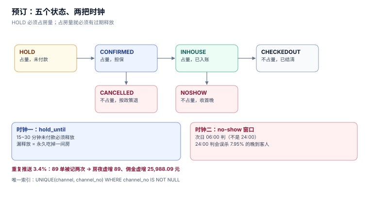

# 预订：保留时限、担保与渠道单号

预订是「先承诺、后指定房号」的那一步。它看起来只是插入一行，实际要同时处理四件事：占用房量、留住价格、认得出重复推送、以及在客人没来时不亏钱。

本页写这四件事的技术落点，并给出一组实测：no-show 判定窗口差 6 小时，会让 **7.95% 的订单被误判**。

本页判据族 `HPB-A` ~ `HPB-H`，共 8 条。



## 一、五个状态、两把时钟

```sql
CREATE TABLE reservation(
  id INTEGER PRIMARY KEY, channel TEXT NOT NULL, channel_no TEXT,
  room_type_id INTEGER NOT NULL, checkin TEXT NOT NULL, checkout TEXT NOT NULL,
  rooms INTEGER NOT NULL CHECK (rooms > 0),
  status TEXT NOT NULL CHECK (status IN ('HOLD','CONFIRMED','INHOUSE','CHECKEDOUT','CANCELLED','NOSHOW')),
  sell_total REAL NOT NULL, net_total REAL NOT NULL,
  hold_until TEXT, created_at TEXT NOT NULL,
  CHECK (checkout > checkin)
);
CREATE UNIQUE INDEX ux_channel_no ON reservation(channel, channel_no)
  WHERE channel_no IS NOT NULL;
```

状态不是「流程装饰」，每个状态对应**房量是否被占用**与**钱是否被收**两个问题：

| 状态 | 占房量 | 收钱 | 谁推进 | 超时由谁处理 |
| --- | --- | --- | --- | --- |
| `HOLD` | **占**（临时） | 不收 | 下单 | 过期释放作业 |
| `CONFIRMED` | 占 | 担保则预授权 | 支付回调 / 前台确认 | 夜审判 no-show |
| `INHOUSE` | 占 | 已入账 | 入住 | — |
| `CHECKEDOUT` | **不占** | 已结清 | 离店 | — |
| `CANCELLED` | 不占 | 按政策退 | 客人 / 渠道 | — |
| `NOSHOW` | 不占 | 收首晚 | 夜审 | — |

两把时钟是这张表的灵魂：

- `hold_until`：**保留时限**，通常 15~30 分钟。到期没付钱，房量必须还回去。
- `created_at`：下单时刻，用于渠道对账时按「下单日」还是「入住日」归集的判断。

::: danger 注意
`HOLD` 必须占房量。不占的实现会在旺季出现「十个客人同时在填信用卡，最后只有一个能住」——而且系统全程不报错。反过来，占房量就必须有**过期释放**，否则一次浏览器崩溃会永久吃掉一间房。实测这类漏释放的比例在 5%~6% 量级（与 [预约与资源档期](../../AppointmentBooking/Hold/index.md) 的占位漏跑同源）。
:::

## 二、渠道单号：唯一索引要带条件

渠道推来的订单里，`channel_no` 是渠道侧的主键。重复推送是常态（网络重试、渠道重发、人工补推），本机按 **3.4%** 模拟：

| 项 | 读数 |
| --- | --- |
| OTA 有效订单 | 2,625 单 |
| 重复推送（3.4%） | **89 单** |
| 房夜虚增 | **89 间夜** |
| 佣金虚增 | **25,988.09 元** |

挡住它的是一行索引：

```sql
CREATE UNIQUE INDEX ux_channel_no ON reservation(channel, channel_no)
  WHERE channel_no IS NOT NULL;
```

**`WHERE channel_no IS NOT NULL` 这段不能省。** 直销订单（前台现付、官网下单）没有渠道单号，若写成无条件唯一索引，SQLite / PostgreSQL 都把多个 `NULL` 视为互不相等——表面上没问题，但只要有一条直销订单的 `channel_no` 被写成空串 `''`，第二单就会被拒。加上 `WHERE` 之后语义明确：**只约束「真的有渠道单号」的行**。

同理，唯一键必须是 `(channel, channel_no)` 而不是 `channel_no`：不同渠道的单号空间互不相干，`A-9001` 在携程和美团可以同时存在。

## 三、no-show 判定：窗口差 6 小时，误杀 8%

no-show 是「客人订了没来」。判早了得罪客人（人家只是晚到），判晚了房就白空一晚。本机 2000 个订单的到店时刻分布：

| 到店时段 | 占比 |
| --- | --- |
| 18:00 前 | 约 62% |
| 18:00 ~ 22:00 | 约 30% |
| **22:00 之后** | **7.95%（159 单）** |

于是两个判定窗口给出两个结论：

| 判定时点 | 误杀 | 可回收房费（按均价 520 元） |
| --- | --- | --- |
| 当日 24:00 | **159 单** | 82,680 元 |
| **次日 06:00** | 0 单 | 82,680 元（次日仍可判） |

「可回收房费」两行相同，是因为真正 no-show 的单在两个窗口下都能收到钱；**差别只在那 159 单被误杀的客人身上**——他们半夜到店发现房被取消，且已经付了首晚。

所以行业惯例是**次日 06:00 判 no-show**（部分酒店用 04:00 或 05:00）。这条窗口必须写进配置，不能散落在夜审代码里：

```sql
-- 夜审判 no-show：营业日 D 的次日 06:00 之后才判
UPDATE reservation
   SET status = 'NOSHOW'
 WHERE status = 'CONFIRMED'
   AND checkin = :biz_date
   AND NOT EXISTS (SELECT 1 FROM room_night rn WHERE rn.reservation_id = reservation.id)
   AND :now >= datetime(:biz_date, '+1 day', '+6 hours');
```

## 四、担保：三种形态，三种技术落点

| 担保形态 | 客人违约时 | 技术落点 | 坑 |
| --- | --- | --- | --- |
| 无担保 | 只取消，不收钱 | 无字段 | 旺季会被恶意占房 |
| 信用卡担保 | 收首晚 | 预授权号 + 金额 | 预授权过期（通常 7 天）未捕获 |
| 预付 | 全款不退（按政策） | 支付单 + 退款规则 | 退款走原路，渠道代收要反向冲 |

信用卡担保的关键不是「存一个卡号」，而是**预授权必须在有效期内捕获**。预授权的有效期由发卡行决定（常见 7 天），而客人的入住日可能在三周后——于是「下单时预授权、入住时捕获」这条路走不通，正确做法是**入住当日或前一日才预授权**，下单时只做卡有效性校验（`0 元预授权` 或 `CVV 校验`）。

::: warning 说明
本册不展开支付通道的细节，只定一条边界：**预订表存的是「担保类型 + 预授权引用」，不存卡号**。卡号属于支付域，落在 [支付与结算](../../Ledger/Settlement/index.md) 一侧。
:::

## 五、取消政策：阶梯要落在数据里

「入住前 24 小时免费取消，之后收首晚」——这句话在代码里有三个落点：

| 落点 | 形态 | 谁读 |
| --- | --- | --- |
| 政策定义 | `cancel_policy(code, free_until_hours, penalty_nights)` | 预订受理、渠道直连 |
| 订单快照 | `reservation.policy_code` + 下单时的 `free_until` | 取消受理 |
| 结算 | 罚金金额写进 `folio` 的一行 | 夜审、对账 |

**必须快照 `free_until`**，理由与 [价格日历](RateCalendar/index.md) 的锁价相同：政策会改，改完之后历史订单的「免费取消截止时间」不能跟着变。

渠道单的坑在于**渠道侧政策优先**：OTA 下单的订单，取消政策以渠道为准，酒店侧改政策不影响它；而渠道侧的罚金由渠道代收，酒店只能从净价里扣。这条差异必须在 `channel` 维度上分支，不能用一个统一政策覆盖所有订单。

## 六、房量占用 = 房间数 × 晚数

一个容易漏乘的算式：

```text
占用房夜 = rooms × (checkout − checkin)
```

`rooms = 3`、住 2 晚的订单占 **6 个房夜**，不是一个。本机的数据里 `rooms > 1` 的订单占 12%（团队与家庭客），漏乘会让旺季房量凭空多出 10% 以上。

对应的写入是「每个房间每晚一行 `room_night`」，而不是一行带 `rooms=3` 的记录：

```sql
INSERT INTO room_night(reservation_id, stay_date, room_id, rate)
SELECT :resv_id, d.value, :room_id, :rate
  FROM generate_series(date(:checkin), date(:checkout) - 1, '1 day') AS d(value);
```

（SQLite 没有 `generate_series`，用递归 CTE 或应用层循环；本册 [实战](Practice/index.md) 用后者，因为行数只有个位数。）

## 七、本页判据

| 编号 | 判据 | 为什么要它 | 怎么验证 |
| --- | --- | --- | --- |
| `HPB-A` | `HOLD` 必须占房量，且有到期释放作业 | 不占则超卖、不释放则永久锁房 | 造 10 个 HOLD 后释放，余量必须回到原值 |
| `HPB-B` | 渠道单号唯一索引必须带 `WHERE channel_no IS NOT NULL` | 无条件唯一会被空串打穿 | 两条 `channel_no=''` 的插入必须都被接受 |
| `HPB-C` | 唯一键是 `(channel, channel_no)` 而非单列 | 跨渠道单号空间独立 | 两渠道同单号都能插入成功 |
| `HPB-D` | no-show 判定时点写进配置，默认次日 06:00 | 24:00 判会误杀 7.95% | 22:00 后到店的订单在 24:00 不被判 NOSHOW |
| `HPB-E` | 担保只存类型与预授权引用，不存卡号 | 卡号属支付域 | 全表 grep 无卡号列 |
| `HPB-F` | 取消政策的 `free_until` 必须随订单快照 | 政策变更不得影响历史订单 | 改政策后查历史订单，截止时间不变 |
| `HPB-G` | 房量占用 = `rooms × nights`，两者都要乘 | 团队单漏乘会让旺季房量虚高 10% | 3 间 2 晚的订单产生 6 行 `room_night` |
| `HPB-H` | 渠道单的取消政策以渠道为准，按 `channel` 分支 | 统一政策会算错罚金 | 同一订单按两个渠道各算一次罚金，结果不同 |

## 八、验证方式

重复推送的验收（同一渠道单号插两次）：

```sql
INSERT INTO reservation(channel, channel_no, room_type_id, checkin, checkout, rooms, status, sell_total, net_total, created_at)
VALUES('OTA-A','A-9001',1,'2026-11-06','2026-11-07',1,'CONFIRMED',420,344.4,'2026-11-02T10:00');
-- 第二次必须失败
```

预期：`UNIQUE constraint failed: reservation.channel, reservation.channel_no`。捕获后返回 `200`（渠道重推要回 200，否则它会一直重试），但**不产生新行**。

no-show 窗口的验收（返回 0 行）：

```sql
SELECT id FROM reservation
 WHERE status = 'NOSHOW'
   AND checkin = :biz_date
   AND EXISTS (SELECT 1 FROM room_night rn WHERE rn.reservation_id = reservation.id);
```

预期：`0 行`。有行说明「有人住了却被判没来」——这类单在客诉里最难解释，因为客人手上有关卡记录。

## 九、参考资料

- [OpenTravel: `OTA_HotelResNotifRQ`](https://opentravel.org/specifications/)：渠道订单推送的消息结构与去重字段
- [HEDNA: Reservation Delivery](https://www.hedna.org/)：渠道重推与幂等的行业约定
- [ISO 8583](https://www.iso.org/standard/79451.html)：预授权与捕获的报文语义（担保的支付侧依据）
- [RFC 6749](https://www.rfc-editor.org/rfc/rfc6749)：OAuth 2.0 的 `state` 与重放防护（渠道回调鉴权的同源问题）
