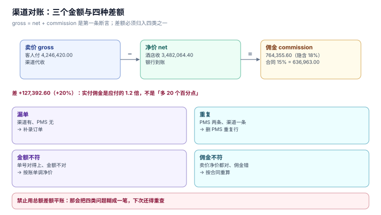

# 渠道与对账：三个金额与四种差额

渠道对账是酒店财务每月最花时间的一件事，也是最容易「签字之后再发现」的一件事。原因是同一个订单在系统里有**三个金额**，而这三个金额由三方各自维护：渠道给卖价与净价、酒店记卖价与应收、银行收到净价。

本页把这三个金额拆开，给出三种差额的实测，并给出「三向对账」的落点。

本页判据族 `HPX-A` ~ `HPX-H`，共 8 条。



## 一、三个金额

| 金额 | 谁付 | 谁收 | 表达式 |
| --- | --- | --- | --- |
| **卖价**（gross） | 客人 | 渠道代收 | `reservation.sell_total` |
| **净价**（net） | 渠道 | 酒店 | `reservation.net_total` |
| **佣金**（commission） | 酒店 | 渠道 | `gross − net` |

三个金额满足一个恒等式：`gross = net + commission`。**任何对账的第一条断言都是它。** 本机的 OTA 数据里这条恒等式成立（净价按卖价 82% 生成），但「佣金率」与合同不一致——这正是最常见的差额形态。

## 二、差额一：合同率 ≠ 实际隐含率

| 项 | 读数 |
| --- | --- |
| OTA 卖价合计 | 4,246,420.00 |
| 净价合计 | 3,482,064.40 |
| 隐含佣金率 | **18.00%** |
| 按合同 15% 应计 | **636,963.00** |
| 按「卖价 − 净价」实际 | **764,355.60** |
| 差 | **+127,392.60（+20%）** |

注意这个 20%：它不是「佣金多了 20 个点」，而是「实付佣金是应付的 1.2 倍」。**报百分比时必须说清分母**——「多付 20%」和「多付 3 个百分点」是两件事，而财务口径里两者都会被写成「超额」。

差额的来源通常是三条，必须分开查：

1. **合同里有多档费率**（不同房型/不同结算周期不同率）——按单一率算就必然偏；
2. **促销由渠道承担**（渠道贴钱做活动，净价低于 82%）——这类差额是「渠道让利」，不是「多付」；
3. **打包产品拆分**（含早餐、含温泉的套餐，渠道只对房费部分计佣）——按整单算会多计。

## 三、差额二：取消单漏剔

| 项 | 读数 |
| --- | --- |
| 取消单数 | **344 单（6.04%）** |
| 取消单卖价合计 | 273,280.00 |
| 若不剔除而按 15% 计佣 | **多付 40,992.00** |

渠道账单里通常会同时列出「成交」与「取消」两类行。取消单的佣金处理有三种：

| 渠道政策 | 佣金 | 落点 |
| --- | --- | --- |
| 取消不收费 | 0 | 账单里仍有该行，金额为 0 |
| 取消收违约金 | 按违约金计佣 | 佣金基数是违约金，不是房费 |
| 取消收首晚 | 按首晚计佣 | 佣金基数是首晚房价 |

**第三种最容易被算错**：拿整单房费乘 15%，而不是首晚乘 15%。本机的取消单平均住 2.2 晚，按整单算会多计一倍以上。

## 四、差额三：重复推送

| 项 | 读数 |
| --- | --- |
| OTA 有效订单 | 2,625 单 |
| 重复推送率 | 3.4% |
| 被记两次的单 | **89 单** |
| 房夜虚增 | **89 间夜** |
| 佣金虚增 | **25,988.09 元** |

这条差额与前两条不同：**它是酒店侧的错，不是渠道侧的错**。渠道重推是正常行为（网络抖动就会重推），酒店侧必须靠 `UNIQUE(channel, channel_no)` 挡住（见 [预订](Booking/index.md) 第二节）。

对账时它表现为「渠道账单只有 2,625 行，PMS 有 2,714 行」——**方向是 PMS 多**。这个方向性很重要：如果反过来（渠道多），说明是酒店漏记，属于更严重的问题。

## 五、三向对账：三张表、四个形状

对账不是「两边比一比」，是三方比对：

| 来源 | 内容 | 权威性 |
| --- | --- | --- |
| 渠道账单（statement） | 渠道认为成交的单与佣金 | 佣金以它为准 |
| PMS 订单（reservation） | 酒店认为成交的单 | 房态与履约以它为准 |
| 银行到账（settlement） | 实际收到的钱 | 金额以它为准 |

三向比对后，差异只有四种形状：

| 形状 | 判定 | 处理 |
| --- | --- | --- |
| **漏单** | 渠道有、PMS 无 | 补录订单（会影响房态，需要人工确认） |
| **重复** | PMS 有两条、渠道一条 | 删 PMS 的重复行（不改渠道账单） |
| **金额不符** | 单号对得上、金额对不上 | 按「渠道账单优先」调 PMS 的净价 |
| **佣金不符** | 卖价与净价都对、佣金对不上 | 按合同重算，差额进「渠道费用」科目 |

四种形状的处理方向不同，**唯一不能做的是「用总额差额去平」**——那会把四类问题糊成一笔「对账差异」，下次还得重查。

### 5.1 对账表的形状

```sql
CREATE TABLE channel_statement(
  channel TEXT NOT NULL, biz_date TEXT NOT NULL, orders INTEGER NOT NULL,
  gross REAL NOT NULL, commission REAL NOT NULL CHECK (commission >= 0),
  PRIMARY KEY (channel, biz_date)
);
CREATE TRIGGER trg_commission_cap BEFORE INSERT ON channel_statement
WHEN NEW.commission > NEW.gross * 0.25
BEGIN SELECT RAISE(ABORT, 'COMMISSION_CAP'); END;
```

`commission <= gross × 25%` 这条上限不是业务规则，是**防呆**：佣金率超过 25% 的酒店业合同极少见，超出基本意味着「基数写错了」（比如把含税总额当成了不含税房费）。实测把 40% 的佣金插进去会被拒（反例 `N5`）。

## 六、月结的五个动作

| 动作 | 输入 | 输出 | 谁签 |
| --- | --- | --- | --- |
| 拉账单 | 渠道后台 | `channel_statement` 行 | 渠道经理 |
| 三向比对 | 账单 + 订单 + 到账 | 差异清单 | 财务 |
| 差异归口 | 差异清单 | 四类形状分类 | 财务 |
| 调账 | 归口结果 | 调整分录 | 财务主管 |
| 归档 | 全部 | 月度对账包 | 财务经理 |

第 2 步的判据是**「每条差异都能追到一个单号」**。追不到单号的差异（比如渠道账单只有汇总数）必须单独列，不能混进四类里——它属于「渠道没给明细」，是流程问题不是数据问题。

## 七、本页判据

| 编号 | 判据 | 为什么要它 | 怎么验证 |
| --- | --- | --- | --- |
| `HPX-A` | 对账第一条断言是 `gross = net + commission` | 三个金额必须自洽 | 逐单校验，返回 0 行 |
| `HPX-B` | 佣金率必须同时报「合同率」与「隐含率」 | 只报一个看不出系统性偏差 | 两个数都打印，差值 = 多付额 |
| `HPX-C` | 取消单必须按政策区分「不计佣 / 按违约金 / 按首晚」 | 按整单算会多计一倍 | 取消单平均 2.2 晚，按整单算的佣金约为应有的 2.2 倍 |
| `HPX-D` | 差异必须归入四类形状之一，禁止用总额差平账 | 糊成一笔下次还得重查 | 差异清单每行有 `shape` 字段 |
| `HPX-E` | 每条差异必须能追到单号 | 追不到的属流程问题 | 无单号的差异单独列，不进四类 |
| `HPX-F` | 重复推送的判定在 PMS 侧，渠道账单不背这个锅 | 方向错会去改渠道账单 | 账单行数 < PMS 行数时先查重复 |
| `HPX-G` | 佣金上限做成数据库约束（≤ 25%） | 基数写错是最常见的错 | 插入 40% 必须被拒 |
| `HPX-H` | 对账结果按月归档，含差异清单原件 | 三个月后无法复算 | 归档包含账单、差异清单、调整分录 |

## 八、验证方式

恒等式的验收（返回 0 行）：

```sql
SELECT id, sell_total, net_total, sell_total - net_total AS implied_commission
  FROM reservation
 WHERE channel LIKE 'OTA%' AND status = 'CONFIRMED'
   AND ABS((sell_total - net_total) - ROUND(sell_total * 0.18, 2)) > 0.05;
```

预期：`0 行`——本机净价是按 82% 生成的，隐含佣金率恒为 18%，误差不超过 5 分钱。若有行，说明某些订单的净价用了别的规则（比如打包产品拆分），**这些行就是对账时第一批要人工看的单**。

重复推送的验收（返回空）：

```sql
SELECT channel, channel_no, COUNT(*) FROM reservation
 WHERE channel_no IS NOT NULL
 GROUP BY 1,2 HAVING COUNT(*) > 1;
```

预期：`0 行`。有行说明 `ux_channel_no` 没建或被绕过了（例如应用层写了 `INSERT OR REPLACE`，它会静默覆盖而不是报错）。

## 九、参考资料

- [HEDNA: Global Commission and Payment Models](https://www.hedna.org/)：渠道佣金结算的行业口径
- [OpenTravel: `OTA_HotelInvNotifRQ`](https://opentravel.org/specifications/)：渠道账单的字段定义
- [ISO 20022](https://www.iso20022.org/)：`BankToCustomerStatement` 的报文结构（银行到账侧的依据）
- [PostgreSQL: `CHECK` Constraints](https://www.postgresql.org/docs/current/ddl-constraints.html#DDL-CONSTRAINTS-CHECK-CONSTRAINTS)：用约束表达业务上限
