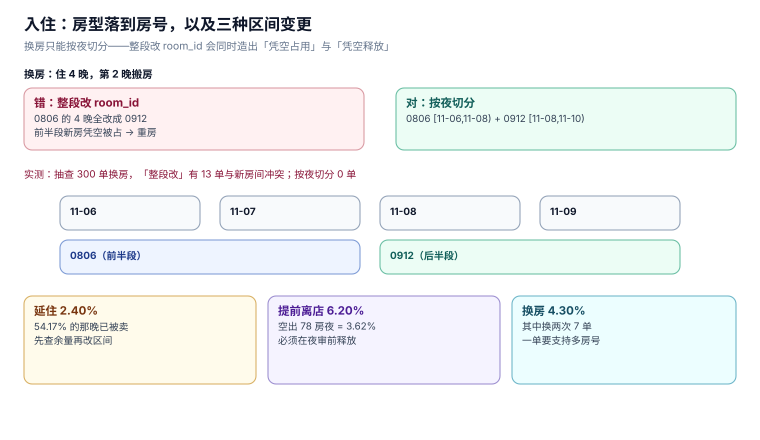

# 入住与在住：从房型到房号

预订卖的是**房型**（「一间大床房」），入住给的是**房号**（「0806」）。这一步是全链路里唯一一次「把承诺落到具体物理对象」的动作——落错了，客人推开房门会看见别人的行李。

本页写四个在住动作的技术落点：入住、换房、延住、提前离店。四者的共同点是**它们都在改一段已经存在的区间**，而区间一旦被改，前后的房态必须同时守恒。

本页判据族 `HPC-A` ~ `HPC-H`，共 8 条。



## 一、入住：一次写入，三处状态

前台点「入住」这一下，系统要同时做三件事：

| 动作 | 表 | 变化 |
| --- | --- | --- |
| 订单状态推进 | `reservation` | `CONFIRMED` → `INHOUSE` |
| 落房号 | `room_night` | 补 `room_id`（若预订时未预排） |
| 房态改在住 | `room`（当日视图） | `VC`（空净）→ `OC`（在住） |

三者必须在**同一个事务**里。分开提交的最坏情况是：订单已是 `INHOUSE`、房号没落、房态还是 `VC`——于是这间房在系统里「空着」，第二天会被再卖一次。

::: danger 注意
`room.status` 这一列如果真的要存，**只能存「此刻」**，且必须由入住/离店两个动作独占写入。让夜审、清洁、维修也去改它，就再也说不清「谁把它改成了 VC」。
:::

### 1.1 预排房与现场排房

| 方式 | 时点 | 优点 | 风险 |
| --- | --- | --- | --- |
| 预排（预订时定房号） | 下单时 | 前台零操作，可提前制卡 | 客人改期后要重排；房号被锁死后无法灵活调度 |
| 现场排（入住时才定） | 到店时 | 灵活，可按当日房况优化 | 高峰排队；需要「推荐房号」算法 |

本册默认**现场排**，`room_night` 在预订阶段可以先写 `room_id = NULL`（表示「占量未落房」），入住时补。这样 `avail_daily.sold` 在预订时就已 +1，而 `ux_room_night` 只在落房后才起作用——两层约束各自负责不同的阶段。

## 二、换房：不能「改整段」

客人住 4 晚，第 2 晚要换房。最直觉的写法是把这单的 `room_night.room_id` 全改成新房号——**这是错的**，因为它同时做了两件不该做的事：让新房在**前 1 晚**凭空被占（那晚客人还住在旧房），让旧房在**后 2 晚**凭空释放（那晚客人已搬走）。

正确写法是**把区间切开**：

```text
原区间：room 0806 [11-06, 11-10)
换房：  room 0806 [11-06, 11-08) + room 0912 [11-08, 11-10)
```

技术上就是「删掉后半段的行、在新房插后半段的行」，两条语句在一个事务里。实测「直接改整段」的代价：

| 写法 | 抽查 300 单的结果 |
| --- | --- |
| 直接改整段 `room_id` | **13 单**与新房间已有占用冲突（即重房） |
| 按夜切分 | 0 单冲突（`ux_room_night` 兜底） |

13/300 这个比例不是随机噪声，是**结构性**的：换房往往发生在满房时段（客人投诉、设备故障），而满房时段新房大概率已被占。

### 2.1 换房要留痕

换房必须有一条独立记录（`room_move(stay_id, from_room, to_room, moved_at, reason)`），因为三件事都要它：

- 客诉时回答「为什么把我换走」；
- 清洁排班要知道哪间房提前空了；
- 房费差价（换到更好房型时的升级费）要挂在这次变更上。

只在 `room_night` 上体现换房，**事后查不出发生过换房**——这是本册要求单独建表的原因。

### 2.2 换房率与「换两次」

本机 1000 单住宿里换房 **43 单（4.30%）**，其中**换两次 7 单**。换两次意味着区间被切成三段，`room_night` 里出现三组行——如果代码里假设「一单最多一个房号」，这里就会崩（典型表现是账单只出了一间的房费）。

## 三、延住：先查可售，再改区间

延住（extend stay）是「把 `checkout` 往后推」。它看起来只是改一个日期，实际是一次**新的库存请求**：延住那一晚，这间房可能已经被卖给别人了。

本机 1000 单里延住 **24 单（2.40%）**，其中**13 单（54.17%）** 延住的那一晚该房号已经被占用。

| 处理 | 结果 |
| --- | --- |
| 直接 `UPDATE reservation SET checkout = checkout + 1` | 54.17% 的概率与新占用冲突（`ux_room_night` 会拒，但错误信息对前台不可读） |
| 先查 `avail_daily` 余量 + 目标房号那晚是否空 → 再写 | 冲突时给出「本房已满，可换至 0912 或加价升级」的可选方案 |

延住的正确流程是三步：

1. 查房型-日余量与目标房号占用（两条独立查询）；
2. 有余量则在事务里插 `room_night` + 改 `checkout` + 改 `sell_total`；
3. 无余量则返回**可执行的替代方案**，而不是一个 409。

::: tip 一句话理解
延住不是「改日期」，是「再卖一晚」。把它当库存请求处理，就自然不会写错。
:::

## 四、提前离店：空出来的房要能再卖

客人原订 3 晚，住了 1 晚就走了。系统要做两件事：

| 动作 | 影响 |
| --- | --- |
| 释放后两晚 | `avail_daily.sold` 减 2，余量回到可售 |
| 结算改口径 | 房费只收到 1 晚，`folio` 里要有冲减行 |

本机 1000 单里提前离店 **62 单（6.20%）**，空出 **78 个房夜**，占总房夜（2,154）的 **3.62%**。

这 3.62% 在收益管理里是**真金白银**：它意味着旺季每晚大约有 3.6% 的房可以二次销售，前提是释放动作**在夜审之前**完成。释放晚了（比如第二天早上才处理），那晚的房就永久损失了。

### 4.1 房费的冲减必须落在 `folio`，不能「改原价」

错误写法：把 `room_night.rate` 改成 0。
正确写法：保留原价，插一条 `item='REBATE'` 的负数行。

理由与 [复式记账](../../Ledger/DoubleEntry/index.md) 同源：**原始记录不可变**。改原价的后果是「账单上从来没有出现过那两晚」，而客人手上的预订确认单上有——对不上时，酒店无法自证。

## 五、房态与清洁：两套状态，两个系统

前台的「房态」与客房的「清洁状态」经常被混成一个字段，实际是两个维度：

| 维度 | 取值 | 谁改 | 用途 |
| --- | --- | --- | --- |
| 占用状态 | 空房 / 在住 / 已退未清 | 入住、离店 | 能不能卖 |
| 清洁状态 | 待清 / 清洁中 / 已检 | 客房部 | 能不能给客人 |

组合出四个常用态：`VC`（空净，可卖）、`VD`（空脏，待清）、`OC`（在住净）、`OD`（在住脏）。**只有 `VC` 可以直接卖**，其余三个要么等清洁、要么等退房。

把两套合并成一个五值枚举，会丢掉「在住但房间很脏」这种状态——而它恰是客房部排班的输入。

## 六、本页判据

| 编号 | 判据 | 为什么要它 | 怎么验证 |
| --- | --- | --- | --- |
| `HPC-A` | 入住的三处写入在同一事务 | 分开提交会出现「已入住但房还空着」 | 事务内注入异常，三张表必须同时回滚 |
| `HPC-B` | 换房必须按夜切分区间，不得整段改 `room_id` | 整段改会造出重房 | 抽查换房单，新旧房号的 `room_night` 日期必须互补且不重叠 |
| `HPC-C` | 换房留独立记录（含原因与时点） | 只在 `room_night` 上看不出换过房 | `room_move` 行数 = 换房次数 |
| `HPC-D` | 一单支持多个房号（换两次要三段） | 假设「一单一个房号」会让账单漏房费 | 构造换两次的单，账单房费 = 三段之和 |
| `HPC-E` | 延住前必须查余量与目标房占用 | 54.17% 的延住那晚已被占 | 构造已占房的延住，必须返回替代方案而非裸 409 |
| `HPC-F` | 提前离店只冲减 `folio`，不改 `room_night.rate` | 改原价后无法自证 | 冲减后 `room_night` 行数不变、`folio` 多一条负数行 |
| `HPC-G` | 释放的房夜要回到 `avail_daily.sold` | 不释放则 3.62% 的房永久损失 | 提前离店后余量 +剩余夜数 |
| `HPC-H` | 占用状态与清洁状态分两列 | 合并后丢失「在住但脏」 | 两列同时存在，且 `VC` 是唯一可卖态 |

## 七、验证方式

重房的验收（换房后两条 SQL 都返回 0 行）：

```sql
-- ① 同一房号同一夜不能有两行（唯一索引兜底）
SELECT room_id, stay_date, COUNT(*) FROM room_night
 GROUP BY 1,2 HAVING COUNT(*) > 1;

-- ② 换房前后两段必须首尾相接、不重叠
SELECT s.stay_id, s.ci, s.co, MIN(rn.stay_date), MAX(rn.stay_date), COUNT(*)
  FROM stay s JOIN room_night rn ON rn.stay_id = s.id
 GROUP BY s.stay_id
HAVING COUNT(*) <> (julianday(s.co) - julianday(s.ci));
```

预期：两条都 `0 行`。第二条是本页最实用的断言——**它用「行数 = 夜数」一次性抓住「丢了一晚」和「多了一晚」两种错**。

提前离店的验收（返回非空）：

```sql
SELECT s.id, s.co, MAX(rn.stay_date) AS last_night
  FROM stay s JOIN room_night rn ON rn.stay_id = s.id
 GROUP BY s.id
HAVING MAX(rn.stay_date) < date(s.co, '-1 day');
```

预期：能列出所有提前离店的单。**这是「应该被释放的房」的清单**，拿它去比对 `avail_daily.sold` 是否已减，就能查出漏释放。

## 八、参考资料

- [OpenTravel: `OTA_HotelStayInfoNotifRQ`](https://opentravel.org/specifications/)：在住信息（换房、延住）的上报字段
- [RFC 5545 §3.8.5.3](https://www.rfc-editor.org/rfc/rfc5545#section-3.8.5.3)：`RECURRENCE-ID`——把「一段区间被切开」表达成一串实例的标准做法
- [PostgreSQL: `daterange` 与 `EXCLUDE`](https://www.postgresql.org/docs/current/rangetypes.html)：用排他约束表达「同房不重叠」
- [SQLite: Transaction](https://www.sqlite.org/lang_transaction.html)：`BEGIN IMMEDIATE` 与写锁获取时机
