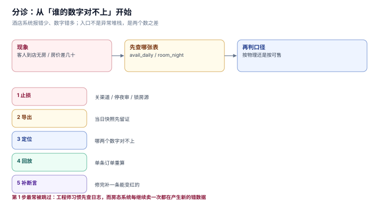

# 常见问题与分诊

这一页按「现象 → 先查哪张表 → 最可能的原因」的顺序排。酒店系统的问题有个共同特征：**报错很少，数字不对很常见**，所以分诊的入口往往是「谁的数字和谁对不上」，而不是「哪里抛了异常」。

本页判据族 `HPQ-A` ~ `HPQ-H`，共 8 条。



## 一、分诊表

| 现象 | 先查 | 最可能的原因 | 对应页 |
| --- | --- | --- | --- |
| 客人到店无房 | `avail_daily` 当日 `sold` vs `total` | 超售额度按整店设，小房型超不出去 | [房量与房态](RoomInventory/index.md) |
| 同一间房分给两拨人 | `room_night` 按 `(room_id, stay_date)` 分组 | 缺 `ux_room_night`，或换房时整段改了 `room_id` | [入住与在住](CheckIn/index.md) |
| 房价差几十块 | `room_night.rate` 与 `sell_total` | 派生顺序：先折扣后加餐包 | [价格日历](RateCalendar/index.md) |
| 渠道订单重复 | `reservation` 按 `(channel, channel_no)` 分组 | 唯一索引漏了 `WHERE channel_no IS NOT NULL` | [预订](Booking/index.md) |
| 出租率两个数 | 分子分母来源 | 一个用物理、一个用可售 | [总览](Overview/index.md) |
| 月度间夜对不上 | `room_night.stay_date` 的月份分布 | 按退房月归属 | [夜审与间夜](NightAudit/index.md) |
| 佣金多付 | `gross - net` 与合同率 | 取消单没剔、隐含率 ≠ 合同率 | [渠道与对账](ChannelRecon/index.md) |
| 夜审后金额翻倍 | `folio` 按 `(stay_id, biz_date, item)` 分组 | 唯一键缺 `item` 或整个缺失 | [夜审与间夜](NightAudit/index.md) |
| 客人账单少了杂费 | `folio` 该 `stay_id` 的行数 | 唯一键漏了 `item`，房费挤掉杂费 | [夜审与间夜](NightAudit/index.md) |
| 延住报 409 且无建议 | 延住流程 | 直接改 `checkout`，没查库存 | [入住与在住](CheckIn/index.md) |

## 二、十二问

### Q1：为什么不能用一个 `room.status` 字段表示房态？

因为字段没有日期。`status='VC'` 在 23:59 正确，在 00:01 可能是错的（那间房明天已被订走）。可售性必须表达成「房 × 日」，见 [房量与房态](RoomInventory/index.md)。

### Q2：超售额度为什么不能按整店设？

因为 `CAST(rooms × pct / 100 AS INT)` 在小房型上恒为 0。4 间套房 3% 超售 = 0 间，40 间标准房 3% = 1 间。按整店统一比例，会让小房型永远超不出去、大房型超得太狠。

### Q3：`HOLD` 状态到底占不占房？

占。不占的实现会在旺季出现「十个人同时填卡，最后只有一个能住」。占就必须有到期释放作业，否则一次浏览器崩溃永久吃掉一间房。

### Q4：为什么换房不能直接改 `room_night.room_id`？

因为那会同时做两件错事：让新房在前半段凭空被占，让旧房在后半段凭空释放。实测抽查 300 单里有 13 单因此与新房间冲突（即重房）。正确做法是按夜切分区间。

### Q5：夜审为什么不能按自然日跑？

因为凌晨入住的客人买的是「前一天的房」。按自然日跑，11-05 少一间夜、11-06 多一间，两个月的报表各自平衡却互相错位。

### Q6：`UNIQUE(stay_id, biz_date)` 够不够？

不够。缺 `item` 时，同一晚的房费与洗衣费只有一条能进。表现是「客人账单少了杂费」，而总额仍然平衡——因为少的是一条明细，不是一笔金额。

### Q7：佣金「多付 20%」是什么意思？

指实付佣金是应付的 1.2 倍（15% → 18%），不是「多 20 个百分点」。报百分比必须带分母，否则财务和业务会吵起来。

### Q8：为什么取消单要单独算佣金？

因为基数不同：不计佣 / 按违约金计佣 / 按首晚计佣。取消单平均住 2.2 晚，按整单房费算会多计一倍以上。

### Q9：`closed`（关房）和 `total=0`（卖不了）有区别吗？

有。前者是策略（不想卖），后者是物理（维修/满房）。两者都导致不可售，但只有后者该进物理不可售的分母——把策略关闭算成物理损坏，业主会以为房间坏了。

### Q10：Adapter/渠道单号为什么用部分唯一索引？

因为直销订单没有渠道单号。无条件唯一索引在 `NULL` 上不会冲突（SQL 把 `NULL` 视为互不相等），但一旦有订单写成空串 `''`，第二单就被拒。`WHERE channel_no IS NOT NULL` 把语义写死：只约束真有单号的行。

### Q11：为什么 ADR 与 RevPAR 的分母不同？

ADR 的分母是「已售间夜」，RevPAR 的分母是「可售房量」。写成同一个分母，两个指标会一起偏且方向相反——ADR 偏低、RevPAR 偏高，肉眼看不出异常。

### Q12：夜审崩了能直接重跑吗？

能，前提是唯一键齐备且异常被捕获。实测无唯一键重跑一次金额 +100%（312,000 → 624,000）；有 `UNIQUE(stay_id, biz_date, item)` 时两轮仍是一轮。

## 三、止血五步

线上出问题时的顺序，**不要跳步**：

| 步 | 动作 | 目的 |
| --- | --- | --- |
| 1 | 停掉出问题的入口（关渠道 / 停夜审 / 锁房源） | 先止住扩散，再查原因 |
| 2 | 导出现场（相关表当日快照） | 数据会被后续操作覆盖，先留证 |
| 3 | 定位口径（哪两个数字对不上） | 酒店问题几乎都是口径问题 |
| 4 | 小范围回放（单条订单重算） | 验证修法，不动全量 |
| 5 | 补数据 + 补断言 | 修完必须加一条能变红的断言，否则下次还会犯 |

第 1 步最容易被跳过：工程师习惯先查日志。但**房态类系统的每一次「继续卖」都在产生新的错误数据**，停一分钟比查一小时值钱。

## 四、术语表

| 术语 | 英文 | 一句话 | 易混点 |
| --- | --- | --- | --- |
| 房夜 | room night | 一间房住一晚 = 1 房夜 | 与「间夜」同义，但与「房数」不同 |
| 间夜 | room night | 同上，财务口径 | 与「住宿单数」不是一回事 |
| 房量 | inventory | 可卖的房数 | 与「房间数」差维修房 |
| 房态 | room status | 此刻的占用/清洁状态 | 与「可售性」不是一回事 |
| OOO | Out of Order | 维修房，不可售 | 与「关闭」不同（策略 vs 物理） |
| BAR | Best Available Rate | 最优可售价，房价基准 | 不等于「最低价」 |
| 夜审 | night audit | 结束营业日的作业 | 不等于「零点结算」 |
| 营业日 | business date | 夜审切点定义的「今天」 | 不等于自然日 |
| no-show | no show | 订了没来 | 判定窗口是次日 06:00，不是 24:00 |
| walk | walking a guest | 把客人送到别的酒店 | 超售的代价，不是「请客人走」 |
| ADR | Average Daily Rate | 房费收入 / 已售间夜 | 分母不是可售房量 |
| RevPAR | Revenue Per Available Room | 房费收入 / 可售房量 | 分母与 ADR 不同 |

## 五、本页判据

| 编号 | 判据 | 为什么要它 | 怎么验证 |
| --- | --- | --- | --- |
| `HPQ-A` | 分诊表每行必须有「先查哪张表」 | 没有入口的分诊等于没有 | 每行的第二列不是空 |
| `HPQ-B` | 每个现象必须能追到一条断言或一条 SQL | 否则只是经验，不可复现 | 现象与断言编号有映射 |
| `HPQ-C` | 「止血五步」的第 1 步必须是止损而非排查 | 每次继续卖都在产生错数据 | 步骤顺序固定，不可交换 |
| `HPQ-D` | 修复后必须新增一条能变红的断言 | 不补断言下次还会犯 | 缺陷单里含「新增断言」项 |
| `HPQ-E` | 术语表必须标出易混点 | 「间夜 / 房间数」混用是高频错 | 每行第 4 列非空 |
| `HPQ-F` | 百分比结论必须带分母 | 「多付 20%」与「多 20 点」不同 | 全页百分比都能找到分母 |
| `HPQ-G` | 同一术语在全册只有一个定义 | 两种定义会让两页互相矛盾 | 术语表与本册各页一致 |
| `HPQ-H` | 每个「不能做 X」必须给出「应该做 Y」 | 只禁不导会让读者卡住 | 每处 `danger` 都含正确写法 |

## 六、验证方式

分诊表与断言的映射可以机械核对——本页列出的每条 SQL 都能在 [实战](Practice/index.md) 的库里直接跑：

```shell
python3 hp_practice.py | grep -c PASS
# 预期输出：16
```

术语一致性可以 grep：

```shell
grep -rn "间夜" docs/Backend/HotelPMS/*/index.md | grep -c "房间数"
# 预期输出：0（这两个词不应出现在同一句里作为同义词）
```

## 七、参考资料

- [USALI (Uniform System of Accounts for the Lodging Industry)](https://www.hospitalitynet.org/)：ADR / RevPAR / 间夜的统一定义
- [HEDNA](https://www.hedna.org/)：渠道对账与佣金口径
- [OpenTravel Specifications](https://opentravel.org/specifications/)：渠道消息字段
- [《旅游饭店星级的划分与评定》GB/T 14308—2010](https://openstd.samr.gov.cn/)：客房数与出租率口径
