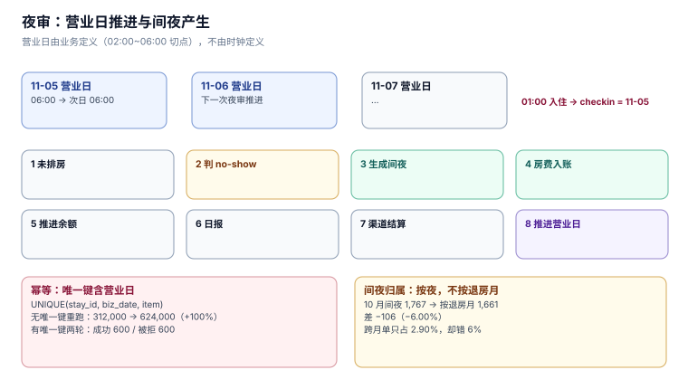

# 夜审与间夜：营业日不等于自然日

夜审（night audit）是酒店业独有的一个作业：它不是在「零点」结束一天，而是在**凌晨某个时刻**把「今天」关掉。这件事听起来只是定时任务，实际决定了三张报表的分母：间夜数、房费收入、出租率。

本页写三件事：营业日怎么定义、间夜归到哪一天、以及为什么夜审必须是幂等的。

本页判据族 `HPN-A` ~ `HPN-H`，共 8 条。



## 一、营业日：一个被业务定义的日期

| 概念 | 定义 | 例子 |
| --- | --- | --- |
| 自然日 | 00:00 ~ 23:59 | 11-06 |
| **营业日**（business date） | 上一个夜审结束 ~ 本次夜审开始 | 11-06 06:00 ~ 11-07 06:00 |
| 到店日（arrival date） | 订单上的 `checkin` | 11-06 |

凌晨 1 点入住的客人，`checkin` 是**前一天**（11-05）——因为他买的是「11-05 这一晚」。如果系统按自然日算，这单会被记到 11-06，于是 11-05 的间夜少一间、11-06 的多一间，而两个月的月报都可能因此错位。

::: tip 一句话理解
营业日的切点由**业务**定（多数酒店在 02:00~06:00 之间），不由时钟定。切点写进配置，夜审按配置推进。
:::

### 1.1 夜审的八步

| 步 | 动作 | 失败后果 |
| --- | --- | --- |
| 1 | 检查未排房订单 | 到店客人无房可给 |
| 2 | 判 no-show（次日 06:00 后） | 误杀晚到客人 |
| 3 | 生成当晚间夜（`room_night` 落账） | 间夜数少一晚 |
| 4 | 房费入账（`folio` 写 `ROOM` 行） | 收入少一天 |
| 5 | 推进在住客人余额 | 账单与预授权对不上 |
| 6 | 生成当日经营报表 | 报表缺数 |
| 7 | 结算当日渠道单 | 佣金对不上 |
| 8 | 推进营业日（`night_audit.seq += 1`） | 重复跑会翻倍入账 |

第 3 与第 4 步是「产生间夜」与「产生收入」两个动作。**它们必须都能幂等**，因为夜审是整个系统里最常被重跑的作业。

## 二、幂等：唯一键必须含营业日

| 实现 | 一轮 | 两轮 | 差异 |
| --- | --- | --- | --- |
| 无唯一键 | 312,000.00 | **624,000.00** | **+100%** |
| `UNIQUE(biz_date, resv_id)` | 312,000.00 | **312,000.00** | 0 |

两轮后的行数：有唯一键时「成功 600 / 被拒 600」，合计金额仍是一轮的 312,000.00。

```sql
CREATE TABLE folio(
  id INTEGER PRIMARY KEY, stay_id INTEGER NOT NULL,
  biz_date TEXT NOT NULL, item TEXT NOT NULL, amount REAL NOT NULL
);
CREATE UNIQUE INDEX ux_folio ON folio(stay_id, biz_date, item);
```

这个唯一键有三列，每一列都不能省：

| 列 | 省了会怎样 |
| --- | --- |
| `stay_id` | 所有客人的房费撞在一起，第二个人就记不上 |
| `biz_date` | 连住三晚的客人只有第一晚能记账 |
| `item` | 同一晚的房费与迷你吧消费互相挤掉 |

::: danger 注意
只写 `UNIQUE(stay_id, biz_date)` 而漏 `item`，是本册见过最隐蔽的一种：**房费和杂费在同一晚只留一条**。它的表现是「客人账单少了洗衣费」，而账目总额仍然平衡——因为少的是一条明细，不是一笔金额。
:::

### 2.1 夜审的第二个守卫：`night_audit` 主键

```sql
CREATE TABLE night_audit(biz_date TEXT NOT NULL, seq INTEGER NOT NULL,
                         run_at TEXT NOT NULL, PRIMARY KEY(biz_date, seq));
```

`PRIMARY KEY(biz_date, seq)` 让「同一营业日只能有一条记录」，于是「夜审跑了几次」这件事本身可查。实测重跑时插入被拒（`IntegrityError`），捕获后当作「已跑过」。

## 三、间夜归属：按夜还是按退房日

「10 月的间夜」有两种算法，3000 单住宿数据（跨月单 2.90%）：

| 口径 | 10 月间夜 | 说明 |
| --- | --- | --- |
| 按夜归属 | **1,767** | 每一晚记在自己的日期上 |
| 按退房月归属 | **1,661** | 整单记到退房月 |
| 差 | **−106（−6.00%）** | 跨月单被整体推到下个月 |

正确的只有第一种。理由是**收入与履约同步**：11-06 那一晚的房费，是客人在 11-06 那一晚住了才赚到的；把它记到 11 月，等于把 10 月的成本（清洁、能耗、人工）和收入错配。

### 3.1 「已售未住」：第三种间夜

间夜有三种状态，报表必须分得开：

| 状态 | 含义 | 本机读数 |
| --- | --- | --- |
| 已售且已住 | 正常 | 主体 |
| 已售未住（提前离店） | 收了钱但没住 | **219 / 6,667 = 3.28%** |
| 已售未住（no-show） | 收了首晚但没来 | 4.43% 的订单 |

前两种都是「已售」，但只有第一种是「履约完成」。把三者合并成一个「间夜数」，会同时高估出租率与收入确认进度。

## 四、no-show 落账：收多少、记到哪

no-show 的账务处理有三条路，取决于担保形态：

| 担保 | 收多少 | 记到哪个科目 | 谁承担 |
| --- | --- | --- | --- |
| 无担保 | 0 | 不记 | 酒店（房空一晚） |
| 信用卡担保 | 首晚房费 | 房费收入 | 客人 |
| 预付 | 全款（按政策） | 房费收入 + 可能的违约金 | 客人 |

技术上要注意的是：**no-show 的房费要记在「原入住日」**，不是判定的那一天。11-05 的 no-show 在 11-06 06:00 判定，账要记在 `biz_date = '2026-11-05'`——否则 11-05 少一间夜收入、11-06 多一笔无对应间夜的收入。

## 五、三种报表口径必须同时给出

夜审产出的日报有三个核心数字，它们各自的分母不同：

| 指标 | 分子 | 分母 | 本机读数 |
| --- | --- | --- | --- |
| 出租率（按物理） | 已售间夜 | 物理房量 | 75.83% |
| 出租率（按可售） | 已售间夜 | 可售房量 | 76.60% |
| 平均房价 ADR | 房费收入 | **已售间夜** | 由订单加权 |
| RevPAR | 房费收入 | **可售房量** | 由前两者派生，但分母不同 |

第三、四行的分母容易被写错：ADR 的分母是「已售」，RevPAR 的分母是「可售」。写成同一个分母，两个指标会一起偏，而**偏的方向相反**——ADR 偏低、RevPAR 偏高，肉眼看不出异常。

## 六、本页判据

| 编号 | 判据 | 为什么要它 | 怎么验证 |
| --- | --- | --- | --- |
| `HPN-A` | 营业日切点写进配置，不硬编码 `00:00` | 凌晨入住归前一天 | 01:00 的订单 `checkin` 必须是前一天 |
| `HPN-B` | 房费入账唯一键含 `(stay_id, biz_date, item)` 三列 | 少 `item` 会让房费挤掉杂费 | 同一晚插房费与洗衣费，两条都要成功 |
| `HPN-C` | `night_audit` 主键含营业日与序号 | 重跑要能被识别 | 同一营业日插第二条必须被拒 |
| `HPN-D` | 间夜按「夜」归属，不按退房日 | 跨月单会让两个月错位 6% | 跨月单的两晚必须落在两个月份 |
| `HPN-E` | 已售未住要分「提前离店」与「no-show」两类 | 合并会高估履约 | 两个计数分别可查 |
| `HPN-F` | no-show 房费记在原入住日 | 否则收入与间夜错位一天 | no-show 单的 `biz_date = checkin` |
| `HPN-G` | ADR 分母是已售、RevPAR 分母是可售 | 同分母会让两个指标反向偏 | 两个指标各自复算，与报表一致 |
| `HPN-H` | 夜审可重跑且结果不变（同金额、同行数） | 凌晨崩溃是常态 | 连跑两次，`SUM(folio.amount)` 不变 |

## 七、验证方式

幂等的验收（两轮后金额不变）：

```sql
-- 第一轮
INSERT INTO folio(stay_id, biz_date, item, amount) VALUES (1,'2026-11-06','ROOM',940.0);
-- 第二轮（同一条，必须失败）
INSERT INTO folio(stay_id, biz_date, item, amount) VALUES (1,'2026-11-06','ROOM',940.0);
```

预期：第二条报 `UNIQUE constraint failed: folio.stay_id, folio.biz_date, folio.item`。捕获后继续执行——**不要让异常冒到事务外**，否则后面所有客人的房费都不会入账。

间夜归属的验收（跨月单两晚必须分属两月）：

```sql
SELECT r.id, r.checkin, r.checkout,
       GROUP_CONCAT(substr(rn.stay_date,1,7)) AS months
  FROM reservation r JOIN room_night rn ON rn.reservation_id = r.id
 WHERE substr(r.checkin,1,7) <> substr(r.checkout,1,7)
 GROUP BY r.id
HAVING COUNT(DISTINCT substr(rn.stay_date,1,7)) <> 2;
```

预期：`0 行`。有行说明跨月单的某一晚被记到了错误的月份——这正是「两个月的报表各自平衡、互相差 106 间夜」的来路。

## 八、参考资料

- [USALI (Uniform System of Accounts for the Lodging Industry)](https://www.hospitalitynet.org/)：间夜、ADR、RevPAR 的行业统一定义
- [《旅游饭店星级的划分与评定》GB/T 14308—2010](https://openstd.samr.gov.cn/)：客房出租率的统计口径
- [SQLite: UPSERT](https://www.sqlite.org/lang_upsert.html)：`ON CONFLICT DO NOTHING` 与幂等写入
- [PostgreSQL: `ON CONFLICT`](https://www.postgresql.org/docs/current/sql-insert.html)：冲突处理的两种语义
