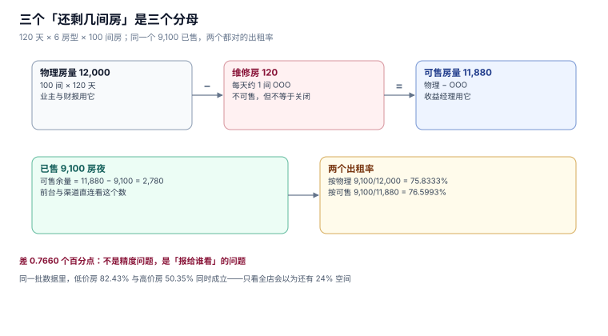

# 总览：七段链、三个「还剩几间房」与五个安静的失败

一家 100 间房的酒店，一年有 36,500 个「房夜」可以卖。这个数字在系统里**没有任何一行能直接表示**：`room` 表只有 100 行，`reservation` 表存的是区间，房态要么是每房每日一行、要么是一段区间、要么是一个字段。三种表示各自能回答不同的问题，混用就会在某个报表上炸掉。

本页把全册的骨架铺开：为什么房量有三种口径、七段链各自改哪个数、以及为什么酒店的五个典型失败都不报警。

本页判据族 `HPO-A` ~ `HPO-H`，共 8 条；整个专题九页共 72 条，定义在 `docs/Backend/HotelPMS/` 各页的「本页判据」一节。



## 一、三种口径：物理、可售、余量

先看一组本机读数。120 天 × 6 个房型 × 100 间房，需求按房型基准出租率加周末波动生成，维修房按每天 1.2% 随机摊：

| 口径 | 算法 | 读数 |
| --- | --- | --- |
| 物理房量 | `Σ room_type.rooms × 天数` = 100 × 120 | **12,000** 房夜 |
| 维修房（OOO） | 每天约 1 间的不可用 | **120** 房夜 |
| 可售房量 | 物理 − OOO | **11,880** 房夜 |
| 已售房夜 | `COUNT(room_night)` | **9,100** 房夜 |
| 可售余量 | 可售 − 已售 | **2,780** 房夜 |

于是两个都对的出租率出现了：

```text
按物理分母：9,100 / 12,000 = 75.8333%
按可售分母：9,100 / 11,880 = 76.5993%
差          = 0.7660 个百分点
```

**这不是四舍五入，是两个业务问题。** 给业主的月报必须用物理房量（他买的是 100 间房，不是 99 间）；给收益经理的日报必须用可售房量（维修房他卖不了，算进分母会让他看起来「不努力」）。

::: danger 注意
最常见的错法是把两个分母混在一个页面上：**KPI 卡片写「入住率 76.6%」，分子分母却来自两个不同的查询**。这类错在月度报表里看不出来——因为两个数各自都「算对了」。
:::

同一个数据里还有一对同时成立、方向相反的读数，它解释了为什么必须分房型看：

| 分组 | 出租率 |
| --- | --- |
| 低价房（STD + SUP，64 间） | **82.43%** |
| 高价房（SUI + ACC，6 间） | **50.35%** |
| 全店 | **75.83%** |

全店 75.83% 看起来「还行」，但它由 82% 和 50% 两台发动机组成。**只看全店，收益经理会以为还有 24% 的空间；实际低价房已经快满了。**

## 二、七段链：每一步改哪个数

| 段 | 输入 | 输出 | 改的数 |
| --- | --- | --- | --- |
| 排房 | 房型、房号、维修计划 | 房-日格与可售量 | 可售房量 |
| 定价 | 基准价、餐包、会员等级 | `rate_cal` 一行 | 卖价 |
| 预订 | 房型、日期、渠道 | `reservation` + 房量占用 | 可售余量 |
| 入住 | 订单、可用房号 | `room_night` 落房号 | 房态 |
| 在住 | 换房、延住、消费 | 房态、`folio` | 间夜与应收 |
| 夜审 | 当日在住、未到店 | 房费入账、状态推进 | 已售、应收 |
| 离店 | 账单、渠道回调 | 结算、释放房 | 可售余量、佣金 |

这七段里，**只有「排房」和「定价」是可以在营业前批量算好的**，其余五段都发生在有人操作、有渠道回调的现场。所以全册的重心在「现场的五段」：它们的共同要求是**幂等**（重复调用不出错）与**可解释**（出错时能说清是哪一单、哪一晚）。

## 三、五个安静的失败

### 3.1 超卖：写入成功，前台爆炸

房量约束最容易被写成「先查余量、再写入」。本机用 `threading.Barrier` 把 20 个线程卡在「查过之后、写之前」再一起放行，抢同一间房：

| 实现 | 认为成功的线程 | 终值 `sold` | 超卖 |
| --- | --- | --- | --- |
| 先查后改（`SELECT` 后 `UPDATE`） | **7** | **7**（容量 1） | **6 间** |
| 条件更新（`UPDATE … WHERE sold < total`） | **1** | **1** | **0 间** |

注意第二行的 `rowcount`：条件更新把「判定」和「写入」压进同一条语句，SQLite 的行锁让它原子。**这不是「更好的写法」，是唯一正确的写法**——先查后改在单线程下永远是对的，所以它能在开发环境活很久。

::: warning 说明
「7 个线程认为成功」这个数字每次跑都不一样（实测 5~9），因为线程调度不确定。**但超卖一定发生**，这是结构性的，不是概率性的。
:::

### 3.2 价格派生顺序：每单都对，合计不同

房价日历给的是「BAR（Best Available Rate，最优可售价）」，客户端看到的是派生价：加早餐、会员折扣、连住折扣。三个因子写在同一段代码里，顺序不同结果不同：

```text
A：先加餐包，再乘折扣      (bar + bf) × 0.92 × 0.88
B：先乘折扣，再加餐包      bar × 0.92 × 0.88 + bf
```

2000 单随机数据：

| 口径 | 合计 |
| --- | --- |
| A（先加后折） | 5,993,698.19 |
| B（先折后加） | 6,034,657.81 |
| 差 | **+40,959.62（+0.6834%）** |

受影响的订单 **855 单（42.75%）**，单笔最大差 **106.63 元**。0.68% 在财务报表上是「可接受的差异」，在单笔订单上是「客人为早餐多付了 106 块」。

**正确的顺序只有一条：固定金额的附加费永远在折扣之后加。** 因为折扣是对「房费」的让步，不是对「早餐成本」的让步——早餐有实打实的成本。

### 3.3 夜审重跑：报表能出，金额翻倍

夜审（night audit）是一天的收尾作业：把在住客人的房费记到当天的账上。它天然会被重跑——凌晨崩溃、运维手滑、定时任务重试。

| 实现 | 一轮 | 两轮 | 差异 |
| --- | --- | --- | --- |
| 无唯一键 | 312,000.00 | **624,000.00** | **+100%** |
| `UNIQUE(biz_date, resv_id)` | 312,000.00 | **312,000.00** | 0 |

第二行的机制很简单：`INSERT` 撞唯一键就抛 `IntegrityError`，捕获后当作「已经记过」。**关键是这个唯一键必须包含营业日**——只写 `UNIQUE(resv_id)` 的话，连住三晚的客人第二晚就记不上账了。

### 3.4 佣金多付：签字时才发现

渠道佣金有三个数：卖价（客人付的）、净价（渠道打给你的）、佣金（两者之差）。合同写 15%，实际净价按 82% 结算（即 18%），差额是**系统性**的：

| 项 | 读数 |
| --- | --- |
| OTA 卖价合计 | 4,246,420.00 |
| 按合同 15% 计佣 | 636,963.00 |
| 按「卖价 − 净价」实际 | 764,355.60 |
| 差 | **+127,392.60（+20%）** |

这还不是全部：取消单卖价合计 273,280.00，按月对账时若不剔除，多付佣金 **40,992.00**；渠道重复推送率 3.4%，若不幂等，89 单被记两次、佣金再虚增 **25,988.09**。

### 3.5 间夜归错月：两个月各自平衡

「10 月的间夜」有两种算法：按每一晚的日期归属，或按退房日归属。3000 单住宿数据：

| 口径 | 10 月间夜 |
| --- | --- |
| 按夜归属（每晚记在自己的日期） | **1,767** |
| 按退房月归属（整单记到退房月） | **1,661** |
| 差 | **−106（−6.00%）** |

跨月单只占 2.90%，却让 10 月少了 6% 的间夜。**而 11 月的报表会多出同样的 106** ——两个月各自的「间夜 × 房价 = 房费收入」都能对上自己那张表，互相之间差 106 间夜。

## 四、为什么这一册不按版本组织

本仓只在「同一份代码两套写法」时建版本目录（[Spring5](../../Java/Frame/Spring/Spring5/index.md) / [Spring6](../../Java/Frame/Spring/Spring6/index.md)、[Vue2](../../../Frontend/Frame/Vue/Vue2/index.md) / [Vue3](../../../Frontend/Frame/Vue/Vue3/index.md)）。酒店这一册不满足这条判据：换代的只是渠道协议与门锁硬件，**「同一间房同夜只能卖一次」二十年没变过**。所以全册不建 `HotelPMSv5/` 这类目录，差异写进页内的参数表。

## 五、本页判据

| 编号 | 判据 | 为什么要它 | 怎么验证 |
| --- | --- | --- | --- |
| `HPO-A` | 每个出租率读数必须同时标注分子口径与分母口径 | 两个分母都「对」，混用就是错 | 全站 grep 出租率文案，确认每处带「按物理/按可售」 |
| `HPO-B` | 房量三层（物理/可售/余量）由三条独立 SQL 给出，不互相推导 | 推导链一错全错，且错得安静 | 三条 SQL 各跑一次，`物理 − OOO = 可售`、`可售 − 已售 = 余量` |
| `HPO-C` | 五个安静失败每个都有一条「能变红」的探针 | 不报警的错误只能靠断言抓 | `HPO` 探针清单，逐条必须能构造出失败态 |
| `HPO-D` | 超卖的判定写在 `UPDATE … WHERE` 或唯一索引里，不写在应用层分支里 | 先查后改在并发下必错 | 20 线程栅栏实验，终值 `sold` 必须 ≤ 容量 + 超售额度 |
| `HPO-E` | 固定附加费在折扣之后相加 | 顺序错则合计差 0.68%、单笔差 106 元 | 同一批订单跑两种顺序，比值必须与手算一致 |
| `HPO-F` | 夜审的唯一键必须含营业日 | 不含则连住第二晚记不上账 | 连住 3 晚的客人，夜审后 `folio` 应有 3 行而不是 1 行 |
| `HPO-G` | 佣金对账必须能分别回答「合同率」「实际净价隐含率」两个数 | 只报一个数就看不出系统性偏差 | 两个数都打印，差值 = 多付金额 |
| `HPO-H` | 间夜归属口径写进表注释与报表标题 | 归错月时两边各自平衡 | 跨月单抽样 10 条，两条口径的月份必须可复算 |

## 六、验证方式

本页的五个读数全部可用 SQLite 复现，命令形如：

```shell
python3 -c "
import sqlite3
c = sqlite3.connect(':memory:')
c.executescript(open('hp_fixture.sql').read())
print(c.execute('SELECT SUM(rooms) FROM room_type').fetchone()[0])
"
```

预期输出：`100`（六个房型房量之和）。改动房型总数后重跑，**这个数必须跟着变**——不变说明 `room_type.rooms` 没被用在房量计算里，而是被某个常量替代了。

三条房量口径的验收 SQL（返回一行三列）：

```sql
SELECT (SELECT SUM(rooms) FROM room_type) * 120                      AS physical,
       (SELECT SUM(total) FROM avail_daily)                          AS available,
       (SELECT SUM(total - sold) FROM avail_daily)                    AS remaining;
```

预期：`physical = 12000`、`available = 11880`、`remaining = 2780`，且 `physical - available = 120`（正好是维修房夜）。

## 七、参考资料

- 《旅游饭店星级的划分与评定》（GB/T 14308—2010）
- [OpenTravel Alliance Specifications](https://opentravel.org/specifications/)
- [Hotel Electronic Distribution Network Association (HEDNA)](https://www.hedna.org/)
- [SQLite: Partial Indexes](https://www.sqlite.org/partialindex.html)
- [PostgreSQL: Explicit Locking](https://www.postgresql.org/docs/current/explicit-locking.html)
