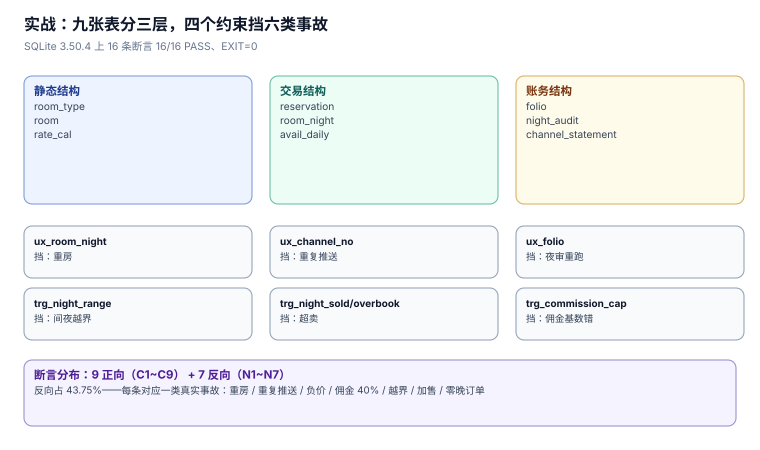

# 实战：九张表、四个约束与十六条断言

前面七页的口径要变成可执行的东西，只需要一张足够小的库。本页给出完整 DDL、四个关键约束、十六条断言（9 正向 + 7 反向）与逐条实测结果——**在 SQLite 3.50.4 上 16/16 PASS、`EXIT=0`**。

本页判据族 `HPT-A` ~ `HPT-H`，共 8 条。



## 一、九张表

```sql
CREATE TABLE room_type(
  id INTEGER PRIMARY KEY, code TEXT NOT NULL UNIQUE,
  rooms INTEGER NOT NULL CHECK (rooms > 0),
  bar INTEGER NOT NULL CHECK (bar > 0));
CREATE TABLE room(
  id INTEGER PRIMARY KEY,
  room_type_id INTEGER NOT NULL REFERENCES room_type(id),
  no TEXT NOT NULL UNIQUE);
CREATE TABLE rate_cal(
  room_type_id INTEGER NOT NULL REFERENCES room_type(id), stay_date TEXT NOT NULL,
  price INTEGER NOT NULL CHECK (price > 0),
  breakfast INTEGER NOT NULL DEFAULT 0 CHECK (breakfast >= 0),
  min_stay INTEGER NOT NULL DEFAULT 1 CHECK (min_stay >= 1),
  closed INTEGER NOT NULL DEFAULT 0 CHECK (closed IN (0,1)),
  PRIMARY KEY (room_type_id, stay_date));
CREATE TABLE reservation(
  id INTEGER PRIMARY KEY, channel TEXT NOT NULL, channel_no TEXT,
  room_type_id INTEGER NOT NULL REFERENCES room_type(id),
  checkin TEXT NOT NULL, checkout TEXT NOT NULL,
  rooms INTEGER NOT NULL CHECK (rooms > 0),
  status TEXT NOT NULL CHECK (status IN
    ('HOLD','CONFIRMED','INHOUSE','CHECKEDOUT','CANCELLED','NOSHOW')),
  sell_total REAL NOT NULL CHECK (sell_total >= 0),
  net_total REAL NOT NULL CHECK (net_total >= 0),
  hold_until TEXT, created_at TEXT NOT NULL,
  CHECK (checkout > checkin));
CREATE TABLE room_night(
  reservation_id INTEGER NOT NULL REFERENCES reservation(id),
  stay_date TEXT NOT NULL,
  room_id INTEGER NOT NULL REFERENCES room(id),
  rate REAL NOT NULL CHECK (rate >= 0),
  PRIMARY KEY (reservation_id, stay_date, room_id));
CREATE TABLE avail_daily(
  room_type_id INTEGER NOT NULL REFERENCES room_type(id), stay_date TEXT NOT NULL,
  total INTEGER NOT NULL CHECK (total >= 0),
  sold INTEGER NOT NULL DEFAULT 0 CHECK (sold >= 0),
  overbook_pct INTEGER NOT NULL DEFAULT 0 CHECK (overbook_pct BETWEEN 0 AND 15),
  PRIMARY KEY (room_type_id, stay_date));
CREATE TABLE folio(
  id INTEGER PRIMARY KEY, stay_id INTEGER NOT NULL,
  biz_date TEXT NOT NULL, item TEXT NOT NULL, amount REAL NOT NULL);
CREATE TABLE night_audit(
  biz_date TEXT NOT NULL, seq INTEGER NOT NULL, run_at TEXT NOT NULL,
  PRIMARY KEY (biz_date, seq));
CREATE TABLE channel_statement(
  channel TEXT NOT NULL, biz_date TEXT NOT NULL, orders INTEGER NOT NULL,
  gross REAL NOT NULL, commission REAL NOT NULL CHECK (commission >= 0),
  PRIMARY KEY (channel, biz_date));
```

九张表的关系可以用三句话概括：

- **静态结构**：`room_type` → `room`，`room_type` → `rate_cal`；
- **交易结构**：`reservation` → `room_night` ← `room`，`avail_daily` 是 `room_night` 的汇总缓存；
- **账务结构**：`folio`（逐笔）、`night_audit`（营业日）、`channel_statement`（渠道月结）。

## 二、四个约束：每个挡一类事故

```sql
CREATE UNIQUE INDEX ux_channel_no ON reservation(channel, channel_no)
  WHERE channel_no IS NOT NULL;
CREATE UNIQUE INDEX ux_room_night ON room_night(room_id, stay_date);
CREATE UNIQUE INDEX ux_folio ON folio(stay_id, biz_date, item);

CREATE TRIGGER trg_night_range BEFORE INSERT ON room_night
WHEN NEW.stay_date < (SELECT checkin FROM reservation WHERE id = NEW.reservation_id)
  OR NEW.stay_date >= (SELECT checkout FROM reservation WHERE id = NEW.reservation_id)
BEGIN SELECT RAISE(ABORT,'NIGHT_OUT_OF_RANGE'); END;

CREATE TRIGGER trg_night_sold AFTER INSERT ON room_night
BEGIN
  UPDATE avail_daily SET sold = sold + 1
   WHERE room_type_id = (SELECT room_type_id FROM room WHERE id = NEW.room_id)
     AND stay_date = NEW.stay_date;
END;

CREATE TRIGGER trg_overbook BEFORE UPDATE OF sold ON avail_daily
WHEN NEW.sold > NEW.total + CAST(NEW.total * NEW.overbook_pct / 100.0 AS INT)
BEGIN SELECT RAISE(ABORT,'OVERBOOK_LIMIT'); END;

CREATE TRIGGER trg_commission_cap BEFORE INSERT ON channel_statement
WHEN NEW.commission > NEW.gross * 0.25
BEGIN SELECT RAISE(ABORT,'COMMISSION_CAP'); END;
```

| 约束 | 挡的事故 | 反例 |
| --- | --- | --- |
| `ux_room_night` | 同一间房同夜两拨人（重房） | `N2` |
| `ux_channel_no` | 渠道重复推送 | `N3` |
| `ux_folio` | 夜审重跑导致房费翻倍 | `C5` |
| `trg_night_range` | 间夜落在住宿区间之外 | `N6` |
| `trg_night_sold` + `trg_overbook` | 房型超卖 | `N7` |
| `trg_commission_cap` | 佣金基数写错 | `N5` |

### 2.1 为什么超卖要两个触发器

单靠 `ux_room_night` 挡不住超卖：房型只剩 1 间可售时，系统仍可能把「另一间物理上存在的房」分出去——因为 `ux_room_night` 只保证「同一间房不同时卖两次」，不保证「房型不超量」。

于是 `trg_night_sold`（写入时累加 `sold`）+ `trg_overbook`（累加后校验上限）两个配合，才是房型层的守卫。这个拆分还有一个好处：**`sold` 是可读的**，前台查余量时不用聚合。

::: danger 注意
`trg_overbook` 写的是 `BEFORE UPDATE OF sold`，不是 `BEFORE UPDATE`。差别在于：**只有改 `sold` 时才校验**。写成 `BEFORE UPDATE` 的话，改 `total`（比如新增维修房把可售调小）也会触发校验，于是「把 `total` 调小」这个合法操作会被拒——而拒绝的理由是「超卖」，完全误导。
:::

## 三、十六条断言与实测

在 SQLite 3.50.4 / Python 3.13.12 上逐条跑，输出如下（节选自实测日志）：

| 编号 | 断言 | 结果 |
| --- | --- | --- |
| `C1` | 房型房量之和(6) = 实际房间数(6) | PASS |
| `C2` | 每单间夜数 = 退房日 − 入住日（不符 0 单） | PASS |
| `C3` | 5 条间夜同一房间同一夜无重复 | PASS |
| `C4` | 房量表的 `sold` 与间夜表实际计数一致（不一致 0 行） | PASS |
| `C5` | 夜审重跑两次金额不变（2640.0 → 2640.0） | PASS |
| `C6` | 同一营业日只有一条夜审记录 | PASS |
| `C7` | 渠道毛额与订单卖价一致（2980.0） | PASS |
| `C8` | 佣金不超过毛额 25% | PASS |
| `C9` | 房量查询走索引（`SCAN rn USING COVERING INDEX ux_room_night`） | PASS |
| `N1` | 退房日 = 入住日被拒（`CHECK checkout > checkin`） | PASS |
| `N2` | 同一房间同一夜重复占用被拒（`ux_room_night`） | PASS |
| `N3` | 渠道单号重复被拒（`ux_channel_no`） | PASS |
| `N4` | 负房价被拒（`CHECK bar > 0`） | PASS |
| `N5` | 佣金 40% 被拒（`COMMISSION_CAP`） | PASS |
| `N6` | 间夜越出 `[入住,退房)` 被拒（`NIGHT_OUT_OF_RANGE`） | PASS |
| `N7` | 房型-日已满仍加售被拒（`OVERBOOK_LIMIT`） | PASS |

末两行原文：

```text
合计 16 条断言，PASS=16 FAIL=0
EXIT=0
```

### 3.1 为什么反向断言占七条

正向断言证明「对的能进去」，反向断言证明「错的进不来」。本册七个反向断言各自对应一类真实事故：

| 反例 | 真实事故形态 |
| --- | --- |
| `N1` | 客人 11-06 到店当天就走，前台手快点成同一日期 |
| `N2` | 两个前台同时给两拨客人开 0806 |
| `N3` | 渠道重推，PMS 记了两单 |
| `N4` | 经理录错价格（负数），房价日历成了负价 |
| `N5` | 把含税总额当房费基数，佣金率算成 40% |
| `N6` | 手工补录间夜时多补了一晚 |
| `N7` | 旺季手动「加售」绕过超售额度 |

**没有反向断言的测试集只能证明「你写的路径能跑」，不能证明「错的路径被堵住」。** 本册的七个反例全部来自上面七类事故，不是为了让数字好看。

## 四、覆盖不到的四个缺口（诚实清单）

这套脚本跑绿了，但**它证明的东西有边界**。以下四件事本页没有验，落地时必须补：

| 缺口 | 为什么没验 | 怎么补 |
| --- | --- | --- |
| 并发 | SQLite 单文件锁的行为与 PG 不同 | 用 PG + 20 连接重跑 `HPR-D` 的栅栏实验 |
| no-show 窗口 | 需要「当前时间」可注入 | 把夜审的时间参数化成 `:now`，用固定时刻跑三个窗口对照 |
| 跨月间夜拆分 | 需要跨月数据 | 造 11-30 → 12-02 的单，验两晚分属两月 |
| 多店隔离 | 本册所有表省略了 `property_id` | 加列 + 行级安全策略（见 [多租户](../../MultiTenantSaaS/Overview/index.md) 的 `FORCE ROW LEVEL SECURITY`） |

::: warning 说明
「跑绿了」的准确含义是：**这十六条断言在 SQLite 3.50.4 上成立**。换成 PostgreSQL 时，`julianday()` 没有对应函数（要用 `date - date`），`CAST(... AS INT)` 要写成 `(...)::int`，部分唯一索引语法一致。这三处是迁移必改点，见 [技术基线](../../../../project/Complete/LearningHub/TechBaseline/index.md) 的同源清单。
:::

## 五、复跑方式

```shell
python3 hp_practice.py
# 预期末行：EXIT=0
```

脚本用 `:memory:` 建库，不落任何文件，**跑完即销毁**。若末行是 `EXIT=1`，第一列 FAIL 的那条就是缺口所在。

按页分组的复跑（每条只验一页的口径）：

| 想验什么 | 跑哪几条 | 期望 |
| --- | --- | --- |
| 房态表示对不对 | `C1 C2 C3 C4` | 全 PASS |
| 夜审幂等 | `C5 C6` | 金额不变、记录唯一 |
| 渠道对账 | `C7 C8` | 恒等式成立、佣金有上限 |
| 约束真的挡得住 | `N1`~`N7` | 全部被拒 |

## 六、本页判据

| 编号 | 判据 | 为什么要它 | 怎么验证 |
| --- | --- | --- | --- |
| `HPT-A` | 断言必须分正向与反向，反向不少于总数的三分之一 | 只有正向证明不了「错的进不来」 | 反例数 / 总数 ≥ 33%（本册 7/16 = 43.75%） |
| `HPT-B` | 反例必须来自真实事故形态，不能为凑数构造 | 凑出来的反例不承重 | 每条反例能说出对应的事故 |
| `HPT-C` | `trg_overbook` 用 `BEFORE UPDATE OF sold` | 用 `BEFORE UPDATE` 会误伤改 `total` | 改 `total`（调小）必须成功 |
| `HPT-D` | 超卖必须两个触发器配合，不能只靠唯一索引 | 唯一索引只管同房同夜 | `ux_room_night` + `trg_overbook` 同时存在 |
| `HPT-E` | 脚本必须能在 `:memory:` 跑完即销毁 | 留下磁盘文件会污染仓库 | 跑完后工作目录无新增文件 |
| `HPT-F` | 末行必须给 `EXIT=0/1`，不能只打印 PASS | 人工数行会漏 | 末尾两行固定格式 |
| `HPT-G` | 必须列出「覆盖不到的缺口」 | 跑绿不等于覆盖 | 缺口表至少 3 行 |
| `HPT-H` | 迁移到 PG 的三处必改点写进页面 | 换库时才知道要改哪 | `julianday` / `CAST AS INT` / 部分索引三处清单 |

## 七、参考资料

- [SQLite: Triggers](https://www.sqlite.org/lang_createtrigger.html)：`BEFORE`/`AFTER` 与 `UPDATE OF` 的语义
- [SQLite: `RAISE`](https://www.sqlite.org/lang_createtrigger.html#the_raise_function)：自定义错误标识的写法
- [PostgreSQL: Trigger Functions](https://www.postgresql.org/docs/current/plpgsql-trigger.html)：PL/pgSQL 的对应写法
- [PostgreSQL: Partial Indexes](https://www.postgresql.org/docs/current/indexes-partial.html)：与 SQLite 的语法差异
