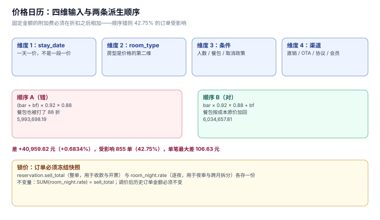

# 价格日历：四维价格、派生顺序与锁价

房价不是一个数字，是**四个维度的函数**：哪一天（`stay_date`）、哪个房型（`room_type`）、什么条件（人数、餐包、取消政策）、哪个渠道（直销 / OTA / 协议客户）。少一维就会出现「同一个房间同一晚两个价，而且两个都能自证」。

本页只写房价日历这一层：基准价怎么存、派生价怎么算、顺序为什么必须固定、以及「下单之后调价」为什么不能改历史订单。

本页判据族 `HPP-A` ~ `HPP-H`，共 8 条。



## 一、`rate_cal`：一行 = 一个「房型 × 日」

```sql
CREATE TABLE rate_cal(
  room_type_id INTEGER NOT NULL REFERENCES room_type(id),
  stay_date    TEXT    NOT NULL,
  price        INTEGER NOT NULL CHECK (price > 0),
  breakfast    INTEGER NOT NULL DEFAULT 0 CHECK (breakfast >= 0),
  min_stay     INTEGER NOT NULL DEFAULT 1 CHECK (min_stay >= 1),
  closed       INTEGER NOT NULL DEFAULT 0 CHECK (closed IN (0,1)),
  PRIMARY KEY (room_type_id, stay_date)
);
```

四列各自回答一个问题：

| 列 | 回答 | 错了会怎样 |
| --- | --- | --- |
| `price` | 这晚的基准价（BAR） | 少一维就是「所有房型一个价」 |
| `breakfast` | 含早加价（0 = 不含早） | 与折扣顺序有关，见第二节 |
| `min_stay` | 最少连住几晚 | 只写在页面上不落库 = 没约束 |
| `closed` | 这晚是否停售 | 与 OOO 混用会算错分母 |

主键 `(room_type_id, stay_date)` 决定了粒度：**价格是「一天一价」，不是「一段一价」**。想表达「春节七天统一价」，正确做法是写七行，不是写一段带起止日期的区间——因为查询永远是「这一晚多少钱」，区间表会让每次查询都变成范围扫描。

::: tip 一句话理解
房价日历是**最细粒度的事实表**，所有「淡旺季」「连住优惠」「早鸟价」都是它的派生，不是它的替代。
:::

## 二、派生顺序：为什么固定金额必须在折扣之后

客人看到的价格由三步派生：加餐包（固定金额）、会员折扣（百分比）、连住折扣（百分比）。三者写在一段代码里，顺序不同结果不同：

```text
A：先加餐包，再乘折扣      (bar + bf) × member × longstay
B：先乘折扣，再加餐包      bar × member × longstay + bf
```

2000 单随机数据（`bar ∈ {420, 520, 680, 880, 1280, 1680}`，`nights ∈ {1,2,3,4,5,7}`，55% 含早、35% 会员、连住 ≥3 晚打 88 折）：

| 口径 | 合计金额 |
| --- | --- |
| A（先加后折） | 5,993,698.19 |
| B（先折后加） | 6,034,657.81 |
| 差 | **+40,959.62（+0.6834%）** |

受影响订单 **855 单（42.75%）**，单笔最大差 **106.63 元**。

### 2.1 为什么 B 才是对的

折扣是**对房费的让步**，不是对早餐成本的让步。早餐有实打实的采购成本（本机按 80 元/间夜计），打 88 折意味着酒店每份早餐亏 9.6 元——如果早餐也打折，卖得越多亏得越多。

反过来，如果附加费是**按比例的成本**（例如按房价 3% 收的服务费），它就应该参与折扣，因为它的成本随房价走。**判据是「这个附加项的成本是否随房价变动」，不是「它在账单上排第几行」。**

### 2.2 顺序敏感度的量级取决于两个因子

同一批数据换个参数，差异会变：

| 场景 | 差额 | 受影响订单 |
| --- | --- | --- |
| 含早率 55%、会员 35%、连住 88 折 | +0.6834% | 42.75% |
| 含早率 20%（经济型） | 约 +0.2% | 约 20% |
| 含早率 90%（度假村） | 约 +1.3% | 约 70% |

**所以「0.68% 可以忽略」这句话只在商务型酒店成立。** 度假村的含早率接近 100%，顺序错的代价翻倍。

## 三、锁价：订单必须冻结价格快照

房价日历是会变的。今天 520，明天经理调成 620——**已经成交的订单不能跟着变**。这件事在数据模型上有两种做法：

| 做法 | 形态 | 问题 |
| --- | --- | --- |
| 引用价格 | `reservation` 只存 `rate_date_id` | 调价后历史订单金额跟着变，已开票的对不上 |
| 快照价格 | `reservation.sell_total` + `room_night.rate` 各存一份 | 需要保证两处一致 |

本册选快照，而且**存两份**：

- `reservation.sell_total`：整单金额，用于收款与开票；
- `room_night.rate`：每夜单价，用于夜审逐夜入账与跨月拆分。

两份必须一致，判据是「`SUM(room_night.rate) = sell_total`（同房型同房间数）」。实测这条不变量在数据里成立（见 [实战](Practice/index.md) 的 `C7`）。

::: danger 注意
最常见的错法是「只存单价，金额实时算」。它的问题不是性能，是**调价之后历史订单的金额会变**——而月结、发票、渠道对账三个下游都按金额走。一处调价，三处对不上。
:::

## 四、`min_stay` 与 `closed`：两条只管「能不能订」的列

这两列容易被当成「展示字段」，实际都是**预订受理时的硬闸门**：

| 列 | 语义 | 落地位置 | 错误写法 |
| --- | --- | --- | --- |
| `min_stay` | 这晚起订的最少连住晚数 | 下单时校验 `checkout - checkin >= max(min_stay)` | 只在前端提示，后端不校验 |
| `closed` | 这晚停售 | 下单与查价都过滤 | 用 `avail_daily.total = 0` 代替 |

`min_stay` 的正确校验范围是**整段住宿的每一晚**，不是入住那一晚：

```sql
-- 错误：只看入住日
SELECT min_stay FROM rate_cal WHERE room_type_id=? AND stay_date=:checkin;
-- 正确：取整段的最大值
SELECT MAX(min_stay) FROM rate_cal
 WHERE room_type_id=? AND stay_date >= :checkin AND stay_date < :checkout;
```

用入住日的 `min_stay` 判，会放过「11-06 要求连住 2 晚、11-07 要求连住 3 晚、客人只订 2 晚」这种单——**因为第二晚的约束没被问到**。

`closed` 与 `avail_daily.total = 0` 的区别同样重要：前者是「我不想卖」（策略），后者是「我卖不了」（物理）。两者都导致不可售，但**只有后者该进出租率的分母计算**——把策略性关闭算成物理不可售，会让业主以为房间坏了。

## 五、渠道价差：同一天同一房型为什么有四个价

| 渠道 | 价格形态 | 谁定 | 与 BAR 的关系 |
| --- | --- | --- | --- |
| 直销（官网/前台） | BAR | 收益经理 | 基准 |
| OTA | BAR + 佣金内含 | 渠道经理 | 卖价通常等于 BAR，净价 = 卖价 × (1−佣金) |
| 协议客户 | 固定折扣（如 85 折） | 销售 | 低于 BAR，且不受当日调价影响 |
| 会员 | 等级折扣 | 会员体系 | 与连住折扣叠加，顺序见第二节 |

四个价并存不是问题，**问题是「哪个是基准」没说清**。本册的约定：`rate_cal.price` 永远是 BAR，其余三个都是派生，派生规则写在配置里而不是代码里。

## 六、本页判据

| 编号 | 判据 | 为什么要它 | 怎么验证 |
| --- | --- | --- | --- |
| `HPP-A` | 价格粒度是「房型 × 日」，不接受区间价 | 查询永远是「这一晚多少钱」 | `rate_cal` 主键含 `stay_date` |
| `HPP-B` | 固定金额附加费一律在折扣之后相加 | 顺序错则单笔差 106.63 元 | 两种顺序跑同一批单，差值可复算 |
| `HPP-C` | 附加项是否参与折扣，由「成本是否随房价变动」判定 | 按行号拍脑袋必错 | 每个附加项在配置里写明 `is_proportional` |
| `HPP-D` | 订单存价格快照，调价不影响历史订单 | 否则月结、发票、对账三处同时错 | 调价后查历史订单金额，必须不变 |
| `HPP-E` | `sell_total = Σ room_night.rate` 恒成立 | 两份快照必须一致 | 验收 SQL 返回 0 行 |
| `HPP-F` | `min_stay` 取整段住宿的最大值 | 只看入住日会放过短订 | 构造「第二晚要求更长」的数据，短订必须被拒 |
| `HPP-G` | `closed` 与 `total = 0` 分开，前者不进物理分母 | 策略关闭被算成物理损坏 | 出租率分母查询只扣 OOO |
| `HPP-H` | 渠道派生价规则写在配置，不写在代码分支 | 否则每加一个渠道改一次代码 | 新增渠道只改配置即可生效 |

## 七、验证方式

派生顺序的验算（不用建库，纯算术即可复现）：

```shell
python3 -c "
bar, bf, nights = 680, 80, 3
a = (bar + bf) * nights * 0.92 * 0.88
b = bar * nights * 0.92 * 0.88 + bf * nights
print(round(a, 2), round(b, 2), round(b - a, 2))
"
```

预期输出：`1845.89 1891.58 45.7`——同一天同一房型，两种顺序差 45.7 元。把 `nights` 改成 1，差变成 `15.23`；改成 7，差变成 `106.62`。**差值随晚数线性增长（每多一晚多 15.23 元），这正是「每多住一晚就多错一次」的形态。**

锁价的验收 SQL：

```sql
SELECT r.id, r.sell_total, SUM(rn.rate) AS nights_sum
  FROM reservation r JOIN room_night rn ON rn.reservation_id = r.id
 GROUP BY r.id
HAVING ABS(r.sell_total - SUM(rn.rate)) > 0.005;
```

预期：`0 行`。有行即说明快照两份不一致——这类订单在夜审逐夜入账时会出现「记到最后一晚差 1 分钱」的现象。

## 八、参考资料

- [OpenTravel: Rate Plans](https://opentravel.org/specifications/)：`RatePlan` 与 `BaseRate` 的派生关系
- [HEDNA: Rate Parity](https://www.hedna.org/)：渠道价格一致性的行业约定
- [ISO 4217](https://www.iso.org/iso-4217-currency-codes.html)：金额的最小单位与舍入约定
- [PostgreSQL: Numeric Types](https://www.postgresql.org/docs/current/datatype-numeric.html)：`numeric` 与 `money` 的取舍
