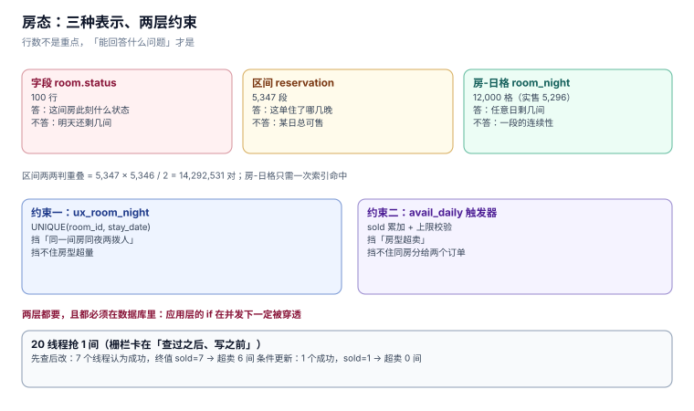

# 房量与房态：为什么房态不能是一个字段

「房态」这个词在酒店里有两种意思：前台说的房态是**这一间房此刻**的状态（空净、空脏、在住），系统说的房态是**这一间房在某一天**能不能卖。前者是一个字段，后者是一个三维格子。把它们混成一个 `room.status` 列，是这类系统最常见的起点错误——它在单店、单日、单班次的情况下完全正确。

本页把「房量」拆成三层表示，把「房态」拆成两个层次（房型-日 / 房间-日），并给出超卖必须由数据库而不是应用层兜住的三条证据。

本页判据族 `HPR-A` ~ `HPR-H`，共 8 条。



## 一、三种表示，三个能回答的问题

同一份「100 间房 × 120 天」的数据，有三种存法：

| 表示 | 形态 | 行数 | 能回答 | 不能回答 |
| --- | --- | --- | --- | --- |
| 字段 | `room.status` | **100** | 这间房此刻是什么状态 | 明天还剩几间 |
| 区间 | `reservation(checkin, checkout)` | **5,347** 段 | 这个订单住了哪几晚 | 任意一天的总可售 |
| 房-日格 | `room_night(room_id, stay_date)` | **12,000** 格（实售 5,296） | 任意房型任意一天剩几间 | 一段住宿的连续性 |

行数不是重点，**能回答什么才是**。前台的「这间房能不能给客人」用字段；收益的「下周还剩几间」用房-日格；渠道的「这个订单占哪几晚」用区间。

::: tip 一句话理解
`room.status = 'VC'` 这句话在 23:59 是对的，在 00:01 就可能是错的——**因为它没有日期**。
:::

### 1.1 为什么区间判重叠不可行

如果坚持「只用区间表示」，那么「这间房这一晚有没有人住」要靠**区间两两比较**：

```text
5,347 段两两比对 = 5,347 × 5,346 / 2 = 14,292,531 对
```

一次前台查询要跑 1400 万次比较。而房-日格方案只需要 `WHERE room_id=? AND stay_date=?` 一次索引命中（实测 `SCAN rn USING COVERING INDEX ux_room_night`，见 [实战](../Practice/index.md)）。

**结论：区间是「业务语义」，房-日格是「查询结构」，两者都要，但不能互相替代。** 区间写进 `reservation` 供人读，房-日格写进 `room_night` 供机器查。

### 1.2 半开区间：`[checkin, checkout)`

住宿的日期区间是**左闭右开**的，这一点与 [RFC 5545](https://www.rfc-editor.org/rfc/rfc5545) 的 `DTSTART`/`DTEND` 完全一致：

| 订单 | 入住 | 退房 | 住的夜 | 间夜数 |
| --- | --- | --- | --- | --- |
| A | 11-06 | 11-08 | 11-06、11-07 | 2 |
| B | 11-06 | 11-07 | 11-06 | 1 |

如果写成闭区间 `[checkin, checkout]`，A 会占 3 晚，而且**退房当天会被算成已售**——于是同一天既有一批人退房、又被算作满房，前台看着「满房」却不能卖。

`CHECK (checkout > checkin)` 是这条约定在数据库里的唯一守卫：它同时挡住了「零晚订单」和「退房早于入住」。

## 二、房态的两个层次

### 2.1 房型-日：可售量

`avail_daily(room_type_id, stay_date, total, sold, overbook_pct)` 是「还剩几间」的唯一数据源：

| 列 | 含义 | 谁写 |
| --- | --- | --- |
| `total` | 该房型该日的可售房量（已扣 OOO 与关闭） | 排房作业 / 维修单 |
| `sold` | 已售房数 | 预订与间夜写入时触发器累加 |
| `overbook_pct` | 允许超售的百分比（0~15） | 收益经理按日设置 |

`total` 与 `sold` 分开存，是为了让「可售余量」变成一次减法而不是一次 `COUNT`：旺季首页要展示 30 天的余量，`COUNT` 方案是 30 次聚合。

### 2.2 房间-日：唯一占用

`room_night(room_id, stay_date)` 上的唯一索引 `ux_room_night` 是「同一间房同一晚不能睡两拨人」的**唯一可信守卫**：

```sql
CREATE UNIQUE INDEX ux_room_night ON room_night(room_id, stay_date);
```

它挡住的是「把同一间房分给两个订单」——这类错误在前台叫「重房」，是行业里最丢人的事故之一。

### 2.3 两个约束不能互相替代

| 约束 | 挡的是 | 挡不住 |
| --- | --- | --- |
| `ux_room_night`（房间-日唯一） | 同一间房同夜两拨人 | 房型只剩 1 间时卖出 2 间（两间不同的房，但房型超了） |
| `avail_daily` 触发器（房型-日上限） | 房型超卖 | 同一间房分给两个订单（房量够，但房号重复） |

实测两件事都会发生：

- 20 线程抢同一间房，「先查后改」让 **7 个线程都认为成功**，终值 `sold=7`（容量 1）——这是 `avail_daily` 层失守。
- 若只做房量表、不做 `ux_room_night`，两个并发的「排房」会把同一间房分给两个订单——这是房间层失守。

**两层都要，且都必须在数据库里。** 应用层的 `if` 在并发下一定被穿透。

## 三、超售：一个业务决策，三个技术落点

超售（overbooking）在酒店不是 bug，是**策略**：因为 no-show 与取消的存在，卖满 100 间通常还能再卖几间。本机的经济账（120 天、100 间房、ADR 520 元、单次 walk 赔付 780 元）：

| 超售额度 | 多接间夜 | 增收 | walk 单数 | 赔付 | 净收益 |
| --- | --- | --- | --- | --- | --- |
| 0% | 0 | 0 | 0 | 0 | **0** |
| 3% | 53 | 27,560 | 15 | 11,700 | **+15,860** |
| 5% | 79 | 41,080 | 21 | 16,380 | **+24,700** |
| 8% | 117 | 60,840 | 46 | 35,880 | **+24,960** |

这张表有一个必须读出来的结论：**8% 的净收益与 5% 几乎相同，但 walk 单数翻了一倍多（21 → 46）**。多出来的 22 单是真实的客人被送到隔壁酒店，换来 260 元的边际收益。**超售的拐点在 5% 附近，而拐点的位置由 no-show 率决定，不是由房价决定。**

::: danger 注意
不要用「超售比例」一个数字管所有房型。本机的 6 个房型里，套房只有 4 间——**3% 超售在 4 间的房型上是 0 间（`CAST(4*3/100 AS INT) = 0`），在 40 间的房型上是 1 间**。按整店算超售额度，会在小房型上永远超不出去、在大房型上超得太狠。
:::

## 四、OOO 与「关闭」：两个不同的分母

| 概念 | 触发 | 是否计入可售 | 分母影响 |
| --- | --- | --- | --- |
| **OOO**（Out of Order，维修房） | 漏水、空调坏、翻新 | 否，从 `total` 扣掉 | 可售房量下降，出租率上升 |
| **关闭**（closed to sale） | 收益决策：这天不卖了 | 否，从 `total` 扣掉 | 同上 |
| **停售某渠道** | 渠道策略 | 是，`total` 不变 | 无影响，只影响渠道可售 |

三者的技术落点完全不同：OOO 要写进维修单并驱动 `avail_daily.total` 变更；关闭是 `rate_cal.closed = 1`（价格日历上的一个开关）；停售渠道是渠道映射表上的一行。**把三者混成一个 `is_available` 字段，就再也拆不出「为什么这天卖不了」。**

## 五、本页判据

| 编号 | 判据 | 为什么要它 | 怎么验证 |
| --- | --- | --- | --- |
| `HPR-A` | 房态不得用单个 `room.status` 表达「某日可售」 | 字段没有日期，跨零点即错 | 查 `room` 表无 `status` 列，或该列不被任何可售查询引用 |
| `HPR-B` | 住宿区间一律左闭右开，且 `CHECK (checkout > checkin)` | 闭区间会把退房日算成已售 | 插入 `checkin = checkout` 必须被拒（反例 `N1`） |
| `HPR-C` | 房间-日唯一索引必须存在 | 重房是行业最丢人的事故 | 插入同房同夜第二条必须被拒（反例 `N2`） |
| `HPR-D` | 房型-日上限由触发器或条件更新守住，不写在应用层 | 先查后改在并发下必错 | 20 线程栅栏，终值 `sold` ≤ `total + 超售额度` |
| `HPR-E` | `total` 已扣除 OOO 与关闭，且两条来源可追溯 | 否则出租率分母说不清 | `total = rooms − ooo − closed` 恒等式逐日成立 |
| `HPR-F` | 超售额度按「房型 × 日」设置，不按整店 | 4 间房 3% 恒为 0 间 | 每个房型算出额度，小房型额度允许为 0 |
| `HPR-G` | 关房与维修必须是两张单，不能共用一个布尔列 | 混用后无法回答「为什么卖不了」 | 查询能分别列出 OOO 房与关闭房 |
| `HPR-H` | 可售余量查询必须走索引，不得全表扫 | 首页要 30 天余量 | `EXPLAIN QUERY PLAN` 出现 `USING … INDEX`（`C9`） |

## 六、验证方式

建两张表、插一行、看是否被拒：

```sql
-- 必须失败：同房同夜第二条
INSERT INTO room_night VALUES(2,'2026-11-06',1,420);
-- 预期：UNIQUE constraint failed: room_night.room_id, room_night.stay_date

-- 必须失败：零晚订单
INSERT INTO reservation VALUES(99,'DIRECT',NULL,1,'2026-11-08','2026-11-08',1,'CONFIRMED',100,100,NULL,'x');
-- 预期：CHECK constraint failed: checkout > checkin
```

房量恒等式（返回 0 行才算通过）：

```sql
SELECT a.room_type_id, a.stay_date
  FROM avail_daily a JOIN room_type t ON t.id = a.room_type_id
 WHERE a.total <> t.rooms - COALESCE(
         (SELECT COUNT(*) FROM room r WHERE r.room_type_id = t.id AND r.ooo = 1), 0)
 LIMIT 10;
```

预期：`0 行`。若返回行，说明 OOO 变了但 `avail_daily.total` 没跟着变——这类不一致不会报错，只会让出租率分母慢慢偏。

## 七、参考资料

- [RFC 5545 §3.6.1](https://www.rfc-editor.org/rfc/rfc5545#section-3.6.1)：`VEVENT` 的 `DTEND` 为**非包含**（exclusive）
- [SQLite: CREATE INDEX](https://www.sqlite.org/lang_createindex.html)：唯一索引与部分索引
- [PostgreSQL: Constraints](https://www.postgresql.org/docs/current/ddl-constraints.html)：`EXCLUDE` 约束（用 `daterange` 表达「同房不重叠」的另一种写法）
- [OpenTravel: Hotel Availability](https://opentravel.org/specifications/)：`OTA_HotelAvailRQ` 的可售量口径
