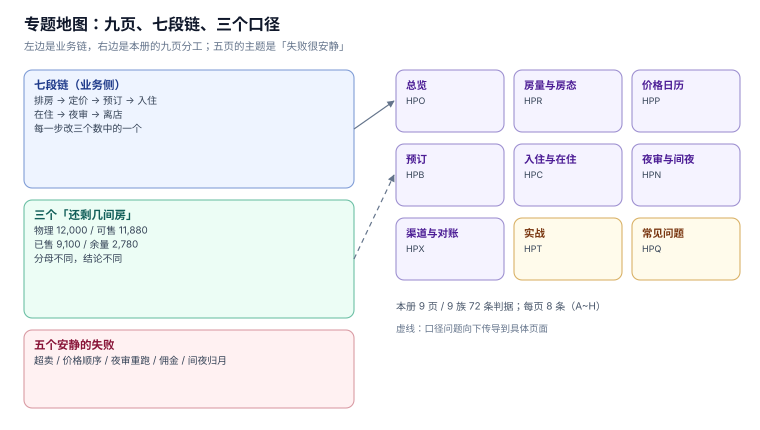
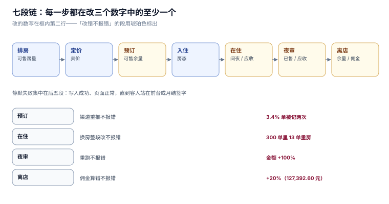

# 酒店房态与预订管理工程

**酒店系统真正在管的不是「房间」，是「房间 × 夜晚」这个格子。** 一间房在 12 月 31 日只能卖给一拨人，而这件事在数据库里没有任何一行能直接表达——它是 `room`（100 行）、`reservation`（五千段区间）、`room_night`（房-日格）三种表示共同兜住的约束。

这一册只写**一间店（或一条连锁的同一家店）从订到走**要写死的东西：房量怎么算、房态为什么不能是一个字段、价格日历怎么派生、预订的保留与担保怎么活、入住怎么把房型落到房号、夜审为什么必须是幂等的、渠道佣金怎么对。九页里有五页的主题是「失败很安静」——超卖不会报错（直到客人站在前台）、价格顺序错了不会报错（只差 0.68%）、夜审跑两次不会报错（金额翻倍但报表能出）、佣金多付不会报错（月结签字了才发现）、间夜归错月份不会报错（月度报表两边各自成立）。

## 章节

- [总览：七段链、三个「还剩几间房」与五个安静的失败](Overview/index.md) —— 房量三层口径、失败形态、相邻专题分工
- [房量与房态：为什么房态不能是一个字段](RoomInventory/index.md) —— 三种表示、半开区间、超卖的三层守卫
- [价格日历：四维价格、派生顺序与锁价](RateCalendar/index.md) —— BAR 与派生价、餐包与折扣的顺序、生效期
- [预订：保留时限、担保与渠道单号](Booking/index.md) —— HOLD 三态、重复推送、取消政策与 no-show 窗口
- [入住与在住：从房型到房号](CheckIn/index.md) —— 排房、换房、延住、提前离店
- [夜审与间夜：营业日不等于自然日](NightAudit/index.md) —— rollover、间夜归属、幂等入账
- [渠道与对账：三个金额与四种差额](ChannelRecon/index.md) —— 卖价/净价/佣金、取消单、重复推送
- [实战：九张表、四个约束与十六条断言](Practice/index.md) —— 完整 DDL、可运行脚本、逐条读数
- [常见问题与分诊](FAQ/index.md) —— 分诊表、十二问、止血五步、术语表

## 判据族一览

九族共 72 条，每页八条（`-A` ~ `-H`），定义在各页「本页判据」一节：

| 页面 | 族 | 约定 | 条数 |
| --- | --- | --- | --- |
| 总览 | `HPO` | 房量三层口径、失败可归因、版本基线、相邻边界 | 8 |
| 房量与房态 | `HPR` | 区间表示、半开区间、超卖三层、OOO 与关闭 | 8 |
| 价格日历 | `HPP` | 四维定价、派生顺序、锁价、生效期 | 8 |
| 预订 | `HPB` | 保留时限、担保、渠道幂等、no-show 窗口 | 8 |
| 入住与在住 | `HPC` | 房型到房号、换房守恒、延住、提前离店 | 8 |
| 夜审与间夜 | `HPN` | 营业日、间夜归属、幂等入账、no-show 落账 | 8 |
| 渠道与对账 | `HPX` | 三个金额、四形状、取消单、重复推送 | 8 |
| 实战 | `HPT` | 分层约束、反向探针、断言计数、验收容差 | 8 |
| 常见问题 | `HPQ` | 分诊可定位、读数可回溯、止血顺序、术语易混 | 8 |

## 三个「还剩几间房」

这是全册的骨架。三句话听起来是同义词，实际是三个不同分母、三个不同时点、三张不同的表：

| 口径 | 定义 | 谁在用它 | 本机读数（120 天 / 6 房型 / 100 间房） |
| --- | --- | --- | --- |
| **物理房量** | 房型 `rooms` 之和 × 天数 | 业主、财报的「客房总数」 | **12,000** 房夜 |
| **可售房量** | 物理 − 维修房（OOO）− 关闭房 | 收益管理、出租率分母 | **11,880** 房夜 |
| **可售余量** | 可售 − 已售 | 前台、渠道直连、超售阈值 | **2,780** 房夜 |

于是同一个 75.83% 和 76.60% 都「对」——**分母取物理还是取可售，差 0.77 个百分点**。这不是精度问题，是「报给谁看」的问题：给业主看的入住率必须用物理房量，给收益经理看的必须用可售房量，因为维修房不是他能卖的。

::: tip 一句话理解
房态系统的全部复杂度来自一件事：**「还剩几间」的答案取决于你问的是哪一天、哪个房型、按哪个口径。**
:::

## 五个安静的失败

选这个专题的理由不是「酒店业务复杂」，而是它的错误几乎都不报警：

| 失败 | 为什么安静 | 本册读数 |
| --- | --- | --- |
| 超卖 | 写入成功、页面正常，直到客人站在前台 | 20 线程抢 1 间：先查后改 **7 个线程认为成功、终值 sold=7**，超卖 6 间 |
| 价格顺序错 | 每单都能算出数，只是口径不同 | 2000 单差 **40,959.62 元（+0.68%）**，受影响 **42.75%** |
| 夜审重跑 | 报表照样出，金额翻倍 | 无唯一键重跑一次：312,000 → **624,000（+100%）** |
| 佣金多付 | 月结签字时没人逐单核 | 合同 15% vs 实际 18%：多付 **127,392.60 元（+20%）** |
| 间夜归错月 | 两个月各自的报表都平衡 | 10 月间夜 1,767 → 按退房月归属 **1,661（−6.00%）** |

这五个的共同点是：**它们都发生在「两个口径之间」，而不是「一个口径之内」**。所以本册每一页的写法都一样——先把口径写死成一条能落进 `WHERE` 的判定，再去谈实现。

## 七段链

| 段 | 一句话 | 改的是哪个数 | 页面 |
| --- | --- | --- | --- |
| 排房 | 把「房型」拆成「房号 × 日期」 | 可售房量 | [房量与房态](RoomInventory/index.md) |
| 定价 | 给每个「房型 × 日期」一个价 | 卖价 | [价格日历](RateCalendar/index.md) |
| 预订 | 承诺一间房，先不指定房号 | 可售余量 | [预订](Booking/index.md) |
| 入住 | 把房型落到具体房号 | 房态（VC → OC） | [入住与在住](CheckIn/index.md) |
| 在住 | 换房、延住、消费入账 | 房态、间夜 | [入住与在住](CheckIn/index.md) |
| 夜审 | 结束营业日，生成间夜与房费 | 已售、应收 | [夜审与间夜](NightAudit/index.md) |
| 离店 | 结算、释放房、回写渠道 | 可售余量、佣金 | [渠道与对账](ChannelRecon/index.md) |

## 与本册相邻的专题

酒店横跨库存、定价、结算、渠道四个域，本册刻意只写「一间店把房间卖出去并结清」，其余交给相邻专题：

| 这件事 | 本册负责 | 隔壁专题负责 |
| --- | --- | --- |
| 「还剩几个位置」 | 房-日格与超售额度 | [预约与资源档期](../../Backend/AppointmentBooking/Overview/index.md) 管时段与座位——它的单位是「半小时」，本册的单位是「一晚」 |
| 商品级库存扣减 | 不涉及 | [Ecommerce/Inventory](../../Backend/Ecommerce/Inventory/index.md) 管 SKU 与中心仓可售 |
| 促销规则与券 | 只认「房价日历上的最终价」 | [PricingPromotion](../../Backend/PricingPromotion/index.md) 管券的叠加与最优选 |
| 会员权益 | 只认「折扣率从哪来」 | [LoyaltyProgram](../../Backend/LoyaltyProgram/index.md) 管等级、积分与权益发放 |
| 分录与未达账项 | 只产出「应收/已收/佣金」三个数 | [Ledger](../../Backend/Ledger/index.md) 管横平与对账 |
| 收入确认时点 | 只定义「间夜何时算已售」 | [RevenueRecognition](../../Backend/RevenueRecognition/index.md) 管履约义务与摊销 |
| 渠道通知与回执 | 只管「发出去」 | [NotificationDelivery](../../Backend/NotificationDelivery/index.md) 管重试、去重与回执 |
| 班次与工时 | 不涉及 | [TimeAttendance](../../Backend/TimeAttendance/Overview/index.md) 管排班与工时 |
| 多店隔离 | 只假设「本册所有表都有 `property_id`」 | [MultiTenantSaaS](../../Backend/MultiTenantSaaS/Overview/index.md) 管租户与行级安全 |

::: warning 说明
本册所有 DDL 都省略了 `property_id`（多店隔离列），理由是它属于横切关注点，写进来会淹没房态本身的讨论。落地时必须补——[Practice](Practice/index.md) 第九节会给出补法。
:::

## 为什么这一册不建版本目录

本仓的判据是「同一份代码两套写法」才建版本目录——[Spring5](../../Backend/Java/Frame/Spring/Spring5/index.md) / [Spring6](../../Backend/Java/Frame/Spring/Spring6/index.md)、[Vue2](../../Frontend/Frame/Vue/Vue2/index.md) / [Vue3](../../Frontend/Frame/Vue/Vue3/index.md) 都是这个理由。酒店这一册**不满足**这条判据，三条理由：

1. **换代的是渠道与设备，不是判据。** PMS 从 C/S 换到 SaaS、房卡从磁条换到 NFC、渠道从传真换到直连 API——「同一间房同夜只能卖一次」一个字都没变。
2. **并存差异是业态，不是代际。** 商务酒店、度假村、民宿、钟点房的差别在「最小住宿单位」和「超售容忍度」，不在版本号。本册把这类差异写成页内的 `::: info` 参数表，而不是另起目录。
3. **真正需要版本目录的是「同一份代码两套写法」。** 这一册里没有一个 API 有两条互斥的写法——超售额度、夜审幂等、佣金口径，换任何一家 PMS 都是同一套约束。

## 参考资料

- 《旅游饭店星级的划分与评定》（GB/T 14308—2010）：客房数与出租率的统计口径
- [OpenTravel Alliance Specifications](https://opentravel.org/specifications/)：OTA 渠道消息（`OTA_HotelResNotifRQ` 等）的字段定义
- [Hotel Electronic Distribution Network Association (HEDNA)](https://www.hedna.org/)：渠道对账与佣金结算的行业口径
- [RFC 5545](https://www.rfc-editor.org/rfc/rfc5545)：`VEVENT` 的 `DTSTART`/`DTEND` 半开区间语义（房态区间与它是同一套约定）
- [SQLite: Partial Indexes](https://www.sqlite.org/partialindex.html)：`WHERE` 子句唯一索引的语义
- [PostgreSQL: CREATE INDEX](https://www.postgresql.org/docs/current/sql-createindex.html)：`CONCURRENTLY` 与部分索引
