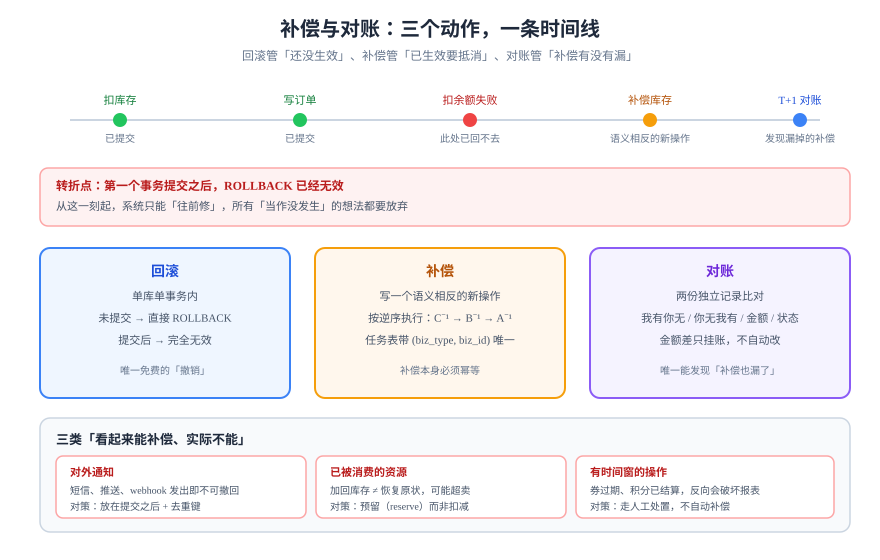

# 补偿与对账：回不去的时候往前修

幂等与状态机保证「该发生的只发生一次、且落在合法状态上」，但它们不保证**一次跨资源的操作全部成功**。当「扣库存成功、扣余额失败」时，系统已经无法回到过去，只能**往前修**。这一页讲补偿的边界、补偿本身的幂等，以及唯一能发现「补偿也没做成」的手段：对账。



## 判据族声明

本页判据族 `CMP-A` ~ `CMP-H`，共 8 条。定义表在第八节。

## 一、补偿不是回滚

| 概念 | 作用范围 | 机制 | 能力边界 |
| --- | --- | --- | --- |
| **回滚**（rollback） | 单个数据库事务 | `ROLLBACK` | 只能撤未提交的本地事务 |
| **补偿**（compensation） | 已提交的多个事务/服务 | 执行一个**语义相反**的新操作 | 只能撤销「可逆」的效果 |
| **对账**（reconciliation） | 事后 | 比对两份独立记录 | 只能发现，不能修复 |

一张表说清三者的分工：**回滚管「还没生效」，补偿管「已生效但需要抵消」，对账管「补偿有没有漏」。**

## 二、可补偿与不可补偿

补偿的前提是「能构造出一个把效果抵消掉的操作」。这个前提并不总成立：

| 操作 | 可补偿？ | 补偿动作 | 注意 |
| --- | --- | --- | --- |
| 扣库存 | 是 | 加回库存 | 若库存已被别人买走，加回会造成超卖→ 需「预留」而非「扣减」 |
| 扣余额 | 是 | 反向入账 | 必须走账务分录，不能直接改余额 |
| 创建订单 | 是 | 置为 `CANCELLED` | 不物理删除，保留痕迹 |
| 发短信 / 发邮件 | **否** | 再发一条「请忽略上一条」 | 只能降低误解，不能撤回 |
| 调用第三方已成功的支付 | 部分 | 发起退款 | 退款本身可能失败，需二次对账 |
| 已交付的实物 | **否** | 走退货流程 | 是业务流程，不是技术补偿 |

::: danger 三类「看起来能补偿、实际不能」的操作
1. **对外通知**：短信、推送、webhook 一旦发出，无法收回。设计上应把通知放在**事务提交之后**且允许失败重试，而不是放在事务中间。
2. **已被消费的资源**：库存被别的订单占用后，「加回去」不等于「恢复原状」，可能造成超卖。
3. **有时间窗的操作**：优惠券已过期、积分已结算，反向操作会破坏已出的报表。
:::

## 三、补偿的四种形态

| 形态 | 做法 | 适用 | 风险 |
| --- | --- | --- | --- |
| **自动补偿** | 检测到失败立即执行反向操作 | 强一致要求、失败可识别 | 补偿本身失败时无人接手 |
| **延迟补偿** | 写入补偿任务表，由调度器重试 | 大多数业务 | 有延迟，需要可观测 |
| **人工补偿** | 生成工单，人工核对后处置 | 金额大、语义复杂 | 依赖流程，可能积压 |
| **不做补偿，只对账** | 记录差异，日终统一处理 | 差异可容忍（如统计类） | 差异会累积 |

**选择判据**：先问「补偿失败会不会造成资金/库存错账」。会 → 自动补偿 + 对账兜底；不会 → 延迟补偿或只对账。

## 四、补偿任务表：让补偿本身可重试

```sql
create table compensation_task (
  id            bigint generated always as identity primary key,
  biz_type      text not null,              -- ORDER_CANCEL / REFUND / STOCK_RELEASE
  biz_id        text not null,
  payload       jsonb not null,
  status        text not null default 'PENDING',
  attempts      int  not null default 0,
  next_run_at   timestamptz not null default now(),
  last_error    text,
  created_at    timestamptz not null default now(),
  constraint ct_status_ck check (status in ('PENDING','RUNNING','DONE','DEAD')),
  -- 同一业务对象的同一补偿只能有一条在途，防止重复补偿
  constraint ct_uniq unique (biz_type, biz_id)
);
create index ct_due_idx on compensation_task (next_run_at) where status = 'PENDING';
```

四个设计点：

1. **`unique (biz_type, biz_id)`**：让「重复投递补偿任务」变成幂等操作——这是补偿表最重要的一条约束。
2. **`next_run_at` + 部分索引**：只索引 `PENDING`，表变大后取任务仍然是常数级。
3. **`attempts` 与 `DEAD` 状态**：重试不是无限的，超过上限进 `DEAD` 并告警，进入人工队列。
4. **`payload` 存快照**：补偿执行时不能再读业务表（状态可能已变），必须用当时的数据。

```sql
-- 取任务：跳过已被别的实例锁住的行
select id, biz_type, biz_id, payload
  from compensation_task
 where status = 'PENDING' and next_run_at <= now()
 order by next_run_at
   for update skip locked
 limit 20;
```

## 五、补偿必须按逆序执行

一次操作里如果有三个步骤 A → B → C，失败发生在 C 之后，补偿顺序必须是 **C⁻¹ → B⁻¹ → A⁻¹**，反过来会破坏依赖（先解冻额度再加回库存，会让「额度已解冻但库存已加回」的中间态被别人看到并利用）。

| 顺序 | 结果 |
| --- | --- |
| 正序补偿（A⁻¹ → B⁻¹ → C⁻¹） | 中间态违反不变量（额度未解冻就退了库存） |
| 逆序补偿（C⁻¹ → B⁻¹ → A⁻¹） | 每一步的中间态都是「少做了」，不会「多做」 |

**判据**：如果某一步的补偿会让系统短暂处于「比原始状态更宽松」的状态，那它必须排在后面。

## 六、补偿的幂等

补偿动作本身也会被重试，因此它必须幂等。三种做法：

| 做法 | 例子 | 说明 |
| --- | --- | --- |
| 状态条件更新 | `update order set state='CANCELLED' where id=? and state='PAID'` | 第二次影响 0 行，视为已补偿 |
| 反向分录带唯一键 | `insert into ledger_entry (ref, ...) values ('refund:order:1', ...)` | 唯一键挡住第二次退款 |
| 补偿任务表 `DONE` | 任务执行前先 `update ... set status='DONE' where id=? and status='PENDING'` | 抢到任务才执行，天然互斥 |

::: warning 「先删再补」是最危险的补偿写法
`delete from stock_reservation where order_id = ?` 这类补偿，如果被重复执行，第二次删不到东西「看起来没问题」；但如果期间又有新的预留在同一行上，就会删掉别人的。**补偿必须按「谁的」来限定，不能按「什么状态」来删。**
:::

## 七、对账：唯一能发现「补偿也漏了」的手段

对账的本质是**拿两份独立记录比对**，因此两份记录不能来自同一个写入路径（否则同一个 bug 会让两边一起错）。

| 对账类型 | 两份记录 | 能发现 | 频率 |
| --- | --- | --- | --- |
| **内部对账** | 业务表 vs 账务分录 | 状态变了但没记账、记了账但状态没变 | 每小时 |
| **外部对账** | 我方支付单 vs 渠道账单 | 渠道成功但我方失败、金额不一致 | 每天（渠道出账后） |
| **跨系统对账** | 订单系统 vs 库存系统 | 扣减漏执行、补偿未生效 | 每小时 |

差异必须先分类再处理，**金额类差异绝不自动修正**：

| 差异类型 | 含义 | 处理 |
| --- | --- | --- |
| 我有你无 | 我方记了，对方没有 | 查是否对方延迟；超过 T+1 挂账人工 |
| 你无我有 | 对方记了，我方没有 | 立即人工，涉及资金 |
| 金额不等 | 双方都有，数值不同 | 绝不自动改；挂账并保留原始报文 |
| 状态不等 | 金额一致，状态不同 | 可由自动任务按「以资金侧为准」修正 |

```sql
-- 内部对账的最小查询：找出「状态已支付但无分录」的订单
select o.id, o.amount, o.paid_at
  from orders o
  left join ledger_entry e
    on e.ref = 'order:' || o.id and e.direction = 'DEBIT'
 where o.state = 'PAID' and e.id is null;
```

**预期输出**：正常情况下 0 行；出现行即为「钱收了没记账」，必须人工核查后再补记，不能直接插入分录了事。

## 八、判据定义表

| 判据 | 约定 | 定错了会怎样 | 怎么验证 |
| --- | --- | --- | --- |
| `CMP-A` | 每个跨资源写操作必须能指出「失败后走哪条路」：回滚 / 补偿 / 只对账 | 失败后无处置，脏数据留存 | 接口设计文档每个写操作有「失败处置」列 |
| `CMP-B` | 补偿必须是语义相反的新操作，不得物理删除或改历史 | 审计断链，无法举证 | 补偿路径里没有 `delete` 业务表 |
| `CMP-C` | 补偿任务表必须有 `(biz_type, biz_id)` 唯一约束 | 重复补偿（重复退款） | 同一业务插入两条补偿任务，第二条必须冲突 |
| `CMP-D` | 补偿按逆序执行，且每步的中间态不违反不变量 | 中间态被读取并利用 | 人为让第 3 步失败，观察第 2、1 步的补偿顺序日志 |
| `CMP-E` | 补偿动作本身必须幂等（条件更新或唯一键） | 重试导致双倍补偿 | 同一补偿任务连续执行两次，业务效果只发生一次 |
| `CMP-F` | 重试有上限，超限进 `DEAD` 并告警 | 无限重试打爆下游 | 注入永久失败，任务在 N 次后转 `DEAD` 且出现告警 |
| `CMP-G` | 必须存在至少一条内部对账，且差异可分类 | 「补偿也漏了」无人发现 | 人为制造半成功，对账查询能报出该笔 |
| `CMP-H` | 金额类差异不得自动修正，必须挂账留证 | 掩盖问题、二次错账 | 对账代码里金额差异分支只写挂账，不写 `update` |

## 如何验证

```sql
-- ① 补偿任务唯一性：同一业务对象只能有一条在途补偿
insert into compensation_task (biz_type, biz_id, payload)
values ('STOCK_RELEASE', 'order:1001', '{"sku":"A-1","qty":1}');
insert into compensation_task (biz_type, biz_id, payload)
values ('STOCK_RELEASE', 'order:1001', '{"sku":"A-1","qty":1}');
```

**预期输出**：第二条报 `duplicate key value violates unique constraint "ct_uniq"`。成功插入两条说明唯一约束缺失或列顺序不对。

```shell
# ② 半成功场景：让下游失败，补偿任务必须被创建且最终 DONE
curl -s -X POST http://localhost:8080/api/orders/1001/pay -d '{"failStock":true}'
psql -U app -d demo -c \
  "select biz_type, status, attempts from compensation_task where biz_id='order:1001';"
```

**预期输出**：一行 `STOCK_RELEASE`，`status = DONE`，`attempts >= 1`。若为 `PENDING` 且 `attempts` 不再增长，说明调度器没在跑。

```sql
-- ③ 对账必须能报出「状态已支付但无分录」
select count(*) from (
  select o.id from orders o
    left join ledger_entry e on e.ref = 'order:' || o.id
   where o.state = 'PAID' and e.id is null
) t;
```

**预期输出**：造一笔半成功数据后该值为 1，补记分录后回到 0。**先造差异再验证对账能发现**，而不是等它自然出现。

## 参考资料

- Fowler, M. *Sagas*（2014）——补偿事务的经典表述与「语义锁」讨论
- Garcia-Molina, H., Salem, K. *Sagas*（SIGMOD 1987）——补偿的原始论文
- [Stripe：Advanced error handling](https://docs.stripe.com/error-low-level)——「5xx 结果不确定」与对账的关系
- [账务 · 对账体系与差错处理](../../Ledger/Reconciliation/index.md)——账务侧的差异分类与挂账口径
- [分布式事务](../../Microservices/DistributedTransaction/index.md)——TCC / Saga 的协议层实现（本页只讲补偿的语义与幂等）
- 相邻页面：[状态机建模](../StateMachine/index.md) · [重放](../Replay/index.md)
