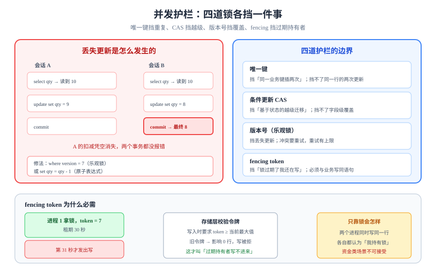

# 并发护栏：乐观锁、条件更新与 fencing

幂等解决「同一次来两遍」，不解决「两次不同的写同时到」。这一页讲并发写同一行时的四道护栏：**唯一键、条件更新、版本号（乐观锁）、fencing token**，以及它们各自能挡什么、不能挡什么。



## 判据族声明

本页判据族 `CGR-A` ~ `CGR-H`，共 8 条。定义表在第八节。

## 一、四道护栏的分工

| 护栏 | 机制 | 挡什么 | 挡不了什么 | 代价 |
| --- | --- | --- | --- | --- |
| **唯一键** | 数据库唯一索引 | 重复实体（同一业务键插两次） | 同一行的两次更新 | 零（索引本来就要） |
| **条件更新**（CAS） | `update ... where state = ?` | 基于状态的非法迁移 | 基于字段值的覆盖写 | 零 |
| **版本号**（乐观锁） | `where version = ?` + `version = version + 1` | 丢失更新（lost update） | 业务语义冲突 | 需重试 |
| **fencing token** | 单调递增令牌，写入时校验 | 过期锁持有者继续写 | 令牌本身被伪造（需服务端签发） | 需一个发号器 |

四者不是互斥的：**唯一键挡插入，CAS 挡状态，版本号挡覆盖，fencing 挡「我以为我还持有锁」**。生产系统通常四个都用。

## 二、丢失更新是怎么发生的

```sql
-- 会话 A                           -- 会话 B
begin;                              begin;
select qty from stock where id=1;   -- 读到 10
                                    select qty from stock where id=1;  -- 也读到 10
update stock set qty=9 where id=1;  -- 写 9
                                    update stock set qty=8 where id=1; -- 写 8
commit;                             commit;   -- 最终 8，A 的扣减凭空消失
```

这就是**丢失更新**（lost update）。它在 `read committed` 与 `repeatable read` 下都存在（前者读到旧值，后者会报序列化失败但很多驱动会静默重试）。

修法只有两种：**在写语句里带上读到的值**，或者**锁住读**。

```sql
-- 修法一：把读到的值带进 where（乐观锁）
update stock set qty = qty - 1, version = version + 1
 where id = 1 and version = 7;      -- 影响 0 行 = 有人先改了，重来

-- 修法二：原子减法，不读不写（最适合「累加/扣减」语义）
update stock set qty = qty - 1 where id = 1 and qty >= 1;
```

::: tip 能用原子表达式就不要用「读出来再算」
`set qty = qty - 1` 让数据库在行锁内完成读改写，天然不会丢失更新；`set qty = 9` 是「写死一个算好的值」，才会丢失。**判据：等号右边出现具体数字（且这个数字来自应用层计算），就要怀疑丢失更新。**
:::

## 三、版本号的三条纪律

1. **版本号由数据库自增**（`version = version + 1`），不能由应用传入。
2. **每次写都要带 `where version = ?`**，影响 0 行必须当作冲突处理，不能静默重试无穷次。
3. **重试次数要有上限**（通常 3 次）+ 指数退避；超过上限返回 409，让调用方决定。

```java [OptimisticRetry.java]
for (int i = 0; i < 3; i++) {
  var row = repo.find(id);                 // 读到 version
  int n = repo.casUpdate(id, row.version(), newState);
  if (n == 1) return row.state();
  // 0 行：别人先改了。重读再试，但最多 3 次
}
throw new ConflictException("concurrent modification");
```

::: danger 不要在重试循环里「重新读一次再无条件写」
那等于把乐观锁退化成先查后写，读与写之间又有窗口。**每次重试都必须带版本条件**。
:::

## 四、fencing token：解决「锁过期了但我还在写」

分布式锁有一个无法回避的事实：**锁有租期，而持有锁的进程可能在第 31 秒才发出第 30 秒该发的写**。此时锁已经属于别人，两边同时写。

解法不是「把租期调长」，而是**给每次加锁发一个单调递增的令牌**，存储层拒绝对旧令牌的写：

```sql
-- 存储层带令牌校验：令牌必须不小于该行已经见过的最大值
create table resource_lock (
  resource_id text primary key,
  fencing     bigint not null default 0,
  holder      text,
  expires_at  timestamptz
);

-- 加锁：拿号（原子自增）
update resource_lock set fencing = fencing + 1, holder = $2,
       expires_at = now() + interval '30 seconds'
 where resource_id = $1
returning fencing;                       -- 拿到 token = 7

-- 业务写：带上令牌，旧令牌直接失败
update stock set qty = qty - 1
 where id = 1 and $token >= (select fencing from resource_lock where resource_id = 'stock:1');
```

关键点：**令牌校验必须和业务写在同一条语句或同一个事务里**。如果先查令牌再写，中间又有窗口，等于没做。

| 方案 | 挡过期持有者 | 需要发号器 | 适用 |
| --- | --- | --- | --- |
| 只用分布式锁 | 否 | 否 | 单写者且能容忍偶发双写 |
| 锁 + fencing token | 是 | 是（可复用锁服务） | 资金、库存、配额 |
| 不用锁，只用 CAS | 是（天然） | 否 | 单库单行写入 |

::: warning fencing 不是「可选优化」
只要你的写路径依赖「先抢锁、再写库」，就必须考虑过期持有者。**「锁没过期」是客户端的判断，不是存储层的事实。**
:::

## 五、乱序：版本号挡不住的那一种

版本号保证「不丢失更新」，但不保证「顺序正确」。两个请求 `cancel`（先发）与 `pay`（后发）乱序到达：

| 到达顺序 | 结果 | 是否正确 |
| --- | --- | --- |
| `cancel` → `pay` | `pay` 在 `CANCELLED` 上非法 → 409 | 正确（用户看到「已取消，支付失败」） |
| `pay` → `cancel` | `pay` 成功，`cancel` 在 `PAID` 上合法 → 退款 | 正确（但用户意图是取消） |

第二种在业务上可能不符合用户意图，但**技术上是对的**：状态机只能保证「每条边合法」，不能保证「用户的意图顺序」。要保证意图顺序，需要：

1. **客户端用同一个键串行化**（同一次操作的重试排队）；
2. **服务端按 `(entity_id, seq)` 排序消费**（`seq` 单调，缺口等待或补偿）；
3. **给操作带客户端时间戳，但不信任它**（只用于展示与审计，不用于裁决）。

判据：**如果你需要「谁先发生」的结论，就必须有一个单调序号；时间戳不是序号。**

## 六、隔离级别带来的三处错觉

| 你以为 | 实际 | 影响 |
| --- | --- | --- |
| `repeatable read` 下两个事务不会冲突 | 会，冲突时抛 `40001` 序列化失败 | 应用必须能重试整个事务，而不是只重试语句 |
| `read committed` 下 `select` 后 `update` 是原子的 | 不是，`select` 与 `update` 之间可被插入 | 先查后写必须加条件 |
| 唯一索引冲突只会在插入时发生 | `update` 改唯一列也会冲突 | 更新路径也要处理 `23505` |

```sql
-- 确认当前隔离级别（默认 read committed）
show transaction_isolation;
```

## 七、把「偶发」变成「必然」：确定性并发

并发缺陷之所以难修，是因为**它不稳定复现**。三种手段把它变确定：

1. **栅栏（barrier）**：让 N 个线程在「即将写库」处等待，同时放行；
2. **固定顺序**：用两个显式事务按 A→B 顺序执行，断言最终值；
3. **注入延迟**：在「读之后、写之前」`pg_sleep`，强制制造窗口。

```sql
-- 会话 A：在读到值之后睡 2 秒，模拟慢请求
begin;
select qty from stock where id = 1;
select pg_sleep(2);
update stock set qty = 9 where id = 1 and version = 7;
commit;
```

配合会话 B 在同一窗口内完成「读 + 写 + 提交」，就能稳定复现丢失更新。**没有这一步，任何并发结论都只是「在我机器上没复现」。**

## 八、判据定义表

| 判据 | 约定 | 定错了会怎样 | 怎么验证 |
| --- | --- | --- | --- |
| `CGR-A` | 有覆盖语义的更新必须带版本条件或使用原子表达式 | 丢失更新 | 两会话并发扣减，最终值等于「初始 - 2」 |
| `CGR-B` | 版本号由数据库自增，不由应用传入 | 客户端可伪造版本，跳过冲突检测 | 请求体里带 `version` 字段必须被服务端忽略 |
| `CGR-C` | CAS 影响 0 行必须区分「不存在 / 版本不符 / 状态不符」 | 错误码误导，客户端错误重试 | 三种前置各构造一次，分别得 404 / 409 / 409 |
| `CGR-D` | 乐观锁重试有上限（≤3）且有退避 | 高冲突下 CPU 打满、请求堆积 | 冲突注入下请求 P99 不随重试线性增长 |
| `CGR-E` | 依赖分布式锁的写路径必须带 fencing token 校验 | 锁过期后双写 | 手工把锁 `expires_at` 改到过去，旧令牌写入必须失败 |
| `CGR-F` | 需要「先后」结论的地方必须有单调序号，不得用时间戳裁决 | 时钟漂移导致顺序错乱 | 事件表有 `seq` 且唯一，消费端按 `seq` 排序 |
| `CGR-G` | 应用必须能处理 `40001`（序列化失败）与 `23505`（唯一冲突） | 偶发 500，且不可自愈 | 注入冲突后接口成功率仍为 100%（含重试） |
| `CGR-H` | 并发结论必须有可复现脚本（栅栏或延迟注入），不得只写「不会发生」 | 问题在线上才暴露 | 存在一个能稳定复现旧缺陷的脚本，修复后该脚本不再复现 |

## 如何验证

```sql
-- 准备：一行带版本号的库存
create table stock (id int primary key, qty int not null, version bigint not null default 0);
insert into stock (id, qty, version) values (1, 10, 0);
```

两个终端分别执行（A 先，B 后，A 在写之前睡 2 秒）：

```sql
-- 终端 A
begin;
select qty, version from stock where id = 1;   -- 10, 0
select pg_sleep(2);
update stock set qty = 9, version = version + 1 where id = 1 and version = 0;
commit;
```

```sql
-- 终端 B（在 A 睡着时执行）
begin;
select qty, version from stock where id = 1;   -- 10, 0
update stock set qty = 8, version = version + 1 where id = 1 and version = 0;
commit;
```

**预期输出**：B 的 `update` 影响 1 行并提交成功；A 的 `update` 在 B 提交后影响 **0 行**（版本已变成 1），A 必须重读重试。若 A 也影响 1 行，说明 `where version = 0` 没生效——此时 `select qty from stock where id = 1` 会得到 `9`，A 的扣减被覆盖（这正是要防的丢失更新）。

```sql
-- 原子表达式的对照：无论并发多少次，结果都可预期
update stock set qty = qty - 1 where id = 1 and qty >= 1;
select qty from stock where id = 1;
```

**预期输出**：每成功执行一次减 1，且 `qty` 不会小于 0。

## 参考资料

- [PostgreSQL 文档：事务隔离](https://www.postgresql.org/docs/18/transaction-iso.html)——`read committed` 与 `repeatable read` 下的更新冲突语义
- [PostgreSQL 文档：`UPDATE` 与并发更新](https://www.postgresql.org/docs/18/dml-update.html)——行锁与 `RETURNING`
- Kleppmann, M. *Designing Data-Intensive Applications*（2017）第 7 章——丢失更新与 fencing token
- Martin Kleppmann, *How to do distributed locking*（2016）——fencing token 的完整论证
- 相邻页面：[状态机建模](../StateMachine/index.md) · [怎么测](../Testing/index.md)
