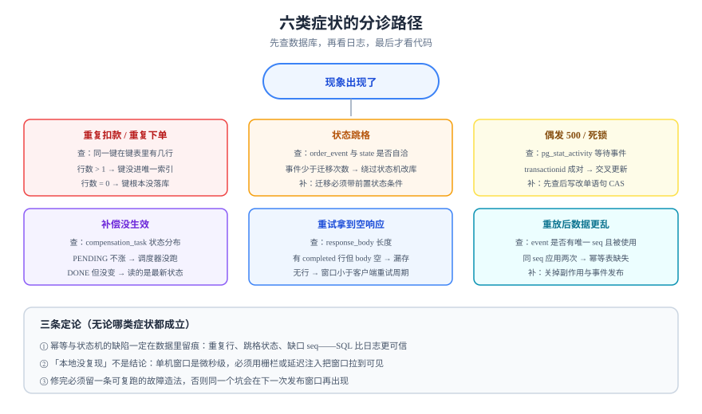

# 常见问题与最佳实践

这一页按「症状 → 分诊 → 定论」组织：先给你一张能对着现象查的表，再给十二个高频问题，最后是十二条可以直接抄进团队规范的实践。



## 判据族声明

本页判据族 `IFQ-A` ~ `IFQ-G`，共 7 条。定义表在第五节。

## 一、六类症状分诊

| 症状 | 最可能的三个原因 | 先查什么 | 定论 |
| --- | --- | --- | --- |
| **重复扣款 / 重复下单** | ① 幂等键没落库；② 键每次重试都新建；③ 业务唯一键没进唯一索引 | 同一键在键表里有几行 | 只要键表行数 > 1，就是「键没进唯一索引」或「键值变了」 |
| **状态跳格（`CREATED` → `SHIPPED`）** | ① 迁移没带前置状态；② 代码直接 `set state`；③ 手工修数据 | `order_event` 与 `orders.state` 是否对得上 | 事件数量少于迁移次数 → 有人绕过状态机改了库 |
| **偶发 500 / 死锁** | ① 先查后写；② 事务里调外部服务；③ 无索引更新锁了太多行 | `pg_stat_activity` 的等待事件 | 等待事件是 `transactionid` 且成对出现 → 两个事务交叉更新 |
| **补偿没生效** | ① 补偿任务表没有唯一约束，重复补偿；② 调度器没跑；③ 补偿顺序反了 | `compensation_task.status` 分布 | 大量 `PENDING` 且 `attempts` 不涨 → 调度器问题；`DONE` 但业务没变 → 补偿逻辑读的是最新状态 |
| **重试拿到空响应** | ① 只存了状态码没存 body；② `completed` 行被清理；③ 窗口小于客户端重试周期 | `idempotency_key` 的 `response_body` 长度 | 有 `completed` 行但 body 为空 → 实现漏存 |
| **重放后数据更乱** | ① 消费端不幂等；② 用时间戳排序；③ 重放期间改代码 | `order_event` 是否有唯一 `seq` 且被使用 | 同一 `seq` 被应用两次 → 幂等表缺失 |

::: tip 分诊的第一原则
**先看数据库，再看日志，最后才看代码。** 幂等与状态机的所有缺陷都会在数据里留下痕迹（重复行、跳格状态、缺口 seq），而日志只能告诉你「谁调了」。
:::

## 二、十二个高频问题

**Q1：幂等键应该由前端生成还是后端生成？**
前端（调用方）生成。它最清楚「这是一次操作」。后端生成只能在「服务端能算出业务键」的场景用，例如第三方回调与定时任务。

**Q2：幂等键的有效期设多长？**
大于「客户端最长重试跨度 + 一次人工介入的时间」。Stripe 是 24 小时，Adyen 是 7~14 天，跨天对账类业务建议 7 天以上。**这个值必须写进接口文档**，因为窗口外的重试会被当成新请求。

**Q3：为什么不能「先 select 判断是否存在，再 insert」？**
因为两个并发请求会同时查不到、同时插入。判断与写入必须在同一条语句（`on conflict`）或同一个唯一索引裁决下完成。

**Q4：`in_progress` 卡住了怎么办？**
靠锁超时接管：`where status='in_progress' and locked_at < now() - interval '60 seconds'`。超时值取处理时长 p99 × 1.5，太短会误接管，太长会让客户端长时间 409。

**Q5：重复回调应该返回 200 还是 409？**
**200**。重复回调是渠道的正常行为，返回 409 会让渠道持续重发。409 只用于「同一幂等键、载荷不同」或「原请求仍在执行」这两种真正的冲突。

**Q6：状态机要不要用现成的库（Spring StateMachine / XState）？**
状态少（≤6）且只在一个服务内用 → 一张迁移表 + 条件更新就够，库会带来额外抽象。状态多、需要层次/并发区域、需要可视化 → 用库。**判据是「迁移规则是否需要被非程序员读懂」**。

**Q7：能不能直接 `delete` 掉错误数据再做一次？**
不能。物理删除会同时删掉审计痕迹与事件，导致「重放无法重建」。正确做法是补偿（写反向操作）或状态置为终态。

**Q8：`version` 和 `updated_at` 能互相替代吗？**
不能。`updated_at` 精度有限（同一毫秒内两次更新无法区分），且时钟可能回拨。版本号必须单调自增。

**Q9：分布式锁能替代状态机吗？**
不能。锁只保证「同一时刻一个写者」，不保证「这次迁移合法」。锁 + 无条件更新 = 依然可以 `CANCELLED → SHIPPED`。

**Q10：对账发现差异，能不能自动改？**
金额类差异**绝不能**自动改，必须挂账留证。状态类差异可以在明确「以哪一侧为准」后自动修正，且必须留审计。

**Q11：事件溯源是不是比状态表更好？**
只在「必须能回到任意历史时刻」时更好（账务、审批）。普通业务用状态表 + 事件表混合即可；纯事件溯源会让读取路径复杂一个量级。

**Q12：怎么说服团队「不做幂等的接口也要写清幂等档位」？**
用事故成本说话：一次重复扣款的退款成本 + 客服成本，远高于在接口文档里加一列。**「说不清档位」本身就是缺陷**，因为它意味着没人想过重复会发生什么。

## 三、十二条最佳实践

1. **幂等判定落在数据库约束上**，不靠应用层的「先查再写」。
2. **幂等键按租户分区**，主键 `(tenant_id, key)`，避免跨租户碰撞与探测。
3. **存请求指纹**，同键不同载荷返回 422，不要拿旧结果糊弄。
4. **响应码与响应体一起存**，重试必须能拿到与首次逐字节相同的响应。
5. **重复请求返回成功**（当目标状态已达成），只有真冲突才 409。
6. **状态取值有约束**（外键表或 `CHECK`），并用 `select distinct` 定期核对。
7. **每次迁移都是条件更新**，影响 0 行必须区分「不存在 / 状态不符」。
8. **副作用与状态同事务写 outbox**，跨进程投递靠 outbox 重试，不靠「再调一次」。
9. **补偿表带 `(biz_type, biz_id)` 唯一约束**，补偿动作本身必须幂等。
10. **金额用整数分**，浮点在累加与比较上必然出错。
11. **重放必须显式给水位线、关掉外部副作用、可断点续跑**。
12. **测试要造故障**：重复、并发、崩溃、下游失败、渠道多记，五类各一条可复跑步骤。

::: danger 三条最贵的教训
1. **「本地测过没问题」在幂等场景几乎没有信息量**：单机的窗口是微秒级，线上是几十毫秒。没有并发用例，等于没测。
2. **幂等键写在应用内存里**，在多实例 + 滚动发布下必然失效，而重复恰好发生在发布窗口。
3. **把「重试」当成兜底**：重试只能解决瞬时故障，解决不了「请求已经成功但响应丢了」——后者只能靠幂等。
:::

## 四、术语速查

| 术语 | 一句话解释 |
| --- | --- |
| 幂等（Idempotency） | 同一意图执行多次，效果等于一次 |
| 请求指纹（Fingerprint） | 方法 + 路径 + 规范化 body 的哈希，用于识别「同键不同请求」 |
| CAS（Compare-And-Swap） | 带前置条件的更新，影响 0 行即冲突 |
| 丢失更新（Lost Update） | 两个事务读同一值，后写者覆盖先写者 |
| fencing token | 单调递增令牌，存储层据此拒绝过期锁持有者的写 |
| outbox | 与业务同事务写入的待投递表，保证「状态与通知一致」 |
| 补偿（Compensation） | 对已提交操作的语义相反的新操作 |
| 水位线（Watermark） | 重放的起点/终点位置（`seq`） |

## 五、判据定义表

| 判据 | 约定 | 定错了会怎样 | 怎么验证 |
| --- | --- | --- | --- |
| `IFQ-A` | 排障必须先查数据库再看日志 | 被日志误导，改错地方 | 排障记录里有 SQL 读数 |
| `IFQ-B` | 接口文档必须写明幂等档位与窗口 | 客户端不知道能否重试 | 文档每个写接口有「幂等 / 窗口」两列 |
| `IFQ-C` | 重复请求返回成功，只有真冲突才 409 | 渠道持续重发 | 重复回调响应码 200 |
| `IFQ-D` | 状态跳格必须能由事件表解释 | 有人绕过状态机改库 | `order_event` 数量 = 成功迁移次数 |
| `IFQ-E` | 补偿表有唯一约束，补偿动作幂等 | 重复补偿 | 同一业务插两条补偿任务，第二条冲突 |
| `IFQ-F` | 金额类对账差异只挂账不自动改 | 掩盖问题 | 对账代码金额分支无 `update` |
| `IFQ-G` | 五类故障各有一条可复跑步骤 | 失败路径从未验证 | 故障清单里每类都有命令与读数 |

## 如何验证

```sql
-- ① 全库扫一遍「幂等失守」的痕迹：同一业务键多行
select channel, channel_txn_id, count(*)
  from payment_notify group by 1,2 having count(*) > 1;
```

**预期输出**：0 行。有行即为回调去重失效（`ISP-A`）。

```sql
-- ② 扫「状态跳格」：事件里的迁移序列与当前状态是否自洽
select o.id, o.state, count(e.seq) as events
  from orders o left join order_event e on e.order_id = o.id
 group by 1,2 having count(e.seq) = 0;
```

**预期输出**：0 行。有行说明订单被直接插入或绕过状态机改成了非初始态。

```shell
# ③ 幂等窗口与文档一致（示例：24 小时）
grep -rn "24 小时\|24h\|86400" docs/ --include="*.md" | head -5
```

**预期输出**：只出现在文档的「幂等窗口」小节，且数值与代码里的清理窗口一致。

## 参考资料

- [The Idempotency-Key HTTP Header Field（draft-07）](https://datatracker.ietf.org/doc/html/draft-ietf-httpapi-idempotency-key-header)——语义与状态码
- [Stripe：Idempotent requests](https://docs.stripe.com/api/idempotent_requests)——窗口、并发、结果缓存
- [RFC 9110 §9.2](https://www.rfc-editor.org/rfc/rfc9110#section-9.2)——方法的幂等性定义
- 相邻页面：[概述](../Overview/index.md) · [实战](../Practice/index.md) · [怎么测](../Testing/index.md)
