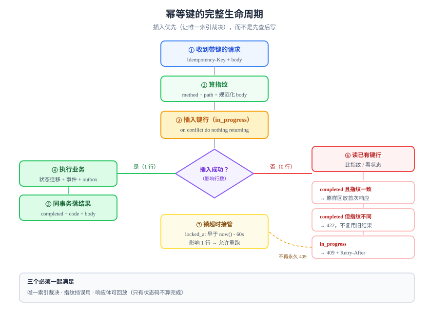

# 幂等键设计：让同一个请求只发生一次

幂等键（Idempotency Key）是客户端为**一次逻辑操作**生成的唯一值，重试时原样带回。服务端靠它认出「这是同一次」，从而**返回第一次的结果，而不是再执行一遍**。这一页讲清四件事：键从哪来、键怎么存、并发同键怎么办、结果要存到什么程度。



## 判据族声明

本页判据族 `IK-A` ~ `IK-H`，共 8 条。定义表在第九节。

## 一、键从哪来：三种来源与它们的责任划分

| 来源 | 谁生成 | 长什么样 | 优点 | 风险 |
| --- | --- | --- | --- | --- |
| **客户端生成** | 调用方（App / 前端 / 合作方） | `Idempotency-Key: 0192f0c4-...` | 语义最准：客户端最清楚「这是一次操作」 | 客户端每次重试都换新键 → 等于没有 |
| **服务端派生** | 服务端从业务属性算出 | `sha256(user_id + sku + period)` | 不依赖客户端配合 | 业务属性一变（改数量）就变成「新的一次」 |
| **混合** | 客户端给业务键，服务端归一化 | `order:{client_order_no}` | 兼顾语义与可控 | 需要定义归一化规则（大小写、空白） |

**选择顺序**：能由客户端表达就用客户端；不能（第三方回调、定时任务）就用服务端派生；两者都行时**优先业务键**，因为它同时能挡住「用户点两次」。

::: danger 客户端最常见的三个错
1. **每次重试都生成新键**——把键存在「发起点击」的那一刻，重试时复用，而不是在重试函数里 `uuid()`。
2. **把键存在内存里**——App 被杀掉后键丢失，重试变成新请求；键要随「待提交操作」一起持久化。
3. **用敏感信息当键**——邮箱、手机号、身份证进键，等于把它们写进日志与索引；Stripe 文档明确建议用 UUID。
:::

## 二、键长什么样

| 维度 | 建议 | 理由 |
| --- | --- | --- |
| 长度 | 16~255 字符 | 太短会撞，太长浪费索引；Stripe 上限 255、Adyen 上限 64 |
| 生成方式 | UUIDv7（PostgreSQL 18 可直接 `uuidv7()`） | 时间有序，索引插入局部性好于 v4 |
| 字符集 | `[A-Za-z0-9_-]` | 避免 URL / header 转义问题 |
| 作用域 | **按租户（或账号）分区**，不是全局 | 全局唯一会让 A 租户能探测 B 租户的键 |
| 可读性 | 允许带业务前缀（`order:2026-10:123`） | 排障时一眼看出属于哪个业务 |

```sql
-- PostgreSQL 18：直接生成时间有序的键，作为默认值兜底
create table demo_order (
  id    uuid primary key default uuidv7(),
  note  text not null
);
```

**作用域是必须写进设计的一条**：主键应为 `(tenant_id, idempotency_key)`，而不是单列 `idempotency_key`。否则两个租户用了同一个键（例如都用了订单号 `1001`），后到的那个会拿到别人的响应。

## 三、三种实现与它们的代价

| 实现 | 机制 | 成本 | 适用 | 不适用 |
| --- | --- | --- | --- | --- |
| **去重表 + 唯一键** | 插入键行，冲突即命中 | 一次插入 + 一次查询 | 通用，最稳 | 极高 QPS 的写热点 |
| **业务唯一键** | 直接给业务表加唯一索引，冲突即命中 | 零额外表 | 有天然业务键（订单号、流水号） | 无天然键 |
| **状态机条件更新** | `update ... where state = ?`，0 行即冲突 | 零额外表 | 「同一个状态只能进一次」 | 需要返回首次响应体 |

三者可以叠加：**业务唯一键挡重复实体，去重表挡重复请求，条件更新挡重复迁移**。

## 四、去重表的完整 DDL

```sql
create table idempotency_key (
  tenant_id     bigint      not null,
  key           text        not null,
  -- 请求指纹：方法 + 路径 + 规范化后的 body
  fingerprint   bytea       not null,
  -- in_progress / completed
  status        text        not null default 'in_progress',
  -- 首次请求的结果，命中时原样回放
  response_code int,
  response_body bytea,
  created_at    timestamptz not null default now(),
  locked_at     timestamptz not null default now(),
  completed_at  timestamptz,
  primary key (tenant_id, key),
  constraint ik_status_ck check (status in ('in_progress', 'completed')),
  constraint ik_done_ck   check (status <> 'completed' or response_code is not null)
);
create index ik_cleanup_idx on idempotency_key (created_at);
```

四个设计点：

1. **主键带 `tenant_id`**：键的作用域就是租户，见第二节。
2. **`fingerprint` 必存**：同键不同载荷是**客户端的 bug**，必须能被识别并拒绝（422），而不是拿旧结果糊弄过去。
3. **`status` 两态而非三态**：不要引入 `failed`。失败要么是可重试的（删掉键行或允许接管），要么是终态（连同响应一起存成 `completed`）。
4. **`check` 约束保证「完成必有响应」**：这条约束挡住「忘了存响应」的实现错误——那种情况下重试会拿到 200 空 body，比报错更难查。

## 五、请求指纹：同键不同载荷必须报错

```java [IdempotencyService.java]
private byte[] fingerprint(String method, String path, byte[] body) {
  // 只把「影响结果」的东西算进来：方法、路径、规范化 body
  // 不要把 trace-id、时间戳、签名等易变头算进来，否则每次都是新指纹
  var md = MessageDigest.getInstance("SHA-256");
  md.update(method.getBytes(StandardCharsets.UTF_8));
  md.update((byte) 0);
  md.update(path.getBytes(StandardCharsets.UTF_8));
  md.update((byte) 0);
  return md.digest(canonicalJson(body)); // 键序固定、去掉无意义空白
}
```

::: warning 指纹最容易被算错的两处
1. **JSON 键序**：`{"a":1,"b":2}` 与 `{"b":2,"a":1}` 语义相同，直接 `sha256(body)` 会算出两个指纹，于是同一请求被判成「同键不同载荷」而 422。**必须先规范化**。
2. **把易变头算进去**：`traceparent`、`x-request-id`、`date` 每次不同，算进去等于关闭幂等。
:::

命中处理的三条分支：

| 情况 | 返回 | 说明 |
| --- | --- | --- |
| 键存在、`completed`、指纹一致 | 首次的 `response_code` + `response_body` | 真正的幂等回放 |
| 键存在、`completed`、指纹不一致 | `422` | 草案语义：同键不同请求 |
| 键存在、`in_progress` | `409` + `Retry-After` | 原请求还在跑，让客户端等，而不是并行再跑一遍 |

## 六、in-flight 冲突：409 与「接管」

`in_progress` 的行会一直卡住，如果进程在「插入键行」之后、`completed` 之前崩溃。必须有一个**接管机制**，否则这个键永久 409。

```sql
-- 接管：只有超过锁超时（此处 60s）的 in_progress 才允许被复位
update idempotency_key
   set status = 'in_progress', locked_at = now()
 where tenant_id = $1 and key = $2
   and status = 'in_progress'
   and locked_at < now() - interval '60 seconds';
-- 影响 1 行 = 接管成功；0 行 = 仍在执行中，返回 409
```

锁超时必须**大于你 99 分位的最长处理时间**，否则会在正常慢请求上误接管，造成两次真实执行。这个数字不是拍的：从 `http_server_requests_seconds` 的 p99 取，再乘 1.5。

::: danger 不要用「短事务 + 异步执行」回避 409
把业务逻辑丢进异步队列、立刻把键标成 `completed`，是最隐蔽的错误：**客户端拿到 202，任务却可能失败**，此时键已经是「完成」，重试永远拿不到真实结果。异步的正确做法是键表记录 `in_progress`，等任务真正完成再落 `completed`。
:::

## 七、结果必须存到「能原样回放」的程度

「只存一个 `ok = true`」是常见的半成品实现：客户端重试时拿到 `{"ok": true}`，但拿不到资源 id，于是它只能再查一次——多一次往返，且查到的可能是后续被修改过的状态。

存什么，取决于客户端拿它干什么：

| 存法 | 够不够 | 说明 |
| --- | --- | --- |
| 只存成功/失败 | 不够 | 重试方拿不到 id |
| 存 `response_code` + `response_body` | 够 | 与首次响应逐字节一致，这是草案的期望行为 |
| 存重定向/流式响应 | 不适用 | 流式接口不适合幂等回放，建议改成「创建任务 + 查任务」 |
| 存 500 | 视策略 | Stripe 连 500 都缓存，理由是避免重试放大故障；也有系统选择不缓存 500 以便重试 |

**推荐**：4xx（除 409/429）与 2xx 都缓存；5xx 不缓存，但把键保持着 `in_progress`，靠接管机制重试。

## 八、窗口与清理

| 项 | 建议值 | 依据 |
| --- | --- | --- |
| 保留窗口 | 24 小时起步，跨天对账类业务 7~30 天 | 必须覆盖客户端最长重试周期 + 一次人工介入的时间 |
| 清理方式 | 按 `created_at` 批量删，单批 ≤ 5000 行 | 大批量删除会长时间持锁、制造 WAL 峰值 |
| 归档 | 删除前把 `key` 与 `response_code` 落到审计表 | 事后要能回答「这个键当时返回了什么」 |
| 窗口外重试 | 视为新请求，并在文档里写明 | 不能假装还认识它 |

```sql
-- 清理：分批删，带 limit，避免长事务
with victims as (
  select tenant_id, key from idempotency_key
   where created_at < now() - interval '24 hours'
   limit 5000
)
delete from idempotency_key k
 using victims v
 where k.tenant_id = v.tenant_id and k.key = v.key;
```

## 九、判据定义表

| 判据 | 约定 | 定错了会怎样 | 怎么验证 |
| --- | --- | --- | --- |
| `IK-A` | 幂等键必须由客户端为「一次逻辑操作」生成，并在重试时复用 | 每次重试都是新请求，幂等失效 | 同一操作连发两次，第二次响应体与第一次逐字节相同 |
| `IK-B` | 键的作用域必须包含租户（或账号），主键为复合键 | 跨租户键碰撞，A 拿到 B 的响应 | 两租户用同一个键各发一次，各自拿到自己的资源 id |
| `IK-C` | 必须存请求指纹，同键不同指纹返回 422 | 用旧结果糊弄新请求，数据错乱 | 同键改一个字段重发，返回 422 |
| `IK-D` | `in_progress` 必须有锁超时与接管机制 | 进程崩溃后该键永久 409 | 手工插入一条 61 秒前的 `in_progress`，重发必须成功 |
| `IK-E` | 响应码与响应体必须一起存，完成态不由空响应构成 | 重试拿到 200 空 body | `select count(*) from idempotency_key where status='completed' and response_body is null` 为 0 |
| `IK-F` | 保留窗口必须写进文档且长于客户端重试总时长 | 窗口外重试变成第二次执行 | 文档窗口 ≥ 客户端最大重试跨度 |
| `IK-G` | 幂等键只保护有副作用的写，`GET` 与覆盖式 `PUT` 不加 | 多一次 I/O，语义混乱 | 接口清单中 `GET` 无键字段 |
| `IK-H` | 清理必须分批且有归档，不得整表 `delete` | 长事务、锁表、事后无法举证 | 清理脚本每次影响行数 ≤ 5000 |

## 如何验证

```shell
# ① 连发两次，第二次必须复用第一次的响应
curl -s -X POST http://localhost:8080/api/orders \
  -H 'Content-Type: application/json' \
  -H 'Idempotency-Key: 0192f0c4-7a1e-7c3b-9d2f-2b6f1c9a0001' \
  -d '{"sku":"A-1","qty":1}' | tee /tmp/r1.json
curl -s -X POST http://localhost:8080/api/orders \
  -H 'Content-Type: application/json' \
  -H 'Idempotency-Key: 0192f0c4-7a1e-7c3b-9d2f-2b6f1c9a0001' \
  -d '{"sku":"A-1","qty":1}' | tee /tmp/r2.json
diff /tmp/r1.json /tmp/r2.json && echo "IDEMPOTENT_OK"
```

**预期输出**：`IDEMPOTENT_OK`（两次响应逐字节相同）。若不同，先看第二次是否带回了新的资源 id——那说明键没被复用或键表没落库。

```sql
-- ② 库里必须只有一行键、且已有响应
select status, response_code, octet_length(response_body) as body_len
  from idempotency_key where key = '0192f0c4-7a1e-7c3b-9d2f-2b6f1c9a0001';
```

**预期输出**：一行，`status = completed`，`response_code = 201`，`body_len > 0`。

```shell
# ③ 同键换载荷：必须 422，而不是复用旧结果
curl -s -o /dev/null -w '%{http_code}\n' -X POST http://localhost:8080/api/orders \
  -H 'Content-Type: application/json' \
  -H 'Idempotency-Key: 0192f0c4-7a1e-7c3b-9d2f-2b6f1c9a0001' \
  -d '{"sku":"A-1","qty":2}'
```

**预期输出**：`422`。返回 201 说明指纹没算或没比。

## 十、与「通知中心读接口」的分工

本页讲**写侧幂等**：键的来源、去重表 DDL、指纹三坑、409/422 分支、锁超时接管。**读侧动作也有幂等需求**（点两次「已读」不该产生两条审计），这一半见[在线协作任务看板 · 通知中心读接口](/project/Complete/TeamBoard/NotificationCenter/index.md)。

读侧幂等的写法与本页的「去重表」不同：它不需要额外的键表，**用一个条件更新就够**：

```sql
UPDATE notification SET read_at = now()
 WHERE id = $1 AND recipient_id = $2 AND read_at IS NULL;
-- 实测：第一次 UPDATE 1（0.984 ms），第二次 UPDATE 0（0.358 ms）
```

::: danger 读侧幂等最容易写成「先查后改」
`if (n.getReadAt() == null) { n.setReadAt(now()); save(n); }` 在并发下会写两次 `read_at`。虽然结果看起来一样，但**审计里的「已读时间」会变**，且如果有「已读触发下游」的逻辑就会执行两次。
判据只有一条：**一次请求的幂等性，必须由一条 SQL 的受影响行数决定**，而不是由应用层的 `if` 决定。
批量动作（「全部已读」）还要额外加**水位**（`AND created_at <= max(created_at)`），否则刚到达的新通知会被一起标成已读。
:::

## 与「多活与单元化」的分工（第 163 天补充）

本页讲幂等键怎么选、怎么存、怎么过期。这些结论在单库环境里是完备的；**在多单元环境里，幂等键还多一个必须满足的条件：它要能区分「谁产生的」**。

```sql
-- 单库：一个序列就够
CREATE TABLE idem_record (idem_key text PRIMARY KEY, ...);

-- 多单元：两个单元的本地序列都会从 1 开始，必须把来源单元放进主键
CREATE TABLE idem_record (
  src_cell text   NOT NULL,
  idem_key text   NOT NULL,
  PRIMARY KEY (src_cell, idem_key)
);
```

实测依据：两个单元各自 `bigserial`，各插两行，合并后 **4 行只有 2 个不同 ID**，而两侧主键都不报错——撞号在合并/迁移时才暴露。

| 本页的结论 | 多活里的补充 | 去哪 |
| --- | --- | --- |
| 幂等键由客户端生成、服务端校验 | 键的作用域必须含单元/租户 | [数据同步](../../../Ops/MultiActive/DataSync/index.md) 第 4 节 |
| 幂等记录有 TTL、可清理 | 跨单元重放要按 `(单元, 键)` 去重 | [冲突裁决](../../../Ops/MultiActive/Conflict/index.md) |
| 重放要幂等 | 迁移期旧写被 `epoch` 拒绝后，重试要打到新单元 | [单元化模型](../../../Ops/MultiActive/CellModel/index.md) 第 4.1 节 |

::: tip 一个便宜的判断
**如果你的幂等键是自增 ID，它在多活里一定失效。** 换成「客户端生成的 UUID + 来源单元」几乎零成本，而它能挡住「同一笔操作在两个单元各执行一次」这类最贵的重复。
:::


## 与「状态管理与数据流」专题的分工

本页是**幂等键的服务端语义**：键的作用域、存储、去重窗口、与状态机的关系。前端为什么要带、在什么粒度生成、重试时怎么复用，归 [状态管理与数据流](/docs/Frontend/StateDataFlow/index.md) 的 [乐观更新](/docs/Frontend/StateDataFlow/OptimisticUpdate/index.md)。

::: danger 键在哪里生成，决定了它有没有用
若幂等键在**请求封装内部**生成（每次 `fetch` 一个 `randomUUID()`），那么「超时重试」会拿到一个新键，服务端认为是两次不同的操作——重复创建照样发生。键必须在**用户操作**这一层生成（一次拖动 / 一次提交一个），并随重试一起传下去。判断方法很简单：把超时调到 1 秒、服务延迟调到 3 秒，制造一次「客户端以为失败、服务端其实成功」，看列表里是一条还是两条。
:::
## 参考资料

- [The Idempotency-Key HTTP Header Field（draft-07）](https://datatracker.ietf.org/doc/html/draft-ietf-httpapi-idempotency-key-header)——键的语义、400/409/422 三个状态码
- [Stripe：Idempotent requests](https://docs.stripe.com/api/idempotent_requests)——24 小时窗口、255 字符、并发 409
- [Stripe：Advanced error handling](https://docs.stripe.com/error-low-level)——「500 结果不确定」与对账的关系
- [PostgreSQL 18：`uuidv7()`](https://www.postgresql.org/docs/18/functions-uuid.html)——时间有序键的生成
- 相邻页面：[概述](../Overview/index.md) · [并发护栏](../ConcurrencyGuard/index.md) · [实战](../Practice/index.md)
