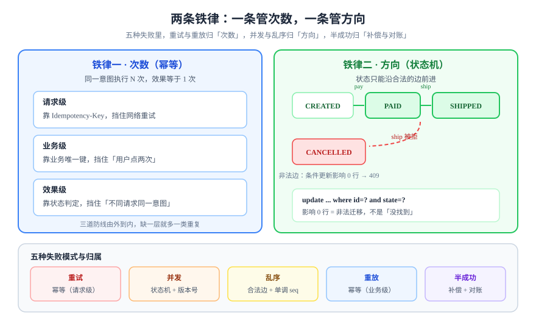

# 概述：两条铁律与五种失败模式

写路径上的正确性可以压缩成两句话：**同一个意图执行多次，效果等于执行一次**（幂等）；**状态只能沿合法的边前进，非法迁移被拒绝而不是被忽略**（状态机）。这一页把这两句话拆开，说明它们各自覆盖哪些失败、不覆盖哪些失败，以及在什么场景下**不该**做。



## 判据族声明

本页判据族 `ID-A` ~ `ID-H`，共 8 条。定义表在第七节。

## 一、铁律一：次数（幂等）

数学定义很干脆：`f(f(x)) = f(x)`。但在业务系统里，这个定义没法直接用——因为「`x`」到底是什么，有三种完全不同的答案：

| 口径 | 「同一次」指什么 | 判定依据 | 典型失效 |
| --- | --- | --- | --- |
| **请求级** | 同一个 HTTP 请求被重发 | 客户端带来的 `Idempotency-Key` | 客户端每次重试都生成新键 |
| **业务级** | 同一笔业务意图 | 业务唯一键（订单号、流水号、`(user, period)`） | 业务键没进唯一索引 |
| **效果级** | 最终状态相同 | 状态机的目标状态 | 中间副作用（发短信、扣库存）重复了 |

三者不是替代关系，而是**从外到内的三道防线**：请求级挡住网络重试，业务级挡住「用户点两次」，效果级挡住「两个人各发一个不同请求，但意图相同」。

::: tip 一句话判断
如果你的系统里，「同一个意图」无法被一个唯一键表达出来，那么它**不可能**做到幂等——你只能做到「尽量少重复」。
:::

## 二、铁律二：方向（状态机）

状态机约束的不是「谁在写」，而是「从哪儿能写到哪儿」。它有三个不能省的部分：

1. **状态集合是封闭的**：`state` 列的取值必须由约束或枚举限定，不能出现 `state = 'done!'` 这种拼写变体；
2. **迁移是显式的**：每一条合法的边都要在迁移表里存在，代码里没有「默认允许」；
3. **迁移是条件更新**：`update ... where id = ? and state = ?`，前置状态不对就影响 0 行。

第 3 条最容易被省略。省略之后，状态机就退化成一个注释——`update ... set state = 'SHIPPED'` 在任何状态下都能成功。

## 三、五种失败模式

这两条铁律之所以必须同时存在，是因为写路径上的失败有五种，每种只被其中一条覆盖：

| 失败模式 | 具体长什么样 | 谁负责挡住 | 挡不住的后果 |
| --- | --- | --- | --- |
| **重试** | 客户端超时后重发，或网关自动重试 | 幂等（请求级） | 一次下单生成两笔订单 |
| **并发** | 两个请求同时读到 `PAID` 再各自写 | 状态机（条件更新） | 一个订单既发货又退款 |
| **乱序** | 后发的「取消」先到，先发的「支付」后到 | 状态机（合法性）+ 版本号 | 已取消的订单被改回已支付 |
| **重放** | 消息被重复投递、任务被重跑、事件被回放 | 幂等（业务级） | 库存被扣两次 |
| **半成功** | 数据库提交了，下游通知没发出去 | 补偿与对账 | 钱扣了、货没发，且没人知道 |

五种模式里，只有前两种能被「在入口加一层」解决；后三种必须落到**状态、补偿与对账**上。这就是本专题要讲五页而不只讲一页的原因。

## 四、天然幂等与需要人造幂等

| 操作 | 天然幂等？ | 说明 |
| --- | --- | --- |
| `GET`、`HEAD`、`OPTIONS` | 是 | HTTP 语义保证；不要给它们加幂等键 |
| `PUT /orders/{id}`（客户端指定 id） | 是 | 重发写的是同一条记录，效果相同 |
| `DELETE /orders/{id}` | 是 | 第二次删不到东西，但「已删除」这个结论不变 |
| `POST /orders`（服务端生成 id） | **否** | 每次都会生成新 id，必须有幂等键或业务唯一键 |
| `PATCH`（部分更新，累加语义） | **否** | `balance = balance + 10` 重发两次就加了两遍 |
| 发短信、发邮件、调第三方 | **否** | 副作用不可撤销，只能靠去重表 |

::: warning 判断 `PUT` 是否真幂等，看它是不是「覆盖式写」
`PUT /cards/{id}` 传完整对象 → 幂等；`PUT /cards/{id}/move` 传「往前挪一格」这种**相对指令** → 不幂等。**同一方法名下，绝对语义幂等，相对语义不幂等**，这是很多「PUT 居然重复了」的根因。
:::

## 五、四种不该做幂等的场景

幂等不是免费的：每次写多一次查、多一张表、多一个清理任务。下列四种情况**加幂等键是负收益**：

1. **操作本身就是幂等的**（`GET` / `PUT` 覆盖式 / 天然唯一键写入）——加了只是多一次 I/O。
2. **重复的代价远小于防重复的成本**：例如「记录一次浏览」重复两条，业务上无感，而全链路加键会让写入延迟翻倍。
3. **必须每次都执行的操作**：例如「刷新令牌」「重算缓存」。这类操作的语义是「让结果与此刻一致」，不是「执行一次」。
4. **无法定义「同一次」的场景**：例如「随机推荐一批内容」，两次调用本就该不同。硬造一个键只会把功能弄坏。

::: danger 常见误判
把「查询类接口」也加上幂等键，是最常见的过度设计：查询不需要幂等键，它需要的是**缓存与超时**。幂等键只保护**有副作用**的写。
:::

## 六、五步决策清单

拿到一个写接口，按顺序问五个问题，答案直接决定实现方式：

| 步骤 | 问题 | 答「是」的落点 |
| --- | --- | --- |
| 1 | 这个操作有副作用吗？ | 没有 → 结束，不需要幂等 |
| 2 | 它天然幂等吗（覆盖式写、天然唯一键）？ | 是 → 只加唯一索引即可，不做键表 |
| 3 | 「同一次」能被客户端的键表达吗？ | 能 → 用 `Idempotency-Key`，见[幂等键设计](../IdempotencyKey/index.md) |
| 4 | 「同一次」只能由业务属性表达吗？ | 是 → 业务唯一键 + 唯一索引，见[状态机建模](../StateMachine/index.md) |
| 5 | 失败后能回滚还是只能往前修？ | 回不去 → [补偿与对账](../Compensation/index.md) |

这五步的顺序不能换：**先判断要不要，再判断用哪种**。反过来做（先选技术再找场景）就会出现「所有接口都套一个幂等表」的结局。

## 七、判据定义表

| 判据 | 约定 | 定错了会怎样 | 怎么验证 |
| --- | --- | --- | --- |
| `ID-A` | 每个有副作用的写接口，必须能指出它属于「请求级 / 业务级 / 效果级」哪一档幂等 | 说不清就等于没有，重试与并发各暴露一次 | 接口清单里每行都有「幂等档位」列，不允许空 |
| `ID-B` | 幂等判定必须落在数据库约束上，不得只靠「先查再写」 | 并发下同时查不到、同时写入 | 并发两个请求打同一键，最终行数为 1 |
| `ID-C` | 状态列必须有取值约束（`CHECK` 或枚举表外键） | 拼写变体混入，状态机形同虚设 | `select distinct state` 的取值集合等于设计文档里的集合 |
| `ID-D` | 每次状态迁移必须带前置状态条件，影响行数为 0 时按冲突处理 | 非法迁移静默成功 | 对终态再发一次迁移，必须返回冲突且行数不变 |
| `ID-E` | 「半成功」必须有对应的补偿或对账手段，不能只记日志 | 钱扣了、货没发，无人发现 | 人为制造下游失败，日终对账能报出该笔差异 |
| `ID-F` | 幂等窗口必须写进接口文档，并大于客户端最长重试周期 | 窗口外的重试被当成新请求 | 文档里的窗口值 ≥ 客户端重试总时长 |
| `ID-G` | 不得给天然幂等的操作（`GET` / 覆盖式 `PUT`）强加幂等键 | 多一次 I/O 且语义混乱 | 接口清单里 `GET` 行没有幂等键字段 |
| `ID-H` | 幂等与状态机的判定结果必须可观测（命中幂等、非法迁移各自有计数） | 出事后无法回答「重试了几次、被挡了几次」 | 指标里存在 `idempotent_hit_total` 与 `illegal_transition_total` |

## 如何验证

以下三条命令能在任意 PostgreSQL 上验证本页最重要的结论（**唯一索引才是幂等的底座**）：

```sql
-- ① 没有唯一索引时：先查后写在并发下挡不住
create table t_no_uk (k text, v int);
-- 两个会话同时执行下面两句，都会成功插入
insert into t_no_uk (k, v) select 'a', 1 where not exists (select 1 from t_no_uk where k = 'a');
```

**预期输出**：单会话执行两次，第二次插入 0 行（看起来「幂等」）；但只要两个会话同时执行，就会得到 2 行——`where not exists` 在 `read committed` 下看不到对方未提交的行。

```sql
-- ② 加了唯一索引之后：由数据库来裁决
create table t_uk (k text primary key, v int);
insert into t_uk (k, v) values ('a', 1) on conflict (k) do nothing;
insert into t_uk (k, v) values ('a', 1) on conflict (k) do nothing;
select count(*) from t_uk;
```

**预期输出**：`1`。并发场景下同样为 1，第二条会走 `on conflict` 分支。

```sql
-- ③ 状态迁移必须带前置条件：影响行数是唯一可信的判据
create table t_state (id int primary key, state text not null);
insert into t_state (id, state) values (1, 'PAID');

update t_state set state = 'SHIPPED' where id = 1 and state = 'PAID';   -- UPDATE 1
update t_state set state = 'SHIPPED' where id = 1 and state = 'PAID';   -- UPDATE 0
```

**预期输出**：第一条 `UPDATE 1`，第二条 `UPDATE 0`。如果第二条也是 `UPDATE 1`，说明条件没生效（例如把 `and state = 'PAID'` 漏掉了），状态机就只剩注释。

## 与「对象存储工程」专题的分工（第 173 天补充）

| 问题 | 归本页 | 归[文件与对象存储工程](../../ObjectStorage/index.md) |
| --- | --- | --- |
| 幂等键设计、状态机建模、补偿与对账 | ✅ | — |
| 字节层的幂等：同 key 覆盖写、内容寻址、`commit` 条件更新 | — | ✅ [一致性与并发写](../../ObjectStorage/ConsistencyModel/index.md) |
| 「同一个请求只变一次」的接口保证 | ✅ | — |
| 「同一份字节传两次会怎样」 | — | ✅ [去重与内容寻址](../../ObjectStorage/DedupCAS/index.md) |

一句话边界：本页的幂等发生在**请求层**（幂等键 + 状态机），专题的幂等发生在**字节层**（覆盖写 / 内容哈希 / 条件写）；两者不能互相替代。

::: danger 本页特有的坑：接口幂等 ≠ 上传幂等
`Idempotency-Key` 能保证「同一个 `commit` 只成功一次」，但它**保证不了字节那一步**：
- 客户端重试上传时，`PUT` 会**覆盖**同一个 key（后写胜出），如果第一次传到一半断了，第二次从头发——中间那次的部分内容会被完整覆盖，看起来「没问题」；
- 若两次上传的 key 不同（例如 key 里带时间戳），则得到**两份**对象，而接口层只记了一条记录 —— 另一份成为孤儿。

所以上传链路的幂等要三道一起：**接口幂等键**（请求层）+ **固定 key**（字节层）+ **`commit` 条件更新**（状态层）。
:::

## 与「邮件送达工程」专题的分工（第 179 天补充）

| 问题 | 本页回答 | 邮件送达工程回答 |
| --- | --- | --- |
| 幂等键怎么设计 | 请求级 / 业务级 / 效果级三档口径、键长与去重表 | 键必须带**收件人**：`(biz_type, biz_id, recipient)`，因为同一业务事件可能通知多个人 |
| 重放与重发的区别 | 重放是同一请求再来一次，必须无副作用 | 「用户没收到，再发一次」是**新的业务意图**，不能被幂等键挡住 |
| 状态机建模 | 五元组、迁移表、条件更新 | 邮件状态机多两个终态：`suppressed`（被抑制）与 `complained`（被投诉） |
| 失败补偿 | 逆序补偿、对账 | 邮件的「补偿」只有重发，且要换模板版本（同一封重复发会被判骚扰） |

::: danger 本页特有的坑：拿 `Message-ID` 当幂等键
`Message-ID` 看起来是天然的全局唯一键，实际有三个问题：自研发信脚本可能生成重复值、中间网关转投时会重写、同一封信重试时通常会换一个新值。三者叠加的结果是——**幂等时灵时不灵**，而且失败时表现为「用户收到两封」，很难归因。

正确做法：幂等键由业务生成并落库（`UNIQUE` 约束），`Message-ID` 只用于日志关联与退信匹配。
:::

## 与「分布式调度与任务编排」的分工（第 180 天补充）

| 问题 | 归哪一页 |
| --- | --- |
| 幂等键怎么设计、状态机怎么建、补偿与对账 | **本页** |
| 定时任务的重复触发、补跑、人工重跑 | [分布式调度与任务编排](../../DistributedScheduling/index.md) |
| 补跑必须带 `fire_time` | 该页的「misfire 与补跑」；本页提供「带进来之后怎么保证只生效一次」 |
| 执行语义 exactly-once | 该页讲「只有效果层能 exactly-once」，本页给状态机实现 |

> 该页特有的一个坑：补偿动作（退款、回滚库存）常常**自己不是幂等的**。状态机里写「失败则补偿」很容易变成「失败则再补偿一次」，正确做法是把补偿也建成一条带业务键的流水，而不是一个可以任意重放的函数。

## 参考资料

- [The Idempotency-Key HTTP Header Field（draft-07）](https://datatracker.ietf.org/doc/html/draft-ietf-httpapi-idempotency-key-header)——请求级幂等的语义来源
- [RFC 9110 · HTTP Semantics §9.2](https://www.rfc-editor.org/rfc/rfc9110#section-9.2)——哪些方法幂等、哪些不幂等
- [Stripe：Idempotent requests](https://docs.stripe.com/api/idempotent_requests)——工业界的窗口与并发语义
- 下一站：[幂等键设计](../IdempotencyKey/index.md) · [状态机建模](../StateMachine/index.md)
