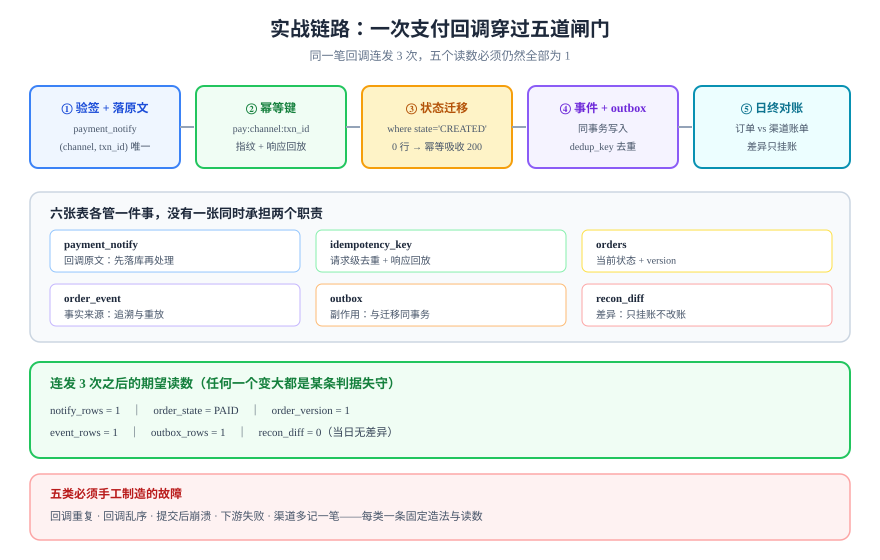

# 实战：支付回调到日终对账

前面七页分别讲了幂等键、状态机、并发护栏、补偿、重放与测试。这一页把它们串成**一条能照着做的链路**：第三方支付回调进来 → 订单状态迁移 → 台账与通知 → 日终对账 → 差异处置。全程只用到 PostgreSQL 18 与 HTTP，不需要任何框架特性。



## 判据族声明

本页判据族 `ISP-A` ~ `ISP-H`，共 8 条。定义表在第六节。

## 一、先把口径定死

口径不定的项目，后面每一步都会返工。开工前写死这五个：

| 口径 | 本实战的取值 | 为什么这么定 |
| --- | --- | --- |
| 「同一次支付」 | 渠道流水号 `channel_txn_id` | 渠道保证唯一，且重发回调时不变 |
| 幂等键 | `pay:{channel}_{channel_txn_id}` | 可读、可追溯，且能直接进唯一索引 |
| 订单状态集合 | `CREATED / PAID / SHIPPED / COMPLETED / CANCELLED / REFUNDED` | 六个状态覆盖主流程，超过 8 个就要考虑拆分 |
| 金额单位 | 分（整数） | 浮点在累加与比较上必然出错 |
| 对账时点 | T+1 02:00（渠道账单就绪后） | 渠道出账前的对账一定有一堆「我有你无」 |

::: warning 金额用整数不是为了省事
用 `numeric` 也可以，但**千万不要用 `double`**：`0.1 + 0.2 != 0.3` 在金额上意味着对账永远有 1 分差异，而这种差异会被当成「渠道错了」查上一整天。
:::

## 二、六张表撑起整条链路

```sql
-- ① 订单：状态 + 版本
create table orders (
  id          bigint generated always as identity primary key,
  user_id     bigint not null,
  amount_cent bigint not null check (amount_cent > 0),
  state       text   not null default 'CREATED'
                check (state in ('CREATED','PAID','SHIPPED','COMPLETED','CANCELLED','REFUNDED')),
  version     bigint not null default 0,
  created_at  timestamptz not null default now(),
  updated_at  timestamptz not null default now()
);

-- ② 渠道回调原文：先落库，再处理（回执与处理解耦）
create table payment_notify (
  id             bigint generated always as identity primary key,
  channel        text   not null,
  channel_txn_id text   not null,
  payload        jsonb  not null,
  signature_ok   boolean not null,
  handled        boolean not null default false,
  received_at    timestamptz not null default now(),
  unique (channel, channel_txn_id)
);

-- ③ 幂等键：请求级
create table idempotency_key (
  scope         text   not null,
  key           text   not null,
  fingerprint   bytea  not null,
  status        text   not null default 'in_progress'
                  check (status in ('in_progress','completed')),
  response_code int,
  response_body bytea,
  locked_at     timestamptz not null default now(),
  primary key (scope, key)
);

-- ④ 事件：追溯与重放的唯一事实来源
create table order_event (
  seq        bigint generated always as identity primary key,
  order_id   bigint not null references orders(id),
  event_type text   not null,
  payload    jsonb  not null,
  occurred_at timestamptz not null default now()
);

-- ⑤ outbox：状态与副作用同事务
create table outbox (
  id         bigint generated always as identity primary key,
  topic      text   not null,
  dedup_key  text   not null,
  payload    jsonb  not null,
  sent       boolean not null default false,
  created_at timestamptz not null default now(),
  unique (dedup_key)
);

-- ⑥ 对账差异：只挂账，不自动改
create table recon_diff (
  id         bigint generated always as identity primary key,
  biz_date   date   not null,
  diff_type  text   not null check (diff_type in ('ONLY_MINE','ONLY_THEIRS','AMOUNT','STATE')),
  ref        text   not null,
  amount_cent bigint,
  detail     jsonb,
  status     text   not null default 'OPEN' check (status in ('OPEN','CLOSED')),
  created_at timestamptz not null default now(),
  unique (biz_date, diff_type, ref)
);
```

六张表各管一件事，**没有一张表同时承担两个职责**：回调原文进 ②，事实进 ④，去重进 ③，副作用进 ⑤，差异进 ⑥。这是这条链路能逐个环节验收的前提。

::: info 还差一张「外部输入」表
对账需要一份渠道账单，它不属于本系统的业务表，因此不计入上面六张：`recon_src_theirs(channel_txn_id text primary key, amount_cent bigint not null, settled_at date not null)`。这张表由账单导入作业写入，是**对账的输入**而不是输出；把它混进业务表，会让「谁的数据」这件事说不清。
:::

## 三、十步施工

| 步 | 做什么 | 完成判据 |
| --- | --- | --- |
| 1 | 建上面六张表，跑一次 `\d+` 确认约束都在 | 六张表存在，`orders.state` 有 `check`，`idempotency_key` 主键为 `(scope,key)` |
| 2 | 回调入口：验签 → 落 `payment_notify` → 返回 200 | 同一 `channel_txn_id` 回两次，表里只有 1 行 |
| 3 | 幂等键：按 `channel_txn_id` 组装键，插键行 | 同键第二次返回首次响应 |
| 4 | 状态迁移：`update ... where state='CREATED'` | 第二次回调影响 0 行，但返回 200（幂等吸收） |
| 5 | 事件与 outbox：与迁移同事务写入 | 人为让 outbox 插入失败，订单状态必须回滚 |
| 6 | 补偿任务：发货失败时写补偿行 | 注入发货失败，补偿行出现并最终 `DONE` |
| 7 | 手工造五类故障（见第四节） | 每类故障都有一条可复跑的步骤与读数 |
| 8 | 日终对账：比订单与渠道账单 | 造 1 笔差异，对账能报出且 `recon_diff` 有 1 行 |
| 9 | 差异处置：挂账 → 人工 → 关闭 | 差异行状态从 `OPEN` 到 `CLOSED`，有处置记录 |
| 10 | 读模型重放：用 `order_event` 重建一张汇总表 | 重放两次结果一致，差异为 0 |

## 四、五类必须手工制造的故障

**不主动造故障，就等于没测过失败路径。** 这五类每类都要有一条固定的造法与读数：

| 故障 | 怎么造 | 期望读数 |
| --- | --- | --- |
| **回调重复** | 同一报文连发 3 次 | `payment_notify` 1 行；`orders` 状态只前进一步 |
| **回调乱序** | 先发 `shipped` 通知，再发 `paid` 回调 | 后者在 `SHIPPED` 上非法 → 409，且状态不回退 |
| **提交后崩溃** | 事务提交后、返回响应前 `kill -9` | 同键重试返回首次结果，无第二条订单 |
| **下游失败** | 发货接口注入 500 | 补偿任务出现，重试 3 次后 `DONE`（或 `DEAD` + 告警） |
| **渠道多记一笔** | 在对账输入里多放一条渠道流水 | `recon_diff` 出现 `ONLY_THEIRS`，不产生账务改动 |

## 五、关键实现：三次写、一个事务

回调处理的核心是「三件事要么一起成、要么一起不成」：**推进状态 + 写事件 + 写 outbox**。

```java [PaymentCallbackService.java]
@Transactional
public void onPaid(Notify n) {
  // ① 条件更新：只有 CREATED 能进 PAID；已 PAID 时 0 行，视为重复
  int n1 = jdbc.update("""
      update orders set state='PAID', version=version+1, updated_at=now()
       where id=? and state='CREATED'""", n.orderId());

  // ② 事件与 outbox 无论是否首次都要检查：0 行时不能重复写事件
  if (n1 == 1) {
    jdbc.update("insert into order_event(order_id,event_type,payload) values (?,?,?::jsonb)",
        n.orderId(), "PAID", n.rawJson());
    jdbc.update("""
        insert into outbox(topic,dedup_key,payload)
        values ('order.paid', ?, ?::jsonb)
        on conflict (dedup_key) do nothing""",
        "paid:" + n.channelTxnId(), n.rawJson());
  }
  // ③ 键行标记完成（同一事务）：崩溃则一起回滚，重试会重新走一遍
  jdbc.update("""
      update idempotency_key set status='completed', response_code=200, response_body=?
       where scope='pay' and key=?""", "{\"ok\":true}".getBytes(UTF_8), n.key());
}
```

三个容易写错的地方：

1. **`n1 == 0` 时不能返回 409**：重复回调是正常的，必须返回 200（否则渠道会一直重发）。
2. **事件与 outbox 只在首次迁移时写**：否则重复回调会写多条事件，重放时把状态推错。
3. **键行更新在同一事务**：这是「提交后崩溃」能安全重试的前提。

## 六、判据定义表

| 判据 | 约定 | 定错了会怎样 | 怎么验证 |
| --- | --- | --- | --- |
| `ISP-A` | 回调必须先落 `payment_notify` 再处理，且 `(channel, channel_txn_id)` 唯一 | 渠道重发时重复处理 | 同报文连发 3 次，该表 1 行 |
| `ISP-B` | 状态迁移必须是带前置状态的单语句更新 | 重复回调把状态推两格 | 连发两次 `paid`，`version` 只增 1 |
| `ISP-C` | 重复回调必须返回 200 而不是 409 | 渠道持续重发，形成风暴 | 第二次回调响应码 200 |
| `ISP-D` | 事件与 outbox 只在首次迁移时写 | 事件重复，重放推错状态 | `select count(*) from order_event where order_id=? and event_type='PAID'` 为 1 |
| `ISP-E` | 金额一律整数分，禁止浮点 | 对账恒有 1 分差异 | 表结构中金额列为 `bigint` 或 `numeric` |
| `ISP-F` | 下游副作用必须经 outbox，且有 `dedup_key` | 通知重发、状态与通知不一致 | 让 outbox 写入失败，订单迁移必须回滚 |
| `ISP-G` | 对账差异只挂账，不自动改账 | 掩盖问题、二次错账 | 代码里金额差异分支无 `update` 业务表 |
| `ISP-H` | 读模型必须能由事件重建，且重放两次结果一致 | 无法修复、无法验证 | 重放两次后差异计数为 0 |

## 七、如何验证（一条完整命令序列）

```shell
# 0) 起库并建表（把第二节的 DDL 存成 db/migration/V20__payment.sql）
docker run --rm -d --name pg18 -e POSTGRES_PASSWORD=app -p 5432:5432 postgres:18
docker exec -i pg18 psql -U postgres -d postgres < db/migration/V20__payment.sql
docker exec pg18 psql -U postgres -d postgres -c "\dt"
```

**预期输出**：列出 6 张表（`orders`、`payment_notify`、`idempotency_key`、`order_event`、`outbox`、`recon_diff`）。

```shell
# 1) 同一笔回调连发 3 次
for i in 1 2 3; do
  curl -s -o /dev/null -w "attempt=$i code=%{http_code}\n" \
    -X POST http://localhost:8080/api/pay/notify \
    -H 'Content-Type: application/json' \
    -d '{"channel":"mockpay","channel_txn_id":"T-1001","orderId":1,"amountCent":4200}'
done
```

**预期输出**：三行都是 `code=200`。若第二次出现 409，说明把重复回调当成了冲突（违反 `ISP-C`）。

```sql
-- 2) 三张表的读数必须互相对得上
select (select count(*) from payment_notify where channel_txn_id='T-1001') as notify_rows,
       (select state from orders where id=1)                              as order_state,
       (select version from orders where id=1)                            as order_version,
       (select count(*) from order_event where order_id=1)                as event_rows,
       (select count(*) from outbox where dedup_key='paid:T-1001')        as outbox_rows;
```

**预期输出**：`notify_rows = 1`、`order_state = PAID`、`order_version = 1`、`event_rows = 1`、`outbox_rows = 1`。五个数字里任何一个变大，都指向一条具体的判据失守。

```shell
# 3) 提交后崩溃：在 handler 里注入 System.exit(1) 后重启，再重试同键
curl -s -o /dev/null -w '%{http_code}\n' -X POST http://localhost:8080/api/pay/notify \
  -H 'Content-Type: application/json' \
  -d '{"channel":"mockpay","channel_txn_id":"T-1002","orderId":2,"amountCent":100}'
```

**预期输出**：`200`，且 `select count(*) from orders where id=2` 为 1、`state = PAID`。出现两条订单说明键行与业务不在同一事务。

```sql
-- 4) 对账：造一笔「渠道有、我方无」的差异，必须被报出且不改账
insert into recon_src_theirs (channel_txn_id, amount_cent) values ('T-9999', 500);
-- 执行对账作业（应用侧调用），然后查差异
select diff_type, ref, amount_cent, status from recon_diff where biz_date = current_date;
```

**预期输出**：一行 `ONLY_THEIRS / T-9999 / 500 / OPEN`；`orders` 与账务表的行数不变（对账只挂账）。

```sql
-- 5) 重放两次，结果必须一致
-- 第一次：insert into order_summary_replay select ... from order_event order by seq;
select count(*) from order_summary_replay;
-- 清空后用同区间再跑一次
select count(*) from order_summary_replay;   -- 两次读数必须相同
```

**预期输出**：两次计数相同。不同说明消费端没有事件级幂等（`ISP-H` 失守）。

## 八、这条链路还缺什么

按今天的十步，链路已经能跑通并逐条验收。以下三项是后续步骤，**不在本页冒充已完成**：

| 缺项 | 为什么不在本页 | 在哪补 |
| --- | --- | --- |
| 压测与容量结论 | 需要确定的硬件与并发模型 | 第 3 周联调测试 |
| 监控指标与告警 | 需要接入既有采集链路 | 第 4 周部署验收 |
| 多租户隔离 | 本实战先做单租户，隔离见项目章节 | 项目 `MultiTenancy` 与下一章 |

## 参考资料

- [The Idempotency-Key HTTP Header Field（draft-07）](https://datatracker.ietf.org/doc/html/draft-ietf-httpapi-idempotency-key-header)——回调入口的语义依据
- [Stripe：Advanced error handling](https://docs.stripe.com/error-low-level)——「5xx 结果不确定 → 必须对账」的官方口径
- [PostgreSQL 18：`INSERT ... ON CONFLICT`](https://www.postgresql.org/docs/18/sql-insert.html)——幂等写入与 outbox 去重的实现基础
- [账务 · 实战：从一笔支付到日终打平](../../Ledger/Practice/index.md)——账务侧的完整分录与打平脚本
- 相邻页面：[幂等键设计](../IdempotencyKey/index.md) · [状态机建模](../StateMachine/index.md) · [补偿与对账](../Compensation/index.md)
