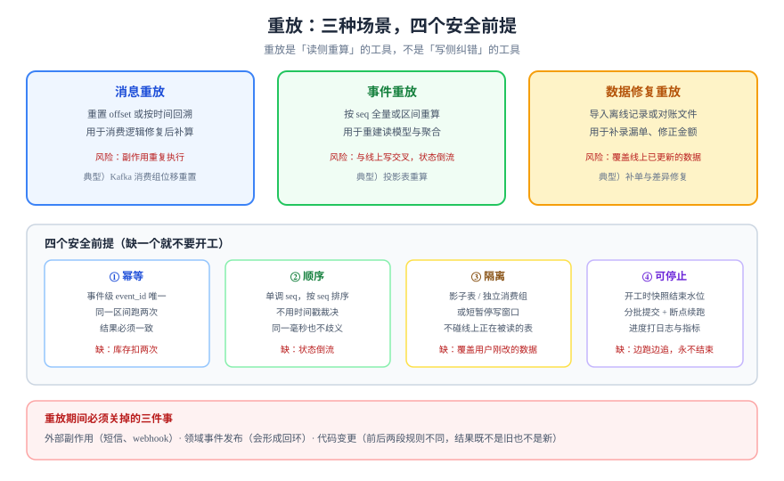

# 重放：把历史事件再跑一遍

重放（Replay）是把已经记录下来的事件或消息，按原顺序再消费一遍，用于修复数据、重建视图、迁移逻辑。它是幂等设计最严苛的验收场：**平时靠「不会重复」掩盖的缺陷，在重放时全部暴露**。这一页讲三种重放、四个安全前提、以及「怎么知道该停了」。



## 判据族声明

本页判据族 `RPL-A` ~ `RPL-H`，共 8 条。定义表在第七节。

## 一、三种重放，风险完全不同

| 类型 | 重放什么 | 目的 | 最大风险 |
| --- | --- | --- | --- |
| **消息重放** | MQ 里的历史消息（重置 offset / 按时间回溯） | 消费端逻辑修复后补算 | 副作用重复执行（发通知、扣库存） |
| **事件重放** | 事件表里的事件（按 `seq` 全量或区间） | 重建读模型、修复聚合 | 与线上写入交叉，状态倒流 |
| **数据修复重放** | 一份离线导出的原始记录（CSV / 对账文件） | 补录漏单、修正金额 | 覆盖了线上更新过的数据 |

::: tip 还有第四种重放：聚合重建
如果你的事件表本身就是**状态的唯一来源**（事件溯源），那么「重放」还有第四种含义——**把一个聚合从零折叠回来**，目的不是修视图，而是恢复状态本身。它比上面三种安全得多（不产生副作用、不改任何外部数据），但成本随流长度线性上升，所以需要[快照](../../EventSourcing/Replay/index.md)把「从头」往后挪。

判据很简单：**重放的目标是「视图」还是「状态」？** 视图可以随时删了重建；状态不能删，只能靠折叠得到——后者属于[事件溯源](../../EventSourcing/index.md)的范畴。
:::

三者共用一个前提：**被重放的东西必须是「事实」，而不是「当时算出来的结果」**。重放一份已经聚合过的报表，只会把旧结论再写一遍。

## 二、四个安全前提

| 前提 | 含义 | 不满足的后果 |
| --- | --- | --- |
| **① 幂等** | 同一事件消费两次，效果等于一次 | 库存扣两次、通知发两遍 |
| **② 顺序确定** | 有单调 `seq`，按 `seq` 而不是时间戳排序 | 状态倒流（后发生的事件先应用） |
| **③ 隔离** | 重放写入与线上写入不互相污染（影子表 / 独立消费组 / 停写窗口） | 重放覆盖了用户刚改的数据 |
| **④ 可停止** | 有明确水位线（到哪个 `seq` 停），且能中途打断 | 重放跑飞，边跑边改逻辑 |

### 前提①：幂等落在哪里

重放场景下，「请求级幂等键」没用（历史事件里没有键）。必须靠**业务级幂等**：

```sql
-- 消费端幂等表：以事件 id 为主键，处理前先占位
create table consumed_event (
  event_id   uuid primary key,
  consumer   text not null,
  consumed_at timestamptz not null default now()
);

-- 同一事务内：占位成功才处理
insert into consumed_event (event_id, consumer) values ($1, 'order-projection')
on conflict do nothing
returning event_id;
-- 返回 1 行 = 首次消费；返回 0 行 = 已消费过，直接跳过
```

### 前提②：顺序必须由序号决定

```sql
-- 事件表：seq 单调，且对同一聚合唯一
create table order_event (
  seq        bigint generated always as identity,
  order_id   bigint not null,
  event_type text not null,
  payload    jsonb not null,
  occurred_at timestamptz not null default now(),
  primary key (seq),
  unique (order_id, seq)
);
```

排序用 `order by seq`，**不要用 `order by occurred_at`**：同一毫秒内的事件顺序不确定，且时钟可能回拨。

### 前提③：隔离的三种做法

| 做法 | 机制 | 优点 | 缺点 |
| --- | --- | --- | --- |
| **影子表** | 重放写到 `order_view_replay`，比对后再切换 | 完全不影响线上 | 需要双倍空间与切换步骤 |
| **独立消费组** | 重放用新的 group，写到独立读模型 | 简单 | 读模型要能多版本共存 |
| **停写窗口** | 短暂停止线上写，清空读模型后重放 | 最简单 | 有停机成本 |

判据：**如果重放的输出会覆盖线上正在被读的数据，必须选影子表；只影响内部统计的，可以用独立消费组。**

## 三、重放的执行骨架

```java [ReplayJob.java]
long from = Long.parseLong(args[0]);   // 起始 seq（含）
long to   = Long.parseLong(args[1]);   // 结束 seq（不含），必须显式给出

try (var conn = ds.getConnection()) {
  conn.setAutoCommit(false);
  while (from < to) {
    var batch = loadEvents(conn, from, Math.min(from + 500, to)); // 分批
    for (var e : batch) {
      if (!markConsumed(conn, e.id())) { from = e.seq() + 1; continue; } // 幂等跳过
      applyProjection(conn, e);      // 只写影子表
      from = e.seq() + 1;
    }
    conn.commit();                    // 每批提交，可中断
    logger.info("replay progress: seq={} / {}", from, to);
  }
}
```

四个要点：

1. **`to` 必须显式给出**：用「当前最大 seq」作为终点会让重放在追赶时永远追不上（边跑边新增）。正确做法是**开工时快照一个水位线**。
2. **分批 + 每批提交**：单事务重放百万条会撑爆 WAL 与 undo。
3. **进度可观测**：日志里打 `seq / to`，并暴露成指标，否则无法判断「还要多久」。
4. **幂等跳过**：重放中断后重跑，已处理的批次必须被跳过，而不是报错。

::: danger 三个会让重放变成事故的细节
1. **在重放中调用外部服务**：重放一万条事件会发一万条短信。重放必须**关掉所有外部副作用**（用开关或独立的无副作用配置）。
2. **重放写入触发了新的领域事件**：读模型更新又发出「已更新」事件，形成回环。重放要**抑制事件发布**。
3. **重放期间修改了代码**：跑了一半改逻辑，前后两段用的规则不同，结果既不是旧的也不是新的。**先冻结代码，再重放。**
:::

## 四、水位线与「什么时候算跑完」

| 概念 | 含义 | 用法 |
| --- | --- | --- |
| **起始水位** | 重放从哪个 `seq` 开始 | 通常取「缺陷引入前的最后一个正确点位」 |
| **结束水位** | 到哪个 `seq` 停 | 开工时快照的当前最大 `seq` |
| **检查点** | 已处理到的位置 | 落库或用进度表记录，支持断点续跑 |
| **完成判据** | 什么条件说明重放成功 | 不只是「跑完」，还要**对账一致** |

完成判据必须包含一次对账：

```sql
-- 影子表与线上表的差异计数，必须为 0 才算重放成功
select count(*) from (
  select id from order_view
  except
  select id from order_view_replay
) t;
```

## 五、重放与「时间旅行」的边界

重放能重建**读模型**，但它不能重建**外部世界的状态**：三天前发出去的短信收不回来，三天前扣掉的库存可能已经被别的订单消耗。因此：

| 重放对象 | 可重建 | 说明 |
| --- | --- | --- |
| 订单读模型、报表 | 是 | 只依赖事件 |
| 库存数量 | 有条件 | 只在与线上写入隔离（影子表）时可重建 |
| 已发出的通知 | 否 | 外部副作用不可逆 |
| 第三方已结算金额 | 否 | 只能通过对账与退款修正 |

**结论**：重放是「读侧重算」的工具，不是「写侧纠错」的工具。写侧错了要靠[补偿](../Compensation/index.md)与对账。

## 六、重放之后

重放做完不等于结束，还要做三件事：

1. **切流**：影子表 → 正式表（改名或视图切换），切换要有回滚路径；
2. **复核**：抽样比对 N 条记录，逐字段核对；
3. **封存**：把这次重放的范围、水位线、代码版本、差异数写进变更记录——下次再出问题，需要知道这次动过什么。

## 七、判据定义表

| 判据 | 约定 | 定错了会怎样 | 怎么验证 |
| --- | --- | --- | --- |
| `RPL-A` | 被重放的必须是原始事实（事件/报文），不是聚合结果 | 重放旧结论，错误被固化 | 重放输入表里没有「已计算」的字段 |
| `RPL-B` | 消费端必须有事件级幂等（`event_id` 唯一） | 重放重复扣减 | 同一区间重放两次，读模型结果一致 |
| `RPL-C` | 排序必须用单调 `seq`，不得用时间戳 | 状态倒流 | 事件表有 `seq` 且重放 SQL 的 `order by` 是 `seq` |
| `RPL-D` | 结束水位必须在开工时快照，不得取「当前最大」 | 边跑边追，永不结束 | 作业日志里的 `to` 在运行期间不变 |
| `RPL-E` | 重放必须关闭外部副作用与事件发布 | 短信轰炸、事件回环 | 重放配置里有 `side-effects=false` 且被断言 |
| `RPL-F` | 重放写入必须与线上隔离（影子表/独立消费组/停写） | 覆盖用户刚改的数据 | 重放期间线上写入不受影响，读到的仍是旧值 |
| `RPL-G` | 必须有断点续跑与进度指标 | 中断后只能从头再来 | 杀掉进程后重启，日志从上次 `seq` 继续 |
| `RPL-H` | 完成后必须对账为 0 并留变更记录 | 「跑完了」但结果是错的 | 差异计数为 0，且变更记录里有水位线与代码版本 |

## 如何验证

```sql
-- ① 幂等：同一区间重放两次，结果必须一致
select count(*) from order_view_replay;   -- 第一次重放后记录数
-- 再跑一次同一区间（from/to 不变）
select count(*) from order_view_replay;   -- 必须与上一次相同
```

**预期输出**：两次读数相同。若第二次变大，说明 `consumed_event` 占位没生效。

```shell
# ② 水位线在运行期间不变
curl -s http://localhost:8080/actuator/metrics/replay.progress | jq '.measurements'
```

**预期输出**：包含 `from` 与 `to` 两个值，多次采样 `to` 不变、`from` 递增。`to` 跟着涨说明取的是「当前最大 seq」。

```sql
-- ③ 完成判据：差异必须为 0
select count(*) from (
  select id from order_view
  except
  select id from order_view_replay
) t;
```

**预期输出**：`0`。非 0 时先看差异行的 `updated_at`——如果晚于重放开始时间，说明隔离没做好，线上写入混进来了。

## 参考资料

- Kleppmann, M. *Designing Data-Intensive Applications*（2017）第 11 章——事件溯源与重放的边界
- [Kafka：Consumer 位移重置](https://kafka.apache.org/documentation/#basic_ops_consumer_lag)——消息重放的工程口径
- [Debezium：快照与增量阶段](https://debezium.io/documentation/reference/stable/connectors/postgresql.html)——「先快照后流式」的重放模型
- 相邻页面：[补偿与对账](../Compensation/index.md) · [怎么测](../Testing/index.md) · [实战](../Practice/index.md)
