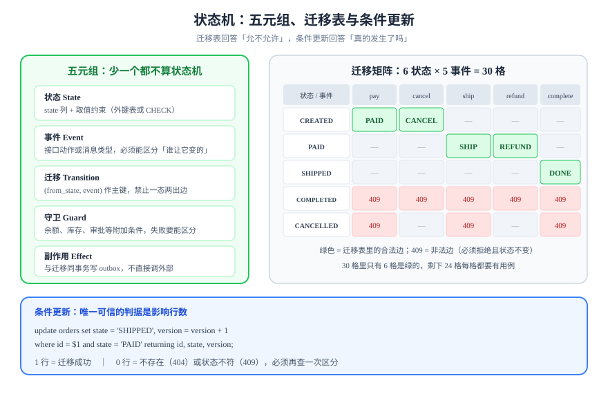

# 状态机建模：状态只能沿合法的边迁移

状态机（State Machine）在代码里的价值不是「画得清楚」，而是**让非法迁移在数据库那一层插不进去**。这一页给出可以直接落库的五元组、迁移表 DDL、条件更新的三条写法、非法迁移的响应契约，以及两个最容易做错的地方：幂等迁移与状态爆炸。



## 判据族声明

本页判据族 `STM-A` ~ `STM-H`，共 8 条。定义表在第九节。

## 一、五元组：少一个都不算状态机

| 元素 | 含义 | 落点 | 少了会怎样 |
| --- | --- | --- | --- |
| **状态**（State） | 实体此刻所处的阶段 | `state` 列 + 取值约束 | 拼写变体混入，统计与判断全部失真 |
| **事件**（Event） | 触发迁移的外部动作 | 接口或消息类型 | 无法区分「谁让它变的」 |
| **迁移**（Transition） | `(from, event) → to` | 迁移表 | 迁移规则散落在 `if` 里，无人能列全 |
| **守卫**（Guard） | 迁移的附加条件（余额足够、审批已通过） | 迁移表的 `guard` 或代码内断言 | 状态对了但业务条件不满足，脏数据被放行 |
| **副作用**（Effect） | 迁移成功后要发生的事 | 同事务内写 outbox | 状态变了但通知没发，或通知发了但状态没变 |

::: tip 一句话分辨
只有 `state` 列、没有「事件」与「迁移表」的，叫**状态字段**；能列出 `(from, event) → to` 的，才叫状态机。
:::

## 二、状态机、状态图、工作流不是一回事

| 概念 | 描述的对象 | 谁执行 | 本专题的态度 |
| --- | --- | --- | --- |
| **状态机** | 一个实体的生命周期 | 业务代码（一次条件更新） | 本页主题 |
| **状态图**（UML Statechart） | 状态机的可视化，可含并发区域与层次 | 人（设计与沟通） | 用来画，不用来生成代码 |
| **工作流**（BPMN） | 跨多个角色/系统的长流程，含人工任务 | 流程引擎 | 交 [工作流与规则引擎](../../WorkflowEngine/index.md)，不在这里讲 |

判据很简单：**如果一个迁移需要「等人审批」或「等第三方回调」，它是工作流；如果它由本系统的一次操作直接决定，它是状态机。** 二者可以嵌套——工作流的一个节点内部，仍然是一个状态机。

## 三、迁移表落库

```sql
create table order_state (
  code text primary key
);
insert into order_state (code) values
  ('CREATED'), ('PAID'), ('SHIPPED'), ('COMPLETED'), ('CANCELLED'), ('REFUNDED');

create table order_transition (
  from_state text not null references order_state(code),
  event      text not null,
  to_state   text not null references order_state(code),
  guard      text,          -- 守卫名，执行前在代码里求值
  primary key (from_state, event)   -- 同一状态下同一事件只能有一条出边
);
insert into order_transition (from_state, event, to_state, guard) values
  ('CREATED',  'pay',      'PAID',      null),
  ('CREATED',  'cancel',   'CANCELLED', null),
  ('PAID',     'ship',     'SHIPPED',   'stock_reserved'),
  ('PAID',     'refund',   'REFUNDED',  null),
  ('SHIPPED',  'complete', 'COMPLETED', null);
```

**主键 `(from_state, event)` 是这张表的全部意义**：它在数据库层就禁止了「同一状态下同一事件有两条出边」。这条约束一旦缺，`select to_state ... where from_state=? and event=?` 会返回两行，代码只能随便取一行。

状态取值用外键表而不是 `CHECK` 列表，好处是**新增状态不需要改表结构**（`ALTER TYPE`/`ALTER TABLE` 在大表上是运维事故），代价是多一次 join——但这个 join 只在管理端与校验时用，业务写入不查它。

## 四、条件更新的三条写法

### 写法一：单语句 CAS（推荐）

```sql
update orders
   set state = 'SHIPPED', version = version + 1, updated_at = now()
 where id = $1 and state = 'PAID'
returning id, state, version;
```

影响 1 行 = 迁移成功；影响 0 行 = **要么实体不存在，要么前置状态不对**。两种情况必须再查一次区分，否则错误码会误导。

```sql
-- 区分「不存在」与「状态不对」
select id, state from orders where id = $1;
-- 无行 → 404；有行但 state <> 'PAID' → 409，响应里带上当前 state 与允许的 event
```

### 写法二：先查后判再写（不推荐，但常见）

```java [OrderService.java]
// 反例：读与写之间有窗口，两个请求都会通过 state == PAID 的判断
Order o = repo.findById(id);              // 读到 PAID
if (o.getState() != PAID) throw conflict();
o.setState(SHIPPED);
repo.save(o);                             // 后写的覆盖先写的
```

它的问题不是「性能」，而是**判定与写入不在同一条语句里**。在 `read committed` 下，两个事务都能读到 `PAID`，都能写成功，最终状态是后提交者的值——中间那个迁移凭空消失。

### 写法三：`select ... for update` + 判断

适合「一次迁移需要读多行做决策」的场景（例如迁移前要核对库存、额度）：

```sql
begin;
select state from orders where id = $1 for update;   -- 拿行锁
-- 应用层判断合法性与守卫
update orders set state = 'SHIPPED' where id = $1 and state = 'PAID';
commit;
```

代价是**锁持有时间包含应用层逻辑**，高并发下会排队。用它的判据是：**这个迁移的决策需要读别的表**。不需要的话，回到写法一。

| 写法 | 冲突语义 | 锁 | 适用 |
| --- | --- | --- | --- |
| 单语句 CAS | 影响 0 行 | 行锁（极短） | 绝大多数迁移 |
| 先查后写 | 无冲突检测 | 无 | 不要用于状态迁移 |
| `for update` | 阻塞等待 | 行锁（含应用逻辑） | 决策需要跨表读取 |

## 五、幂等迁移：重复事件不是冲突

同一个事件到达两次，有两种截然不同的正确处理，必须先分类：

| 情况 | 语义 | 处理 | 返回 |
| --- | --- | --- | --- |
| 事件重复，实体已在**目标状态** | 上一次已经成功，只是响应丢了 | 视为成功，不再执行副作用 | 200 + 当前状态 |
| 事件重复，实体在**目标状态之后** | 语义上已被后续迁移覆盖 | 视为成功（幂等吸收） | 200 + 当前状态 |
| 事件到达，实体在**不相容状态** | 真冲突（例如 `CANCELLED` 后又收到 `ship`） | 拒绝 | 409 + 当前状态 + 允许事件 |

实现上，第二条靠「目标状态判定」而不是「迁移表反查」：

```sql
-- 幂等迁移：目标状态优先判定，其次才是 CAS
update orders
   set state = 'SHIPPED', version = version + 1
 where id = $1 and state in ('PAID')          -- 合法前置
returning state;
-- 0 行时再查：已经是 SHIPPED / COMPLETED → 200；是 CANCELLED → 409
```

::: danger 「重复事件直接报 409」是最常见的过度严格
前端网络抖动导致的重试会被用户看到「操作失败」，而实际上第一次已经成功。**判断依据是「目标状态是否已经达成」，不是「迁移是否真的执行了」。**
:::

## 六、状态爆炸与正交拆分

当状态数超过 7~8 个，迁移表会迅速膨胀成 `n²` 量级，而且大部分格子是空的。这时候要问一句：**这些状态真的属于同一个生命周期吗？**

| 症状 | 拆法 | 例子 |
| --- | --- | --- |
| 两个维度独立变化 | 拆成两个状态字段 | 「支付状态」与「履约状态」分开，`PAID + SHIPPING` 不必叫 `PAID_AND_SHIPPING` |
| 一个状态只被一个子流程使用 | 拆成子状态机（父子表） | 审批中的 `APPROVING` 内部再分 `L1/L2` |
| 状态里混进了「结果」 | 把结果移到结果表 | `REFUND_FAILED` 不是订单状态，是退款单状态 |

正交拆分的判据：**两个维度能否同时取到全部组合且都合法**。能，就该拆；不能（例如 `CANCELLED` 与 `SHIPPED` 互斥），说明它们本来就是同一个维度。

## 七、和事件溯源的关系

| 方案 | 存什么 | 读什么 | 代价 |
| --- | --- | --- | --- |
| **状态表（本页）** | 当前状态 + 版本 | 直接读 | 历史丢失，只能靠审计表补 |
| **事件表 + 快照** | 每次迁移一条事件 | 快照 + 重放增量 | 写入只追加，读要重放，实现复杂 |
| **混合** | 状态表 + 事件表 | 常规读状态表，追溯读事件表 | 两份写，需保证同事务 |

**默认选状态表 + 事件表混合**：状态表服务在线读写，事件表服务追溯与[重放](../Replay/index.md)。选纯事件溯源的判据是「业务必须能回到任意时刻的状态」——大多数业务不需要，但账务与审批需要。

## 八、判据定义表

| 判据 | 约定 | 定错了会怎样 | 怎么验证 |
| --- | --- | --- | --- |
| `STM-A` | 状态取值必须有约束（外键表或 `CHECK`），不得为自由文本 | 拼写变体混入，迁移表查不到 | `select distinct state from orders` 的集合等于 `order_state` 的集合 |
| `STM-B` | 迁移表主键必须是 `(from_state, event)` | 同一状态同一事件有两条出边 | `select count(*) from (select from_state, event from order_transition group by 1,2 having count(*)>1) t` 为 0 |
| `STM-C` | 每次迁移必须是带前置状态条件的单语句更新 | 并发下丢迁移 | 对同一实体并发两次 `ship`，一次成功一次 409 |
| `STM-D` | 迁移影响 0 行时必须区分「不存在」与「状态不符」 | 404 与 409 混淆，客户端无法决策 | 不存在的 id 返回 404；`CANCELLED` 上 `ship` 返回 409 |
| `STM-E` | 重复事件按「目标状态是否已达成」处理，不得一律报错 | 正常重试被报失败 | 连发两次 `ship`，第二次 200 且状态不变 |
| `STM-F` | 副作用必须与迁移同事务写入 outbox | 状态变了通知丢了 | 人为让 outbox 插入失败，迁移必须一起回滚 |
| `STM-G` | 守卫条件必须在迁移前求值，且失败原因可区分 | 状态对了但业务条件不满足，脏数据放行 | 未预留库存时 `ship` 返回 422 而不是 200 |
| `STM-H` | 状态数超过 8 个必须论证是否需要正交拆分 | 迁移表膨胀、语义纠缠 | 设计文档里有一节说明「为什么不拆」 |

## 如何验证

```sql
-- ① 迁移表本身是完备的：每条边都在状态集合里
select t.event, t.from_state, t.to_state
  from order_transition t
  left join order_state f on f.code = t.from_state
  left join order_state g on g.code = t.to_state
 where f.code is null or g.code is null;
```

**预期输出**：0 行。有行说明迁移表里有状态值没登记，`\d order_transition` 的外键本该拦住它。

```shell
# ② 非法迁移必须 409，且状态不变
curl -s -o /dev/null -w '%{http_code}\n' -X POST http://localhost:8080/api/orders/1/ship \
  -H 'Content-Type: application/json' -d '{"event":"ship"}'
```

**预期输出**：对 `PAID` 的订单是 `200`；对 `CANCELLED` 的订单是 `409`。若两次都是 200，说明 `where state = ...` 没写。

```sql
-- ③ 迁移之后必须留下一条事件，且版本号前进
select id, state, version from orders where id = 1;
select count(*) from order_event where order_id = 1;
```

**预期输出**：`state = SHIPPED`、`version` 比迁移前大 1；事件表行数等于成功迁移的次数（含首次创建）。

## 参考资料

- [RFC 9110 §9.2.2](https://www.rfc-editor.org/rfc/rfc9110#section-9.2.2)——幂等方法与非幂等方法的界定
- Harel, D. *Statecharts: A Visual Formalism for Complex Systems*（1987）——层次状态与正交区域的理论来源
- Fowler, M. *State Machine* 模式条目——`(from, event) → to` 表驱动写法的经典描述
- [PostgreSQL 18：`RETURNING` 与条件更新](https://www.postgresql.org/docs/18/dml-update.html)——`returning old.*, new.*` 可用于记录迁移前后值
- 相邻页面：[概述](../Overview/index.md) · [并发护栏](../ConcurrencyGuard/index.md) · [补偿与对账](../Compensation/index.md)
