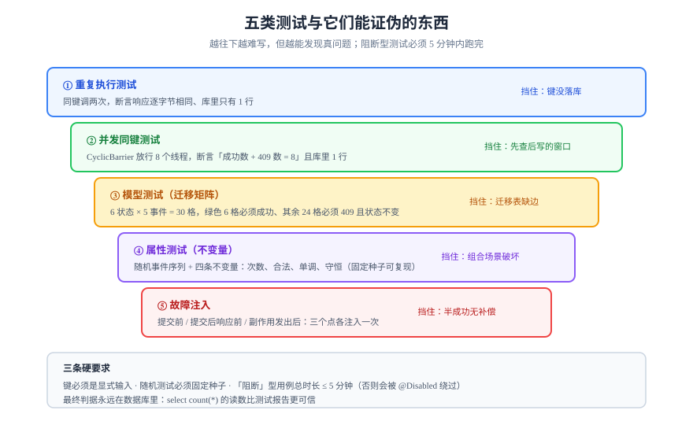

# 怎么测：属性测试与模型测试

幂等与状态机的缺陷有个共同特征：**单次执行的测试永远通过**。因为「重复」「并发」「中断」这三件事不在普通用例的坐标系里。这一页给的不是「多写测试」，而是**四类能把偶发变成必然的测试**，以及它们各自能证伪什么。



## 判据族声明

本页判据族 `MDT-A` ~ `MDT-H`，共 8 条。定义表在第八节。

## 一、为什么普通单测测不出幂等

```java [OrderServiceTest.java]
// 这条测试看起来在测幂等，其实什么都没测
@Test
void createOrderTwice() {
  var a = service.create(cmd);
  var b = service.create(cmd);          // 新的事务、新的键、新的内存状态
  assertEquals(a.getId(), b.getId());   // 必然失败，于是有人「改成」各自新建
}
```

问题在于：**「同一次」不是「同一个对象」，而是「同一个键」**。不把键显式带进测试，测的就不是幂等。

正确的写法是把「键」当成测试的一等输入：

```java
@Test
void sameKeyReturnsFirstResult() {
  var key = "k-1";
  var a = service.create(cmd, key);
  var b = service.create(cmd, key);     // 同键
  assertEquals(a.getId(), b.getId());
  assertEquals(1, orderRepo.countByKey(key));
}
```

## 二、四类测试与它们的分工

| 类型 | 手段 | 能证伪 | 不能证伪 |
| --- | --- | --- | --- |
| **重复执行测试** | 同键调用两次 | 幂等键没落库、响应没回放 | 并发窗口 |
| **并发测试** | 栅栏 + 多线程/多连接 | 丢失更新、先查后写的窗口 | 顺序错乱 |
| **模型测试** | 遍历迁移矩阵的每条边与非法边 | 迁移表缺边、非法边被放行 | 副作用是否发生 |
| **属性测试** | 随机生成事件序列 + 不变量断言 | 组合场景下的不变量破坏 | 性能与容量 |
| **故障注入** | 在提交前/后/响应前杀进程 | 「半成功」无补偿 | 逻辑错误 |

五类都要有，但**优先级是：重复 < 并发 < 模型 < 属性 < 故障注入**——越往后越难写，也越能发现真问题。

## 三、幂等的三条可证伪测试

### 测试一：连发两次，只应发生一次

```java
@Test
void duplicateRequestProducesSingleEffect() {
  var key = UUID.randomUUID().toString();
  var r1 = api.post("/api/orders", body, key);
  var r2 = api.post("/api/orders", body, key);
  assertThat(r1.statusCode()).isEqualTo(201);
  assertThat(r2.statusCode()).isEqualTo(201);
  assertThat(r2.body()).isEqualTo(r1.body());          // 逐字节相同
  assertThat(jdbc.queryForObject("select count(*) from orders", Integer.class)).isEqualTo(1);
}
```

### 测试二：并发同键，只应成功一次

```java
@Test
void concurrentSameKeyYieldsOneEffect() throws Exception {
  var key = UUID.randomUUID().toString();
  var barrier = new CyclicBarrier(8);
  var pool = Executors.newFixedThreadPool(8);
  var results = new ArrayList<Integer>();
  for (int i = 0; i < 8; i++) {
    pool.submit(() -> {
      barrier.await();                                  // 八条线程同时放行
      return api.post("/api/orders", body, key).statusCode();
    });
  }
  pool.shutdown();
  pool.awaitTermination(10, TimeUnit.SECONDS);
  // 至少 1 个成功；成功数 + 409 数 = 8；库里只有 1 行
  assertEquals(1, orderRepo.countByKey(key));
}
```

**断言里必须包含「409 的数量」**：只有 `1 个 201 + 7 个 409` 或 `8 个 201（全部回放同一响应）` 才是正确的，`2 个 201 且资源不同` 是失败。

### 测试三：中断后重试，不应产生第二次副作用

在「业务写完、响应未返回」处杀掉进程（用故障注入，见第七节），再用同键重发：

```java
@Test
void retryAfterCrashIsSafe() {
  var key = "k-crash-1";
  crashAfterCommit();                     // 事务提交后抛错，模拟响应前崩溃
  assertThatThrownBy(() -> api.post("/api/orders", body, key));
  var r = api.post("/api/orders", body, key);   // 同键重试
  assertThat(r.statusCode()).isEqualTo(201);
  assertThat(orderRepo.countByKey(key)).isEqualTo(1);   // 关键断言
}
```

这条测试专治「键表在事务外写入」——那种实现下重试会再执行一次，库里出现两行。

## 四、状态机的模型测试

模型测试（model-based testing）把迁移表当成**被测模型**，自动生成用例：

| 用例来源 | 断言 | 覆盖目标 |
| --- | --- | --- |
| 迁移表里的每条 `(from, event)` | 执行后 `state = to_state`，且影响 1 行 | 合法边全覆盖 |
| 状态集合 × 事件集合 的**补集**（非法边） | 返回 409，且 `state` 不变 | 非法边全穷举 |
| 幂等序列（同一事件连发两次） | 第二次 200 且状态不变 | 幂等迁移 |
| 终态之后再发任何事件 | 409 或 200（按策略），状态不变 | 终态保护 |

穷举的规模是可以接受的：6 个状态 × 6 个事件 = 36 格，减去合法边（本例 5 条），剩下 31 格必须全部被拒绝。**31 个非法边用例漏一个，就等于留了一条后门。**

```java
@ParameterizedTest
@MethodSource("illegalEdges")
void illegalTransitionIsRejected(String from, String event) {
  var id = seedOrder(from);
  var res = api.post("/api/orders/" + id + "/" + event);
  assertThat(res.statusCode()).isEqualTo(409);
  assertThat(orderRepo.stateOf(id)).isEqualTo(from);    // 状态必须没变
}
```

## 五、属性测试：四条不变量

属性测试（property-based testing）不写具体用例，而写「无论怎么操作，某条性质恒成立」：

| 不变量 | 表述 | 反例会暴露 |
| --- | --- | --- |
| **次数** | 对任意键 `k`，无论请求多少次，`count(k) = 1` | 幂等失效 |
| **合法** | 任意事件序列执行后，`state ∈ 状态集合` 且每次迁移都在迁移表里 | 迁移表缺边、越权迁移 |
| **单调** | `version` 严格递增，`seq` 严格递增 | 覆盖写、乱序应用 |
| **守恒** | 库存总数 + 已售 = 初始值；分录借贷相等 | 补偿方向错、重复补偿 |

```java
@Property(tries = 200)
void stateStaysLegal(@ForAll("eventSequences") List<String> events) {
  var id = seedOrder("CREATED");
  for (var e : events) {
    api.post("/api/orders/" + id + "/" + e);           // 允许失败
    assertThat(orderRepo.stateOf(id)).isIn(STATES);     // 但状态必须合法
  }
}
```

用固定种子（`@Property(seed = 42)`）让失败可复现——**随机测试不可复现等于没有测试**。

## 六、确定性并发：三个必备手法

| 手法 | 做法 | 解决 |
| --- | --- | --- |
| **栅栏** | `CyclicBarrier` / `CountDownLatch` 让 N 个请求同时放行 | 「并发度不够，永远不会撞」 |
| **延迟注入** | 在「读之后、写之前」`Thread.sleep` 或数据库 `pg_sleep` | 「窗口太窄，撞不上」 |
| **固定随机种子** | 压测与属性测试都用固定 seed | 「失败无法复现」 |

```sql
-- 数据库侧的延迟注入：让「读到旧值」的窗口拉长到人眼可见
create or replace function slow_read(p_id int) returns int as $$
begin
  perform pg_sleep(1);
  return (select qty from stock where id = p_id);
end $$ language plpgsql;
```

## 七、故障注入：三个必须注入的点

| 注入点 | 模拟的故障 | 期望行为 |
| --- | --- | --- |
| **事务提交前** | 进程崩溃 / 连接断开 | 什么都不发生（回滚） |
| **事务提交后、响应前** | 响应丢失 | 重试命中幂等，返回首次结果 |
| **副作用发出后、确认前** | 下游收到但上游不知道 | 重放/重试不重复执行副作用 |

第三个点最难测，也最容易被忽略：它要求的不是「事务原子」，而是**副作用本身可去重**（下游按 `dedup_key` 幂等）。

```java
// Testcontainers + 网络代理，让「提交后响应丢失」可复现
@Test
void responseLostAfterCommit() {
  toxiproxy.toxics().timeout("downstream", "downstream", 1, 0);
  assertThatThrownBy(() -> api.post("/api/orders", body, key));
  toxiproxy.toxics().timeout("downstream", "downstream", 0, 0);   // 恢复
  assertThat(api.post("/api/orders", body, key).statusCode()).isEqualTo(201);
}
```

## 八、这些测试挂在哪

| 测试 | 层次 | 跑的频率 | 门禁强度 |
| --- | --- | --- | --- |
| 重复执行 | 集成测试 | 每次提交 | 阻断 |
| 并发同键 | 集成测试 | 每次提交 | 阻断 |
| 模型测试（全边） | 集成测试 | 每次提交 | 阻断 |
| 属性测试 | 集成测试 | 每晚 + 发版前 | 阻断（发版） |
| 故障注入 | 端到端 | 每周 | 告警（不阻断） |

判据：**「阻断」的那些必须在 5 分钟内跑完**，否则开发者会用 `@Disabled` 绕过它——这是测试门禁最常见的死法。

## 九、判据定义表

| 判据 | 约定 | 定错了会怎样 | 怎么验证 |
| --- | --- | --- | --- |
| `MDT-A` | 幂等测试必须把「键」作为显式输入，不得依赖对象相等 | 测的不是幂等 | 测试代码里出现 `Idempotency-Key` 或键参数 |
| `MDT-B` | 必须有并发同键测试，且断言成功数 + 冲突数 = 并发数 | 并发窗口未覆盖 | 8 并发下断言 `1 成功 + 7 冲突` 或 `8 同一响应` |
| `MDT-C` | 必须有「提交后崩溃再重试」的测试 | 键表写在事务外不会被发现 | 故障注入用例存在且在 CI 通过 |
| `MDT-D` | 迁移矩阵必须穷举非法边（状态数 × 事件数 - 合法边数） | 留后门 | 参数化用例数量等于非法边数 |
| `MDT-E` | 必须有用例断言「非法迁移后状态不变」 | 只断言状态码，掩盖了状态被改 | 断言里同时检查 `state` |
| `MDT-F` | 属性测试必须固定种子且可复现 | 失败无法重现 | 失败用例能本地用同一 seed 复现 |
| `MDT-G` | 守恒类不变量必须有断言（库存、分录） | 补偿方向错无人发现 | 存在「初始 = 剩余 + 已售」断言 |
| `MDT-H` | 阻断型测试总时长 ≤ 5 分钟 | 被 `@Disabled` 绕过 | CI 步骤耗时读数 |

## 如何验证

```shell
# ① 只跑幂等与并发相关用例
./gradlew test --tests '*Idempotency*' --tests '*Concurrency*'
```

**预期输出**：`BUILD SUCCESSFUL`，且报告里用例数 ≥ 3（重复、并发、崩溃重试）。

```shell
# ② 模型测试的用例数必须等于「合法边 + 非法边 + 幂等序列」
./gradlew test --tests '*TransitionMatrixTest'
```

**预期输出**：测试报告中 `TransitionMatrixTest` 的执行用例数 = 5（合法）+ 31（非法）+ 2（幂等序列）= 38。少于 38 说明非法边没穷举完。

```sql
-- ③ 跑完后核对应用侧断言：库里的行数就是最终判据
select key, count(*) from orders group by key having count(*) > 1;
```

**预期输出**：0 行。有行说明幂等键没落到唯一索引上——测试再绿也没意义。

## 参考资料

- Claessen, H., Hughes, J. *QuickCheck: A Lightweight Tool for Random Testing of Programmatic Properties*（ICFP 2000）——属性测试的起点
- Utting, M., Legeard, B. *Practical Model-Based Testing*（2006）——模型测试的系统方法
- [Testcontainers：网络与故障注入](https://java.testcontainers.org/)——容器化集成测试的落地方式
- [jqwik 用户手册](https://jqwik.net/docs/current/user-guide.html)——Java 侧的属性测试与固定种子
- 相邻页面：[并发护栏](../ConcurrencyGuard/index.md) · [重放](../Replay/index.md) · [实战](../Practice/index.md)
