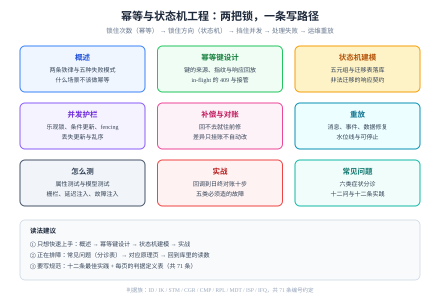

# 幂等与状态机工程

**同一个请求送到两次，系统的状态只应该变一次；一次状态变化，只能从合法的边走过去。** 前者叫幂等（Idempotency），后者叫状态机（State Machine）——它们是同一条写路径上的两把锁：一把锁住「次数」，一把锁住「方向」。

<p style="text-align:center;"></p>

这个专题不讲分布式事务协议，也不讲账务怎么记账，只回答一个更靠前的问题：**当你手里那一次写操作被重试、被并发、被乱序、被重放的时候，凭什么它只发生一次、并且落在合法的状态上。** 适用于写订单、写支付、写工单、写审批、写任何「有状态且不能重复」的后端工程师。

::: tip 一句话理解
幂等不是「不让请求进来第二次」，而是**第二次进来时，系统能认出它并给出第一次的答案**；状态机不是「画一张流程图」，而是**让非法迁移在数据库那一层就插不进去**。
:::

## 为什么单独成一个专题

因为这两件事最容易被当成「顺手就做了」的细节，直到出事才发现它们是**架构级选择**：

- 幂等键放在应用内存里，滚动发布后全部失效，重复扣款刚好发生在发布窗口；
- 状态迁移写成 `update order set state = ?`，两个并发请求各自读到 `PAID`，一个改成 `SHIPPED`、另一个改成 `REFUNDED`，谁都没报错；
- 补偿逻辑写成「删掉刚才那条」，结果删掉的是别人刚写的那条。

这三种事故的共同点是：**代码看起来完全正确，测试也全绿，只在并发、重试、发布这三个时刻露头。**

## 与相邻专题的分工

这个题目和库内好几块内容相邻，先把边界写死，避免读者以为在看同一件事：

| 相邻专题 | 那边讲什么 | 本专题讲什么 | 为什么不互相替代 |
| --- | --- | --- | --- |
| [账务 · 记账幂等](../Ledger/Idempotency/index.md) | 三个唯一键怎么挡住「同一笔业务记两遍账」 | 幂等键**本身**怎么设计：来源、构成、存储、窗口、响应回放 | 那边是账务场景的落地细节，本专题给的是可迁移到任何写路径的方法 |
| [电商 · 订单状态机](../Ecommerce/OrderStateMachine/index.md) | 订单的十几个状态与事件去重 | 状态机**怎么建模与落库**：五元组、迁移表、守卫、非法迁移契约 | 那边是「订单这个域长什么样」，本专题是「状态机这个工具怎么用」 |
| [分布式事务](../Microservices/DistributedTransaction/index.md) | 2PC / TCC / Saga / 本地消息表的协议取舍 | 单服务内的**一次写**怎么保证只发生一次、只前进一步 | 协议解决「跨服务最终都发生」，本专题解决「发生的那一次是对的」 |
| [工作流与规则引擎](../WorkflowEngine/index.md) | BPMN 流转、审批人、网关、超时 | 代码里的状态迁移与守卫 | 那边是「流程引擎驱动的长流程」，本专题是「业务实体自己的状态机」 |
| [消息队列](../MessageQueue/index.md) | 至少一次投递、消费幂等、顺序性 | 消费端幂等的**键从哪来**、以及「处理到一半」怎么办 | 消息幂等解决「同一条消息消费两次」，本专题还要解决「两条不同消息表达同一件事」 |
| [高并发系统设计](../HighConcurrency/index.md) | 限流、排队、削峰 | 并发写同一行时的 CAS 与冲突语义 | 限流挡的是「量」，挡不住「同一个人点了两次」 |
| [领域驱动设计](../DDD/index.md) | 聚合、不变量、领域事件 | 不变量在状态机里的落点（守卫与迁移表） | DDD 说「不变量要守住」，本专题说「用哪张表守住、守不住返回什么」 |
| [在线协作任务看板](../../../project/Complete/TeamBoard/index.md) | 一个真实系统里拖动卡片的幂等键与乐观锁 | 通用方法论与判据 | 那边是实例，这边是原理；实例页只写「这套系统怎么做的」 |

::: warning 防重复核查（2026-10-17 实测）
开工前用 `git grep` 查过三处最容易撞车的正面内容：`幂等键设计` 仅 2 篇、`状态机建模` **0 篇**、`补偿事务` **0 篇**；`TCC` 23 篇、`对账` 118 篇、`重放` 92 篇，但都分布在各自专题内部（分布式事务、账务、协作）。**通用层面的「幂等 + 状态机」是一块空白**，因此本专题独立建档，并在每一页写明与上述专题的边界。
:::

## 专题地图

| 页面 | 回答什么问题 | 适合谁读 |
| --- | --- | --- |
| [概述：两条铁律与五种失败模式](Overview/index.md) | 幂等与状态机各自守什么、五种失败长什么样、什么场景不该做 | 所有人，先读这页 |
| [幂等键设计：让同一个请求只发生一次](IdempotencyKey/index.md) | 键从哪来、键长什么样、三种实现怎么选、窗口与响应回放 | 要写「写接口」的人 |
| [状态机建模：状态只能沿合法的边迁移](StateMachine/index.md) | 五元组、迁移表落库、守卫、非法迁移返回什么 | 写领域逻辑的人 |
| [并发护栏：乐观锁、条件更新与 fencing](ConcurrencyGuard/index.md) | 两个请求同时到，谁赢、输的那个看到什么 | 写仓储层与更新语句的人 |
| [补偿与对账：回不去的时候往前修](Compensation/index.md) | 什么能补偿、什么不能、对账怎么发现差异 | 写失败处理与日终任务的人 |
| [重放：把历史事件再跑一遍](Replay/index.md) | 三种重放、重放的安全前提、怎么停 | 做数据修复与运维的人 |
| [怎么测：属性测试与模型测试](Testing/index.md) | 怎么把「偶发」变成必然失败的用例 | 写测试与守门禁的人 |
| [实战：支付回调到日终对账](Practice/index.md) | 一条完整链路：回调、状态机、补偿、对账 | 想直接照做的人 |
| [常见问题与最佳实践](FAQ/index.md) | 六类症状分诊、十二问、十二条最佳实践 | 所有人 |



## 判据族声明

本专题每一页的约定都编号，每条只回答三件事：**约定是什么 / 定错了会怎样 / 怎么验证它没被破坏**。

| 页面 | 判据族 | 数量 |
| --- | --- | --- |
| 概述 | `ID-A` ~ `ID-H` | 8 |
| 幂等键设计 | `IK-A` ~ `IK-H` | 8 |
| 状态机建模 | `STM-A` ~ `STM-H` | 8 |
| 并发护栏 | `CGR-A` ~ `CGR-H` | 8 |
| 补偿与对账 | `CMP-A` ~ `CMP-H` | 8 |
| 重放 | `RPL-A` ~ `RPL-H` | 8 |
| 怎么测 | `MDT-A` ~ `MDT-H` | 8 |
| 实战 | `ISP-A` ~ `ISP-H` | 8 |
| 常见问题 | `IFQ-A` ~ `IFQ-G` | 7 |

## 事实与版本（2026-10 核对）

本专题讨论的是**协议语义与数据库能力**，不绑定某个框架版本，但下面几条事实会影响你的实现选择：

| 事实 | 现状 | 对本专题的影响 |
| --- | --- | --- |
| `Idempotency-Key` 请求头 | IETF HTTPAPI 工作组的 `draft-ietf-httpapi-idempotency-key-header-07`（2025-10-15），**已于 2026-04-18 过期归档，不是 RFC** | 可以照着它的状态码语义做，但不要把它当稳定标准；引用时写明是草案 |
| 草案推荐状态码 | 缺键 400、同键不同载荷 422、原请求仍在执行 409 | 本专题的统一错误码口径按这三条走 |
| Stripe 的窗口 | 24 小时；键最长 255 字符；**结果包含 500 也缓存**；并发同键返回 `409 idempotency_key_in_use`；v2 API 改为 30 天窗口 | 「窗口」是产品参数不是技术限制，必须写进文档 |
| Adyen / 英国开放银行 | 前者 7~14 天、最长 64 字符；后者 24 小时窗口、重放返回 201 | 同一个词在不同厂商手里差别很大，别跨文档照抄 |
| PostgreSQL 18 | 新增 `uuidv7()`（时间有序 UUID）与 `RETURNING OLD.*` / `RETURNING NEW.*` | 幂等键可以直接用 `uuidv7()` 生成；状态迁移能把「迁移前」与「迁移后」一次拿到 |

::: info 不按大版本建目录
本专题没有「Spring5 / Spring6」式的语义断层：幂等的语义来自 HTTP 与数据库，状态机的语义来自有限状态机理论，都不随框架大版本变化。**示例默认面向 PostgreSQL 18 + Java 25 / Spring Boot 4.1**，其他栈把 DDL 与语法换成等价写法即可。
:::

## 学习路径

1. **先读概述**，把「次数」与「方向」两条铁律分开，后面每一页都挂在其中一条上。
2. **按你的写路径顺序读**：入口（幂等键）→ 领域（状态机）→ 并发（护栏）→ 失败（补偿）→ 运维（重放）。
3. **一定要读「怎么测」**：这一页给的是「怎么让偶发必然失败」，否则前面所有约定都只是纸面。
4. **最后读实战**，把一条从回调到对账的链路拼完，再回到自己系统里替换。

## 验证方式

本专题的 SQL 面向 PostgreSQL 18，可在官方 Docker 镜像里直接验证（**本仓不提供可执行工程**，命令与片段都在正文，读者在自己的库里落地）：

```shell
docker run --rm -d --name pg18 -e POSTGRES_PASSWORD=app -p 5432:5432 postgres:18
docker exec -it pg18 psql -U postgres -c "select version();"
```

**预期输出**：第一行包含 `PostgreSQL 18.`；若显示 17 或更早，`uuidv7()` 会报 `function uuidv7() does not exist`，请改用 `gen_random_uuid()` 验证其余结论。

```sql
-- 一分钟验证本专题最核心的一条：唯一索引能挡住第二次插入
create table demo_key (k text primary key, n int not null default 0);
insert into demo_key (k) values ('order-1') on conflict (k) do nothing;
insert into demo_key (k) values ('order-1') on conflict (k) do nothing;
select count(*) from demo_key;
```

**预期输出**：`1`。把 `on conflict do nothing` 去掉，第二条会报 `duplicate key value violates unique constraint`——这正是幂等实现里最可靠的一道闸门。

::: danger 三条最容易踩的坑
1. **把幂等键存进应用内存或本地缓存**：单机测试永远通过，滚动发布、多实例、重启后全部失效，而重复恰好发生在这些时刻。
2. **只在「插入前查一下」而不建唯一索引**：两个并发请求同时查、同时查不到、同时插入，所谓幂等只是把窗口缩小了。
3. **状态迁移不带前置条件**：`update ... set state = 'DONE'` 不写 `where state = 'RUNNING'`，等于允许任何状态直接跳到 `DONE`，状态机只剩下注释。
:::

## 谁来发起重试，决定幂等键怎么设计（第 187 天补充）

本页讲的是「同一次操作被执行多次，结果要一样」。重试的来源有两个，设计时必须分开对待：

| 重试来源 | 触发条件 | 对幂等键的要求 |
| --- | --- | --- |
| 业务代码显式重试 | 你写的 `for` 循环或框架 `@Retryable` | 幂等键由**业务**生成并在重试间保持不变 |
| 基础设施重试（网格/网关） | 连接失败、`unavailable` 等「大概率未到达」的失败 | 幂等键必须来自**请求本身**（Header 或业务主键），不能由每次尝试新生成 |

第二条是引入服务网格后新增的：Istio 默认对 `connect-failure`、`refused-stream`、`unavailable`、`cancelled` 重试两次，而**默认不重试 5xx**——这个默认值的设计意图就是「只重试能确认没到应用的失败」。但只要你把 `5xx` 加进 `retryOn`，就必须确保接口幂等，否则一次扣款可能变成两次。判据与配置见 [服务网格 · 东西向流量治理](../ServiceMesh/Traffic/index.md)。

::: danger 本页特有的坑：幂等键放在请求体里，被代理重试时重复生成
把幂等键写成「请求体里的一个字段，由调用方服务在构造请求时生成」是安全的；但如果它是在**每次发送尝试**时生成（例如放在拦截器里 new 一个 UUID），基础设施层重试就会带着新键到达，幂等表完全失效，而且日志里看不出异常——因为每次请求的键都不一样，看上去「都是第一次」。正确做法是：幂等键在**进入发送逻辑之前**确定，并随请求一起重放。
:::

## 与「工具调用协议与契约工程」专题的分工（第 201 天补充）

本页讲**服务端怎么去重**（幂等表、状态机、补偿）。但幂等在工具调用里还有一半在**协议层**：幂等键放在哪、超时与重试怎么乘积、取消能不能生效，归[调用生命周期](../../AI/AgentToolProtocol/Invocation/index.md)。

| 问题 | 归本页 | 归协议专题 |
| --- | --- | --- |
| 幂等表怎么建、窗口多长、409 还是 200 | 本页 | —— |
| 幂等键放在请求体的哪个位置 | 本页（HTTP 头/体之争） | [调用生命周期](../../AI/AgentToolProtocol/Invocation/index.md)：放 `_meta`，由调用方生成并随重试原样带上 |
| 为什么压测时「重复请求」陡增 | 服务端视角看不到 | [同一页](../../AI/AgentToolProtocol/Invocation/index.md)：超时 800 ms + 重试 2 次 → 执行放大 3.00× |

**本页特有的一个坑**：本页已经写明「幂等键不能在每次发送尝试时生成」，工具调用里这句话会以另一种形态复现——**把 JSON-RPC 的 `id` 当幂等键**。请求 id 天生每次重试都变（无状态协议还要求断流后用新 id 重发），拿它去重等于没去重。幂等键必须是业务键（订单号 + 动作），与协议 id 完全解耦。

## 与「实时风控决策」的分工（第 204 天补充）

风控是**同步旁路**，它的幂等要求和业务接口不太一样，三条差异值得单独写：

| 差异 | 业务接口 | 风控决策 |
| --- | --- | --- |
| 幂等键来源 | 通常由调用方生成（`Idempotency-Key`） | 必须是**调用方传入的 `decision_id`**，不能由风控自己生成（否则重试就会算出第二个决策） |
| 重放语义 | 返回上次结果 | 返回上次结果，**但历史上必须能看出这是重放**（`cached=true`），否则拦截率会重复计数 |
| 允许被覆盖的例外 | 一般不允许 | **降级期间的决策允许重算**（依赖恢复后质量更高），但要写进契约，见[在线服务](../RiskDecision/Serving/index.md) |

两条纪律：

1. **`decision_id` 必须在业务侧生成并持久化**。让风控服务自己生成 UUID，等于把幂等交给了网络——超时重试一定会产生第二个决策。
2. **风控的幂等表要有 TTL（24 小时量级）**。永久幂等会把「昨天的名单」固化到今天，风控实际上停止更新；而 TTL 到期后重算，正是我们要的行为。

## 参考资料

- [The Idempotency-Key HTTP Header Field（draft-07）](https://datatracker.ietf.org/doc/html/draft-ietf-httpapi-idempotency-key-header)——状态码语义的原始出处（已过期归档）
- [Stripe：Idempotent requests](https://docs.stripe.com/api/idempotent_requests)——窗口、并发 409、结果缓存的工业实践
- [Stripe：Advanced error handling](https://docs.stripe.com/error-low-level)——「500 也应视为结果不确定」的官方口径
- [PostgreSQL 18 发布说明](https://www.postgresql.org/docs/18/release-18.html)——`uuidv7()`、`RETURNING OLD/NEW`
- Kleppmann, M. *Designing Data-Intensive Applications*（2017）第 7、11 章——幂等与恰好一次的边界
- Fowler, M. *Sagas*（2014）——补偿式失败的经典表述；*State Machine* 模式条目——状态迁移建模的起点
