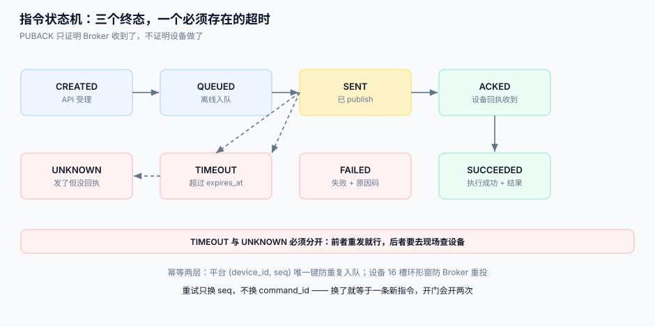

# 指令下发

影子回答「最终应该是什么样」，指令回答「现在做这件事」。前者可以合并、可以丢中间态，后者**一次都不能少、一次都不能多**。本页讲怎么把一条指令从「点了按钮」送到「设备真的做了」并且能证明。

::: tip 一句话定位
`PUBACK` 只证明「Broker 收到了」，不证明「设备做了」。**把 `PUBACK` 当成功，是物联网平台最常见的一次性错误**——它会让所有「门没开」「锁没弹」的问题在后台看起来全部成功。
:::



## 一、状态机：七个状态，三个终态

| 状态 | 含义 | 谁推进 |
| --- | --- | --- |
| `CREATED` | 平台已受理，落库 | API |
| `QUEUED` | 设备离线，进离线队列 | 调度器 |
| `SENT` | 已 publish 到 Broker（收到 `PUBACK`） | 投递器 |
| `ACKED` | 设备回执「收到」（业务 ACK） | 设备 |
| `SUCCEEDED` | 设备回执「执行成功」+ 结果 | 设备 |
| `FAILED` | 设备回执「执行失败」+ 原因码 | 设备 |
| `TIMEOUT` / `UNKNOWN` | 超过 `expires_at` 仍未到终态 | 扫描任务 |

三个终态是 `SUCCEEDED` / `FAILED` / `TIMEOUT`。`UNKNOWN` 是 `TIMEOUT` 的一种特化：**已经发出去了但没回执**，与「压根没发出去」必须分开——前者要去现场查设备，后者重发就行。

```sql
CREATE TABLE command (
  command_id  TEXT PRIMARY KEY,              -- 平台生成 UUIDv7（时间有序）
  device_id   TEXT NOT NULL,
  name        TEXT NOT NULL,                 -- 物模型里的动作名，如 unlock
  params      TEXT NOT NULL,
  state       TEXT NOT NULL,
  seq         INTEGER NOT NULL,              -- 设备维度的单调序号，用于排序与去重
  attempts    INTEGER NOT NULL DEFAULT 0,
  created_at  TEXT NOT NULL,
  sent_at     TEXT,
  acked_at    TEXT,
  expires_at  TEXT NOT NULL,                 -- 终态超时，必须非空
  result      TEXT,
  UNIQUE (device_id, seq)                     -- 同一设备的序号不许重复
);
CREATE INDEX ix_cmd_pending ON command (device_id, state) WHERE state IN ('CREATED','QUEUED','SENT');
```

## 二、幂等：设备侧去重，平台侧唯一键

MQTT 的 QoS 1 是**至少一次**，重投由发送方与网络共同决定。假设重投率 3%：

| 做法 | 10,000 条指令的重复执行次数 |
| --- | --- |
| 无幂等键 | **300** |
| 设备侧按 `command_id` 去重（保留最近 16 个） | 0 |
| 平台侧 `(device_id, seq)` 唯一键 | 0（只能防平台重复插入，防不了 Broker 重投） |

**两层都要有**：平台侧唯一键防「调度器重复入队」，设备侧去重窗防「Broker 重投」。设备侧窗口不必很大——16 个足够，因为重投通常发生在秒级。

```c
/* 设备侧：环形去重窗（RAM 16 × 16 字节 = 256 B） */
static uint8_t wm[16][16];
static int wm_head;
bool seen(const uint8_t id[16]) {
    for (int i = 0; i < 16; i++) if (!memcmp(wm[i], id, 16)) return true;
    memcpy(wm[wm_head], id, 16);
    wm_head = (wm_head + 1) % 16;
    return false;
}
```

## 三、重试：三次是上限，间隔要带抖动

| 参数 | 建议值 | 理由 |
| --- | --- | --- |
| 首次重试 | 5 s | 覆盖绝大多数瞬时抖动 |
| 退避 | 5 / 15 / 45 s（×3） | 与设备侧重连退避错开 |
| 最大尝试 | **3 次** | 再多就是设备不在线，应进 `QUEUED` 而不是继续 `SENT` |
| 终态超时 `expires_at` | 按业务：门锁 30 s，抄表 24 h | 「多久没执行就等于失败」 |

::: warning 重试必须换一个新的 `seq`，但不能换 `command_id`
`command_id` 是**业务幂等键**（同一条指令），`seq` 是**传输序号**（第几次投递）。重试时 `seq` 递增、`command_id` 不变，设备才能「按 `command_id` 去重、按 `seq` 排序」。
:::

## 四、离线队列：TTL 与容量的正面冲突

设备离线时长分布（本机按对数正态生成，仅作示例）：

| 分位 | 离线时长 |
| --- | --- |
| P50 | 8 min |
| P90 | 2.1 h |
| P99 | **19 h** |

| TTL | 覆盖比例 | 队列峰值规模 | 后果 |
| --- | --- | --- | --- |
| 1 h | ~P75 | 小 | 大量「用户点了没反应」 |
| 24 h | ~P99.2 | 中 | 基本够用 |
| 7 天 | ~P99.9 | 大（内存/库压力） | 用户早已重试过 10 次，队列里躺着 10 条冲突指令 |

「设备离线 30 分钟、每 5 s 一条指令」= **360 条**要缓存；如果 `session_expiry=0`（`clean_start=true` 的默认后果），这 360 条在 Broker 侧**全部丢弃**，平台还以为是设备没执行。所以离线队列必须建在**平台侧**（库表），不能指望 Broker 会话。

队列还有一条容易被忽略的规则：**同一设备同一动作，后来的覆盖先前的**。

```sql
-- 入队时把同设备同动作的旧指令作废（「最后一次设置生效」）
UPDATE command SET state='SUPERSEDED'
 WHERE device_id=:d AND name=:n AND state IN ('QUEUED');
INSERT INTO command (...) VALUES (...);
```

对「解锁」这种**不可合并**的动作则相反：每条都要执行，且必须保序（单 in-flight，见下节）。

## 五、顺序：同一设备单 in-flight

设备只有一条执行线程。平台若并发下发 3 条指令，设备可能乱序执行（网络重排 + 固件异步）。做法：

- 每个设备维护一个 `inflight` 标志：`SENT` 未到终态前，后续指令只入 `QUEUED` 不发送。
- `seq` 单调递增，设备按 `seq` 拒绝「比已执行过的小」的指令（防旧指令迟到后被重放）。
- 吞吐代价：单设备 RTT 300 ms 时，串行下发上限约 **3.3 条/秒**；确实需要高吞吐的动作应改成「批量指令」（一条指令带 10 个动作）。

## 六、批量下发：进度比结果更重要

给 8,000 台设备下发同一指令，30 分钟后运营会问三个问题：**发了多少、成了多少、还剩多少**。所以批量任务的表结构要能直接回答：

```sql
CREATE TABLE command_batch (
  batch_id     TEXT PRIMARY KEY,
  name         TEXT NOT NULL,
  total        INTEGER NOT NULL,
  succeeded    INTEGER NOT NULL DEFAULT 0,
  failed       INTEGER NOT NULL DEFAULT 0,
  queued       INTEGER NOT NULL DEFAULT 0,   -- 离线未发
  created_at   TEXT NOT NULL,
  finished_at  TEXT
);
```

进度必须由**终态回执驱动**（`ACKED` → `SUCCEEDED` 时 +1），不能由「publish 成功」驱动。差别在于：发布成功 100% 的批次，最终成功率可能只有 62%（离线 + 超时 + 设备拒绝）。

## 七、判据

| 判据 | 看什么现象 | 判成什么 | 不满足时改哪里 |
| --- | --- | --- | --- |
| `IOC-A` | 是否把 `PUBACK` 当作执行成功 | 是即不合格 | 加业务 ACK 主题 `ack/<device>`，终态只由 ACK 推进 |
| `IOC-B` | 指令是否有非空的 `expires_at` | 为空即不合格 | 表加列；扫描任务把超时置 `TIMEOUT`/`UNKNOWN` |
| `IOC-C` | 设备侧是否有 `command_id` 去重窗 | 无即不合格 | 固件加 16 槽环形窗 |
| `IOC-D` | 是否有 `(device_id, seq)` 唯一键 | 无即不合格 | 补唯一索引，调度器重复入队会立刻报错 |
| `IOC-E` | 离线队列是否有 TTL 且 TTL 覆盖 P99 离线时长 | 无 TTL 即不合格 | 加 `expires_at`；按离线分布选 24 h |
| `IOC-F` | 同一设备是否单 in-flight | 并发下发即不合格 | 调度器加 `inflight` 判断，后续入 `QUEUED` |
| `IOC-G` | 可合并动作是否做了 `SUPERSEDED` | 未做即不合格 | 入队前更新旧指令状态 |
| `IOC-H` | 批量进度是否由终态回执驱动 | 由 publish 驱动即不合格 | 回执处理里更新 `command_batch` 计数 |

::: danger 本页特有的坑
1. **设备回执里没有 `command_id`**。很多固件只回 `{"ok":true}`，平台无法把回执对上指令，只能按「最近一条 `SENT`」猜。设备固件必须回 `{"command_id":"…","ok":true}`，这是硬要求。
2. **`seq` 用时间戳**。同一毫秒内两条指令 `seq` 相同，`UNIQUE` 冲突或设备无法排序。`seq` 必须是**设备维度的自增整数**（平台侧用 `max(seq)+1`，同一事务内）。
3. **超时后不清理 `inflight`**。`SENT` 超时进了 `TIMEOUT`，但 `inflight` 标志没清，该设备后续指令永远排队——表现为「这台设备失联了」，实际只是调度器的一个布尔值没复位。
4. **重试时换了 `command_id`**。设备侧去重窗失效，一条「开门」变成两次开门。重试只换 `seq`，绝不换 `command_id`。
:::

## 八、验证方式

```shell
# 1. 幂等：同一 command_id 发两次，设备侧只应执行一次（看设备日志）
mosquitto_pub -h localhost -q 1 -t 'cmd/SN2026103100071' \
  -m '{"command_id":"0199a1b2-...","name":"unlock","seq":11}'
mosquitto_pub -h localhost -q 1 -t 'cmd/SN2026103100071' \
  -m '{"command_id":"0199a1b2-...","name":"unlock","seq":11}'
# 期望：设备日志只有一条 "exec unlock cmd=0199a1b2..."

# 2. 终态超时是否生效
sqlite3 /tmp/iot.db "SELECT count(*) FROM command WHERE state='SENT' AND expires_at < datetime('now');"
# 期望：0（非 0 说明扫描任务没跑）

# 3. 批量进度是否与终态一致
sqlite3 /tmp/iot.db "SELECT b.batch_id, b.succeeded,
  (SELECT count(*) FROM command c WHERE c.batch_id=b.batch_id AND c.state='SUCCEEDED')
  FROM command_batch b WHERE b.batch_id='B-001';"
# 期望：两个数相等
```

## 参考资料

- MQTT 5.0 §4.3（QoS 1 的重投与去重责任）、§3.3（PUBLISH 的 `Response Topic` / `Correlation Data`）
- [幂等与状态机](../../IdempotencyStateMachine/IdempotencyKey/index.md)——幂等键的一般设计（本页是设备场景的特化）
- [设备影子](../DeviceShadow/index.md)——「只要最终态」的场景不该用指令
- [Eclipse Mosquitto 手册](https://mosquitto.org/man/mosquitto-conf-5.html)——`max_inflight_messages`、`max_queued_messages`
