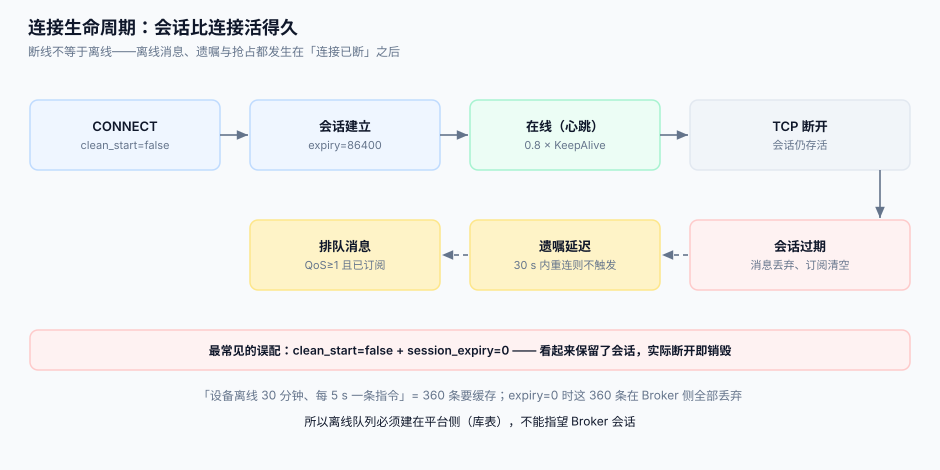

# 连接与会话

「在线」这个词在物联网里是**会话状态**，不是网络状态。一条 TCP 连接断了，会话可能还活着（消息仍在排队）；一条 TCP 连接还在，会话可能早就该被踢了（设备卡死）。本页讲怎么把这两件事分开管。

::: tip 一句话定位
`clean_start=true` 是物联网平台最常见的一行错误配置。它让「设备离线 30 分钟后再上线」变成「离线期间的 360 条指令全部消失」，而且**没有任何报错**。
:::



## 一、CONNECT 里真正要紧的五个字段

| 字段 | 取值 | 选错的后果 |
| --- | --- | --- |
| `client_id` | **设备身份派生的稳定串**（如 `SN2026103100071`） | 随机生成 → 每次重连都是新会话，订阅与离线消息全丢 |
| `clean_start`（v5）/ `clean_session`（3.1.1） | 量产设备填 **`false`** | 填 `true` → 断线即清会话 |
| `session_expiry_interval` | 按业务离线时长，**≥ P99 离线时长** | 填 0 等价于 `clean_start=true`；太大则 Broker 内存被离线会话吃满 |
| `keep_alive` | 30~300 s，见[总览](../Overview/index.md) | 填 0 = 永不超时，等于放弃掉线检测 |
| `will`（遗嘱） | 主题 `st/<device>`、payload `{"online":false}`、**`will_delay_interval` 非零** | 无遗嘱 → 掉线要等心跳超时；无延迟 → 网络抖一下就误报离线 |

```python
# 设备侧连接参数（paho-mqtt 2.x 风格）
client = mqtt.Client(
    callback_api_version=mqtt.CallbackAPIVersion.VERSION2,
    client_id="SN2026103100071",
    protocol=mqtt.MQTTv5,
)
client.connect(
    "mqtt.example.com", 8883, keepalive=60,
    clean_start=False,                       # 保留会话
    properties={
        "SessionExpiryInterval": 86400,      # 离线 24 小时内消息仍排队
        "WillDelayInterval": 30,             # 30 s 内重连则不触发遗嘱
    },
)
```

::: warning `Session Expiry` 与「离线消息」不是一回事
Broker 只对**该会话订阅过、且 QoS ≥ 1** 的消息排队。设备离线期间新订阅的主题不会有历史消息；`retain=true` 的消息只有**一条最新值**，不是队列。所以「离线补发」这件事必须由业务侧（[指令下发](../CommandDispatch/index.md)的离线队列）保证，不能指望 Broker。
:::

## 二、会话的四种组合

| `clean_start` | `session_expiry` | 断开后 | 适用 |
| --- | --- | --- | --- |
| `true` | 0 | 会话立即销毁 | 临时调试客户端 |
| `true` | > 0 | 旧会话先销毁再新建，但新会话保留 | 需要「干净重连 + 保留离线」的固件升级场景 |
| `false` | 0 | **保留会话但立即过期**（等价销毁） | 常见误配，看起来保留了其实没有 |
| `false` | > 0 | 会话与排队消息保留到过期 | **量产设备的正确配置** |

第三行是最坑的一行：很多客户端库默认 `clean_start=false` 但 `session_expiry=0`，配置看起来「保留了会话」，实际什么都没留。

## 三、同一个 `client_id` 连两次：抢占

MQTT 规定同一个 `client_id` 只能有一个连接；新连接进来，旧连接被断开（v5 会给旧连接一个 `DISCONNECT`，reason code `0x8E Session taken over`）。

这件事有两种完全相反的含义：

| 场景 | 现象 | 处理 |
| --- | --- | --- |
| 设备重连（旧连接是半开 TCP） | 旧连接被踢，新连接正常工作 | **正常**，不要告警 |
| 两台设备用同一 `client_id`（克隆/烧录错误） | **两台互相踢**，形成无限重连循环 | **必须告警**：同一 `client_id` 在 10 分钟内被踢 > 5 次 |

平台侧要能把这两种情况分开，判据是「抢占频率」。这也是[设备身份](../DeviceIdentity/index.md)唯一性校验的最后一道兜底。

## 四、遗嘱：让「掉线」这件事有事件

没有遗嘱，平台只能等心跳超时；有了遗嘱，Broker 会在连接异常断开时替设备发一条消息。但遗嘱的默认行为是**立即发布**——电梯里掉一下信号，就报一次离线。

```text
Will Delay Interval 的正确用法
  will_delay = 30 s，设备在 10 s 内重连 → 遗嘱不发布（避免抖动误报）
  will_delay = 30 s，设备 40 s 后才回来 → 遗嘱在 30 s 时发布，然后设备上线再发 online:true
  session_expiry = 0 时 will_delay 不生效（会话已销毁，遗嘱立即发）
```

::: danger 本页特有的坑
1. **`client_id` 用随机 UUID**。设备重启就换一个会话，订阅要重建（重建期间的数据丢失），离线消息永远收不到。正确做法是 `client_id = device_name`。
2. **KeepAlive 精确按周期发送**。协议允许在 1.5 倍内任意时刻发；设备若「正好每 60 s 发一次」，网络抖动累积到 1.5 倍边界就会自我踢下线。**固件应按 0.8 × KeepAlive 发送**，留 20% 余量。
3. **遗嘱主题与普通主题共用 ACL**。遗嘱由 Broker 代发，Broker 用的是**连接时的身份**；如果 ACL 只允许设备写 `up/<device>`，遗嘱写 `st/<device>` 会被静默丢弃（QoS 0）或断开连接（QoS 1）。ACL 里必须显式放行遗嘱主题。
4. **Broker 重启后以为设备还在**。会话持久化（Mosquitto 的 `persistence true`）能保住订阅与排队消息，但**连接状态一定丢**。平台侧必须在 Broker 重启后把所有设备标为「未知」而不是「在线」。
:::

## 五、重连风暴：抖动不是优化，是止损

一次区域性断网恢复，1 万台设备同时重连。服务端按 500 连接/秒接纳。

| 退避策略 | 总尝试次数 | 全部连上耗时 | 现象 |
| --- | --- | --- | --- |
| 固定 1 s 重试 | 巨大 | 取决于服务端容量 | 每秒一次全量冲击 |
| 指数退避（**无抖动**） | 同步浪潮 | 900 s 内未收敛（丢弃模型） | 每轮 9,500 个设备同时到齐，容量被成批浪费 |
| 指数退避 + **full jitter** | 41,981 | **68.6 s** | 首轮摊平到 0~2 s，之后自然错峰 |

理论下界是 `10,000 / 500 = 20 s`（纯排队模型下抖动与否则都是 20 s）。所以结论不是「抖动提升吞吐」，而是：**抖动防止容量被同步浪潮浪费**。服务端一旦开始拒连（accept 队列满、内存不足），无抖动的同步退避会让系统进入长时间不收敛的状态。

```python
def backoff(attempt: int, base=1.0, cap=60.0) -> float:
    """full jitter：在 [0, min(cap, base*2^n)] 内均匀取。"""
    return random.uniform(0, min(cap, base * (2 ** attempt)))
```

设备侧还要加两条：

- **持久化重试计数**：设备重启后从 0 开始退避，会在平台故障恢复的瞬间形成第二波浪潮；计数应写入 flash（哪怕只在断电前存一次）。
- **服务端下发 `Server Keep Alive`**：平台过载时可以在 CONNACK 里把 `Server Keep Alive` 调大，让设备少发心跳、晚发现掉线——这是**主动降级**，比让 Broker 拒连好。

## 六、连接容量：一个连接要多少内存

粗略算式（用于容量规划，不是压测结论）：

```text
单连接内存 ≈ 会话上下文（约 2~8 KB，取决于库实现与订阅数）
           + 排队消息（QoS≥1 时按 session_expiry × 消息速率）
           + TLS 会话（约 16~64 KB，取决于密码套件与缓冲区）

10 万连接 × 40 KB ≈ 4 GB —— 这还没算排队消息。
```

所以「支持 10 万连接」这句话必须附三个条件：**KeepAlive 多少、TLS 还是明文、离线会话保留多久**。把 `session_expiry` 从 24 h 改成 7 天，内存会先于 CPU 崩掉。

## 七、判据

| 判据 | 看什么现象 | 判成什么 | 不满足时改哪里 |
| --- | --- | --- | --- |
| `IOS-A` | 量产设备的 `clean_start` 与 `session_expiry` 取值 | `clean_start=true` 或 expiry=0 即不合格 | 改成 `false` + expiry ≥ P99 离线时长 |
| `IOS-B` | `client_id` 是否由 `device_name` 派生 | 随机生成即不合格 | 固件改为 `client_id=device_name` |
| `IOS-C` | KeepAlive 实际发送间隔是否 ≤ 0.8 × 配置值 | 等于配置值即不合格 | 固件心跳定时器改 `0.8 × keep_alive` |
| `IOS-D` | 遗嘱是否配置了 `will_delay_interval` | 未配置即不合格 | 按网络抖动时长设 15~60 s |
| `IOS-E` | ACL 是否放行遗嘱主题 | 未放行即不合格 | ACL 增 `st/%u` 写权限 |
| `IOS-F` | 是否存在「同一 `client_id` 10 分钟内被踢 > 5 次」的告警 | 无告警即不合格 | 接入日志按 `client_id` 统计 `Session taken over` |
| `IOS-G` | 重连退避是否带抖动、计数是否持久化 | 缺一即不合格 | 固件改 full jitter + flash 存计数 |
| `IOS-H` | Broker 重启后设备状态是否被标为「未知」而非「在线」 | 仍为在线即不合格 | 平台加 `broker_boot_id` 校验，重启后批量置 `UNKNOWN` |

## 八、验证方式

```shell
# 1. 会话是否真的保留（断线期间发一条 QoS1，重连后应收到）
mosquitto_sub -h localhost -i SN2026103100071 -c -q 1 -t 'cmd/SN2026103100071' -C 1 -W 5 &
# 断开该客户端后：
mosquitto_pub -h localhost -q 1 -t 'cmd/SN2026103100071' -m '{"cmd":"ping"}'
# 期望：重连的订阅端在 5 秒内收到该消息；收不到说明 clean_start/session_expiry 配错

# 2. 同一个 client_id 连两次，旧连接应被踢
mosquitto_sub -h localhost -i dup-id -t 'x' -C 1 -W 10 &
mosquitto_sub -h localhost -i dup-id -t 'x' -C 1 -W 3 ; echo "exit=$?"
# 期望：第一个进程被断开（日志含 Session taken over）

# 3. Broker 关闭 persistence 时，重启后离线消息是否消失
mosquitto -c /tmp/m.conf -v &   # persistence false
# 期望：重启后 `mosquitto_sub -c` 收不到重启前排队消息 → 说明必须开持久化
```

## 参考资料

- MQTT 5.0 §3.1.2（CONNECT 字段）、§3.1.3.2（遗嘱与 `Will Delay Interval`）、§4.1（会话状态）
- [Eclipse Mosquitto 变更日志](https://mosquitto.org/blog/)——2.1.0 起对重复 `client_id` 的 `DISCONNECT` 原因码处理
- [Eclipse Mosquitto 手册](https://mosquitto.org/man/mosquitto-conf-5.html)——`persistence`、`max_connections`、`max_packet_size`
- [设备影子](../DeviceShadow/index.md)——会话之上的「期望状态」层
