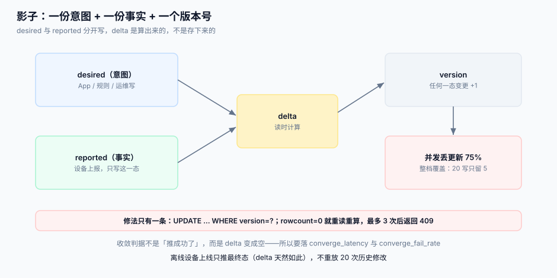

# 设备影子

「把客厅那台空调设成 26 度」——这句话里有两件事：**我希望它是什么样**（desired），和**它现在是什么样**（reported）。设备离线时前者仍然成立，后者停在最后一次上报。把这两个状态分开存、分开改、分开收敛，就是设备影子。

::: tip 一句话定位
影子不是「设备状态的缓存」，而是**一份关于设备的意图与事实的账本**。缓存可以丢（丢了再查一次），账本不能丢（丢了用户设的温度就没了）。
:::



## 一、三态与一个版本号

```json
{
  "device_id": "SN2026103100071",
  "version": 42,
  "desired":  { "target_temp": 26, "mode": "cool", "fan": "auto" },
  "reported": { "target_temp": 28, "mode": "cool", "fan": "low" },
  "delta":    { "target_temp": 26, "fan": "auto" },
  "desired_at": "2026-10-31T05:20:11Z",
  "reported_at": "2026-10-31T05:19:58Z"
}
```

| 字段 | 谁写 | 语义 | 常见错用 |
| --- | --- | --- | --- |
| `desired` | 平台/App | 用户或规则的**意图**，设备离线也成立 | 当作「已生效」展示给用户 |
| `reported` | 设备 | 设备**自报**的当前状态 | 用它覆盖 `desired`（会把用户设置冲掉） |
| `delta` | 平台计算 | `desired` 中与 `reported` 不同的部分 | 持久化存储（它是派生值，存了就会漂移） |
| `version` | 平台 | 每次**任何一态**变更 +1，用于并发控制 | 用时间戳代替（多副本时钟不一致） |

`delta` 必须是**算出来的**，不是存下来的。存 `delta` 的后果是：设备上报后忘了清空它，平台就一直重发同一条期望。

## 二、两条写路径与并发

影子的写入方有两类，规则完全不同：

| 写入方 | 写哪一态 | 冲突策略 | 幂等键 |
| --- | --- | --- | --- |
| App / 规则 / 运维 | `desired` | **平台赢**：后写覆盖，但必须带 `version`（CAS） | `request_id` |
| 设备上报 | `reported` | **设备赢**：同一 `version` 内以最后一次上报为准 | `(device_id, seq)` |

并发问题的严重程度被低估了。本机模拟（20 个并发写者修改同一设备的 5 个字段，全部采用「读整档 → 改一个字段 → 写回整档」）：

| 写法 | 20 次写意图最终留下几个 | 丢失比例 |
| --- | --- | --- |
| 整档覆盖（无版本号） | **5.0** | **75%** |
| 带 `version` 条件更新（失败重读重试） | 20 | 0% |

75% 不是夸张：每个写者都基于同一份旧快照写回整档，于是「别人改的字段」被自己的旧值覆盖。**修法只有一条**：写回时带 `WHERE version = ?`，`rowcount = 0` 就重读重算。

```sql
-- 原子更新：一次 UPDATE 同时做「校验版本 + 写字段 + 版本 +1」
UPDATE shadow
   SET desired    = json_patch(desired, :patch),
       version    = version + 1,
       desired_at = :now
 WHERE device_id = :id
   AND version   = :expected_version;
-- rowcount 必须为 1；为 0 表示有人抢先改了，重读后重试（最多 3 次，仍失败返回 409）
```

## 三、收敛：从 desired 到 reported

影子的价值在于「收敛」，而不是「存两份状态」。一次完整的收敛：

```text
1. 用户设 26 度     → desired.target_temp=26, version 42→43
2. 平台算 delta     → {target_temp: 26}
3. 设备在线？       → 在线：立即推 delta；离线：等设备上线时在 CONNACK 后主动推
4. 设备执行         → 上报 reported.target_temp=26, seq=…
5. 平台重算 delta   → {} → 收敛完成，记录 converge_latency
```

判据不是「推成功了」，而是 **`delta` 变成空**。这一步必须落一个可度量的量：

| 指标 | 定义 | 用途 |
| --- | --- | --- |
| `converge_latency` | `desired_at` → 对应 `reported_at` 的差值 | 用户体感（「我按了为什么没反应」） |
| `converge_fail_rate` | 24 h 内 `delta` 非空且 `desired_at` 超 1 h 的设备占比 | 找出「永远收敛不了」的设备（传感器坏、固件 bug） |
| `shadow_version_skew` | 同一设备 `version` 与 `reported` 的差距 | 判断是不是一直在被改 |

::: warning 离线不是「等一下再推」这么简单
设备离线 3 天后上线，`desired` 里可能积压了 20 次修改（用户改来改去）。正确做法是**只推最终态**（`delta` 天然如此），而不是把 20 条指令排队重放。如果业务需要「每次都生效」（例如每次开门），那就不是影子，是[指令](../CommandDispatch/index.md)——两者的区别是：**影子只关心最终值，指令关心每一次**。
:::

## 四、影子、最新值、时序：三个东西别混

| 存储 | 内容 | 保留 | 回答的问题 |
| --- | --- | --- | --- |
| **影子** | 每个设备一行，desired + reported + version | 永久（删设备才删） | 「现在应该是什么样 / 现在是什么样」 |
| **最新值表** | 每个设备每个指标一行（物模型展开） | 永久 | 「这个指标现在多少」（查询用，比 JSON 好索引） |
| **时序库** | 每个点一行 | 按保留策略（30 天~3 年） | 「过去 7 天怎么变的」 |

常见错误是把影子当查询源：`SELECT * FROM shadow WHERE json_extract(reported,'$.temp') > 30` 这种查询在百万设备规模下无法加索引。正确做法是**写影子时同步展开到最新值表**（同一事务），查询走最新值表。

```sql
CREATE TABLE shadow (
  device_id  TEXT PRIMARY KEY,
  version    INTEGER NOT NULL DEFAULT 0,
  desired    TEXT NOT NULL DEFAULT '{}',
  reported   TEXT NOT NULL DEFAULT '{}',
  desired_at TEXT,
  reported_at TEXT,
  CONSTRAINT version_nonneg CHECK (version >= 0)
);

-- 最新值表：物模型维度，供查询与告警
CREATE TABLE device_metric_latest (
  device_id  TEXT NOT NULL,
  metric     TEXT NOT NULL,
  value_num  REAL,
  value_text TEXT,
  updated_at TEXT NOT NULL,
  PRIMARY KEY (device_id, metric)
);
```

## 五、`reported` 的信任边界

设备上报的 `reported` 是**设备说它是什么样**，不是「它真的是什么样」。三条纪律：

1. **类型与范围校验**：`target_temp` 是 16~30 的整数；设备报 `999` 时不能直接展示给用户（固件 bug 或攻击）。
2. **禁止把 `reported` 当控制指令**：某些设备会上报 `{"switch": "on"}` 表示「我开了」，平台若把它当指令回写 `desired`，就形成了自激循环。
3. **上报时间只用于展示，不用于判新旧**：设备时钟不可信（见[遥测接入](../TelemetryIngest/index.md)）。判新旧用 `seq` 或平台侧 `received_at`。

## 六、判据

| 判据 | 看什么现象 | 判成什么 | 不满足时改哪里 |
| --- | --- | --- | --- |
| `IOW-A` | `desired` 写入是否带 `version` 条件 | 无条件更新即不合格 | 改 `UPDATE … WHERE version=?`；`rowcount=0` 重试 3 次后 409 |
| `IOW-B` | 是否存在持久化的 `delta` 列 | 存在即不合格 | 删列，改为读时计算 |
| `IOW-C` | `reported` 是否会覆盖 `desired` | 会即不合格 | 两条写路径分离，设备只写 `reported` |
| `IOW-D` | 是否有 `converge_latency` 指标与 `converge_fail_rate` | 缺一即不合格 | 影子表加 `desired_at`/`reported_at`，看板算差值 |
| `IOW-E` | 离线设备上线后是推最终态还是重放历史 | 重放历史即不合格 | 只推 `delta`（最终态） |
| `IOW-F` | 查询是否走 `shadow` 的 JSON 抽取 | 走 JSON 即不合格 | 同步写 `device_metric_latest`，查询改走它 |
| `IOW-G` | `reported` 是否有类型/范围校验 | 无校验即不合格 | 接入侧按物模型校验，越界丢弃并计数 |
| `IOW-H` | 是否用设备时钟判新旧 | 用即不合格 | 改用 `seq`/`received_at`；`reported_at` 只做展示 |

::: danger 本页特有的坑
1. **把影子当成「设备状态缓存」而允许丢掉重建**。重建只能恢复 `reported`（设备下次上报即可），**`desired` 永久丢失**——用户设的温度、运维改的阈值全没了。影子表必须在备份策略里。
2. **`delta` 无限重推**。设备固件不支持某个字段（老固件没有 `fan` 档位），平台一直推、设备一直不回，`delta` 永远非空，日志里每秒一对。修法：`delta` 推送要记 `last_sent_at` 与 `send_count`，超过 5 次进 `UNCONVERGED` 并告警，而不是继续推。
3. **用 `reported_at` 做「最后在线时间」**。有的设备只在状态变化时上报，室温稳定 6 小时就 6 小时没上报，看起来像离线。最后在线时间应该来自心跳（[连接与会话](../ConnectionSession/index.md)），不是状态上报。
:::

## 七、验证方式

```shell
# 1. 并发写是否丢更新：两个会话同时基于 version=N 写不同字段
sqlite3 /tmp/iot.db "UPDATE shadow SET desired=json_patch(desired,'{\"target_temp\":26}'), version=version+1
                     WHERE device_id='SN2026103100071' AND version=42; SELECT changes();"
sqlite3 /tmp/iot.db "UPDATE shadow SET desired=json_patch(desired,'{\"fan\":\"auto\"}'), version=version+1
                     WHERE device_id='SN2026103100071' AND version=42; SELECT changes();"
# 期望：第一次 1，第二次 0（第二次必须重读后重试，而不是直接覆盖）

# 2. delta 是否为派生值（库里没有 delta 列）
sqlite3 /tmp/iot.db "PRAGMA table_info(shadow);" | grep -c delta
# 期望：0

# 3. 收敛判定：delta 为空的设备占比
sqlite3 /tmp/iot.db "SELECT
  sum(CASE WHEN json(desired)=json(reported) THEN 1 ELSE 0 END)*1.0/count(*) AS converged
  FROM shadow;"
# 期望：稳态下 > 0.95；长期低于 0.8 说明有设备永远收敛不了
```

## 参考资料

- AWS IoT Core 设备影子文档——`desired` / `reported` / `delta` / `version` 模型的事实来源
- MQTT 5.0 §3.1.2.11——`Session Expiry Interval`，影子与「离线消息」的边界
- [指令下发](../CommandDispatch/index.md)——「每一次都要执行」的场景该用指令而不是影子
- [遥测接入](../TelemetryIngest/index.md)——设备时钟不可信时怎么判新旧
