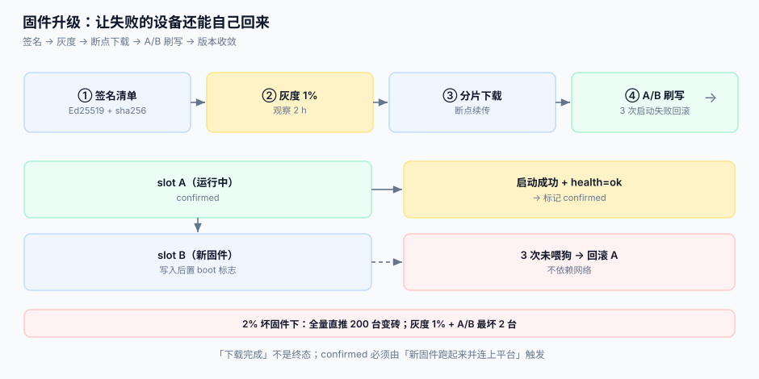

# 固件升级

固件升级是物联网平台里**唯一一个能把设备变砖**的操作。它和其他所有操作的区别是：失败不可回滚（除非设备自己留了退路），而且失败的设备从此不在线——你连日志都拿不到。

::: tip 一句话定位
OTA 的核心不是「把包传下去」，而是**让失败的设备还能自己回来**。做不到这一点的升级，不管灰度做得多细，都是在赌。
:::



## 一、包与签名：先证明「这个包是我发的」

| 要素 | 做法 | 不做会怎样 |
| --- | --- | --- |
| 包哈希 | 对整包算 SHA-256，写进清单 | 传输损坏后刷进去变砖 |
| 签名 | 对**清单**签名（Ed25519 或 ECDSA P-256），设备内置公钥 | 任何人可推任意固件 |
| 兼容矩阵 | 包内声明 `hw_rev` / `min_bootloader` / `flash_size` | 装到不匹配的硬件上，开机即死 |
| 防降级 | 包内 `version` 单调递增 + 设备拒绝低版本 | 被回滚到有漏洞的版本 |
| 密钥轮换 | 设备内置**两把**公钥（当前 + 下一把） | 换密钥那天，全量设备验签失败 |

```json
{
  "version": "3.4.2",
  "hw_rev": ["A2", "A3"],
  "min_bootloader": "1.7.0",
  "size": 536870912,
  "sha256": "9f2c…",
  "chunks": 512,
  "chunk_size": 1048576,
  "sig": "base64(Ed25519(sign, sha256(manifest)))"
}
```

::: warning 签名的是清单，不是包本身
设备先验清单签名，再按清单里的 `sha256` 校验每个分片。这样设备**不需要把整个包读进内存**（8 MB RAM 的模组读不了 512 MB 的包），也不需要先信任传输通道。
:::

## 二、灰度：把「变砖」的概率乘上批次的倒数

假设固件有 2% 的设备会刷失败且无法回滚（真实的坏固件场景）：

| 策略 | 最坏损失设备数（1 万台） |
| --- | --- |
| 全量直推 | **200 台** |
| 灰度 1%（100 台）+ 观察 24 h + A/B 回滚 | **2 台** |
| 灰度 5%（500 台）+ 观察 24 h + A/B 回滚 | 10 台 |

灰度的关键不是「比例小」，而是**观察窗口与暂停条件**：

| 阶段 | 比例 | 观察时长 | 暂停条件（任一命中即停） |
| --- | --- | --- | --- |
| Canary | 0.5%~1% | 2 h | 失败率 > 2%，或新版本心跳在线率比老版本低 5 个百分点 |
| 第一批 | 10% | 24 h | 失败率 > 1%，或崩溃重启率上升 |
| 第二批 | 50% | 24 h | 同上 |
| 全量 | 100% | — | — |

「失败率」的分母必须是**已尝试刷写的设备数**，不是全量设备数——否则 1% 灰度里 3 台失败看起来只有 0.03%，永远触发不了暂停。

## 三、下载：分片、续传与限速

| 问题 | 做法 |
| --- | --- |
| 断网 | 按 `chunk` 续传，设备记录 `bitmap` 或 `next_offset`（存 flash，断电可恢复） |
| 带宽打爆 | CDN + 令牌桶；固件按 `version + hw_rev` 做缓存键，命中率高 |
| 弱网超时 | 单片超时 60 s，重试 3 次；失败退回 `DOWNLOAD_FAILED` 而不是整包重来 |
| 流量成本 | 单台重试一次整包 = 512 MiB；断点续传只重传 1 片 = 1 MiB |

1 MiB × 512 片的包：全量重下的代价是 **512 倍**。断点续传不是优化项，是成本项——尤其是走蜂窝网络的设备。

## 四、刷写：A/B 分区是唯一可靠的退路

```text
┌──────────┬──────────┬──────────┐
│ bootloader │ slot A  │ slot B  │
└──────────┴──────────┴──────────┘
当前运行 A，新固件写入 B → 置 boot 标志 → 重启进 B
  B 启动成功且上报 health=ok → 提交（标记 B 为 confirmed）
  B 启动失败（watchdog 3 次未喂狗）→ 自动回滚到 A
```

三条硬约束：

1. **`confirmed` 必须由「新固件跑起来并连上平台」触发**，不能由「写入完成」触发。写入完成只说明字节到了，不说明能启动。
2. **回滚不能依赖网络**：回滚逻辑在 bootloader 里，不依赖平台下发命令。
3. **刷写期间禁止其他操作**：正在执行的指令、正在采集的数据都要暂停；刷写前把 `desired` 落盘，刷写后重新收敛（见[设备影子](../DeviceShadow/index.md)）。

## 五、收敛：升级任务的唯一验收指标

| 指标 | 定义 | 目标 |
| --- | --- | --- |
| `upgrade_success_rate` | `SUCCESS` / 已尝试 | ≥ 98% |
| `upgrade_stuck_rate` | 停在 `DOWNLOADING`/`FLASHING` 超 6 h | < 1% |
| `rollback_rate` | 触发回滚的设备占比 | < 1%（高于此说明固件质量有问题） |
| `version_convergence` | 目标版本设备数 / 应升级设备数 | 7 天内 ≥ 95% |

「升级完成」这句话只有在 `version_convergence` 达标时才能说。停在 `DOWNLOADING` 的设备最麻烦——它可能只是没电、可能已经变砖，平台侧两者无法区分。

## 六、判据

| 判据 | 看什么现象 | 判成什么 | 不满足时改哪里 |
| --- | --- | --- | --- |
| `IOF-A` | 包清单是否有签名，设备是否内置公钥验签 | 无签名即不合格 | 加 Ed25519 签名；设备内置两把公钥 |
| `IOF-B` | 是否有 `hw_rev` / `min_bootloader` 兼容矩阵 | 无即不合格 | 清单加字段；设备刷写前校验，不匹配拒绝 |
| `IOF-C` | 是否支持断点续传（记录 `next_offset` 到 flash） | 不支持即不合格 | 下载器加 offset 持久化 |
| `IOF-D` | 是否有 A/B 分区与自动回滚 | 无即不合格 | 分区表改造；bootloader 加 3 次启动失败回滚 |
| `IOF-E` | `confirmed` 是否由「新固件连上平台」触发 | 由写入完成触发即不合格 | 改状态机：`FLASHED` → 等首个 health 上报 → `CONFIRMED` |
| `IOF-F` | 灰度是否有暂停条件且分母是「已尝试数」 | 无暂停条件即不合格 | 任务表加 `attempted` / `failed`，按比例判停 |
| `IOF-G` | 是否有 `upgrade_stuck_rate` 监控 | 无即不合格 | 看板加「停留超 6 h」计数 |
| `IOF-H` | 刷写期间是否暂停指令与采集 | 未暂停即不合格 | 升级前置设备 `state=UPGRADING`，调度器跳过该设备 |

::: danger 本页特有的坑
1. **换签名密钥时只换平台侧**。设备内置的还是旧公钥，新包验签失败，升级率瞬间掉到 0，而平台日志只显示「设备拒绝」。修法：设备内置两把公钥，先推一版「认识新公钥」的固件，再切签名密钥。
2. **`version` 只比较字符串**。`3.10.0` 与 `3.9.0` 按字符串比较，`"3.10.0" < "3.9.0"`，于是新版本被当成旧版本拒绝。版本必须按数值三元组比较。
3. **把「下载完成」写进数据库就认为升级成功**。设备可能已经断电，包在 flash 里躺着。`DOWNLOADED` 不是终态。
4. **升级包没有 `min_bootloader` 检查**。新固件需要 bootloader 支持双分区，老 bootloader 单分区，刷进去直接覆盖运行中的固件 → 砖。
:::

## 七、验证方式

```shell
# 1. 清单签名可被设备公钥验证
openssl dgst -sha256 -verify pub.pem -signature manifest.sig manifest.json
# 期望：Verified OK

# 2. 分片哈希与清单一致（抽第 1 片）
curl -s -r 0-1048575 https://cdn.example.com/fw/3.4.2.part0 | sha256sum
# 期望：与 manifest.json 中 chunks[0].sha256 相同

# 3. 升级任务收敛率
sqlite3 /tmp/iot.db "SELECT
  sum(CASE WHEN state='SUCCESS' THEN 1 ELSE 0 END)*1.0/count(*) AS ok,
  sum(CASE WHEN state IN ('DOWNLOADING','FLASHING') AND updated_at < datetime('now','-6 hours') THEN 1 ELSE 0 END) AS stuck
  FROM upgrade_task WHERE target_version='3.4.2';"
# 期望：ok ≥ 0.98，stuck = 0

# 4. 版本字符串比较必须按数值
python3 -c "print('3.10.0' < '3.9.0', (3,10,0) < (3,9,0))"
# 期望：True False —— 前者是错的写法，后者才对
```

## 参考资料

- [Eclipse Mosquitto 手册](https://mosquitto.org/man/mosquitto-conf-5.html)——`max_packet_size`（2.1 起默认 2,000,000 字节，大包必须分片）
- [对象存储](../../ObjectStorage/index.md)——固件包的分片存储与预签名下载
- [边缘 CDN](../../../Ops/EdgeCDN/index.md)——固件分发与缓存键设计
- [指令下发](../CommandDispatch/index.md)——升级指令的幂等与终态
