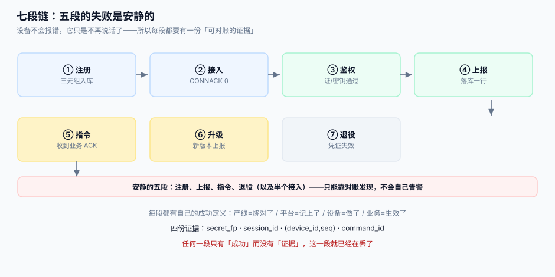

# 总览：七段链与三个「在线」

物联网平台不是「把传感器数据存进数据库」，而是**替一批不在身边的机器保管状态**。这些机器会断电、会换网、会被搬走、会被人拔掉 SIM 卡；而它们从不解释原因。本页把这件麻烦事拆成七段，并给「在线」这个词补上三个必须分开定义的口径。

::: tip 一句话定位
如果你只能记住一句话：**平台里每一个「离线」都是推断出来的，不是被告知的**。既然是推断，就必须写清推断依据、延迟多久、误判率多少——否则运维会拿一个自己都不知道多准的数字去报警。
:::



## 一、七段链

| 段 | 做什么 | 成功由谁定义 | 失败是否安静 |
| --- | --- | --- | --- |
| ① 注册（provision） | 给设备一个身份与凭证 | 产线：烧录成功；平台：三元组入库 | **安静**——烧错了也能连上，只是连成了别人的设备 |
| ② 接入（connect） | 建立长连接 | Broker：TCP + CONNACK 0x00 | 半安静——连上但被踢，日志里只有一行 |
| ③ 鉴权（authenticate） | 证明「你是这台设备」 | 平台：证书链 / 密钥校验通过 | **很吵**——401 会重试成风暴，反而容易发现 |
| ④ 上报（telemetry） | 采数据、上报 | 设备：发出去；平台：落库 | **极安静**——丢了就是少一个点，曲线照样画得出 |
| ⑤ 指令（command） | 下发控制动作 | 设备：执行了；平台：收到 ACK | **极安静**——没 ACK 时你不知道是没收到还是没执行 |
| ⑥ 升级（OTA） | 换固件 | 设备：新版本起来并上报 | 半安静——变砖的设备彻底消失，与「关机」不可区分 |
| ⑦ 退役（retire） | 注销设备、吊销凭证 | 平台：凭证失效、数据归档 | **安静**——忘了退役的设备十年后还在连 |

七段里五段的失败是安静的，这就是本专题存在的原因。**「安静」意味着不能靠异常告警发现，只能靠对账与不变量发现**。

## 二、三个「在线」，必须分开定义

运维大屏上的「在线设备数」通常同时混了这三个概念，于是每天吵架。

| 口径 | 判据 | 检测延迟 | 误判方向 | 适用 |
| --- | --- | --- | --- | --- |
| **连接在线** | Broker 上该 client_id 有活跃会话 | 即时（断开即知） | 把「TCP 半开」当成在线 | 容量规划、连接数配额 |
| **心跳在线** | 最近 `1.5 × KeepAlive` 内收到过任何控制报文 | 最坏 1.5 × KeepAlive | 把「设备卡死但 TCP 还在」当成在线 | 设备健康度 |
| **数据新鲜** | 最近一条遥测的 `received_at` 在业务阈值内 | 取决于上报周期 | 把「在线但传感器坏了」当成离线 | 业务告警、SLA |

本机读数（10 万台设备，仅算心跳报文，不含业务数据）：

| KeepAlive | 心跳报文/天 | 平均检测延迟 | 最坏检测延迟 |
| --- | --- | --- | --- |
| 30 s | 576.00 M | 30 s | 45 s |
| 60 s | 288.00 M | 60 s | 90 s |
| 120 s | 144.00 M | 120 s | 180 s |
| 300 s | 57.60 M | 300 s | 450 s |

读法：KeepAlive 从 30 s 调到 300 s，心跳报文降到 **1/10**，代价是掉线最坏要 **7.5 分钟**才发现。这个交换比必须由业务决定（冷链温度告警不能忍 7.5 分钟，共享单车可以），**不能由 Broker 默认值决定**。

::: warning 三个数不能互相替代
「连接在线 9,800 / 心跳在线 9,600 / 数据新鲜 9,100」是三个都对的数字。把它们平均、或者拿最大值当「在线率」，等于把三种完全不同的故障（网络断、设备死机、传感器坏）压成一个无法归因的指标。
:::

## 三、四个必失接缝

「必失」是指：**在正常运维下，它们一定会出错，问题只是出错时你能不能发现**。

1. **注册 ⇄ 接入**：产线烧录的 `device_id` 与平台入库的 `device_id` 不一致。设备能连上（因为 Broker 只校验凭证），但数据落在「另一台设备」名下。判据是「设备自报的 `device_id` 必须等于凭证里的身份」。
2. **接入 ⇄ 上报**：设备重连后重发缓存数据，平台按「到达时间」入库，历史曲线上出现一段往回折的尖峰。判据是「每条数据带设备侧的 `ts` 与序列号，且平台记录 `received_at`」。
3. **上报 ⇄ 指令**：ACL 只做了主题级授权，设备 A 能订阅 `cmd/dev-b/#`，于是能听到所有设备的指令。判据是「订阅必须用 `%c` 或逐设备主题，通配订阅只允许平台侧服务使用」。
4. **指令 ⇄ 升级**：升级期间设备重启，正在执行的指令丢失，平台侧仍停在「已下发」状态。判据是「指令有终态超时，超时后进 `UNKNOWN` 而不是永远 `SENT`」。

## 四、五个角色

| 角色 | 关心什么 | 在本专题里的位置 |
| --- | --- | --- |
| 硬件/固件工程师 | 内存、断网缓存、看门狗 | 决定「设备能记多少、能等多久」（[固件升级](../FirmwareOTA/index.md)） |
| 平台后端 | 连接数、吞吐、存储 | 七段链的实现者 |
| 运维/SRE | 在线率、告警噪音 | 三个「在线」口径的消费者 |
| 业务/运营 | 设备是否可用、SLA | 「数据新鲜」口径的消费者 |
| 安全 | 凭证、越权、固件签名 | [设备身份](../DeviceIdentity/index.md) 与 OTA 签名的把关人 |

## 五、必失点的代价（按修复成本排序）

| 失败 | 发现方式 | 修复成本 | 一句话 |
| --- | --- | --- | --- |
| 设备身份重复 | 数据对不上账 | **极高**（要现场换设备） | 产线唯一性校验必须在入库前 |
| 固件变砖 | 设备永久消失 | 极高（上门） | A/B 分区 + 灰度是唯一解 |
| 指令重复执行 | 门开了两次 | 高（物理后果） | 幂等键在业务层，不在设备内存 |
| 影子版本冲突 | 设定值莫名回退 | 中（用户投诉） | 期望态写入必须带版本号 |
| 遥测乱序 | 曲线抖动、聚合错 | 中（补数） | 双时间戳 + 序列号 |
| 会话丢失 | 离线期间指令丢 | 低（重发） | `Session Expiry` 要给非零值 |

## 六、判据

| 判据 | 看什么现象 | 判成什么 | 不满足时改哪里 |
| --- | --- | --- | --- |
| `IOO-A` | 平台展示的「在线」是一个数还是三个数 | 只给一个数即为不合格 | 运维看板拆成 `conn_online` / `hb_online` / `data_fresh` 三个指标 |
| `IOO-B` | 掉线告警的延迟是否写进了告警说明 | 未写即不合格 | 告警规则注释里写明 `1.5 × KeepAlive` 的最坏延迟 |
| `IOO-C` | 每条遥测是否同时有 `ts`（设备）与 `received_at`（平台） | 缺一即不合格 | `telemetry` 表加列，写入侧补齐 |
| `IOO-D` | 设备自报 `device_id` 与凭证身份是否校验相等 | 不校验即不合格 | 接入鉴权回调里比对 CN / username 与 payload |
| `IOO-E` | 是否存在 `cmd/#` 这类跨设备通配订阅 | 存在即不合格 | ACL 改为 `cmd/%u/#`，服务侧用独立账号 |
| `IOO-F` | 指令是否有终态超时（`SENT` 不会永久停留） | 无超时即不合格 | 加 `expires_at` 与扫描任务，超时置 `UNKNOWN` |
| `IOO-G` | 设备退役后凭证是否真的失效 | 仍能连上即不合格 | 撤销证书 + `disconnect` + 加入拒绝名单 |
| `IOO-H` | 七段中每一段是否有一条可执行的对账查询 | 少于 5 段即不合格 | 按本文表格逐段补 SQL 或命令 |

::: danger 本页特有的坑
1. **拿 Broker 的 `$SYS/broker/clients/connected` 当「在线设备数」**。它数的是**连接**，不是设备：一台设备重连会短暂出现 2 条连接（旧连接尚未超时），网关多副本时还会重复计数。正确做法是「连接表按 `device_id` 去重 + 以会话过期时间为准」。
2. **把 `KeepAlive` 当成「心跳间隔」直接配到设备上**。MQTT 的语义是「**客户端承诺**在这个周期内至少发一次报文」，服务端按 1.5 倍判定；设备若按 KeepAlive 精确发送，抖动一次就会自我踢下线。
3. **在设备端做「断网缓存队列」却不设上限**。8 KB RAM 的模组写环形缓冲，写满后**静默覆盖最旧数据**——看起来在缓存，实际在丢最早的异常段（往往正是最需要的那段）。
:::

## 七、验证方式

```shell
# 1. 三个在线口径是否分别可查（以本项目 Practice 页的库为例）
sqlite3 /tmp/iot.db "SELECT
  (SELECT count(*) FROM device WHERE last_seen_at > datetime('now','-90 seconds')) AS hb_online,
  (SELECT count(*) FROM device WHERE online = 1)                                   AS conn_online,
  (SELECT count(DISTINCT device_id) FROM telemetry WHERE received_at > datetime('now','-10 minutes')) AS data_fresh;"
# 期望：三个数互不相等（相等通常意味着三个指标读了同一个字段）

# 2. 是否存在跨设备通配订阅
mosquitto_sub -h localhost -t 'cmd/#' -C 1 -W 3 ; echo "exit=$?"
# 期望：exit=0 且收到别的设备指令 → ACL 漏了

# 3. 指令是否永久停在 SENT
sqlite3 /tmp/iot.db "SELECT count(*) FROM command WHERE state='SENT' AND created_at < datetime('now','-1 hour');"
# 期望：0（非 0 说明缺终态超时）
```

## 参考资料

- MQTT 5.0 Specification §3.1.2（CONNECT 与 KeepAlive）、§3.1.3.2（遗嘱与延迟）
- [Eclipse Mosquitto 变更日志](https://mosquitto.org/blog/)——2.1.0 起协议版本号打印口径与 `max_packet_size` 默认值的变化
- [连接与会话](../ConnectionSession/index.md)——本页第二、三节的实现细节
- [设备影子](../DeviceShadow/index.md)——「期望态 / 报告态」如何消掉「设定值回退」这类投诉
