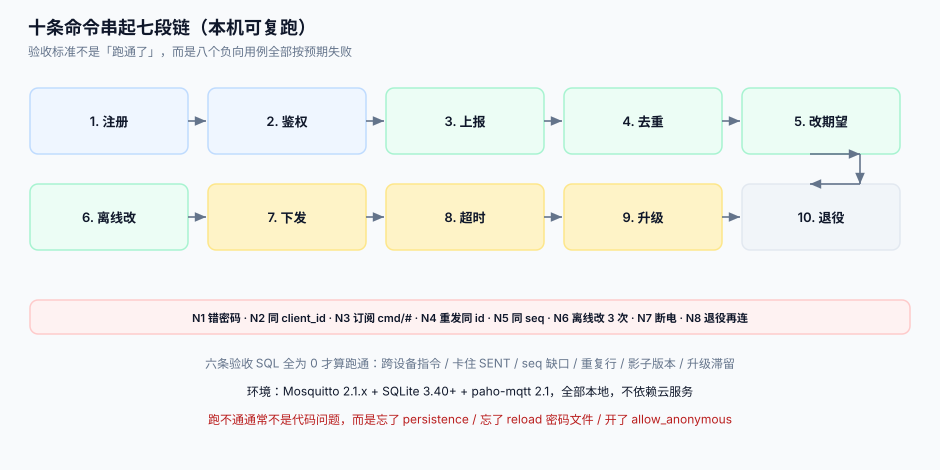

# 实战：本机跑通一条闭环

这一页把前七页的东西串起来，在一台笔记本上跑一条完整闭环：**设备注册 → 接入鉴权 → 上报遥测 → 改期望态 → 下发指令 → 升级固件 → 退役**。全部使用可复制的命令，不依赖云服务。

::: tip 一句话定位
这一页的验收标准不是「跑通了」，而是**八个负向用例全部按预期失败**。正向用例只证明你写对了，负向用例证明你写的这东西**挡得住**。
:::



## 一、环境与目录

| 组件 | 版本 | 用途 |
| --- | --- | --- |
| Python | 3.12+ | 设备模拟器、平台侧脚本（仅标准库 + `paho-mqtt`） |
| Eclipse Mosquitto | 2.1.x | Broker |
| SQLite | 3.40+ | 平台侧库（含 JSON 函数） |

```shell
mkdir -p ~/iot-lab && cd ~/iot-lab
python3 -m venv .venv && source .venv/bin/activate
pip install paho-mqtt==2.1.0
brew install mosquitto || sudo apt install mosquitto mosquitto-clients
mosquitto -h | head -1
# 期望：mosquitto version 2.1.x
```

## 二、Broker 配置（最小可跑集）

```conf
# ~/iot-lab/broker.conf
listener 1883
allow_anonymous false
password_file /Users/you/iot-lab/passwd
persistence true
persistence_location /Users/you/iot-lab/data/
max_keepalive 300
max_packet_size 65536
max_inflight_messages 20
max_queued_messages 1000
log_type all
```

```shell
mosquitto_passwd -c passwd SN2026103100071     # 一机一密：每台设备一条
mosquitto -c broker.conf -v
# 期望：日志出现 "mosquitto version 2.1.x starting" 与 "Opening ipv4 listen socket on port 1883"
```

## 三、平台侧库（六张表）

```sql
-- schema.sql
CREATE TABLE device (
  device_id TEXT PRIMARY KEY, product_key TEXT NOT NULL, device_name TEXT NOT NULL,
  secret_fp TEXT NOT NULL, state TEXT NOT NULL DEFAULT 'PROVISIONED',
  online INTEGER NOT NULL DEFAULT 0, last_seen_at TEXT,
  UNIQUE (device_name), UNIQUE (secret_fp)
);
CREATE TABLE shadow (
  device_id TEXT PRIMARY KEY, version INTEGER NOT NULL DEFAULT 0,
  desired TEXT NOT NULL DEFAULT '{}', reported TEXT NOT NULL DEFAULT '{}',
  desired_at TEXT, reported_at TEXT
);
CREATE TABLE telemetry_raw (
  device_id TEXT NOT NULL, seq INTEGER NOT NULL, event_time TEXT NOT NULL,
  received_at TEXT NOT NULL, metric TEXT NOT NULL, value_num REAL,
  PRIMARY KEY (device_id, seq, metric)
) WITHOUT ROWID;
CREATE TABLE command (
  command_id TEXT PRIMARY KEY, device_id TEXT NOT NULL, name TEXT NOT NULL,
  params TEXT NOT NULL, state TEXT NOT NULL, seq INTEGER NOT NULL,
  attempts INTEGER NOT NULL DEFAULT 0, created_at TEXT NOT NULL,
  expires_at TEXT NOT NULL, device_ack_at TEXT,
  UNIQUE (device_id, seq)
);
CREATE TABLE upgrade_task (
  device_id TEXT NOT NULL, target_version TEXT NOT NULL, state TEXT NOT NULL,
  attempted_chunks INTEGER NOT NULL DEFAULT 0, updated_at TEXT NOT NULL,
  PRIMARY KEY (device_id, target_version)
);
CREATE TABLE auth_fail (
  id INTEGER PRIMARY KEY AUTOINCREMENT, device_id TEXT, reason TEXT, at TEXT NOT NULL
);
```

```shell
sqlite3 iot.db < schema.sql && sqlite3 iot.db ".tables"
# 期望：auth_fail command device shadow telemetry_raw upgrade_task
```

## 四、十步流水

| 步 | 做什么 | 命令/动作 | 通过判据 |
| --- | --- | --- | --- |
| 1 | 注册设备 | `sqlite3 iot.db "INSERT INTO device ..."` + `mosquitto_passwd` | `device` 一行，`secret_fp` 唯一 |
| 2 | 鉴权接入 | 模拟器用错误密码连一次、正确密码连一次 | 错误 → `not authorised`；正确 → `online=1` |
| 3 | 上报遥测 | 模拟器发 `seq=1..5` | `telemetry_raw` 5 行，缺口 0 |
| 4 | 重投去重 | 重发 `seq=3` | 仍 5 行（幂等生效） |
| 5 | 改期望态 | 平台写 `desired.target_temp=26` 带 `version` | `version` +1，`changes()=1` |
| 6 | 离线期间改期望 | 断开设备，再改两次 `desired` | 设备上线后只收到**最终态**（1 条 delta） |
| 7 | 下发指令 | 发 `unlock`，设备回 ACK | `state` 从 `SENT` → `SUCCEEDED` |
| 8 | 指令超时 | 发一条设备不回的指令，等 `expires_at` | `state='TIMEOUT'`，且不进 `SUCCEEDED` |
| 9 | 升级 | 推 `3.4.2`（分 4 片），中途 kill 后重启 | `attempted_chunks` 从断点续，不重下已完成的片 |
| 10 | 退役 | `state='RETIRED'` + 删 `passwd` 条目 + reload | 再连 → `not authorised` |

设备模拟器（最小可跑，单文件）：

```python
# device_sim.py —— 一台设备的七段行为
import json, time, uuid, paho.mqtt.client as mqtt

DEV, SECRET = "SN2026103100071", "s3cr3t-change-me"
_seq = 0
_seen = []                      # 指令去重窗（真机上是 16 槽环形缓冲）

def on_connect(c, u, flags, rc, props=None):
    print("connected", rc)
    c.subscribe(f"cmd/{DEV}", qos=1)
    c.subscribe(f"shadow/delta/{DEV}", qos=1)

def on_message(c, u, msg):
    body = json.loads(msg.payload)
    if msg.topic.startswith("cmd/"):
        cid = body["command_id"]
        if cid in _seen:                       # 幂等：重投不重复执行
            print("dup ignored", cid); return
        _seen.append(cid); del _seen[:-16]
        print("exec", body["name"], cid)
        c.publish(f"ack/{DEV}", json.dumps({"command_id": cid, "ok": True}), qos=1)
    else:
        print("apply desired", body)
        c.publish(f"report/{DEV}", json.dumps({"target_temp": body.get("target_temp", 26)}), qos=1)

c = mqtt.Client(mqtt.CallbackAPIVersion.VERSION2, client_id=DEV, protocol=mqtt.MQTTv5)
c.username_pw_set(DEV, SECRET)
c.on_connect, c.on_message = on_connect, on_message
c.connect("localhost", 1883, keepalive=30, clean_start=False,
          properties={"SessionExpiryInterval": 86400, "WillDelayInterval": 30})
c.loop_start()
for i in range(5):                              # 上报遥测：seq 单调
    _seq += 1
    c.publish(f"up/{DEV}", json.dumps({"seq": _seq, "ts": int(time.time()), "temp": 23.0 + i * 0.1}), qos=1)
    time.sleep(1)
time.sleep(30)
```

## 五、八个负向用例（真正要验收的东西）

| 编号 | 用例 | 期望结果 | 说明 |
| --- | --- | --- | --- |
| `N1` | 用 `device_name=SN...` 但密码错误连接 | 连接被拒（`not authorised`），`auth_fail` 记一行 | 鉴权不是装饰 |
| `N2` | 两台设备用同一 `client_id` 同时连 | 旧连接被踢；若 10 分钟内 > 5 次，告警 | 区分「重连」与「克隆」 |
| `N3` | 设备订阅 `cmd/#` | 被 ACL/设计拒绝；若能收到别的设备指令即失败 | 越权的最短路径 |
| `N4` | 同一条 `command_id` 发两次 | 设备只执行一次 | 幂等窗生效 |
| `N5` | 两条指令同 `seq` | 第二次插入报 `UNIQUE` 冲突（平台侧拒绝） | 序号唯一 |
| `N6` | 设备离线 40 分钟，期间改 3 次 `desired` | 上线后只收到 1 条最终态 delta | 影子不重放历史 |
| `N7` | 升级中途断电，重启 | 从 `attempted_chunks` 续传，不重下第 1 片 | 断点续传 |
| `N8` | 退役设备再用旧密码连 | 被拒；`device.state='RETIRED'` | 退役要真的失效 |

## 六、验收 SQL（六条，全绿才算跑通）

```sql
-- 1. 有没有跨设备的指令（应为 0）
SELECT count(*) FROM command c JOIN device d ON d.device_id=c.device_id WHERE d.state='RETIRED';

-- 2. 指令是否卡在 SENT 超过 1 小时（应为 0）
SELECT count(*) FROM command WHERE state='SENT' AND created_at < datetime('now','-1 hour');

-- 3. 遥测缺口（示例设备应为 0）
WITH o AS (SELECT seq, lag(seq) OVER (ORDER BY seq) p FROM telemetry_raw WHERE device_id='SN2026103100071')
SELECT coalesce(sum(seq-p-1),0) FROM o WHERE p IS NOT NULL AND seq>p+1;

-- 4. 重复遥测（应为 0：主键保证）
SELECT count(*) FROM (SELECT device_id, seq, metric, count(*) c FROM telemetry_raw
                       GROUP BY 1,2,3 HAVING c>1);

-- 5. 影子版本单调（version 必须 > 0，且 desired_at 不早于 created）
SELECT count(*) FROM shadow WHERE version < 0 OR (desired_at IS NOT NULL AND desired_at > datetime('now'));

-- 6. 升级滞留（应为 0）
SELECT count(*) FROM upgrade_task WHERE state IN ('DOWNLOADING','FLASHING')
   AND updated_at < datetime('now','-6 hours');
```

```shell
sqlite3 iot.db < acceptance.sql
# 期望：六个数全部为 0
```

## 七、判据

| 判据 | 看什么现象 | 判成什么 | 不满足时改哪里 |
| --- | --- | --- | --- |
| `IOP-A` | 八条命令是否都能在本机执行（不依赖云） | 任一条需云服务即不合格 | 换成本地 mosquitto + sqlite |
| `IOP-B` | `N1`~`N8` 是否全部按预期失败 | 有一条通过即不合格 | 补 ACL / 幂等窗 / 状态机 |
| `IOP-C` | 六条验收 SQL 是否全为 0 | 有非 0 即不合格 | 按对应表修 |
| `IOP-D` | 设备模拟器是否 `clean_start=false` 且 `SessionExpiryInterval>0` | 否即不合格 | 改连接参数 |
| `IOP-E` | 模拟器是否有 16 槽去重窗 | 无即不合格 | 加 `_seen` 列表 |
| `IOP-F` | 升级是否按片记录 `attempted_chunks` | 整包计数即不合格 | 改按片记录 |
| `IOP-G` | 退役是否同时做「状态 + 凭证 + 断连」三件事 | 缺一即不合格 | 补三件事的脚本 |
| `IOP-H` | 全部动作是否可在 10 分钟内复现（含安装） | 超过即不合格 | 砍掉非必要步骤，保留八条否定用例 |

::: danger 本页特有的坑
1. **`password_file` 改了不 reload**。Mosquitto 的密码文件在启动时读入；`mosquitto_passwd` 加完新用户后不 `SIGHUP`，新设备连不上而你以为配置写错了。2.1 起 `password_file` 被标记弃用，长期应迁到 `password-file` 插件。
2. **本地测试用 `allow_anonymous true`**。所有与 ACL 相关的负向用例（`N3`）都会失效，你会得出「权限没问题」的错误结论。测试环境也必须 `false`。
3. **`clean_start=false` 但没开 `persistence`**。Broker 重启后会话全丢，`N6` 的「离线只收最终态」看起来通过，其实是**什么都没收到**。
:::

## 参考资料

- [Eclipse Mosquitto 手册](https://mosquitto.org/man/mosquitto-conf-5.html)——`persistence`、`password_file`、`max_inflight_messages`
- [paho-mqtt 文档](https://eclipse.dev/paho/)——回调 API v2 的签名变化
- [连接与会话](../ConnectionSession/index.md)——`clean_start` 与 `SessionExpiryInterval`
- [指令下发](../CommandDispatch/index.md)——本页 `N4`/`N5` 的设计出处
