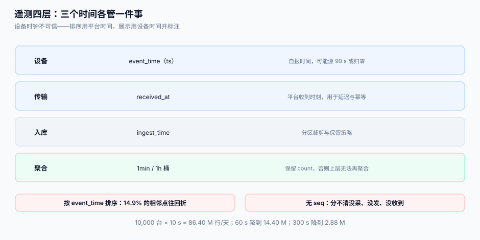

# 遥测接入

遥测是物联网平台里**量最大、价值密度最低、最容易悄悄出错**的一段。一台设备每 10 秒一个点，1 万台设备一天就是 **8,640 万行**；少了几百行，没有任何人会察觉，直到某天有人要算「这个月的能耗」而对不上账。

::: tip 一句话定位
遥测的正确性不体现在「存进去了」，而体现在**三个能算出来的数**：丢点率、迟到分布、时钟偏移。算不出这三个数，你就不知道自己的曲线有多可信。
:::



## 一、三个时间，各管一件事

| 字段 | 谁产生 | 语义 | 用途 |
| --- | --- | --- | --- |
| `event_time`（设备 `ts`） | 设备 | 「我测到这个值的时候，我认为是几点」 | 展示、业务聚合（有漂移风险） |
| `received_at` | 接入层 | 「平台什么时候收到」 | 延迟监控、幂等、离线补传识别 |
| `ingest_time` | 入库 | 「什么时候写进库」 | 分区裁剪、保留策略 |

只用 `received_at` 的问题：设备离线 3 小时后补传，所有点挤在同一秒入库，画出来的曲线是一根竖线。
只用 `event_time` 的问题：设备时钟不准或重启归零，曲线会往回折。

本机读数（5,000 台 × 60 点，10 s 一点，设备时钟漂移 ±90 s 且 1/2 的设备中途断电归零）：

| 排序依据 | 真实时间逆序对 | 说明 |
| --- | --- | --- |
| 按 `event_time` 排序 | **43,939 / 295,000 = 14.9%** | 每 7 个相邻点就有 1 个是往回折的 |

结论：**排序与窗口必须用平台时间，展示可以用设备时间但要标注**。补传的点用 `received_at` 归入「实际到达的批次」，用 `event_time` 归入业务时间轴——两个视图都要有。

## 二、`seq`：唯一能发现「丢点」的字段

只存值和时间，你无法区分三种情况：设备没采、采了没发、发了没收到。加一个设备维度的单调 `seq`，三种情况立刻可分：

| 现象 | 判据 | 归因 |
| --- | --- | --- |
| `seq` 连续，值正常 | — | 正常 |
| `seq` 出现缺口（7 → 10） | 缺 2 个点 | 传输丢失或设备跳过 |
| `seq` 重复 | 同一点到了两次 | 重投，按 `(device_id, seq)` 幂等 |
| `seq` 归零 | 设备重启 | 计数器未持久化，需按会话分段 |

```sql
-- 丢点率：按小时统计每个设备的 seq 缺口
WITH ordered AS (
  SELECT device_id, seq, received_at,
         lag(seq) OVER (PARTITION BY device_id, session_id ORDER BY seq) AS prev
    FROM telemetry_raw
   WHERE received_at >= :hour_start
)
SELECT device_id, sum(seq - prev - 1) AS lost
  FROM ordered
 WHERE prev IS NOT NULL AND seq > prev + 1
 GROUP BY device_id;
```

没有 `seq` 时，行业里的通行替代是「按采样周期推断」——但那只对「定时上报」的设备成立，对「变化上报」的设备会把「值没变所以没报」误判成丢点。

## 三、入库：幂等键与写入放大

```sql
CREATE TABLE telemetry_raw (
  device_id  TEXT    NOT NULL,
  seq        INTEGER NOT NULL,
  event_time TEXT    NOT NULL,
  received_at TEXT   NOT NULL,
  metric     TEXT    NOT NULL,
  value_num  REAL,
  value_text TEXT,
  PRIMARY KEY (device_id, seq, metric)      -- 幂等键：重投不产生新行
) WITHOUT ROWID;

CREATE INDEX ix_tel_time ON telemetry_raw (device_id, event_time);
```

`PRIMARY KEY (device_id, seq, metric)` 的选择理由：`(device_id, event_time)` 看起来更自然，但设备时钟会漂，同一点补传两次 `event_time` 可能不同（固件重新打时间戳），去重就失效了。`seq` 由设备单调分配，天然唯一。

写入量（10,000 台设备）：

| 采样周期 | 行/天 | 1 年（单指标，未压缩） |
| --- | --- | --- |
| 10 s | 86.40 M | 31.5 B |
| 60 s | 14.40 M | 5.3 B |
| 300 s | 2.88 M | 1.1 B |

（按每行约 100 字节估算，未计索引与压缩。实际用列存/时序库 + 压缩通常能压到 1/5~1/10。）

## 四、降采样与保留：三层就够

| 层 | 粒度 | 保留 | 用途 |
| --- | --- | --- | --- |
| raw | 原始 | 7~30 天 | 排障、精确复算 |
| 1min | 每分钟 min/max/avg/count | 90~180 天 | 看板、日报 |
| 1h | 每小时 min/max/avg/count | 3 年 | 年度报表、合规留存 |

降采样必须**同时保留 `count`**，否则上层无法再聚合（平均值不能对平均值再平均）。这一条与[时序数据](../../../DB/TimeSeries/index.md)的口径一致。

::: warning 降采样窗口要按平台时间对齐，且允许迟到
若按 `event_time` 对齐分钟，设备时钟漂 90 s 的点会落进错误的分钟桶，且**补传的点会改写历史桶**（如果允许 upsert）或**被丢弃**（如果桶已封）。做法：桶按 `received_at` 的分钟对齐，且设 5 分钟「允许迟到窗口」，窗口外的点进 raw 不回填桶，并计数 `late_dropped`。
:::

## 五、接入侧的三道闸门

设备端不可信，接入层必须挡三件事：

| 闸门 | 规则 | 不做的后果 |
| --- | --- | --- |
| 频率 | 单设备 ≤ 1 条/秒（按物模型配置） | 固件 bug 死循环上报，打爆 Broker 与写入 |
| 大小 | 单包 ≤ 4 KB（远小于 Broker 的 `max_packet_size`） | 一次上报 1000 个点，阻塞该设备的所有消息 |
| 范围 | 按物模型校验类型与上下界 | `temp=9999` 进库，看板纵轴被拉爆 |

超出频率的处置不是丢包，而是**合并**：把 1 秒内的多个点合成一条批量上报（设备侧做），或在接入层做「每设备 1 秒一聚合」。直接丢会在曲线上形成规律的缺口，看起来像设备坏了。

## 六、判据

| 判据 | 看什么现象 | 判成什么 | 不满足时改哪里 |
| --- | --- | --- | --- |
| `IOT-A` | 每条遥测是否同时有 `event_time` 与 `received_at` | 缺一即不合格 | 表加列，接入层补齐 |
| `IOT-B` | 主键是否包含设备侧 `seq` | 用 `event_time` 作主键即不合格 | 改主键为 `(device_id, seq, metric)` |
| `IOT-C` | 是否能算出丢点率（seq 缺口查询可跑） | 算不出即不合格 | 补 `seq` 与缺口 SQL |
| `IOT-D` | 窗口/排序是否用平台时间 | 用设备时间即不合格 | 聚合桶按 `received_at` 对齐 |
| `IOT-E` | 是否有允许迟到窗口且 `late_dropped` 有计数 | 无即不合格 | 加 5 分钟窗口与计数指标 |
| `IOT-F` | 降采样是否保留 `count` | 只存 avg 即不合格 | 桶表加 `cnt` 列 |
| `IOT-G` | 接入层是否有限频（单设备） | 无限频即不合格 | 按物模型配 `max_rate`，超出合并 |
| `IOT-H` | 是否有保留策略（raw/1min/1h 三层） | 无策略即不合格 | 建三层表 + 定时降采样任务 |

::: danger 本页特有的坑
1. **用 `(device_id, event_time)` 做主键**。设备时钟漂移或固件重打时间戳时，同一个点会以两个 `event_time` 入库，去重失效；更糟的是**补传的旧点会覆盖新点**（若 upsert 的键恰好相同）。
2. **按到达时间画曲线**。离线补传的 3 小时数据会挤在一秒里，客服看到的曲线是「设备在 14:02 突然爆了 1,080 个点」。
3. **设备端把浮点数转成字符串再上报**。`"23.10"` 与 `"23.1"` 是两个不同的字符串，去重与比较都会出错；数值一律用 JSON number，且统一单位（温度统一 ℃，不要一半 ℃ 一半 ℉）。
4. **接入层丢超频数据**。曲线上出现规律缺口，运维会当成设备故障去现场——实际上是被自己的限流丢了。超频要合并，不要丢。
:::

## 七、验证方式

```shell
# 1. 幂等：同一条 seq 写两次只应有一行
sqlite3 /tmp/iot.db "INSERT INTO telemetry_raw VALUES('SN01',7,'2026-10-31T05:00:00Z','2026-10-31T05:00:01Z','temp',23.1,NULL)
  ON CONFLICT(device_id,seq,metric) DO NOTHING;
  INSERT INTO telemetry_raw VALUES('SN01',7,'2026-10-31T05:00:00Z','2026-10-31T05:00:09Z','temp',23.1,NULL)
  ON CONFLICT(device_id,seq,metric) DO NOTHING;
  SELECT count(*) FROM telemetry_raw WHERE device_id='SN01' AND seq=7;"
# 期望：1

# 2. 丢点率可算（缺口）
sqlite3 /tmp/iot.db "WITH o AS (SELECT seq, lag(seq) OVER (ORDER BY seq) p FROM telemetry_raw WHERE device_id='SN01')
  SELECT coalesce(sum(seq-p-1),0) FROM o WHERE p IS NOT NULL AND seq>p+1;"
# 期望：0（正常设备）；注入 seq=10 后应为 2

# 3. 迟到分布（p99）
sqlite3 /tmp/iot.db "SELECT
  max(julianday(received_at)-julianday(event_time))*86400 AS max_lag_s FROM telemetry_raw;"
# 期望：能算出数（算不出说明缺一列）
```

## 参考资料

- [时序数据](../../../DB/TimeSeries/index.md)——建表、分区与压缩的数据库侧说明
- [ClickHouse](../../../DB/ClickHouse/index.md)——大宽表聚合的实现细节
- [设备影子](../DeviceShadow/index.md)——「最新值」为什么另存一张表
- [连接与会话](../ConnectionSession/index.md)——心跳与上报是两条独立信号
