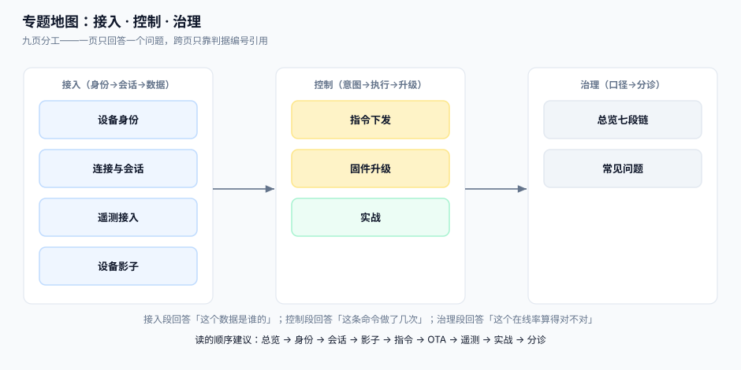

# 物联网设备接入与指令下发工程

物联网平台的难度不在「把数据传上来」，而在**设备不会告诉你它出错了**。它不会抛异常、不会打日志、不会发工单——它只是不再说话了。所以本专题的全部内容，都是围绕一个动作展开：**证明「没消息」和「设备在线但没数据」是两件事**。

::: tip 一句话理解
服务端工程师习惯问「请求成功了吗」。物联网工程师只能问：**这条连接还在吗、这个设备真的说过这句话吗、这条指令它执行了几次**。三个问题对应三份必须落库的证据：连接会话、设备时钟、指令幂等键。
:::

## 与相邻专题的分工

| 专题 | 它回答的问题 | 本专题的回答 |
| --- | --- | --- |
| [消息队列](../MessageQueue/index.md) | 服务之间的消息怎么投递、怎么保证顺序 | 一条消息从**一台可能断网三个月的设备**发出来时，语义变成了什么 |
| [网关深度实践](../GatewayDeep/index.md) | 南北向流量怎么路由、限流、熔断 | 长连接网关的**连接数**才是容量单位，QPS 不是 |
| [幂等与状态机](../IdempotencyStateMachine/IdempotencyKey/index.md) | 一次请求只生效一次 | 一条指令**被设备执行了两次**该怎么发现（设备不会回传 request_id） |
| [对象存储](../ObjectStorage/index.md) | 字节怎么存、怎么取 | 固件包怎么发、怎么被一万台设备同时下载而不打爆带宽 |
| [证书生命周期](../../Ops/CertificateLifecycle/index.md) | 站点证书怎么签发、怎么续期 | **设备**证书十年不换、过期后现场没人能换，怎么办 |
| [时序数据](../../DB/TimeSeries/index.md) | 时序怎么建模、怎么压缩 | 设备时钟不准时，时序的「时间」到底用谁的 |
| [边缘 CDN](../../Ops/EdgeCDN/index.md) | 静态资源怎么分发 | 固件分发为什么不能只靠 CDN（还要版本收敛与回滚） |
| [消息通知与触达](../NotificationDelivery/index.md) | 消息怎么发给**人** | 消息怎么发给**机器**，以及机器不在线时存哪儿 |
| [端侧推理](../../AI/EdgeInference/index.md) | 模型怎么跑在端上 | 模型与规则怎么随固件一起**版本化下发** |

> 一句话记住边界：**消息队列假设消费方一直在；本专题假设消费方随时会消失三个月。**

## 十页导航

| 页 | 讲什么 | 读完能做什么 |
| --- | --- | --- |
| [总览：七段链与三个「在线」](./Overview/index.md) | 七段链、三个在线口径、四个必失接缝 | 判断自己的平台现在把「离线」判错了多少 |
| [设备身份与凭证](./DeviceIdentity/index.md) | 三元组、一机一密 vs 一型一密、产线烧录、轮换 | 设计一套现场换不了密钥也能轮换的凭证体系 |
| [连接与会话](./ConnectionSession/index.md) | CONNECT 参数、会话保持、KeepAlive、遗嘱、抢占 | 让「在线」这个状态第一次有定义 |
| [设备影子](./DeviceShadow/index.md) | 期望态/报告态、版本号、delta、离线指令 | 把「设成 25 度」变成一次可收敛的意图 |
| [指令下发](./CommandDispatch/index.md) | 同步/异步、幂等键、超时与重试、离线队列 | 让一条指令最多执行一次，且能证明它执行过 |
| [固件升级](./FirmwareOTA/index.md) | 签名、分批灰度、断点续传、A/B 回滚 | 把「升级失败变砖」压到可接受的概率 |
| [遥测接入](./TelemetryIngest/index.md) | 设备时钟、乱序、去重、降采样、写入放大 | 在设备时间不可信的前提下算出可信的曲线 |
| [实战：本机跑通一条闭环](./Practice/index.md) | mosquitto + SQLite 十步 + 负向用例 | 在本机复现「上线→下发→升级→退役」 |
| [常见问题与分诊](./FAQ/index.md) | 八类现象的分诊入口、二十项自查 | 三分钟内判断是设备、网络还是平台 |

## 事实与规格速览（2026-10 口径）

| 事项 | 口径 | 出处 |
| --- | --- | --- |
| 协议版本 | MQTT 5.0（OASIS Standard，2019-03-07）；MQTT 3.1.1 即 ISO/IEC 20922:2016 | OASIS / ISO |
| 参考 Broker | Eclipse Mosquitto **2.1.2**（2026-02）；2.1.0 起 `acl_file`/`password_file` 标记弃用，**默认 `max_packet_size` 从 256 MB 降到 2,000,000 字节** | mosquitto.org 变更日志 |
| 集群 Broker | EMQX 开源版 **6.3.1**（2026-09-17，BSL 1.1，非 Apache-2.0）；5.x 维护线 **5.10.5** | EMQX 发布页 |
| 轻量/边缘 Broker | NanoMQ **0.25.6**（2026-08-19，MIT）；VerneMQ **2.2.1**（2026-09-17） | 各自发布页 |
| 端口约定 | 1883 明文 / 8883 TLS / 8083 WebSocket / 8084 WSS | 社区惯例，非规范强制 |
| KeepAlive 判定 | 服务端在 **1.5 × KeepAlive** 内未收到任何控制报文即断开（`[MQTT-3.1.2-24]`） | MQTT 5.0 §3.1.2 |
| 会话保持 | MQTT 5 用 `Session Expiry Interval` 取代 3.1.1 的 `Clean Session`；**0 表示断开即丢** | MQTT 5.0 §3.1.2.11 |
| 遗嘱延迟 | `Will Delay Interval` 让「短暂重连」不触发遗嘱，避免误报离线 | MQTT 5.0 §3.1.3.2.2 |
| 订阅通配 | `+` 单层、`#` 多层（只能出现在末尾）；`$SYS/` 开头不匹配 `#` | MQTT 5.0 §4.7 |
| 上一条指令的重投 | QoS 1 是**至少一次**，重投由发送方决定；设备侧必须靠业务键去重 | MQTT 5.0 §4.3 |

::: info 版本组织说明
本专题**不建版本目录**（如 `IoTDeviceV3/`）。三条理由：① 换代的是**协议版本与 Broker 产品**，判据本身没变——`IOS-B` 说的「1.5 倍 KeepAlive」在 3.1.1 与 5.0 里一字不差；② 3.1.1 与 5.0 **长期并存**于同一批设备，差异是「同一页里的两个分支」，不是「两套要同时教的内容线」；③ 真正需要按大版本组织的是**同一份代码的两套写法**（如 [`Spring5`/`Spring6`](../Java/Frame/Spring/index.md)、`Vue2`/`Vue3`），而这里两套协议写法可以在一张表里对照完。库内按大版本建目录的先例见 [`Spring5`/`Spring6`](../Java/Frame/Spring/index.md) 与 [SpringBoot `v2`/`v3`](../Java/Frame/SpringBoot/index.md)。
:::

## 判据纪律

沿用全库写法：**每页 8 条，编号形如 `IOO-A`**，逐页前缀唯一，可被 `utils/audit` 下的判据类巡检机械核对。每条判据回答三件事：**看什么现象、判成什么、不满足时改哪里**。

| 页 | 判据族 |
| --- | --- |
| 总览 | `IOO-A` ~ `IOO-H` |
| 设备身份与凭证 | `IOK-A` ~ `IOK-H` |
| 连接与会话 | `IOS-A` ~ `IOS-H` |
| 设备影子 | `IOW-A` ~ `IOW-H` |
| 指令下发 | `IOC-A` ~ `IOC-H` |
| 固件升级 | `IOF-A` ~ `IOF-H` |
| 遥测接入 | `IOT-A` ~ `IOT-H` |
| 实战 | `IOP-A` ~ `IOP-H` |
| 常见问题 | `IOQ-A` ~ `IOQ-H` |

## 三个必须先接受的前提

1. **设备的时间不可信**。便宜模组的 RTC 一天能漂几秒，断电后归零的设备很常见。任何以设备时间为唯一排序依据的设计，都会在补偿时钟后变成一条往回折的曲线。
2. **设备的网络不可靠，且「不可靠」是常态而不是异常**。地下室、电梯井、货车、冷库——离线几小时是设计输入，不是故障。
3. **设备的算力与存储小到不能做重试队列**。设备端只保留「当前一条指令」，其余靠平台侧重投；因此**幂等必须做在业务键上，不能做在设备内存里**。

## 参考资料

- MQTT 5.0 Specification（OASIS Standard，2019-03-07）——控制报文、会话状态与遗嘱的权威定义
- ISO/IEC 20922:2016——MQTT 3.1.1 的国际标准编号
- [Eclipse Mosquitto 变更日志](https://mosquitto.org/blog/)——2.1.x 的行为变更（`max_packet_size` 默认值、协议版本号打印口径）
- [EMQX 文档](https://docs.emqx.com/)——集群、共享订阅与规则引擎的产品侧说明
- AWS IoT Core 设备影子文档——「期望态 / 报告态 / 版本号」这一模型的事实来源
